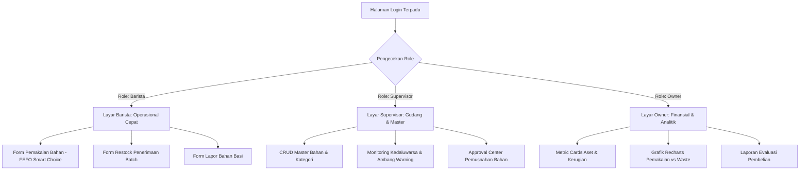

# DESAIN SISTEM & SPESIFIKASI ANTARMUKA (Desain.md)
## Sistem Pemantauan Masa Kadaluwarsa dan Inventaris Kafe (Laravel 11 + Inertia React + shadcn/ui)

Dokumen ini merupakan **Design Contract** resmi untuk seluruh tim pengembang (khususnya Frontend Dev 1 & Frontend Dev 2) dalam membangun antarmuka pengguna yang konsisten, modern, dan fungsional di lingkungan bar kafe yang serba cepat (*fast-paced*).

---

## 1. DESIGN CONTRACT & IDENTITAS VISUAL

### 1.1 Nada & Filosofi Desain (*Design Tone*)
* **Clean & Focused**: Minim ornamen yang tidak perlu; fokus pada kejelasan angka stok dan urgensi tanggal kedaluwarsa.
* **Specialty Coffee Aesthetic**: Nuansa hangat, elegan, dan otentik ala *artisan coffee bar*. Memadukan kanvas lembut susu hangat (*Warm Steamed Milk & Porcelain #FAF7F2*), kontainer bertingkat oat latte (*#F5EFEB, #EDE4DC*), serta penekanan biji kopi sangrai (*Deep Roasted Espresso #4A2C11* & *Spun Amber Caramel #C88242*).
* **Glanceable UI & Traffic Warning**: Barista dapat memahami level urgensi bahan dalam 1 detik pandang saat jam sibuk (*rush hour*) melalui indikator status yang jelas dan kontras tanpa mengorbankan estetika kafe.

### 1.2 Palet Warna & Token (Tailwind Color Tokens)

| Peruntukan | Token Kelas Tailwind | Kode Hex | Filosofi / Deskripsi | Contoh Penggunaan |
| :--- | :--- | :--- | :--- | :--- |
| **Brand Primer (Primary)** | `bg-brand-primary` / `hover:bg-brand-primary-hover` / `text-brand-primary` | `#4A2C11` | Deep roasted espresso bean | Anchoring UI chrome, tombol aksi utama (Submit/Restock), pemicu interaktif krusial |
| **Brand Sekunder (Secondary)** | `bg-brand-secondary` / `text-brand-secondary` / `border-brand-secondary` | `#C88242` | Spun amber and warm caramel | State interaktif aktif, progress bar, cupping score highlight, aksen badge |
| **Brand Tersier (Tertiary)** | `bg-brand-tertiary` / `text-brand-tertiary` / `border-brand-tertiary` | `#8C3D2B` | Terracotta and roasted coffee cherry | Peringatan kritis, batch shelf-life alert, anomali profil sangrai, tombol destruktif |
| **Latar Belakang Kanvas (Canvas)** | `bg-surface-canvas` | `#FAF7F2` | Warm steamed milk & porcelain base | Latar belakang dasar (*viewport*) seluruh dashboard aplikasi |
| **Kontainer Tier 1 (Container Base)** | `bg-surface-container` | `#F5EFEB` | Oat latte base | Permukaan kartu data (*cards*), panel operasional utama, modal dialog |
| **Kontainer Tier 2 (Container Elevated)** | `bg-surface-container-high` | `#EDE4DC` | Unbleached parchment tiers | Pengelompokan card/tabel bertingkat tanpa garis batas kaku (*borderless grouping*) |
| **Garis Batas (Borders / Dividers)** | `border-surface-border` | `#EDE4DC` | Muted parchment border | Garis batas input, pemisah baris tabel, border card halus |
| **Teks Utama (High Emphasis)** | `text-content-high` | `#241408` | Deep Espresso | Tipografi penekanan tinggi: judul halaman (H1), metrik utama, nama bahan |
| **Teks Sekunder (Medium Emphasis)** | `text-content-medium` | `#5C3A21` | Muted Mocha | Tipografi penekanan sedang: label form, satuan bahan (ml/gr), nomor batch |
| **Teks Lemah / Nonaktif (Subtle/Disabled)** | `text-content-subtle` | `#9C8474` | Crema Umber | Placeholder form, label redup, timestamp, status tombol *disabled* |
| **Badge Status: AMAN 🟢** | `bg-emerald-50 text-emerald-800 border-emerald-300` | `#ECFDF5` | Fresh Botanical Harvest | Sisa masa simpan > 7 hari (Lampu hijau operasional kafe) |
| **Badge Status: WARNING 🟡** | `bg-[#FFF7ED] text-[#C88242] border-[#FED7AA]` | `#FFF7ED` / `#C88242` | Spun Amber & Warm Caramel | Sisa masa simpan 3 – 7 hari (Segera Pakai / Peringatan Dini) |
| **Badge Status: KRITIS 🔴** | `bg-[#FDF2F0] text-[#8C3D2B] border-[#F8C6BF]` | `#FDF2F0` / `#8C3D2B` | Terracotta & Roasted Coffee Cherry | Sisa masa simpan < 3 hari / Sudah Basi (Alert Kritis) |
| **Badge Rekomendasi FEFO ★** | `bg-brand-primary text-surface-canvas font-semibold` | `#4A2C11` | Espresso Bean Signature | Batch prioritas utama pemakaian pertama (*First Expired, First Out*) |

### 1.3 Tipografi & Hierarki Skala Teks
Menggunakan font sans-serif modern (Figtree / font default Tailwind):
* **Display / Metrik Utama**: `text-2xl` sampai `text-3xl font-bold tracking-tight text-content-high` (contoh: Nilai Rupiah Aset).
* **Judul Halaman (H1)**: `text-xl font-semibold text-content-high`.
* **Judul Bagian (H2/H3)**: `text-base font-medium text-content-high`.
* **Teks Isi (Body)**: `text-sm font-normal text-content-medium`.
* **Keterangan & Metadata (Caption)**: `text-xs font-normal text-content-subtle`.

### 1.4 Sudut Kelengkungan (*Radius*) & Spacing
* **Border Radius Card & Modal**: `rounded-xl` (12px).
* **Border Radius Button & Input**: `rounded-lg` (8px).
* **Border Radius Badge**: `rounded-full` (capsule style).
* **Padding Kontainer Standar**: `p-4 sm:p-6`.

---

## 2. SPESIFIKASI KOMPONEN UTAMA (SHADCN/UI)

### 2.1 Tombol (Button)
* **Primary**: `bg-brand-primary text-white hover:bg-brand-primary-hover font-medium rounded-lg px-4 py-2 text-sm transition-colors`.
* **Secondary / Active**: `bg-brand-secondary text-white hover:bg-brand-secondary-hover font-medium rounded-lg px-4 py-2 text-sm transition-colors`.
* **Outline / Parchment**: `border border-surface-border bg-surface-container hover:bg-surface-container-high text-content-high rounded-lg`.
* **Destructive**: `bg-brand-tertiary text-white hover:bg-brand-tertiary-hover font-medium rounded-lg`.
* **Ghost**: `hover:bg-surface-container-high text-content-medium`.

### 2.2 Badge Status Kedaluwarsa (`ExpiryBadge`)
* **Format Tampilan**:
  * Aman: `<Badge variant="outline" className="bg-emerald-50 text-emerald-800 border-emerald-300 font-medium">🟢 Aman (12 hari)</Badge>`
  * Warning: `<Badge variant="outline" className="bg-[#FFF7ED] text-[#C88242] border-[#FED7AA] font-medium">🟡 Segera Pakai (4 hari)</Badge>`
  * Kritis: `<Badge variant="outline" className="bg-[#FDF2F0] text-[#8C3D2B] border-[#F8C6BF] font-medium animate-pulse">🔴 Kritis (1 hari)</Badge>`
  * Rekomendasi FEFO: `<Badge className="bg-brand-primary text-surface-canvas font-semibold">★ Rekomendasi FEFO</Badge>`

### 2.3 Kartu Metrik (Metric Cards)
* Kontainer: `bg-surface-container p-5 rounded-xl border border-surface-border shadow-sm flex flex-col justify-between`.
* Terdiri dari: Icon Lucide di pojok kanan atas bertema `text-brand-secondary`, label `text-content-subtle` kecil, nominal besar tebal di tengah bertema `text-content-high`, dan tren/status di bawah.

### 2.4 Pop-up & Dialog
* **Dialog / Modal**: Digunakan untuk form cepat (Tambah Bahan, Input Batch Restock, Lapor Waste) dengan latar `bg-surface-container` agar menyatu dengan palet kafe.
* **AlertDialog (Smart Warning Deviasi)**: Dialog peringatan berlatar kontainer hangat dengan aksen penekanan `text-brand-tertiary` (#8C3D2B) atau `text-brand-secondary` (#C88242), tombol aksi tegas, dan input wajib alasan deviasi.

---

## 3. RANCANGAN LAYAR PER PERAN PENGGUNA (SCREEN BREAKDOWN)

### 3.1 Layar Barista (Fokus: Cepat, Ringkas, Operasional Bar)
1. **Dasbor Operasional Barista**:
   * Menampilkan daftar bahan baku favorit yang sering dipakai di bar (Fresh Milk, Biji Kopi Espresso, Sirup Karamel).
   * Tombol cepat (*Quick Action*): **[+ Catat Pemakaian]**, **[+ Terima Barang]**, **[! Lapor Bahan Rusak]**.
2. **Modal Form Pemakaian Bahan (FEFO Interaktif)**:
   * **Pilih Bahan**: Dropdown pencarian bahan.
   * **Daftar Batch Aktif**: Ditampilkan dalam bentuk kartu radio (*RadioGroup*). Batch dengan tanggal expired paling dekat otomatis berada paling atas dan ditandai badge hijau `[★ REKOMENDASI FEFO - Prioritas Pakai]`.
   * **Smart Warning Alert**: Jika barista memilih batch kedua atau ketiga:
     * Muncul dialog konfirmasi: *"Perhatian: Terdapat batch yang lebih mendekati kedaluwarsa. Mengapa Anda memilih batch ini?"*
     * Textarea wajib: Alasan deviasi.
   * Input kuantitas pemakaian (misal: 250 ml).
3. **Modal Penerimaan Barang (Restock)**:
   * Input cepat saat kurir pemasok datang: Nama bahan, tanggal expired pada kemasan, jumlah karton/botol, dan harga faktur.
4. **Modal Pelaporan Bahan Rusak**:
   * Pilihan batch, jumlah yang rusak, dan upload/keterangan kondisi (asam, menggumpal, pecah).

---

### 3.2 Layar Supervisor (Fokus: Kontrol Gudang, Master Data, Otorisasi)
1. **Pusat Master Data Bahan & Kategori**:
   * Tabel komprehensif berisi seluruh master bahan kafe.
   * Tombol tambah kategori dan tambah bahan baru.
   * Pengaturan ambang batas: *Minimum Stock* (peringatan pesan ulang) dan *Warning Days* (berapa hari sebelum expired sistem mulai menyalakan lampu kuning).
2. **Monitoring Kedaluwarsa & Inventaris Fisik**:
   * DataTable lengkap dengan filter pencarian dan tab status: `[Semua]`, `[Aman]`, `[Mendekati Basi (Kuning)]`, `[Kritis / Basi (Merah)]`.
3. **Pusat Approval Pemusnahan (Waste Write-Off Center)**:
   * Menampilkan daftar tiket pemusnahan yang berstatus `Pending`.
   * Memperlihatkan barista pelapor, alasan kerusakan, kuantitas, serta **kalkulasi nominal kerugian finansial**.
   * Aksi: Tombol **[Setujui Pemusnahan]** (mengubah stok jadi 0 dan membukukan kerugian) atau **[Tolak]**.

---

### 3.3 Layar Owner (Fokus: Ringkasan Eksekutif & Finansial)
1. **Executive Metric Cards (3 Kartu Paling Atas)**:
   * **Total Nilai Aset Bahan**: Total rupiah seluruh modal yang sedang tersimpan di gudang dan chiller.
   * **Nilai Bahan Kritis**: Nilai rupiah bahan baku yang terancam basi dalam 3 hari ke depan jika tidak segera dipromosikan/dipakai.
   * **Total Kerugian Bulan Ini**: Akumulasi kerugian rupiah akibat bahan basi yang telah disetujui pemusnahannya.
2. **Grafik Batang Analitik Bulanan (Recharts)**:
   * Grafik batang ganda berdampingan: Batang Hijau (Biaya Bahan Terpakai Efektif) vs Batang Merah (Biaya Bahan Terbuang Sia-sia / *Waste*).
   * Tooltip interaktif saat mouse diarahkan ke grafik.
3. **Peringkat Bahan Paling Boros (Top Waste Ingredients)**:
   * Tabel 5 bahan dengan kontribusi kerugian finansial terbesar agar Owner bisa mengevaluasi kuantitas pembelian ke pemasok di masa depan.

---

## 4. PENANGANAN STATE & EDGE CASES

| Kasus Khusus (*Edge Case*) | Respon Antarmuka UI |
| :--- | :--- |
| **Data Kosong (*Empty State*)** | Tampilkan ilustrasi cangkir kopi/kotak kosong, teks informatif (*"Belum ada batch bahan yang dicatat"*), dan tombol ajakan aksi (*Call to Action*). |
| **Loading State** | Gunakan komponen *Skeleton* shadcn/ui dengan animasi pulse halus saat data sedang dimuat via Inertia visit. |
| **Stok di Bawah Minimum** | Munculkan badge indikator oranye kecil `[Restock Segera]` di samping nama bahan pada tabel inventaris. |
| **Bahan Sudah Kedaluwarsa Hari Ini** | Warna kartu/baris tabel berubah menjadi kemerahan Terracotta (`bg-[#FDF2F0] border-[#F8C6BF]`) dengan badge berkedip `[Kedaluwarsa]`. |
| **Deviasi FEFO Tanpa Alasan** | Tombol konfirmasi pada `SmartWarningDialog` tetap dinonaktifkan (`disabled`) hingga barista mengetikkan minimal 5 karakter alasan. |
