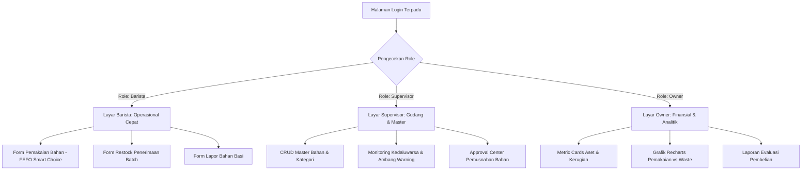

# DESAIN SISTEM & SPESIFIKASI ANTARMUKA (Desain.md)
## Sistem Pemantauan Masa Kadaluwarsa dan Inventaris Kafe (Laravel 11 + Inertia React + shadcn/ui)

Dokumen ini merupakan **Design Contract** resmi untuk seluruh tim pengembang (khususnya Frontend Dev 1 & Frontend Dev 2) dalam membangun antarmuka pengguna yang konsisten, modern, dan fungsional di lingkungan bar kafe yang serba cepat (*fast-paced*).

---

## 1. DESIGN CONTRACT & IDENTITAS VISUAL

### 1.1 Nada & Filosofi Desain (*Design Tone*)
* **Clean & Focused**: Minim ornamen yang tidak perlu; fokus pada kejelasan angka stok dan urgensi tanggal kedaluwarsa.
* **Specialty Coffee Aesthetic**: Nuansa latar belakang bersih dan profesional ala SaaS modern (*Slate/Zinc Neutral*) dengan aksen hijau dedaunan kopi (*Emerald Green*).
* **Glanceable UI**: Barista harus bisa memahami status bahan dalam 1 detik pandang saat jam sibuk (*rush hour*).

### 1.2 Palet Warna & Token (Tailwind Color Tokens)

| Peruntukan                   | Token Kelas Tailwind                                | Kode Hex  | Contoh Penggunaan                            |
| :--------------------------- | :-------------------------------------------------- | :-------- | :------------------------------------------- |
| **Latar Belakang Utama**     | `bg-slate-50` / `bg-zinc-50`                        | `#F8FAFC` | Background halaman dashboard                 |
| **Kartu & Kontainer**        | `bg-white`                                          | `#FFFFFF` | Permukaan card, modal dialog, tabel          |
| **Teks Utama (Headings)**    | `text-slate-900`                                    | `#0F172A` | Judul halaman, nominal metrik, nama bahan    |
| **Teks Sekunder (Muted)**    | `text-slate-500`                                    | `#64748B` | Label satuan (ml/gram), nomor batch, tanggal |
| **Garis Batas (Borders)**    | `border-slate-200`                                  | `#E2E8F0` | Border tabel, pemisah card, garis input      |
| **Brand / Kafe Primer**      | `bg-emerald-600` / `hover:bg-emerald-700`           | `#059669` | Tombol aksi utama (Restock, Simpan, Submit)  |
| **Badge Status: AMAN 🟢**    | `bg-emerald-50 text-emerald-700 border-emerald-200` | `#ECFDF5` | Sisa masa simpan > 7 hari                    |
| **Badge Status: WARNING 🟡** | `bg-amber-50 text-amber-700 border-amber-200`       | `#FFFBEB` | Sisa masa simpan 3 – 7 hari (Segera Pakai)   |
| **Badge Status: KRITIS 🔴**  | `bg-rose-50 text-rose-700 border-rose-200`          | `#FFF1F2` | Sisa masa simpan < 3 hari / Sudah Basi       |

### 1.3 Tipografi & Hierarki Skala Teks
Menggunakan font sans-serif modern (Inter / font default Tailwind):
* **Display / Metrik Utama**: `text-2xl` sampai `text-3xl font-bold tracking-tight text-slate-900` (contoh: Nilai Rupiah Aset).
* **Judul Halaman (H1)**: `text-xl font-semibold text-slate-900`.
* **Judul Bagian (H2/H3)**: `text-base font-medium text-slate-800`.
* **Teks Isi (Body)**: `text-sm font-normal text-slate-700`.
* **Keterangan & Metadata (Caption)**: `text-xs font-normal text-slate-500`.

### 1.4 Sudut Kelengkungan (*Radius*) & Spacing
* **Border Radius Card & Modal**: `rounded-xl` (12px).
* **Border Radius Button & Input**: `rounded-lg` (8px).
* **Border Radius Badge**: `rounded-full` (capsule style).
* **Padding Kontainer Standar**: `p-4 sm:p-6`.

---

## 2. SPESIFIKASI KOMPONEN UTAMA (SHADCN/UI)

### 2.1 Tombol (Button)
* **Primary**: `bg-emerald-600 text-white hover:bg-emerald-700 font-medium rounded-lg px-4 py-2 text-sm`.
* **Secondary / Outline**: `border border-slate-200 bg-white hover:bg-slate-50 text-slate-700 rounded-lg`.
* **Destructive**: `bg-rose-600 text-white hover:bg-rose-700 font-medium rounded-lg`.
* **Ghost**: `hover:bg-slate-100 text-slate-600`.

### 2.2 Badge Status Kedaluwarsa (`ExpiryBadge`)
* **Format Tampilan**:
  * Aman: `<Badge variant="outline" className="bg-emerald-50 text-emerald-700 border-emerald-200 font-medium">🟢 Aman (12 hari)</Badge>`
  * Warning: `<Badge variant="outline" className="bg-amber-50 text-amber-700 border-amber-200 font-medium">🟡 Segera Pakai (4 hari)</Badge>`
  * Kritis: `<Badge variant="outline" className="bg-rose-50 text-rose-700 border-rose-200 font-medium animate-pulse">🔴 Kritis (1 hari)</Badge>`
  * Rekomendasi FEFO: `<Badge className="bg-emerald-600 text-white font-semibold">★ Rekomendasi FEFO</Badge>`

### 2.3 Kartu Metrik (Metric Cards)
* Kontainer: `bg-white p-5 rounded-xl border border-slate-200 shadow-sm flex flex-col justify-between`.
* Terdiri dari: Icon Lucide di pojok kanan atas, label abu-abu kecil, nominal besar tebal di tengah, dan tren/status di bawah.

### 2.4 Pop-up & Dialog
* **Dialog / Modal**: Digunakan untuk form cepat (Tambah Bahan, Input Batch Restock, Lapor Waste) agar tidak me-refresh halaman.
* **AlertDialog (Smart Warning Deviasi)**: Dialog peringatan berlatar belakang amber/kuning dengan tombol aksi tegas dan input wajib alasan deviasi.

---

## 3. RANCANGAN LAYAR PER PERAN PENGGUNA (SCREEN BREAKDOWN)

### 3.1 Layar Barista (Fokus: Cepat, Ringkas, Operasional Bar)
1. **Dasbor Operasional Barista**:
   * Menampilkan daftar bahan baku favorit yang sering dipakai di bar (Fresh Milk, Biji Kopi Espresso, Sirup Karamel).
   * Tombol cepat (*Quick Action*): **[+ Catat Pemakaian]**, **[+ Terima Barang]**, **[! Lapor Bahan Rusak]**.
2. **Modal Form Pemakaian Bahan (FEFO Interaktif)**:
   * **Pilih Bahan**: Dropdown pencarian bahan.
   * **Daftar Batch Aktif**: Ditampilkan dalam bentuk kartu radio (*RadioGroup*). Batch dengan tanggal expired paling dekat otomatis berada paling atas dan ditandai badge hijau `[★ REKOMENDASI FEFO - Prioritas Pakai]`.
   * **Smart Warning Alert**: Jika barista memilih batch kedua atau ketiga:
     * Muncul dialog konfirmasi: *"Perhatian: Terdapat batch yang lebih mendekati kedaluwarsa. Mengapa Anda memilih batch ini?"*
     * Textarea wajib: Alasan deviasi.
   * Input kuantitas pemakaian (misal: 250 ml).
3. **Modal Penerimaan Barang (Restock)**:
   * Input cepat saat kurir pemasok datang: Nama bahan, tanggal expired pada kemasan, jumlah karton/botol, dan harga faktur.
4. **Modal Pelaporan Bahan Rusak**:
   * Pilihan batch, jumlah yang rusak, dan upload/keterangan kondisi (asam, menggumpal, pecah).

---

### 3.2 Layar Supervisor (Fokus: Kontrol Gudang, Master Data, Otorisasi)
1. **Pusat Master Data Bahan & Kategori**:
   * Tabel komprehensif berisi seluruh master bahan kafe.
   * Tombol tambah kategori dan tambah bahan baru.
   * Pengaturan ambang batas: *Minimum Stock* (peringatan pesan ulang) dan *Warning Days* (berapa hari sebelum expired sistem mulai menyalakan lampu kuning).
2. **Monitoring Kedaluwarsa & Inventaris Fisik**:
   * DataTable lengkap dengan filter pencarian dan tab status: `[Semua]`, `[Aman]`, `[Mendekati Basi (Kuning)]`, `[Kritis / Basi (Merah)]`.
3. **Pusat Approval Pemusnahan (Waste Write-Off Center)**:
   * Menampilkan daftar tiket pemusnahan yang berstatus `Pending`.
   * Memperlihatkan barista pelapor, alasan kerusakan, kuantitas, serta **kalkulasi nominal kerugian finansial**.
   * Aksi: Tombol **[Setujui Pemusnahan]** (mengubah stok jadi 0 dan membukukan kerugian) atau **[Tolak]**.

---

### 3.3 Layar Owner (Fokus: Ringkasan Eksekutif & Finansial)
1. **Executive Metric Cards (3 Kartu Paling Atas)**:
   * **Total Nilai Aset Bahan**: Total rupiah seluruh modal yang sedang tersimpan di gudang dan chiller.
   * **Nilai Bahan Kritis**: Nilai rupiah bahan baku yang terancam basi dalam 3 hari ke depan jika tidak segera dipromosikan/dipakai.
   * **Total Kerugian Bulan Ini**: Akumulasi kerugian rupiah akibat bahan basi yang telah disetujui pemusnahannya.
2. **Grafik Batang Analitik Bulanan (Recharts)**:
   * Grafik batang ganda berdampingan: Batang Hijau (Biaya Bahan Terpakai Efektif) vs Batang Merah (Biaya Bahan Terbuang Sia-sia / *Waste*).
   * Tooltip interaktif saat mouse diarahkan ke grafik.
3. **Peringkat Bahan Paling Boros (Top Waste Ingredients)**:
   * Tabel 5 bahan dengan kontribusi kerugian finansial terbesar agar Owner bisa mengevaluasi kuantitas pembelian ke pemasok di masa depan.

---

## 4. PENANGANAN STATE & EDGE CASES

| Kasus Khusus (*Edge Case*) | Respon Antarmuka UI |
| :--- | :--- |
| **Data Kosong (*Empty State*)** | Tampilkan ilustrasi cangkir kopi/kotak kosong, teks informatif (*"Belum ada batch bahan yang dicatat"*), dan tombol ajakan aksi (*Call to Action*). |
| **Loading State** | Gunakan komponen *Skeleton* shadcn/ui dengan animasi pulse halus saat data sedang dimuat via Inertia visit. |
| **Stok di Bawah Minimum** | Munculkan badge indikator oranye kecil `[Restock Segera]` di samping nama bahan pada tabel inventaris. |
| **Bahan Sudah Kedaluwarsa Hari Ini** | Warna kartu/baris tabel berubah menjadi kemerahan (`bg-rose-50/50`) dengan badge berkedip `[Kedaluwarsa]`. |
| **Deviasi FEFO Tanpa Alasan** | Tombol konfirmasi pada `SmartWarningDialog` tetap dinonaktifkan (`disabled`) hingga barista mengetikkan minimal 5 karakter alasan. |
