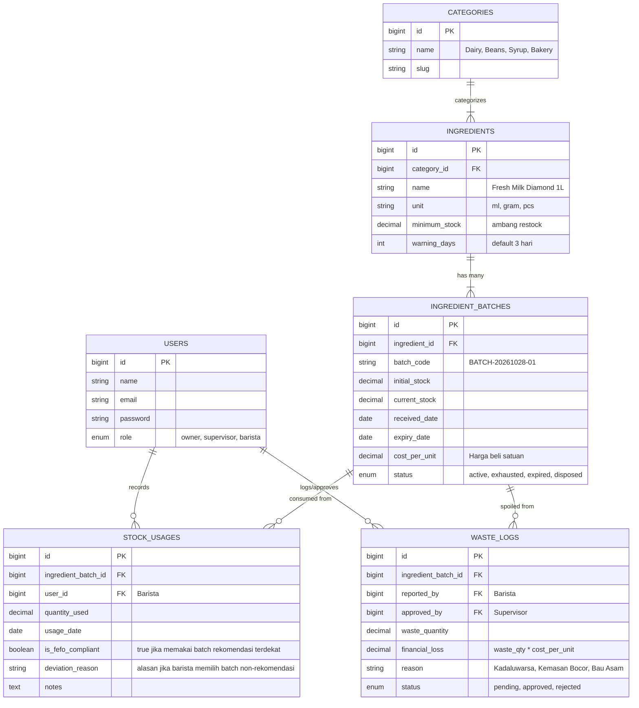

# PRODUCT REQUIREMENTS DOCUMENT (PRD)
## Sistem Pemantauan Masa Kadaluwarsa dan Inventaris Bahan Baku Kafe (Laravel 11 + Inertia.js React + shadcn/ui)

* **Versi Dokumen**: 1.0.0
* **Status**: Siap Implementasi (AI-Ready / Vibe Coding)
* **Target Mata Kuliah**: Pemrograman Lanjut (UAS)
* **Arsitektur Stack**:
  * **Backend**: Laravel 11 (PHP 8.2+), Eloquent ORM, MySQL
  * **Frontend**: React 18+ via Inertia.js, TypeScript / JavaScript
  * **UI Kit**: Tailwind CSS, shadcn/ui, Lucide Icons, Recharts (Chart analitik)

---

## 1. EXECUTIVE SUMMARY & PROBLEM STATEMENT

### 1.1 Ringkasan Produk
Aplikasi web terpadu yang dirancang khusus untuk memodernisasi manajemen inventaris bahan baku kedai kopi (*coffee shop*). Sistem ini mengotomatisasi pencatatan stok berbasis *multibatch* dan menerapkan algoritma **First Expired, First Out (FEFO)** serta sistem peringatan dini (*early warning indicator*) untuk mencegah kerugian finansial akibat pembusukan bahan makanan (*inventory waste*) dan menjaga standar keamanan pangan (*food safety*).

### 1.2 Masalah yang Diselesaikan
* **Penyusutan Modal (*Shrinkage*)**: Bahan baku sensitif seperti susu segar (*fresh milk*), sirup perisa, dan biji kopi (*roasted beans*) sering terbuang karena terselip di rak belakang penyimpanan hingga melewati masa kelayakan.
* **Asimetri Informasi 3 Peran**: Pemilik (*Owner*) tidak tahu riwayat biaya bahan yang terbuang, Supervisor gudang kesulitan mengatur stok minimum, dan Barista tidak memiliki panduan batch mana yang harus dipakai lebih dulu saat jam sibuk (*rush hour*).
* **Kegagalan Audit Manual**: Pencatatan manual pada buku kertas atau spreadsheet tidak memiliki mekanisme kontrol integritas dan tidak mampu memberikan notifikasi dini.

---

## 2. USER PERSONAS & ROLE-BASED ACCESS CONTROL (RBAC)

Sistem menerapkan **3 Tingkat Peran (3 Roles)**:

### Matriks Hak Akses Pengguna (Permissions Matrix)

| Modul & Fitur | Owner | Supervisor | Barista |
| :--- | :---: | :---: | :---: |
| **Dasbor Utama (Metrik & Early Warning)** | View All | View All | View Operasional |
| **Master Data Bahan & Kategori (CRUD)** | View Only | Full Access (CRUD) | View Only |
| **Input Restock Batch Baru (Create)** | View Only | Full Access | Full Access |
| **Pencatatan Pemakaian Harian (Usage)** | View Only | Full Access | Full Access |
| **Pengajuan Pemusnahan (Report Waste)** | View Only | Full Access | Create Only |
| **Approval Pemusnahan (Approve Waste)** | View Only | Full Access | No Access |
| **Laporan Analitik Finansial & Waste** | Full Access (Export) | View Only | No Access |

---

## 3. USER JOURNEYS & CORE WORKFLOWS

### 3.1 Alur Penerimaan Barang Multi-Batch (*Restock Workflow*)
1. Pemasok mengirimkan bahan baku (misal: 10 karton *Fresh Milk* 1 Liter).
2. Barista/Supervisor membuka modul **Penerimaan Stok**.
3. Sistem meminta input: Nama Bahan, Nomor Batch/Faktur, Tanggal Kedaluwarsa (*expiry date*), Jumlah Kuantitas, dan Harga Beli per Unit.
4. Sistem menyimpan data ke tabel `ingredient_batches` dan otomatis mengalkulasi total stok aktif di tabel `ingredients`.

### 3.2 Alur Pengurangan Stok Semi-Otomatis (Rekomendasi FEFO + Konfirmasi Fisik Barista)
1. Barista hendak mencatat pemakaian bahan harian atau pembukaan kemasan baru di bar (misal: susu, sirup, atau biji kopi).
2. Barista memilih nama bahan baku pada antarmuka sistem.
3. **Sistem Menampilkan Daftar Batch Aktif**:
   * Sistem melakukan kueri seluruh batch aktif dan mengurutkannya secara kronologis berdasarkan tanggal kedaluwarsa terdekat (`orderBy('expiry_date', 'asc')`).
   * Batch teratas secara otomatis ditandai dengan badge khusus: `[★ REKOMENDASI FEFO - Prioritas Pakai]`.
   * Sistem secara *default* langsung memilihkan (*pre-select*) batch rekomendasi tersebut di layar.
4. **Verifikasi & Konfirmasi Fisik Barista**:
   * Barista mencocokkan kode batch pada layar dengan kemasan fisik yang dipegang di bar.
   * Barista memasukkan jumlah kuantitas yang digunakan.
   * **Mekanisme Peringatan Deviasi (*Smart Warning*)**: Jika barista sengaja memilih batch lain yang kedaluwarsanya lebih lama (karena alasan tertentu, misal batch sebelumnya sudah terlanjur terbuka), sistem memunculkan dialog konfirmasi peringatan:  
     *"Perhatian: Terdapat batch dengan masa kedaluwarsa lebih dekat. Tetap gunakan batch ini?"* dan meminta alasan singkat.
5. Sistem memotong kuantitas dari batch terpilih dan mencatat riwayat ke tabel `stock_usages` lengkap dengan indikator kepatuhan FEFO.

### 3.3 Alur Peringatan Dini (*Early Warning System*)
Setiap kali membuka dasbor, sistem mengevaluasi selisih tanggal hari ini terhadap `expiry_date`:
* 🟢 **Hijau (Aman)**: Sisa masa simpan > 7 hari.
* 🟡 **Kuning (Warning / Peringatan Dini)**: Sisa masa simpan 3 hingga 7 hari.
* 🔴 **Merah (Kritis / Kedaluwarsa)**: Sisa masa simpan < 3 hari atau sudah melewati tanggal hari ini.

### 3.4 Alur Pemusnahan Bahan Basi (*Waste Disposal & Write-off*)
1. Barista menemukan bahan yang rusak/basi di dalam chiller.
2. Barista membuat tiket: pilih batch, masukkan jumlah yang rusak, dan upload/tulis keterangan (misal: "Susu menggumpal/asam").
3. Status tiket: `Pending Approval`.
4. Supervisor memeriksa kondisi fisik, lalu menekan **Approve Write-off**.
5. Stok batch dikurangi menjadi 0, dan tercatat otomatis ke tabel `waste_logs` beserta nominal kerugian rupiahnya untuk dilaporkan ke Owner.

---

## 4. MATRIKS FITUR CRUD UNTUK PEMROGRAMAN LANJUT

Dosen Pemrograman Lanjut menguji kedalaman logika pemrograman. Berikut pembuktian bobot fitur CRUD dalam sistem ini:

| Tipe Aksi | Modul | Logika Bisnis & Validasi di Controller / Model |
| :--- | :--- | :--- |
| **CREATE** | Penerimaan Batch | Validasi `expiry_date` harus lebih besar dari `received_date`. Pembuatan nomor batch unik otomatis jika tidak diisi manual. Transaksi database (`DB::transaction`) untuk memastikan konsistensi saldo stok. |
| **READ** | Dasbor Inventaris | Query agregasi: `SUM(current_stock)` per bahan, filter dinamis status kedaluwarsa, kalkulasi otomatis sisa hari dengan Carbon: `$batch->expiry_date->diffInDays(now())`. |
| **UPDATE / USAGE** | Pemakaian Harian (Semi-Otomatis FEFO) | Validasi ketersediaan stok pada batch terpilih sebelum dipotong. Sistem mengecek apakah batch yang dipilih barista adalah batch rekomendasi terdekat (FEFO); jika barista memilih batch yang lebih baru, sistem mewajibkan pengisian `deviation_reason`. Pembaruan ambang batas (*threshold*) peringatan oleh Supervisor. |
| **DELETE / DISPOSAL** | Pemusnahan Bahan (*Waste*) | **Soft Action**: Data tidak dihapus permanen (*No Hard Delete*) agar histori pembukuan tidak rusak. Sistem mencatatnya ke `waste_logs` dengan penghitungan: `loss_cost = spoiled_qty * cost_per_unit`. |

---

## 5. RELATIONAL DATABASE SCHEMA (MYSQL & LARAVEL MIGRATIONS)

---

## 6. UI/UX DESIGN SYSTEM (REACT + SHADCN/UI)

* **Design Tone**: Clean, profesional, modern ala SaaS dashboard (*Slate/Zinc Neutral* dengan aksen *Emerald Green* untuk kafe dan warna indikator *Amber/Rose*).
* **Komponen shadcn/ui Utama**:
  * `Table` & `DataTable`: Menampilkan daftar batch bahan lengkap dengan sorting tanggal kedaluwarsa dan pagination.
  * `Badge`: Menampilkan status masa kedaluwarsa:
    * `<Badge variant="outline" className="bg-emerald-50 text-emerald-700 border-emerald-200">Aman</Badge>`
    * `<Badge variant="outline" className="bg-amber-50 text-amber-700 border-amber-200">Segera Pakai</Badge>`
    * `<Badge variant="destructive">Kedaluwarsa</Badge>`
  * `Dialog` & `Sheet`: Modal pop-up untuk form cepat input pemakaian bahan harian atau input restock tanpa reload halaman.
  * `RadioGroup` & `AlertDialog`: Pemilihan batch fisik oleh Barista dan pop-up konfirmasi peringatan (*Smart Warning*) jika memilih batch di luar rekomendasi FEFO.
  * `Card` & `Metric Cards`: Menampilkan metrik ringkas di bagian atas dasbor (Total Nilai Aset Bahan, Estimasi Nilai Bahan Kritis, Total Kerugian Bulan Ini).
  * `Recharts`: Grafik batang perbandingan tren pemakaian bahan vs tren limbah bahan (*waste trend*) bulanan untuk Owner.

---

## 7. 5-STEP AI IMPLEMENTATION ROADMAP (VIBE CODING PROMPT ROADMAP)

Gunakan roadmap 5 langkah ini saat mulai melakukan koding bersama AI coding assistant:

### Langkah 1: Scaffolding Proyek & Database Migrations
> *"Inisialisasi project Laravel 11 dengan Inertia.js React dan TypeScript. Buat migration database dan Model Eloquent untuk `categories`, `ingredients`, `ingredient_batches`, `stock_usages`, dan `waste_logs` sesuai skema ERD yang telah didefinisikan. Tambahkan seeder data awal untuk role user (Owner, Supervisor, Barista) serta beberapa contoh master bahan kafe."*

### Langkah 2: Setup Komponen UI shadcn/ui & Layout
> *"Instal Tailwind CSS dan pasang komponen shadcn/ui: Button, Input, Table, Badge, Dialog, RadioGroup, AlertDialog, Select, Card, dan DropdownMenu. Buat `AppLayout.tsx` yang responsif dengan sidebar navigasi yang dinamis sesuai peran role (Owner, Supervisor, Barista)."*

### Langkah 3: CRUD Master Bahan & Input Batch Restock
> *"Buat `IngredientController` dan `BatchController`. Implementasikan form penerimaan batch bahan lengkap dengan validasi tanggal kedaluwarsa. Tampilkan daftar bahan beserta daftar batch-nya menggunakan DataTable shadcn/ui dengan badge warna masa simpan."*

### Langkah 4: Implementasi Pengurangan Stok Semi-Otomatis (Rekomendasi FEFO)
> *"Buat modul pencatatan pemakaian bahan di `StockUsageController`. Tampilkan daftar batch aktif yang diurutkan dari `expiry_date` terdekat dengan penanda badge `[★ Rekomendasi FEFO]`. Sediakan RadioGroup agar Barista mengonfirmasi batch fisik yang digunakan. Jika barista memilih batch yang bukan prioritas kedaluwarsa pertama, munculkan AlertDialog konfirmasi dan simpan kolom `deviation_reason` ke tabel `stock_usages`."*

### Langkah 5: Modul Waste Disposal Approval & Dashboard Analitik Owner
> *"Bangun alur pengajuan pembuangan bahan rusak oleh Barista dan tombol persetujuan (*approval*) oleh Supervisor. Terakhir, buat halaman dasbor Owner dengan grafik Recharts yang menampilkan total kerugian biaya akibat bahan kedaluwarsa dari tabel `waste_logs`."*
