<div align="center">

# ☕ Sistem Pemantauan Masa Kadaluwarsa & Inventaris Bahan Baku Kafe
### *Smart Multi-Batch Inventory Tracking with FEFO (First Expired, First Out) Algorithm*

> **Tugas Besar Mata Kuliah Pemrograman Lanjut (UAS)**  
> Arsitektur Monolith Modern: **Laravel 11 + Inertia.js (React 18 + TypeScript)**

---

[](https://laravel.com)
[](https://react.dev)
[](https://www.typescriptlang.org)
[](https://inertiajs.com)
[](https://tailwindcss.com)
[](https://ui.shadcn.com)
[](https://www.mysql.com)

</div>

---

## 📖 Ringkasan Proyek (Overview)

Kedai kopi modern (*coffee shop*) mengelola berbagai bahan baku dengan sensitivitas tinggi terhadap masa simpan (*shelf-life*), seperti susu segar, sirup perisa organik, puree buah, dan *specialty coffee beans*. Kesalahan dalam rotasi stok seringkali menyebabkan pembusukan bahan sebelum sempat digunakan, menimbulkan kerugian finansial yang signifikan (*spoilage loss*), serta berisiko menurunkan standar cita rasa sajian kepada pelanggan.

**Sistem Pemantauan Inventaris Kafe** ini dirancang secara khusus untuk mengatasi masalah tersebut melalui pencatatan inventaris berbasis **multi-batch** yang terintegrasi secara cerdas dengan:
1. **Algoritma FEFO (First Expired, First Out)**: Memastikan bahan yang paling mendekati tanggal kedaluwarsa selalu direkomendasikan untuk digunakan lebih dulu.
2. **Sistem Peringatan Dini Multi-Level (Early Warning Indicator)**: Visualisasi status masa simpan bahan dengan kode warna intuitif (*traffic light system*).
3. **Audit Deviasi Stok**: Barista dapat menyimpang dari rekomendasi FEFO jika terdapat kendala fisik, namun sistem mewajibkan pengisian alasan deviasi untuk menjaga akuntabilitas.
4. **Alur Persetujuan Pemusnahan (Waste Approval Center)**: Menggantikan *hard delete* dengan alur verifikasi dua arah (Barista melaporkan $\to$ Supervisor menyetujui), lengkap dengan kalkulasi otomatis nilai kerugian finansial.

---

## ✨ Fitur Unggulan Sistem

### 1. 🔄 Rekomendasi Pemakaian Otomatis Berbasis FEFO
* Setiap kali barista memilih bahan yang akan digunakan, sistem secara dinamis mengurutkan seluruh batch aktif berdasarkan tanggal kedaluwarsa terdekat (`ASC`).
* Batch teratas secara otomatis ditandai dengan badge khusus **`[★ REKOMENDASI FEFO]`**.
* Jika barista memilih batch lain (misalnya kemasan yang lebih baru sudah terlanjur dibuka di area *bar*), sistem menampilkan **Smart Warning Dialog** yang mewajibkan input alasan penyimpangan (*deviation reason*).

### 2. 🚦 Indikator Peringatan Dini (*Early Warning Status*)
Sistem mengelompokkan urgensi konsumsi bahan berdasarkan sisa hari simpan (*days until expiry*):
* 🟢 **Aman (`safe`)**: Sisa masa simpan **> 7 hari**.
* 🟡 **Peringatan Dini (`warning`)**: Sisa masa simpan **3 s/d 7 hari** (Segera diprioritaskan).
* 🔴 **Kritis / Expired (`critical`)**: Sisa masa simpan **< 3 hari** atau sudah melewati batas tanggal kedaluwarsa.

### 3. 🛡️ Tata Kelola Pemusnahan Bahan Rusak (*Waste Write-Off Protocol*)
* **Zero Hard Delete**: Data stok rusak/basi tidak pernah dihapus permanen dari basis data guna menjaga integritas riwayat pembukuan.
* Alur pelaporan:
  1. **Barista** mencatat bahan rusak/tumpah/basi $\to$ Status tercatat sebagai `pending`.
  2. **Supervisor** memeriksa fisik dan alasan $\to$ Melakukan aksi `approved` atau `rejected`.
  3. Setelah disetujui, sistem memotong stok batch secara atomik (`DB::transaction`) dan menghitung kerugian finansial:
     $$\text{Financial Loss} = \text{Waste Quantity} \times \text{Cost Per Unit}$$

### 4. 📊 Dashboard Finansial & Analitik Real-Time (Owner)
* Menampilkan metrik **Total Nilai Valuasi Aset Bahan** yang tersimpan di gudang & bar.
* Rekapitulasi **Total Kerugian Finansial Akibat Bahan Rusak/Basi**.
* Grafik tren pemborosan mingguan/bulanan interaktif menggunakan **Recharts**.

---

## 👥 Matriks Hak Akses Pengguna (Role-Based Access Control)

| Fitur & Modul Sistem | ☕ Barista | 👔 Supervisor | 💼 Owner |
| :--- | :---: | :---: | :---: |
| **Pencatatan Restock Batch Baru** | ✅ | ✅ | ❌ |
| **Pemakaian Bahan Harian (FEFO Guided)** | ✅ | ✅ | ❌ |
| **Lapor Bahan Rusak / Basi (Waste Draft)** | ✅ | ✅ | ❌ |
| **Manajemen Master Data Bahan Baku** | ❌ | ✅ | ❌ |
| **Pengaturan Batas Ambang Peringatan (*Warning Threshold*)** | ❌ | ✅ | ❌ |
| **Persetujuan Pemusnahan Bahan (*Waste Approval*)** | ❌ | ✅ | ❌ |
| **Monitoring Inventaris & Audit Deviasi FEFO** | ❌ | ✅ | ✅ |
| **Dashboard Metrik Finansial & Grafik Analitik** | ❌ | ❌ | ✅ |

---

## 🔄 Alur Logika Bisnis (Workflow)

```mermaid
flowchart TD
    subgraph Operasional Barista
        A[Barista Membuka Form Pemakaian Stok] --> B[Sistem Menampilkan Batch Aktif]
        B --> C{Pilih Batch Teratas / Rekomendasi FEFO?}
        C -- Ya --> D[Input Kuantitas Pemakaian]
        C -- Tidak --> E[Modal Peringatan Deviasi Muncul]
        E --> F[Wajib Isi Alasan Deviasi]
        F --> D
        D --> G[Simpan Transaksi Pemakaian Stok]
    end

    subgraph Tata Kelola Waste
        H[Barista Temukan Bahan Rusak/Basi] --> I[Buat Laporan Waste: Status PENDING]
        I --> J[Supervisor Membuka Approval Center]
        J --> K{Keputusan Supervisor}
        K -- Approved --> L[Stok Batch Dipotong Otomatis]
        L --> M[Hitung & Catat Kerugian Finansial]
        K -- Rejected --> N[Laporan Ditolak & Stok Tetap Utuh]
    end
```



---

## 📁 Struktur Direktori & Arsitektur Proyek

```text
├── app/
│   ├── Http/
│   │   ├── Controllers/        # Batch, StockUsage, WasteDisposal, Analytics Controller
│   │   ├── Middleware/         # CheckRole & RBAC Authentication
│   │   └── Requests/           # Form Request Validation
│   └── Models/                 # Ingredient, IngredientBatch, StockUsage, WasteLog
├── database/
│   ├── migrations/             # Schema: ingredients, batches, usages, waste_logs
│   └── seeders/                # Dummy master data, user roles, sample batches
├── docs/
│   ├── Panduan/                # Panduan kerja spesifik per anggota tim
│   ├── Plan Backend/           # Blueprint arsitektur backend, schema & controllers
│   ├── Plan Frontend/          # Blueprint UI/UX, layout RBAC, dan komponen form
│   └── explanations/           # Penjelasan fungsi teknis ramah pemula (per modul)
├── resources/
│   ├── js/
│   │   ├── Components/         # Komponen UI Reusable (shadcn/ui, Modal, Table)
│   │   ├── Layouts/            # AuthenticatedLayout dengan Dynamic Role Sidebar
│   │   ├── Pages/              # Barista, Supervisor, & Owner Inertia views
│   │   └── types/              # Definisi kontrak tipe data TypeScript
│   └── css/                    # Tailwind CSS stylesheet
└── routes/
    └── web.php                 # Rute terproteksi auth & middleware role
```

---

## 👨‍💻 Pembagian Tanggung Jawab Tim Pengembang (5 Anggota)

Proyek ini dikembangkan secara kolaboratif oleh 5 mahasiswa dengan pembagian modul yang terisolasi untuk menghindari konflik kode:

| Peran | Anggota Tim | Modul Tanggung Jawab | Dokumen Panduan Kerja |
| :--- | :--- | :--- | :--- |
| **Project Manager & Integrator** | **Ahmad Anugrah Satya** | Manajemen branch git, integrasi sistem, review PR, koordinasi tim. | 📖 [Panduan PM](docs/Panduan/PANDUAN_PM.md) |
| **Backend Developer 1** | **Aliyah Resky Putri Subhan** | Skema database, Model Eloquent, Seeder, dan Controller Restock Batch & FEFO. | 📖 [Panduan Backend 1](docs/Panduan/PANDUAN_BACKEND_1.md) |
| **Backend Developer 2** | **Ade Nanda Sapoetra** | Master data bahan, logika Early Warning, persetujuan Waste, dan Analitik Owner. | 📖 [Panduan Backend 2](docs/Panduan/PANDUAN_BACKEND_2.md) |
| **Frontend Developer 1** | **Muhammad Khawarizmi Yunan** | AppLayout berbasis RBAC, Data Table monitoring inventaris, badge status, dashboard owner. | 📖 [Panduan Frontend 1](docs/Panduan/PANDUAN_FRONTEND_1.md) |
| **Frontend Developer 2** | **Dhafiyah Aqila Umar** | Form restock batch, form pemakaian bahan FEFO, dialog konfirmasi deviasi, approval modal. | 📖 [Panduan Frontend 2](docs/Panduan/PANDUAN_FRONTEND_2.md) |

---

## 📚 Indeks Dokumentasi Teknis

Seluruh blueprint dan dokumentasi kode dapat diakses melalui direktori `docs/`:

* 📋 **Panduan Kerja Tim**:
  * [Panduan Git & Lingkungan Pengembangan](docs/Panduan/PANDUAN_GIT_DAN_SETUP.md)
  * [Dokumen Peran PM](docs/Panduan/PANDUAN_PM.md) | [Backend 1](docs/Panduan/PANDUAN_BACKEND_1.md) | [Backend 2](docs/Panduan/PANDUAN_BACKEND_2.md) | [Frontend 1](docs/Panduan/PANDUAN_FRONTEND_1.md) | [Frontend 2](docs/Panduan/PANDUAN_FRONTEND_2.md)
* ⚙️ **Rencana Teknis Backend (`docs/Plan Backend/`)**:
  * Skema Database & Migrasi, Model Eloquent, Database Seeder, Auth/RBAC Middleware, Batch Restock, FEFO Usage Controller, Waste Disposal, dan Dashboard Analytics.
* 🎨 **Rencana Desain & UI/UX (`docs/Plan Frontend/` & `Desain.md`)**:
  * [Desain Sistem & Panduan Visual (`Desain.md`)](Desain.md)
  * Rencana UI Barista Operasional, Master Data Supervisor, Monitoring Inventaris, Waste Approval Center, dan Dashboard Owner.
* 💡 **Penjelasan Kode Ramah Pemula (`docs/explanations/`)**:
  * Penjelasan rinci fungsi per fungsi dengan analogi kafe nyata untuk memudahkan pemahaman seluruh anggota tim.

---

## 🚀 Panduan Memulai Proyek (Quick Start)

### 1. Prasyarat Sistem
Pastikan perangkat lokal Anda telah terpasang:
* **PHP** $\ge$ 8.2 & **Composer**
* **Node.js** $\ge$ 18.x & **NPM**
* **MySQL Database Server** (XAMPP / Laragon / Native)

### 2. Langkah Instalasi

```bash
# 1. Kloning repositori proyek
git clone <url-repository-anda>
cd projek

# 2. Salin environment konfigurasi
cp .env.example .env

# 3. Instalasi dependensi backend & frontend
composer install
npm install

# 4. Generate application key
php artisan key:generate

# 5. Konfigurasi database pada .env, kemudian jalankan migrasi & seeding:
php artisan migrate:fresh --seed

# 6. Jalankan development server (buka 2 terminal terpisah):
# Terminal 1: Backend Server
php artisan serve

# Terminal 2: Vite Hot Reload
npm run dev
```

Aplikasi dapat langsung diakses melalui browser pada: **`http://localhost:8000`**

### 3. Akun Pengujian Default (Seeder Data)

Gunakan akun berikut untuk menguji masing-masing level hak akses (Password default untuk semua akun: `password`):

| Peran | Alamat Email | Password | Akses & Tampilan Utama |
| :--- | :--- | :--- | :--- |
| **Owner** | `owner@kafe.com` | `password` | Metrik Keuangan, Valuasi Aset, Grafik Recharts |
| **Supervisor** | `supervisor@kafe.com` | `password` | Master Bahan, Monitor Inventaris, Waste Approval |
| **Barista** | `barista@kafe.com` | `password` | Restock Batch Baru, Pakai Stok (FEFO), Lapor Basi |

---

## 🌿 Standar & Aturan Git Workflow

Demi menjaga stabilitas basis kode dan meminimalisir potensi konflik:
1. **Branch `main`**: Khusus versi rilis stabil yang siap dipresentasikan. Dilarang melakukan *direct push*.
2. **Branch `develop`**: Cabang integrasi bersama seluruh tim.
3. **Branch Fitur (`feat/<fitur>-<inisial>`)**: Setiap pengembang bekerja pada cabangnya masing-masing:
   * Contoh: `feat/database-schema-aliyah`, `feat/fefo-form-dhafiyah`.
4. **Alur Pull Request (PR)**:
   * Tarik pembaruan terbaru dari `develop` sebelum membuat PR.
   * Ajukan Pull Request ke `develop` dan wajib direview/di-merge oleh Project Manager.

---

<div align="center">
  <sub>Dikembangkan dengan bangga untuk Tugas Besar Pemrograman Lanjut &copy; 2026</sub>
</div>
