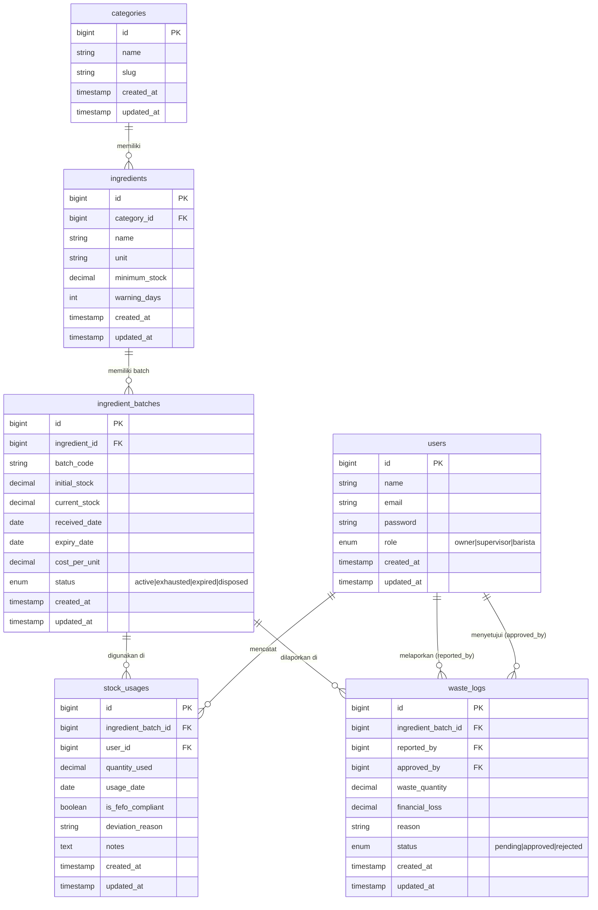

# PLAN 01 — Database Migrations & Schema Design
## Modul: Sistem Inventaris Kafe — Migrasi Database & Desain Skema

> **Versi**: 1.0.0  
> **Status**: Siap Eksekusi  
> **Dibuat**: 2026-10-31  
> **Konteks Stack**: Laravel 11, PHP 8.2+, MySQL 8.0, Eloquent ORM

---

## 1. RINGKASAN SKEMA & DIAGRAM ER

### 1.1 Gambaran Umum

Database proyek ini terdiri dari **6 tabel inti** yang saling terhubung melalui relasi _foreign key_. Urutan pembuatan tabel sangat penting karena setiap tabel merujuk ke tabel lain yang harus sudah ada terlebih dahulu.

```
users → (dirujuk oleh) stock_usages, waste_logs
categories → (dirujuk oleh) ingredients
ingredients → (dirujuk oleh) ingredient_batches
ingredient_batches → (dirujuk oleh) stock_usages, waste_logs
```

### 1.2 Entity Relationship Diagram (ERD)



---

## 2. SPESIFIKASI PER-MIGRATION

> [!IMPORTANT]
> Jalankan migrasi SELALU dalam urutan timestamp yang tertera. Jangan mengubah urutan file karena constraint foreign key bergantung pada urutan ini.

---

### 2.1 Migration 1 — `add_role_to_users_table`

**Nama File**: `database/migrations/2026_01_01_000001_add_role_to_users_table.php`

**Tujuan**: Laravel 11 sudah menyediakan tabel `users` bawaan. Migration ini **menambahkan kolom `role`** ke tabel tersebut tanpa menghapus kolom yang sudah ada.

```php
<?php

use Illuminate\Database\Migrations\Migration;
use Illuminate\Database\Schema\Blueprint;
use Illuminate\Support\Facades\Schema;

return new class extends Migration
{
    /**
     * Run the migrations.
     * Menambahkan kolom role ke tabel users bawaan Laravel.
     */
    public function up(): void
    {
        Schema::table('users', function (Blueprint $table) {
            $table->enum('role', ['owner', 'supervisor', 'barista'])
                  ->default('barista')
                  ->after('password');
        });
    }

    /**
     * Reverse the migrations.
     * Menghapus kolom role jika rollback dijalankan.
     */
    public function down(): void
    {
        Schema::table('users', function (Blueprint $table) {
            $table->dropColumn('role');
        });
    }
};
```

**Penjelasan Kolom**:

| Kolom | Tipe | Alasan Pemilihan |
|-------|------|-----------------|
| `role` | `ENUM('owner','supervisor','barista')` | ENUM dipilih karena nilai role terbatas dan sudah pasti sejak awal. Lebih efisien dari VARCHAR dan MySQL otomatis menolak nilai di luar daftar, sehingga menjadi constraint implisit. `default('barista')` aman karena user baru yang mendaftar tanpa assignment khusus tidak langsung mendapat akses lebih tinggi. |

---

### 2.2 Migration 2 — `create_categories_table`

**Nama File**: `database/migrations/2026_01_01_000002_create_categories_table.php`

**Tujuan**: Mengelompokkan bahan baku (contoh: "Dairy", "Sirup & Topping", "Biji Kopi", "Kemasan"). Dibuat sebelum `ingredients` karena `ingredients.category_id` merujuk ke tabel ini.

```php
<?php

use Illuminate\Database\Migrations\Migration;
use Illuminate\Database\Schema\Blueprint;
use Illuminate\Support\Facades\Schema;

return new class extends Migration
{
    /**
     * Run the migrations.
     * Membuat tabel master kategori bahan baku.
     */
    public function up(): void
    {
        Schema::create('categories', function (Blueprint $table) {
            $table->id();                             // BIGINT UNSIGNED AUTO_INCREMENT PK
            $table->string('name', 100);              // Nama kategori (maks 100 karakter)
            $table->string('slug', 120)->unique();    // URL-friendly identifier, harus unik
            $table->timestamps();                     // created_at & updated_at
        });
    }

    /**
     * Reverse the migrations.
     */
    public function down(): void
    {
        Schema::dropIfExists('categories');
    }
};
```

**Penjelasan Kolom**:

| Kolom | Tipe | Alasan Pemilihan |
|-------|------|-----------------|
| `id` | `BIGINT UNSIGNED AUTO_INCREMENT` | Primary key standar Laravel. BIGINT dipilih karena future-proof untuk data dalam jumlah besar. |
| `name` | `VARCHAR(100)` | Nama kategori dibatasi 100 karakter — cukup untuk nama kategori apapun namun tetap efisien di memori. |
| `slug` | `VARCHAR(120) UNIQUE` | Identifier URL-friendly (contoh: `dairy-products`). Digunakan untuk routing/filtering di frontend tanpa harus encode nama dengan spasi. `UNIQUE` constraint mencegah duplikat kategori. |
| `timestamps()` | `TIMESTAMP` x2 | Audit trail otomatis: kapan kategori dibuat dan terakhir diubah. |

---

### 2.3 Migration 3 — `create_ingredients_table`

**Nama File**: `database/migrations/2026_01_01_000003_create_ingredients_table.php`

**Tujuan**: Tabel master bahan baku yang mendefinisikan **jenis** bahan (bukan stok aktualnya). Stok aktual ada di `ingredient_batches`.

```php
<?php

use Illuminate\Database\Migrations\Migration;
use Illuminate\Database\Schema\Blueprint;
use Illuminate\Support\Facades\Schema;

return new class extends Migration
{
    /**
     * Run the migrations.
     * Membuat tabel master bahan baku kafe.
     */
    public function up(): void
    {
        Schema::create('ingredients', function (Blueprint $table) {
            $table->id();

            // Foreign key ke tabel categories
            $table->foreignId('category_id')
                  ->constrained('categories')
                  ->restrictOnDelete();  // Mencegah penghapusan kategori yang masih punya bahan

            $table->string('name', 150);                       // Nama bahan (contoh: "Fresh Milk Full Cream")
            $table->string('unit', 30);                        // Satuan (contoh: "Liter", "Kg", "Botol")
            $table->decimal('minimum_stock', 10, 2);           // Batas stok minimum untuk alert
            $table->unsignedInteger('warning_days')->default(3); // Hari peringatan sebelum expiry

            $table->timestamps();
        });
    }

    /**
     * Reverse the migrations.
     */
    public function down(): void
    {
        Schema::dropIfExists('ingredients');
    }
};
```

**Penjelasan Kolom**:

| Kolom | Tipe | Alasan Pemilihan |
|-------|------|-----------------|
| `category_id` | `BIGINT UNSIGNED FK` | `foreignId()->constrained()` otomatis membuat index dan FK constraint ke `categories.id`. `restrictOnDelete()` dipilih (bukan `cascade`) agar kategori yang sudah punya bahan tidak bisa dihapus sembarangan — melindungi integritas master data. |
| `name` | `VARCHAR(150)` | Nama bahan lebih panjang dari kategori karena bisa spesifik (contoh: "Oat Milk Barista Edition 1L"). |
| `unit` | `VARCHAR(30)` | Satuan pengukuran fleksibel: "Liter", "Kilogram", "Gram", "Botol", "Sachet". VARCHAR dipilih karena tidak bisa di-ENUM (terlalu banyak kemungkinan). |
| `minimum_stock` | `DECIMAL(10,2)` | DECIMAL dipilih untuk menghindari floating-point rounding error pada perhitungan stok. `(10,2)` = maks 99.999.999,99 unit — jauh melebihi kebutuhan kafe. |
| `warning_days` | `INT UNSIGNED DEFAULT 3` | Default 3 hari sesuai business rule "lampu merah". Supervisor bisa mengubah per-bahan (contoh: susu segar mungkin perlu warning 7 hari, kopi bisa 14 hari). `UNSIGNED` mencegah nilai negatif. |

---

### 2.4 Migration 4 — `create_ingredient_batches_table` ⭐

**Nama File**: `database/migrations/2026_01_01_000004_create_ingredient_batches_table.php`

**Tujuan**: Tabel **paling kritis** dalam sistem. Setiap baris merepresentasikan satu pengiriman/penerimaan bahan dari supplier. Tabel ini adalah pondasi algoritma FEFO.

```php
<?php

use Illuminate\Database\Migrations\Migration;
use Illuminate\Database\Schema\Blueprint;
use Illuminate\Support\Facades\Schema;

return new class extends Migration
{
    /**
     * Run the migrations.
     * Membuat tabel batch bahan baku — inti dari sistem FEFO.
     */
    public function up(): void
    {
        Schema::create('ingredient_batches', function (Blueprint $table) {
            $table->id();

            // Foreign key ke tabel ingredients
            $table->foreignId('ingredient_id')
                  ->constrained('ingredients')
                  ->restrictOnDelete(); // Bahan tidak bisa dihapus jika masih ada batch

            $table->string('batch_code', 50)->unique(); // Kode batch/nomor faktur, HARUS unik
            $table->decimal('initial_stock', 10, 2);    // Stok awal saat diterima (tidak berubah)
            $table->decimal('current_stock', 10, 2);    // Stok sisa real-time (berkurang tiap pemakaian)
            $table->date('received_date');               // Tanggal terima dari supplier
            $table->date('expiry_date');                 // Tanggal kedaluwarsa (kunci FEFO)
            $table->decimal('cost_per_unit', 12, 2);    // Harga beli per unit (untuk hitung financial_loss)

            // Status lifecycle batch (TIDAK ada soft-delete bawaan)
            $table->enum('status', ['active', 'exhausted', 'expired', 'disposed'])
                  ->default('active');

            $table->timestamps();

            // =====================================================================
            // INDEKS PERFORMA — KRITIS UNTUK QUERY FEFO
            // =====================================================================

            // INDEX 1: Composite index — query FEFO paling sering dijalankan
            // WHERE ingredient_id = ? AND status = 'active' AND current_stock > 0
            // ORDER BY expiry_date ASC
            $table->index(['ingredient_id', 'status', 'expiry_date'], 'idx_fefo_query');

            // INDEX 2: Index single — untuk dashboard early warning
            // WHERE expiry_date BETWEEN today AND today+7
            $table->index('expiry_date', 'idx_expiry_date');
        });
    }

    /**
     * Reverse the migrations.
     */
    public function down(): void
    {
        Schema::dropIfExists('ingredient_batches');
    }
};
```

**Penjelasan Kolom**:

| Kolom | Tipe | Alasan Pemilihan |
|-------|------|-----------------|
| `batch_code` | `VARCHAR(50) UNIQUE` | Kode unik tiap pengiriman (contoh: "MILK-20260131-001" atau nomor faktur supplier). `UNIQUE` constraint di DB level mencegah input double batch yang sama. |
| `initial_stock` | `DECIMAL(10,2)` | Stok awal **tidak pernah berubah** setelah dibuat — berfungsi sebagai referensi historis dan untuk audit. |
| `current_stock` | `DECIMAL(10,2)` | Stok sisa yang aktif berkurang. Validasi `>= 0` ditangani di application layer (Form Request). |
| `received_date` | `DATE` | Hanya tanggal (bukan datetime) karena presisi jam tidak relevan untuk tracking stok kafe. Hemat storage. |
| `expiry_date` | `DATE` | **Kunci utama FEFO**. Kolom ini yang di-ORDER BY ASC untuk menentukan batch mana yang harus dipakai lebih dulu. Validasi `expiry_date > received_date` di application layer. |
| `cost_per_unit` | `DECIMAL(12,2)` | `(12,2)` mendukung hingga Rp 9.999.999.999,99 per unit — mengakomodasi bahan premium. Digunakan untuk menghitung `financial_loss` di `waste_logs`. |
| `status` | `ENUM` | 4 state lifecycle yang jelas: `active` (sedang dipakai), `exhausted` (habis terpakai), `expired` (lewat expiry date), `disposed` (dimusnahkan). ENUM mencegah nilai status sembarangan. |

---

### 2.5 Migration 5 — `create_stock_usages_table`

**Nama File**: `database/migrations/2026_01_01_000005_create_stock_usages_table.php`

**Tujuan**: Mencatat setiap kejadian pengurangan stok oleh barista/supervisor beserta informasi kepatuhan FEFO.

```php
<?php

use Illuminate\Database\Migrations\Migration;
use Illuminate\Database\Schema\Blueprint;
use Illuminate\Support\Facades\Schema;

return new class extends Migration
{
    /**
     * Run the migrations.
     * Membuat tabel log pemakaian stok harian.
     */
    public function up(): void
    {
        Schema::create('stock_usages', function (Blueprint $table) {
            $table->id();

            // Foreign key ke batch yang digunakan
            $table->foreignId('ingredient_batch_id')
                  ->constrained('ingredient_batches')
                  ->restrictOnDelete(); // Batch tidak bisa dihapus jika sudah ada riwayat pemakaian

            // Foreign key ke user yang mencatat pemakaian
            $table->foreignId('user_id')
                  ->constrained('users')
                  ->restrictOnDelete(); // User tidak bisa dihapus jika sudah ada riwayat pencatatan

            $table->decimal('quantity_used', 10, 2);           // Jumlah yang digunakan
            $table->date('usage_date');                         // Tanggal pemakaian

            // Kolom kepatuhan FEFO — inti audit trail
            $table->boolean('is_fefo_compliant')->default(true); // Apakah batch yang dipakai sesuai FEFO?
            $table->string('deviation_reason', 500)->nullable(); // Wajib diisi jika is_fefo_compliant = false
            $table->text('notes')->nullable();                   // Catatan bebas opsional dari barista

            $table->timestamps();

            // =====================================================================
            // INDEKS PERFORMA
            // =====================================================================

            // INDEX: Composite — untuk query riwayat pemakaian per batch dalam rentang tanggal
            $table->index(['ingredient_batch_id', 'usage_date'], 'idx_usage_batch_date');
        });
    }

    /**
     * Reverse the migrations.
     */
    public function down(): void
    {
        Schema::dropIfExists('stock_usages');
    }
};
```

**Penjelasan Kolom**:

| Kolom | Tipe | Alasan Pemilihan |
|-------|------|-----------------|
| `ingredient_batch_id` | `BIGINT UNSIGNED FK` | Merujuk ke batch spesifik yang dikurangi stoknya. `restrictOnDelete` memastikan riwayat pemakaian tidak yatim piatu. |
| `user_id` | `BIGINT UNSIGNED FK` | Akuntabilitas: siapa yang mencatat pemakaian ini. Penting untuk audit dan laporan. |
| `quantity_used` | `DECIMAL(10,2)` | Jumlah yang terpakai. DECIMAL mencegah error pembulatan pada hitungan kumulatif. |
| `usage_date` | `DATE` | Tanggal aktual pemakaian. Bisa berbeda dengan `created_at` (contoh: input dilakukan keesokan harinya). |
| `is_fefo_compliant` | `BOOLEAN DEFAULT true` | Flag audit apakah barista mengikuti rekomendasi FEFO. `default(true)` karena mayoritas transaksi diharapkan compliant. |
| `deviation_reason` | `VARCHAR(500) NULLABLE` | **Nullable karena hanya wajib diisi saat `is_fefo_compliant = false`**. Validasi ketergantungan ini ada di Form Request Laravel. |
| `notes` | `TEXT NULLABLE` | Catatan bebas opsional. TEXT (bukan VARCHAR) karena panjangnya tidak bisa diprediksi. Nullable karena tidak selalu diperlukan. |

---

### 2.6 Migration 6 — `create_waste_logs_table`

**Nama File**: `database/migrations/2026_01_01_000006_create_waste_logs_table.php`

**Tujuan**: Mencatat laporan pemusnahan bahan baku rusak/basi dengan sistem approval dua tahap (barista lapor → supervisor approve).

```php
<?php

use Illuminate\Database\Migrations\Migration;
use Illuminate\Database\Schema\Blueprint;
use Illuminate\Support\Facades\Schema;

return new class extends Migration
{
    /**
     * Run the migrations.
     * Membuat tabel log pemusnahan bahan rusak dengan workflow approval.
     */
    public function up(): void
    {
        Schema::create('waste_logs', function (Blueprint $table) {
            $table->id();

            // Foreign key ke batch yang dimusnahkan
            $table->foreignId('ingredient_batch_id')
                  ->constrained('ingredient_batches')
                  ->restrictOnDelete();

            // Foreign key ganda ke tabel users dengan nama kolom kustom
            // reported_by: user yang melaporkan (barista/supervisor)
            $table->unsignedBigInteger('reported_by');
            $table->foreign('reported_by')
                  ->references('id')
                  ->on('users')
                  ->restrictOnDelete();

            // approved_by: user yang menyetujui (supervisor/owner) — NULLABLE karena awalnya belum ada approver
            $table->unsignedBigInteger('approved_by')->nullable();
            $table->foreign('approved_by')
                  ->references('id')
                  ->on('users')
                  ->nullOnDelete(); // Jika approver dihapus, set ke null (tidak batalkan log)

            $table->decimal('waste_quantity', 10, 2);       // Jumlah bahan yang dimusnahkan
            $table->decimal('financial_loss', 12, 2)->nullable(); // Dihitung saat approved: qty × cost_per_unit
            $table->string('reason', 500);                  // Alasan pemusnahan (wajib diisi)

            // Status workflow approval
            $table->enum('status', ['pending', 'approved', 'rejected'])->default('pending');

            $table->timestamps();

            // =====================================================================
            // INDEKS PERFORMA
            // =====================================================================

            // INDEX: Composite — untuk query antrian approval oleh supervisor
            // WHERE status = 'pending' AND reported_by = ?
            $table->index(['status', 'reported_by'], 'idx_waste_status_reporter');
        });
    }

    /**
     * Reverse the migrations.
     */
    public function down(): void
    {
        Schema::dropIfExists('waste_logs');
    }
};
```

**Penjelasan Kolom**:

| Kolom | Tipe | Alasan Pemilihan |
|-------|------|-----------------|
| `reported_by` | `BIGINT UNSIGNED FK` | Menggunakan sintaks manual (bukan `foreignId()`) karena nama kolom tidak mengikuti konvensi `{table}_id`. Ini adalah "pelapor" kejadian. |
| `approved_by` | `BIGINT UNSIGNED NULLABLE FK` | **Nullable karena saat pertama dibuat (status `pending`), belum ada approver**. `nullOnDelete()` dipilih sehingga jika supervisor dihapus dari sistem, log waste tidak ikut terhapus (integritas historis terjaga). |
| `waste_quantity` | `DECIMAL(10,2)` | Jumlah bahan yang dimusnahkan — harus ≤ `ingredient_batches.current_stock` (validasi di application layer). |
| `financial_loss` | `DECIMAL(12,2) NULLABLE` | **Nullable karena dihitung dan diisi HANYA saat status berubah ke `approved`** di application layer: `financial_loss = waste_quantity × cost_per_unit`. `DECIMAL(12,2)` untuk nilai rupiah yang besar. |
| `reason` | `VARCHAR(500)` | Tidak nullable — pelaporan tanpa alasan tidak diizinkan. VARCHAR(500) cukup untuk penjelasan singkat. |
| `status` | `ENUM DEFAULT 'pending'` | Workflow lifecycle: `pending` → `approved` atau `rejected`. ENUM mencegah status sembarangan. |

---

## 3. ANALISIS INDEKS & PERFORMA

### 3.1 Ringkasan Semua Indeks

| Tabel | Nama Index | Kolom | Tipe | Prioritas |
|-------|-----------|-------|------|-----------|
| `ingredient_batches` | `idx_fefo_query` | `(ingredient_id, status, expiry_date)` | Composite | 🔴 **Paling Kritis** |
| `ingredient_batches` | `idx_expiry_date` | `(expiry_date)` | Single | 🟡 Tinggi |
| `stock_usages` | `idx_usage_batch_date` | `(ingredient_batch_id, usage_date)` | Composite | 🟡 Tinggi |
| `waste_logs` | `idx_waste_status_reporter` | `(status, reported_by)` | Composite | 🟢 Sedang |

> [!NOTE]
> Foreign key secara otomatis membuat index oleh MySQL. Index di atas adalah **index tambahan** di luar index FK bawaan.

### 3.2 Analisis Mendalam Per Indeks

#### 🔴 `idx_fefo_query` — Composite `(ingredient_id, status, expiry_date)`

Ini adalah **index paling kritis** dalam seluruh sistem. Setiap kali barista memilih bahan untuk dicatat pemakaiannya, query berikut dieksekusi:

```sql
SELECT *
FROM ingredient_batches
WHERE ingredient_id = 5        -- Filter bahan tertentu
  AND status = 'active'        -- Hanya batch yang masih aktif
  AND current_stock > 0        -- Hanya yang masih ada stoknya
ORDER BY expiry_date ASC       -- FEFO: yang mendekati expired diatas
LIMIT 10;
```

**Tanpa index**: MySQL harus melakukan _full table scan_ pada semua batch. Jika ada 10.000 batch, setiap request barista memindai 10.000 baris.

**Dengan composite index `(ingredient_id, status, expiry_date)`**: MySQL menggunakan B-Tree index untuk langsung melompat ke baris yang relevan. Urutan kolom dalam composite index sangat penting — `ingredient_id` di depan karena itu filter pertama (selectivity tinggi), lalu `status` mempersempit lebih jauh, dan `expiry_date` sudah terurut di dalam index sehingga `ORDER BY` gratis tanpa sorting tambahan.

#### 🟡 `idx_expiry_date` — Single `(expiry_date)`

Digunakan untuk dashboard early warning:

```sql
SELECT *
FROM ingredient_batches
WHERE expiry_date BETWEEN CURDATE() AND DATE_ADD(CURDATE(), INTERVAL 7 DAY)
  AND status = 'active';
```

Query ini dijalankan setiap kali owner/supervisor membuka dashboard. Index ini memungkinkan MySQL menggunakan range scan pada expiry_date alih-alih full table scan.

#### 🟡 `idx_usage_batch_date` — Composite `(ingredient_batch_id, usage_date)`

Digunakan untuk laporan riwayat pemakaian per batch dalam rentang tanggal:

```sql
SELECT *
FROM stock_usages
WHERE ingredient_batch_id = 42
  AND usage_date BETWEEN '2026-01-01' AND '2026-01-31';
```

Useful untuk owner yang ingin melihat riwayat pemakaian batch tertentu dalam sebulan.

#### 🟢 `idx_waste_status_reporter` — Composite `(status, reported_by)`

Digunakan untuk menampilkan antrian approval di dashboard supervisor:

```sql
-- Supervisor melihat semua laporan yang perlu di-approve
SELECT * FROM waste_logs WHERE status = 'pending';

-- Barista melihat status laporan yang dia buat
SELECT * FROM waste_logs WHERE reported_by = 12 AND status = 'pending';
```

---

## 4. CATATAN INTEGRITAS DATA

### 4.1 Proteksi Foreign Key

| Relasi | Strategi | Alasan |
|--------|----------|--------|
| `categories` ← `ingredients` | `RESTRICT` | Kategori tidak boleh dihapus jika masih ada bahan di dalamnya. Cegah data yatim. |
| `ingredients` ← `ingredient_batches` | `RESTRICT` | Bahan master tidak boleh dihapus jika masih ada batch historis/aktif. |
| `ingredient_batches` ← `stock_usages` | `RESTRICT` | Riwayat pemakaian adalah data audit yang tidak boleh kehilangan referensi batch-nya. |
| `ingredient_batches` ← `waste_logs` | `RESTRICT` | Sama seperti stock_usages — integritas audit trail. |
| `users` ← `stock_usages.user_id` | `RESTRICT` | Riwayat pencatatan harus selalu bisa dilacak ke penggunanya. |
| `users` ← `waste_logs.reported_by` | `RESTRICT` | Pelapor harus selalu bisa diidentifikasi. |
| `users` ← `waste_logs.approved_by` | `SET NULL` | Jika supervisor dihapus dari sistem, log approved-nya tidak ikut terhapus. `approved_by` menjadi `NULL` tapi data waste log tetap ada. |

### 4.2 Kolom ENUM dan Alasan Pemilihan

| Tabel | Kolom | Nilai ENUM | Alasan Menggunakan ENUM |
|-------|-------|-----------|------------------------|
| `users` | `role` | `owner, supervisor, barista` | Role terbatas dan sudah final. MySQL menolak nilai di luar ini otomatis. Lebih efisien dari VARCHAR. |
| `ingredient_batches` | `status` | `active, exhausted, expired, disposed` | 4 state lifecycle yang exhaustive. Setiap state memiliki arti bisnis yang jelas. ENUM mencegah typo seperti `'Aktif'` atau `'ACTIVE'`. |
| `waste_logs` | `status` | `pending, approved, rejected` | Workflow approval yang terdefinisi ketat. Tidak ada state lain yang valid. |

### 4.3 Kolom Nullable dan Alasannya

| Tabel | Kolom | Alasan Nullable |
|-------|-------|-----------------|
| `stock_usages` | `deviation_reason` | Hanya wajib diisi ketika `is_fefo_compliant = false`. Jika FEFO dipatuhi, kolom ini tidak relevan. |
| `stock_usages` | `notes` | Catatan bebas opsional. Tidak semua pencatatan memerlukan keterangan tambahan. |
| `waste_logs` | `approved_by` | Saat baru dibuat (status `pending`), belum ada yang menyetujui. Diisi setelah supervisor melakukan approval. |
| `waste_logs` | `financial_loss` | Dihitung dan diisi HANYA saat status berubah ke `approved`. Saat masih `pending`, nilai ini belum diketahui. |

### 4.4 Validasi yang Dihandle di Application Layer (Bukan DB Constraint)

> [!WARNING]
> Constraint berikut **tidak ada di level database** dan harus diimplementasikan di Form Request Laravel:

- `expiry_date` > `received_date` → Validasi di `StoreBatchRequest::rules()`
- `current_stock` ≥ 0 → Validasi saat decrement di `StockUsageService`
- `deviation_reason` wajib diisi jika `is_fefo_compliant = false` → Validasi conditional di `StoreStockUsageRequest`
- `waste_quantity` ≤ `current_stock` batch yang dipilih → Validasi di `StoreWasteLogRequest`

---

## 5. DOKUMENTASI PEMULA

Lihat file terpisah: [`docs/explanations/01_migrations_schema.md`](../explanations/01_migrations_schema.md)

---

## 6. AI EXECUTION PROMPT

Salin seluruh blok di bawah ini dan kirimkan ke AI coding assistant untuk mengeksekusi pembuatan semua file migration:

---

````
KONTEKS:
Saya memiliki proyek Laravel 11 dengan database MySQL. Tabel `users` sudah ada (bawaan Laravel).
Saya perlu membuat 6 file migration dalam urutan YANG HARUS PERSIS SAMA seperti ini.

TUGAS:
Buat file-file migration berikut dengan kode LENGKAP seperti yang sudah direncanakan.
Jangan gunakan `php artisan make:migration` karena timestamp sudah ditentukan.
Buat file secara manual di direktori `database/migrations/`.

FILE YANG HARUS DIBUAT (urutan penting!):

=== FILE 1 ===
Path: database/migrations/2026_01_01_000001_add_role_to_users_table.php
[Kode: Tambahkan kolom `role` ENUM('owner','supervisor','barista') DEFAULT 'barista' ke tabel users yang sudah ada, posisi AFTER password]

=== FILE 2 ===
Path: database/migrations/2026_01_01_000002_create_categories_table.php
[Kode: Buat tabel `categories` dengan kolom: id, name(varchar 100), slug(varchar 120 unique), timestamps]

=== FILE 3 ===
Path: database/migrations/2026_01_01_000003_create_ingredients_table.php
[Kode: Buat tabel `ingredients` dengan kolom: id, category_id(FK→categories RESTRICT), name(varchar 150), unit(varchar 30), minimum_stock(decimal 10,2), warning_days(unsigned int default 3), timestamps]

=== FILE 4 ===
Path: database/migrations/2026_01_01_000004_create_ingredient_batches_table.php
[Kode: Buat tabel `ingredient_batches` dengan kolom: id, ingredient_id(FK→ingredients RESTRICT), batch_code(varchar 50 unique), initial_stock(decimal 10,2), current_stock(decimal 10,2), received_date(date), expiry_date(date), cost_per_unit(decimal 12,2), status(ENUM active/exhausted/expired/disposed default active), timestamps]
[WAJIB tambahkan index: composite(ingredient_id, status, expiry_date) nama 'idx_fefo_query', single(expiry_date) nama 'idx_expiry_date']

=== FILE 5 ===
Path: database/migrations/2026_01_01_000005_create_stock_usages_table.php
[Kode: Buat tabel `stock_usages` dengan kolom: id, ingredient_batch_id(FK→ingredient_batches RESTRICT), user_id(FK→users RESTRICT), quantity_used(decimal 10,2), usage_date(date), is_fefo_compliant(boolean default true), deviation_reason(varchar 500 nullable), notes(text nullable), timestamps]
[WAJIB tambahkan index: composite(ingredient_batch_id, usage_date) nama 'idx_usage_batch_date']

=== FILE 6 ===
Path: database/migrations/2026_01_01_000006_create_waste_logs_table.php
[Kode: Buat tabel `waste_logs` dengan kolom: id, ingredient_batch_id(FK→ingredient_batches RESTRICT), reported_by(unsigned bigint FK→users.id RESTRICT), approved_by(unsigned bigint nullable FK→users.id SET NULL), waste_quantity(decimal 10,2), financial_loss(decimal 12,2 nullable), reason(varchar 500), status(ENUM pending/approved/rejected default pending), timestamps]
[WAJIB tambahkan index: composite(status, reported_by) nama 'idx_waste_status_reporter']
[PERHATIAN: reported_by dan approved_by menggunakan FK manual karena nama kolom tidak standar
SETELAH MEMBUAT SEMUA FILE:
Jalankan perintah verifikasi berikut untuk memastikan migrasi valid sebelum dieksekusi:

```bash
# Lihat SQL yang akan dieksekusi (dry run, tidak mengubah database)
php artisan migrate --pretend

# Jika tidak ada error, eksekusi migrasi sebenarnya
php artisan migrate

# Verifikasi semua tabel berhasil dibuat
php artisan db:show

# Verifikasi struktur tabel paling kritis
php artisan db:table ingredient_batches
```

KRITERIA SUKSES:
- Semua 6 file migration ada di direktori database/migrations/
- `php artisan migrate --pretend` tidak menampilkan error
- `php artisan migrate` berjalan tanpa error
- Tabel `ingredient_batches` memiliki composite index pada (ingredient_id, status, expiry_date)
````

---

> **Catatan Ponytail Sign-off**:  
> Dokumen ini sengaja tidak menyertakan Seeder/Factory — itu masalah modul berikutnya (PLAN_02). Risiko yang perlu diketahui: jika urutan timestamp file migration diubah atau dua migration berjalan bersamaan di lingkungan concurrent, foreign key constraint bisa gagal. Selalu jalankan `php artisan migrate --pretend` terlebih dahulu di environment baru.
