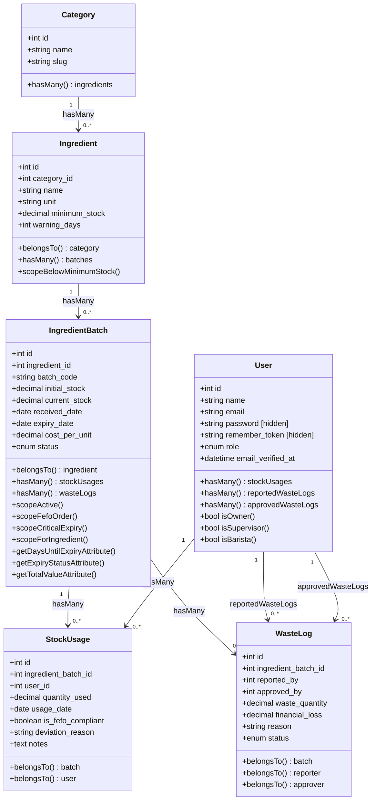

# PLAN 02 — Eloquent Models & Relationships
## Modul: Sistem Inventaris Kafe — Model Eloquent & Relasi Antar-Tabel

> **Versi**: 1.0.0  
> **Status**: Siap Eksekusi  
> **Dibuat**: 2026-10-31  
> **Prasyarat**: [PLAN_01_MIGRATIONS_SCHEMA.md](./PLAN_01_MIGRATIONS_SCHEMA.md) sudah dieksekusi dan semua tabel tersedia  
> **Konteks Stack**: Laravel 11, PHP 8.2+, Eloquent ORM

---

## 1. DIAGRAM RELASI MODEL

### 1.1 Class Diagram — Semua Model & Relasi



### 1.2 Ringkasan Relasi

| Model | Relasi | Target | Foreign Key | Tipe |
|-------|--------|--------|------------|------|
| `Category` | `ingredients` | `Ingredient` | `category_id` | hasMany |
| `Ingredient` | `category` | `Category` | `category_id` | belongsTo |
| `Ingredient` | `batches` | `IngredientBatch` | `ingredient_id` | hasMany |
| `IngredientBatch` | `ingredient` | `Ingredient` | `ingredient_id` | belongsTo |
| `IngredientBatch` | `stockUsages` | `StockUsage` | `ingredient_batch_id` | hasMany |
| `IngredientBatch` | `wasteLogs` | `WasteLog` | `ingredient_batch_id` | hasMany |
| `StockUsage` | `batch` | `IngredientBatch` | `ingredient_batch_id` | belongsTo |
| `StockUsage` | `user` | `User` | `user_id` | belongsTo |
| `WasteLog` | `batch` | `IngredientBatch` | `ingredient_batch_id` | belongsTo |
| `WasteLog` | `reporter` | `User` | `reported_by` | belongsTo |
| `WasteLog` | `approver` | `User` | `approved_by` | belongsTo (nullable) |
| `User` | `stockUsages` | `StockUsage` | `user_id` | hasMany |
| `User` | `reportedWasteLogs` | `WasteLog` | `reported_by` | hasMany |
| `User` | `approvedWasteLogs` | `WasteLog` | `approved_by` | hasMany |

---

## 2. SPESIFIKASI PER-MODEL

> [!IMPORTANT]
> Semua model menggunakan `$fillable` eksplisit. **Dilarang** menggunakan `$guarded = []` karena berpotensi membuka celah mass-assignment vulnerability jika ada kolom sensitif yang tidak sengaja terkena request.

---

### 2.1 Model `User`

**File**: `app/Models/User.php`

**Tujuan**: Model ini sudah ada secara default dari Laravel. Kita **memodifikasinya** untuk menambah kolom `role`, relasi ke `StockUsage` dan `WasteLog`, serta helper method untuk pengecekan role.

```php
<?php

namespace App\Models;

// use Illuminate\Contracts\Auth\MustVerifyEmail;
use Illuminate\Database\Eloquent\Factories\HasFactory;
use Illuminate\Database\Eloquent\Relations\HasMany;
use Illuminate\Foundation\Auth\User as Authenticatable;
use Illuminate\Notifications\Notifiable;

class User extends Authenticatable
{
    /** @use HasFactory<\Database\Factories\UserFactory> */
    use HasFactory, Notifiable;

    // =========================================================================
    // MASS ASSIGNMENT PROTECTION
    // =========================================================================

    /**
     * Kolom yang boleh diisi secara massal (misal: dari form registrasi).
     * 'role' disertakan agar bisa di-set saat create user via Seeder/Admin.
     * Dalam kondisi produksi, assignment role via form publik harus dilindungi
     * di layer Controller/Policy, bukan di sini.
     *
     * @var list<string>
     */
    protected $fillable = [
        'name',
        'email',
        'password',
        'role',
    ];

    // =========================================================================
    // HIDDEN ATTRIBUTES (tidak tampil di JSON/array response)
    // =========================================================================

    /**
     * Kolom sensitif yang TIDAK boleh pernah tampil di response API/Inertia.
     * 'password' dan 'remember_token' selalu tersembunyi.
     *
     * @var list<string>
     */
    protected $hidden = [
        'password',
        'remember_token',
    ];

    // =========================================================================
    // CASTS
    // =========================================================================

    /**
     * Konversi tipe data otomatis saat model dibaca dari database.
     *
     * @return array<string, string>
     */
    protected function casts(): array
    {
        return [
            'email_verified_at' => 'datetime',  // String DB → Carbon object
            'password'          => 'hashed',    // Auto-hash saat di-set
        ];
    }

    // =========================================================================
    // RELATIONSHIPS
    // =========================================================================

    /**
     * Relasi: Satu user bisa mencatat banyak pemakaian stok.
     * Digunakan di: laporan aktivitas user, riwayat pemakaian per-barista.
     */
    public function stockUsages(): HasMany
    {
        return $this->hasMany(StockUsage::class, 'user_id');
    }

    /**
     * Relasi: Satu user bisa membuat banyak laporan pemusnahan.
     * FK custom 'reported_by' harus disebutkan eksplisit karena bukan konvensi '{model}_id'.
     * Digunakan di: riwayat laporan per-barista, dashboard supervisor.
     */
    public function reportedWasteLogs(): HasMany
    {
        return $this->hasMany(WasteLog::class, 'reported_by');
    }

    /**
     * Relasi: Satu user (supervisor) bisa menyetujui banyak laporan pemusnahan.
     * FK custom 'approved_by' — nullable di DB, relasi tetap valid.
     * Digunakan di: riwayat approval per-supervisor, laporan keuangan owner.
     */
    public function approvedWasteLogs(): HasMany
    {
        return $this->hasMany(WasteLog::class, 'approved_by');
    }

    // =========================================================================
    // HELPER METHODS — PENGECEKAN ROLE
    // =========================================================================

    /**
     * Cek apakah user ini adalah Owner.
     * Digunakan di: Policy, middleware, kondisional di Blade/Inertia.
     */
    public function isOwner(): bool
    {
        return $this->role === 'owner';
    }

    /**
     * Cek apakah user ini adalah Supervisor.
     */
    public function isSupervisor(): bool
    {
        return $this->role === 'supervisor';
    }

    /**
     * Cek apakah user ini adalah Barista.
     */
    public function isBarista(): bool
    {
        return $this->role === 'barista';
    }
}
```

**Penjelasan `$fillable`**:

| Kolom | Alasan Dimasukkan $fillable |
|-------|----------------------------|
| `name` | Diisi dari form registrasi/profil |
| `email` | Diisi dari form registrasi |
| `password` | Diisi dari form registrasi — auto-hash oleh cast `'hashed'` |
| `role` | Perlu bisa di-set via Seeder atau panel admin. **Harus diproteksi di Controller** agar user biasa tidak bisa ganti role sendiri |

**Penjelasan Relasi**:

- **`stockUsages()`**: Relasi `hasMany` standar dengan FK `user_id`. Digunakan untuk menarik riwayat aktivitas barista tertentu.
- **`reportedWasteLogs()`** dan **`approvedWasteLogs()`**: Dua relasi `hasMany` ke tabel yang sama (`waste_logs`) tapi lewat FK berbeda. Ini adalah pola **dual foreign key** yang wajib menyebut nama FK secara eksplisit di parameter kedua `hasMany()`.

---

### 2.2 Model `Category`

**File**: `app/Models/Category.php`

**Tujuan**: Merepresentasikan kelompok/rak bahan. Model paling sederhana dalam sistem.

```php
<?php

namespace App\Models;

use Illuminate\Database\Eloquent\Factories\HasFactory;
use Illuminate\Database\Eloquent\Model;
use Illuminate\Database\Eloquent\Relations\HasMany;

class Category extends Model
{
    use HasFactory;

    // =========================================================================
    // MASS ASSIGNMENT PROTECTION
    // =========================================================================

    /**
     * Slug dan name diisi dari form CRUD Supervisor.
     * Slug idealnya digenerate otomatis dari name di layer Service/Controller
     * menggunakan Str::slug($request->name).
     *
     * @var list<string>
     */
    protected $fillable = [
        'name',
        'slug',
    ];

    // =========================================================================
    // CASTS
    // =========================================================================

    /**
     * Tidak ada cast khusus — timestamps sudah di-cast otomatis oleh Eloquent.
     *
     * @return array<string, string>
     */
    protected function casts(): array
    {
        return [];
    }

    // =========================================================================
    // RELATIONSHIPS
    // =========================================================================

    /**
     * Relasi: Satu kategori memiliki banyak bahan baku.
     * Digunakan di: halaman master data kategori (dengan daftar bahan di dalamnya),
     * dropdown filter bahan berdasarkan kategori.
     */
    public function ingredients(): HasMany
    {
        return $this->hasMany(Ingredient::class, 'category_id');
    }
}
```

**Penjelasan `$fillable`**:

| Kolom | Alasan |
|-------|--------|
| `name` | Nama kategori diinput Supervisor dari form |
| `slug` | Digenerate dari name. Bisa diisi manual atau via `Str::slug()` di Controller |

---

### 2.3 Model `Ingredient`

**File**: `app/Models/Ingredient.php`

**Tujuan**: Master data bahan baku. Mendefinisikan identitas bahan, satuannya, dan batas stok minimum. Memiliki Local Scope untuk alert stok rendah.

```php
<?php

namespace App\Models;

use Illuminate\Database\Eloquent\Builder;
use Illuminate\Database\Eloquent\Factories\HasFactory;
use Illuminate\Database\Eloquent\Model;
use Illuminate\Database\Eloquent\Relations\BelongsTo;
use Illuminate\Database\Eloquent\Relations\HasMany;

class Ingredient extends Model
{
    use HasFactory;

    // =========================================================================
    // MASS ASSIGNMENT PROTECTION
    // =========================================================================

    /**
     * @var list<string>
     */
    protected $fillable = [
        'category_id',
        'name',
        'unit',
        'minimum_stock',
        'warning_days',
    ];

    // =========================================================================
    // CASTS
    // =========================================================================

    /**
     * @return array<string, string>
     */
    protected function casts(): array
    {
        return [
            'minimum_stock' => 'decimal:2', // Pastikan selalu 2 desimal saat dibaca
            'warning_days'  => 'integer',
        ];
    }

    // =========================================================================
    // RELATIONSHIPS
    // =========================================================================

    /**
     * Relasi: Bahan ini termasuk kategori mana.
     * Digunakan di: halaman detail bahan, filter dan grouping di laporan.
     */
    public function category(): BelongsTo
    {
        return $this->belongsTo(Category::class, 'category_id');
    }

    /**
     * Relasi: Satu bahan bisa punya banyak batch (kiriman dari supplier).
     * Nama relasi 'batches' (bukan 'ingredientBatches') untuk kemudahan akses:
     * $ingredient->batches vs $ingredient->ingredientBatches.
     * Digunakan di: halaman detail bahan, kalkulasi total stok aktif.
     */
    public function batches(): HasMany
    {
        return $this->hasMany(IngredientBatch::class, 'ingredient_id');
    }

    // =========================================================================
    // LOCAL SCOPES
    // =========================================================================

    /**
     * Scope: Filter bahan yang total stok aktifnya di bawah minimum_stock.
     *
     * PENTING: Ini menggunakan subquery (whereHas + sum) bukan join sederhana,
     * karena stok aktual tersebar di tabel ingredient_batches (multi-batch).
     * Total stok = SUM(current_stock) dari semua batch active milik bahan ini.
     *
     * Contoh penggunaan:
     *   Ingredient::belowMinimumStock()->get()
     *
     * Digunakan di: Dashboard alert stok menipis, notifikasi supervisor.
     *
     * @param Builder $query
     * @return Builder
     */
    public function scopeBelowMinimumStock(Builder $query): Builder
    {
        return $query->whereRaw(
            // Subquery: hitung total current_stock dari semua batch active
            // Bandingkan dengan minimum_stock di tabel ingredients
            '(
                SELECT COALESCE(SUM(ib.current_stock), 0)
                FROM ingredient_batches ib
                WHERE ib.ingredient_id = ingredients.id
                  AND ib.status = ?
            ) < ingredients.minimum_stock',
            ['active']
        );
    }
}
```

**Penjelasan `$fillable`**:

| Kolom | Alasan |
|-------|--------|
| `category_id` | Dipilih dari dropdown kategori di form |
| `name` | Nama bahan diinput Supervisor |
| `unit` | Satuan bahan (Liter, Kg, Botol, dsb.) |
| `minimum_stock` | Batas minimum diset Supervisor per-bahan |
| `warning_days` | Jumlah hari peringatan, default 3 |

**Catatan `scopeBelowMinimumStock`**: Scope ini menggunakan `whereRaw` dengan subquery karena stok tidak tersimpan langsung di tabel `ingredients` — melainkan tersebar di banyak batch. Pendekatan dengan `whereHas()` saja tidak cukup karena kita butuh membandingkan **agregasi** (SUM) dengan kolom di tabel yang sama (`minimum_stock`).

---

### 2.4 Model `IngredientBatch` ⭐

**File**: `app/Models/IngredientBatch.php`

**Tujuan**: Model paling kaya fitur dalam sistem. Merepresentasikan setiap kiriman bahan dari supplier. Berisi 4 Local Scope untuk query FEFO dan 3 Accessor untuk property terkomputasi.

```php
<?php

namespace App\Models;

use Carbon\Carbon;
use Illuminate\Database\Eloquent\Builder;
use Illuminate\Database\Eloquent\Factories\HasFactory;
use Illuminate\Database\Eloquent\Model;
use Illuminate\Database\Eloquent\Relations\BelongsTo;
use Illuminate\Database\Eloquent\Relations\HasMany;

class IngredientBatch extends Model
{
    use HasFactory;

    // =========================================================================
    // MASS ASSIGNMENT PROTECTION
    // =========================================================================

    /**
     * @var list<string>
     */
    protected $fillable = [
        'ingredient_id',
        'batch_code',
        'initial_stock',
        'current_stock',
        'received_date',
        'expiry_date',
        'cost_per_unit',
        'status',
    ];

    // =========================================================================
    // CASTS
    // =========================================================================

    /**
     * Cast penting:
     * - received_date & expiry_date → Carbon agar bisa memanggil ->diffInDays(), ->isPast(), dll.
     * - current_stock & cost_per_unit → decimal untuk presisi kalkulasi finansial.
     * - status tidak di-cast — sudah divalidasi oleh ENUM di DB level.
     *
     * @return array<string, string>
     */
    protected function casts(): array
    {
        return [
            'received_date'  => 'date',         // Carbon\Carbon date instance
            'expiry_date'    => 'date',          // Carbon\Carbon date instance
            'initial_stock'  => 'decimal:2',
            'current_stock'  => 'decimal:2',
            'cost_per_unit'  => 'decimal:2',
        ];
    }

    // =========================================================================
    // RELATIONSHIPS
    // =========================================================================

    /**
     * Relasi: Batch ini adalah kiriman dari bahan apa.
     * Digunakan di: tampilan detail batch, laporan pemakaian, kalkulasi stok per-bahan.
     */
    public function ingredient(): BelongsTo
    {
        return $this->belongsTo(Ingredient::class, 'ingredient_id');
    }

    /**
     * Relasi: Batch ini telah digunakan di berapa banyak pencatatan pemakaian.
     * Digunakan di: riwayat pemakaian batch, audit trail, laporan owner.
     */
    public function stockUsages(): HasMany
    {
        return $this->hasMany(StockUsage::class, 'ingredient_batch_id');
    }

    /**
     * Relasi: Batch ini pernah dilaporkan untuk pemusnahan berapa kali.
     * Digunakan di: detail batch, audit trail pemusnahan.
     */
    public function wasteLogs(): HasMany
    {
        return $this->hasMany(WasteLog::class, 'ingredient_batch_id');
    }

    // =========================================================================
    // LOCAL SCOPES — QUERY BUILDERS UNTUK FEFO & DASHBOARD
    // =========================================================================

    /**
     * Scope: Filter hanya batch yang MASIH AKTIF dan masih ada stoknya.
     *
     * Kondisi: status = 'active' DAN current_stock > 0
     * Kenapa dua kondisi? Batch bisa berstatus 'active' tapi stok = 0
     * jika belum sempat di-update ke 'exhausted'. Double guard ini mencegah
     * batch kosong muncul di pilihan barista.
     *
     * Contoh penggunaan:
     *   IngredientBatch::active()->get()
     *
     * Digunakan di: Dropdown pilihan batch untuk barista, kalkulasi stok aktif.
     *
     * @param Builder $query
     * @return Builder
     */
    public function scopeActive(Builder $query): Builder
    {
        return $query->where('status', 'active')
                     ->where('current_stock', '>', 0);
    }

    /**
     * Scope: Urutkan batch berdasarkan expiry_date terdekat (ASC).
     *
     * INI adalah implementasi inti algoritma FEFO.
     * "First Expired" → expiry_date terkecil (paling lama) ada di atas.
     * Scope ini hampir selalu digunakan bersama scopeActive().
     *
     * Contoh penggunaan:
     *   IngredientBatch::active()->fefoOrder()->get()
     *   // Batch yang paling dekat kadaluwarsa ada di index [0]
     *
     * Digunakan di: Pilihan batch FEFO untuk barista, rekomendasi di form usage.
     *
     * @param Builder $query
     * @return Builder
     */
    public function scopeFefoOrder(Builder $query): Builder
    {
        return $query->orderBy('expiry_date', 'asc');
    }

    /**
     * Scope: Filter batch yang expiry_date-nya dalam rentang N hari ke depan.
     *
     * Default $days = 7 sesuai business rule early warning "lampu kuning/merah".
     * Supervisor bisa memanggil dengan $days berbeda untuk rentang custom.
     *
     * Contoh penggunaan:
     *   IngredientBatch::active()->criticalExpiry()->get()       // dalam 7 hari
     *   IngredientBatch::active()->criticalExpiry(3)->get()      // dalam 3 hari (kritis)
     *   IngredientBatch::active()->criticalExpiry(30)->get()     // dalam 30 hari (preview)
     *
     * Digunakan di: Dashboard early warning, notifikasi harian supervisor.
     *
     * @param Builder $query
     * @param int $days Jumlah hari ke depan
     * @return Builder
     */
    public function scopeCriticalExpiry(Builder $query, int $days = 7): Builder
    {
        return $query->where('expiry_date', '<=', Carbon::now()->addDays($days));
    }

    /**
     * Scope: Filter batch berdasarkan ingredient_id tertentu.
     *
     * Dipisah sebagai scope (bukan query biasa) agar bisa di-chain dengan scope lain.
     *
     * Contoh penggunaan:
     *   IngredientBatch::forIngredient(5)->active()->fefoOrder()->get()
     *   // Ambil semua batch aktif untuk bahan ID=5, urut FEFO
     *
     * Digunakan di: Form pemakaian barista (setelah pilih nama bahan, tampilkan batch-nya).
     *
     * @param Builder $query
     * @param int $ingredientId
     * @return Builder
     */
    public function scopeForIngredient(Builder $query, int $ingredientId): Builder
    {
        return $query->where('ingredient_id', $ingredientId);
    }

    // =========================================================================
    // ACCESSORS — COMPUTED PROPERTIES (LARAVEL 11 STYLE)
    // =========================================================================

    /**
     * Accessor: Hitung sisa hari hingga/sejak kedaluwarsa.
     *
     * Menggunakan Carbon::diffInDays() dengan sign.
     * Return POSITIF jika belum expired (contoh: 5 = masih 5 hari lagi).
     * Return NEGATIF jika sudah expired (contoh: -2 = sudah 2 hari lalu expired).
     *
     * Cara akses: $batch->days_until_expiry
     * Nama accessor otomatis di-resolve dari nama method (Laravel 11).
     *
     * Digunakan di: Tampilan badge expiry di tabel, sorting UI, tooltip informasi.
     *
     * @return int
     */
    public function getDaysUntilExpiryAttribute(): int
    {
        $today = Carbon::today();
        $expiry = Carbon::parse($this->expiry_date);

        if ($expiry->isPast()) {
            // Sudah expired: return nilai negatif
            return -1 * $today->diffInDays($expiry);
        }

        return $today->diffInDays($expiry);
    }

    /**
     * Accessor: Tentukan status expiry untuk early warning (traffic light system).
     *
     * Business rule dari PRD:
     *   🟢 'safe'     → sisa hari > 7
     *   🟡 'warning'  → sisa hari antara 3 dan 7 (inklusif)
     *   🔴 'critical' → sisa hari < 3 ATAU sudah expired (negatif)
     *
     * Cara akses: $batch->expiry_status
     * Digunakan di: Badge warna di tabel batch, filter dashboard, notifikasi.
     *
     * @return string 'safe'|'warning'|'critical'
     */
    public function getExpiryStatusAttribute(): string
    {
        $days = $this->days_until_expiry; // Memanggil accessor di atas

        if ($days > 7) {
            return 'safe';
        }

        if ($days >= 3) {
            return 'warning';
        }

        return 'critical'; // Termasuk nilai negatif (sudah expired)
    }

    /**
     * Accessor: Hitung total nilai finansial stok yang tersisa.
     *
     * Formula: current_stock × cost_per_unit
     * Berguna untuk kalkulasi kerugian potensial jika batch ini tidak habis
     * sebelum expired.
     *
     * Cara akses: $batch->total_value
     * Digunakan di: Laporan finansial owner, kalkulasi kerugian potensial.
     *
     * @return float
     */
    public function getTotalValueAttribute(): float
    {
        return (float) $this->current_stock * (float) $this->cost_per_unit;
    }
}
```

**Penjelasan `$fillable`**:

| Kolom | Alasan |
|-------|--------|
| `ingredient_id` | Dipilih dari dropdown bahan saat input batch |
| `batch_code` | Diinput manual dari faktur supplier |
| `initial_stock` | Jumlah awal saat terima barang |
| `current_stock` | Diinput sama dengan initial_stock saat create; berkurang via Service saat pemakaian |
| `received_date` | Tanggal terima dari supplier |
| `expiry_date` | Tanggal expired dari kemasan |
| `cost_per_unit` | Harga beli per unit dari faktur |
| `status` | Bisa di-update saat workflow (active → exhausted/expired/disposed) |

---

### 2.5 Model `StockUsage`

**File**: `app/Models/StockUsage.php`

**Tujuan**: Mencatat setiap kejadian pemakaian stok oleh barista. Setiap baris adalah satu transaksi pengurangan stok.

```php
<?php

namespace App\Models;

use Illuminate\Database\Eloquent\Factories\HasFactory;
use Illuminate\Database\Eloquent\Model;
use Illuminate\Database\Eloquent\Relations\BelongsTo;

class StockUsage extends Model
{
    use HasFactory;

    // =========================================================================
    // MASS ASSIGNMENT PROTECTION
    // =========================================================================

    /**
     * @var list<string>
     */
    protected $fillable = [
        'ingredient_batch_id',
        'user_id',
        'quantity_used',
        'usage_date',
        'is_fefo_compliant',
        'deviation_reason',
        'notes',
    ];

    // =========================================================================
    // CASTS
    // =========================================================================

    /**
     * @return array<string, string>
     */
    protected function casts(): array
    {
        return [
            'usage_date'       => 'date',         // Carbon date instance
            'quantity_used'    => 'decimal:2',
            'is_fefo_compliant'=> 'boolean',       // DB integer 0/1 → PHP true/false
        ];
    }

    // =========================================================================
    // RELATIONSHIPS
    // =========================================================================

    /**
     * Relasi: Pemakaian ini menguras stok dari batch mana.
     * Digunakan di: Detail riwayat pemakaian, audit FEFO, laporan owner.
     */
    public function batch(): BelongsTo
    {
        return $this->belongsTo(IngredientBatch::class, 'ingredient_batch_id');
    }

    /**
     * Relasi: Pemakaian ini dicatat oleh siapa.
     * Digunakan di: Riwayat aktivitas per-barista, audit trail.
     */
    public function user(): BelongsTo
    {
        return $this->belongsTo(User::class, 'user_id');
    }
}
```

**Penjelasan `$fillable`**:

| Kolom | Alasan |
|-------|--------|
| `ingredient_batch_id` | Dipilih oleh barista (atau auto-selected via FEFO) |
| `user_id` | Diambil dari `Auth::id()` di Controller — tidak dari input form |
| `quantity_used` | Jumlah yang digunakan, diinput barista |
| `usage_date` | Bisa berbeda dari `created_at` (input mundur diizinkan) |
| `is_fefo_compliant` | Dihitung di Controller: apakah batch yang dipilih = rekomendasi FEFO teratas? |
| `deviation_reason` | Wajib diisi jika `is_fefo_compliant = false` (validasi conditional di FormRequest) |
| `notes` | Catatan bebas opsional |

---

### 2.6 Model `WasteLog`

**File**: `app/Models/WasteLog.php`

**Tujuan**: Mencatat laporan pemusnahan bahan rusak dengan workflow approval dua tahap. Model ini memiliki dua relasi `belongsTo` ke model `User` yang berbeda.

```php
<?php

namespace App\Models;

use Illuminate\Database\Eloquent\Factories\HasFactory;
use Illuminate\Database\Eloquent\Model;
use Illuminate\Database\Eloquent\Relations\BelongsTo;

class WasteLog extends Model
{
    use HasFactory;

    // =========================================================================
    // MASS ASSIGNMENT PROTECTION
    // =========================================================================

    /**
     * Perhatikan: 'approved_by' dan 'financial_loss' TIDAK ada di $fillable
     * karena kedua kolom ini HANYA boleh diisi oleh sistem (Service layer)
     * saat proses approval — bukan dari input form pengguna.
     *
     * @var list<string>
     */
    protected $fillable = [
        'ingredient_batch_id',
        'reported_by',
        'waste_quantity',
        'reason',
        'status',
        // 'approved_by'    → SENGAJA TIDAK di-fillable, diisi via Service
        // 'financial_loss' → SENGAJA TIDAK di-fillable, dihitung via Service
    ];

    // =========================================================================
    // CASTS
    // =========================================================================

    /**
     * @return array<string, string>
     */
    protected function casts(): array
    {
        return [
            'waste_quantity'  => 'decimal:2',
            'financial_loss'  => 'decimal:2',    // Nullable — null hingga approved
        ];
    }

    // =========================================================================
    // RELATIONSHIPS
    // =========================================================================

    /**
     * Relasi: Pemusnahan ini untuk batch bahan mana.
     * Digunakan di: Detail laporan waste, kalkulasi financial_loss.
     */
    public function batch(): BelongsTo
    {
        return $this->belongsTo(IngredientBatch::class, 'ingredient_batch_id');
    }

    /**
     * Relasi: Siapa yang membuat laporan pemusnahan ini.
     * FK 'reported_by' harus eksplisit karena bukan konvensi '{model}_id'.
     * Digunakan di: Tampilan nama pelapor di tabel, filter per-user.
     */
    public function reporter(): BelongsTo
    {
        return $this->belongsTo(User::class, 'reported_by');
    }

    /**
     * Relasi: Siapa supervisor yang menyetujui pemusnahan ini.
     * FK 'approved_by' nullable — relasi ini bisa mengembalikan null.
     * Gunakan optional chaining: $wasteLog->approver?->name
     * Digunakan di: Konfirmasi approval, laporan keuangan owner.
     */
    public function approver(): BelongsTo
    {
        return $this->belongsTo(User::class, 'approved_by');
    }
}
```

**Mengapa `approved_by` dan `financial_loss` TIDAK ada di `$fillable`?**

> [!CAUTION]
> Ini adalah keputusan keamanan yang disengaja. Kedua kolom ini **hanya boleh diisi oleh sistem** melalui `WasteLogService::approve()`, bukan dari input pengguna secara langsung. Jika dimasukkan ke `$fillable`, maka request form yang nakal bisa mengisi `financial_loss = 0` atau `approved_by = 1` tanpa melalui proses approval yang benar.

Cara mengisi dari Service layer:
```php
// Di WasteLogService::approve()
$wasteLog->update([
    'status' => 'approved',
]);
// Kolom non-fillable diisi via assignment langsung (bukan mass assignment)
$wasteLog->approved_by = Auth::id();
$wasteLog->financial_loss = $wasteLog->waste_quantity * $wasteLog->batch->cost_per_unit;
$wasteLog->save();
```

---

## 3. PANDUAN LOCAL SCOPES — TABEL REFERENSI CEPAT

| Nama Scope | Model | Cara Panggil | Digunakan Di | Tujuan |
|-----------|-------|-------------|-------------|--------|
| `active()` | `IngredientBatch` | `IngredientBatch::active()` | Form pemakaian barista, kalkulasi stok | Filter status='active' DAN current_stock > 0 |
| `fefoOrder()` | `IngredientBatch` | `->fefoOrder()` | Form pemakaian barista, rekomendasi | Urut expiry_date ASC — inti FEFO |
| `criticalExpiry($days)` | `IngredientBatch` | `->criticalExpiry(7)` | Dashboard early warning | Filter batch yang akan expired dalam N hari |
| `forIngredient($id)` | `IngredientBatch` | `->forIngredient(5)` | Setelah pilih nama bahan di form | Filter berdasarkan ingredient_id |
| `belowMinimumStock()` | `Ingredient` | `Ingredient::belowMinimumStock()` | Dashboard alert stok rendah | Bahan dengan total stok aktif < minimum |

### 3.1 Contoh Chaining Scope (Real Use Case)

```php
// ===== USE CASE 1: Barista pilih bahan → tampilkan daftar batch untuk FEFO =====
// "Tampilkan semua batch Fresh Milk yang masih aktif, urut paling dekat expired"
$batches = IngredientBatch::forIngredient($ingredientId)
    ->active()
    ->fefoOrder()
    ->with('ingredient') // eager load untuk menghindari N+1
    ->get();

// Batch pertama ($batches->first()) adalah rekomendasi FEFO
$recommended = $batches->first();


// ===== USE CASE 2: Dashboard supervisor — early warning =====
// "Tampilkan semua batch aktif yang akan expired dalam 7 hari, beserta nama bahannya"
$nearExpiry = IngredientBatch::active()
    ->criticalExpiry(7)
    ->fefoOrder()
    ->with('ingredient.category') // eager load nested
    ->get();


// ===== USE CASE 3: Dashboard — bahan yang stoknya menipis =====
// "Tampilkan bahan yang total stoknya di bawah minimum, beserta kategorinya"
$lowStock = Ingredient::belowMinimumStock()
    ->with('category')
    ->orderBy('name')
    ->get();


// ===== USE CASE 4: Laporan batch kritis (merah) =====
// "Semua batch yang expired dalam 3 hari atau sudah expired"
$critical = IngredientBatch::active()
    ->criticalExpiry(3)
    ->with('ingredient')
    ->get();
```

---

## 4. PANDUAN ACCESSOR

### 4.1 Daftar Accessor di `IngredientBatch`

| Nama Accessor | Cara Akses | Return Type | Contoh Output |
|--------------|-----------|-------------|--------------|
| `getDaysUntilExpiryAttribute()` | `$batch->days_until_expiry` | `int` | `5`, `0`, `-2` |
| `getExpiryStatusAttribute()` | `$batch->expiry_status` | `string` | `'safe'`, `'warning'`, `'critical'` |
| `getTotalValueAttribute()` | `$batch->total_value` | `float` | `185000.00` |

### 4.2 Menggunakan Accessor di Controller

```php
// Di BatchController atau InertiaController
public function index(int $ingredientId): \Inertia\Response
{
    $batches = IngredientBatch::forIngredient($ingredientId)
        ->active()
        ->fefoOrder()
        ->with('ingredient')
        ->get();

    // Accessor otomatis tersedia tanpa pemanggilan method
    foreach ($batches as $batch) {
        // $batch->days_until_expiry → misal: 5
        // $batch->expiry_status     → misal: 'warning'
        // $batch->total_value       → misal: 185000.00
    }

    return Inertia::render('Batches/Index', [
        'batches' => $batches,
        // Accessor TIDAK otomatis masuk ke array/JSON serialisasi
        // Perlu ditambahkan via $appends atau transform manual
    ]);
}
```

### 4.3 Menyertakan Accessor dalam JSON/Inertia Response

Accessor **tidak otomatis muncul** dalam serialisasi JSON. Ada dua cara:

**Cara A: `$appends` (global, selalu ikut)** — gunakan jika accessor selalu dibutuhkan:

```php
// Di IngredientBatch.php — tambahkan properti $appends
protected $appends = [
    'days_until_expiry',
    'expiry_status',
    'total_value',
];
```

**Cara B: `->append()` saat query (per-request)** — lebih efisien untuk kasus tertentu:

```php
// Di Controller
$batches = IngredientBatch::active()->fefoOrder()->get()
    ->each->append(['days_until_expiry', 'expiry_status']); // Hanya load yang perlu

return Inertia::render('Dashboard/EarlyWarning', [
    'batches' => $batches,
]);
```

> [!TIP]
> **Rekomendasi**: Gunakan `$appends` di model untuk accessor yang selalu dibutuhkan di UI (`expiry_status`). Gunakan `->append()` per-request untuk accessor berat seperti `total_value` yang hanya dibutuhkan di halaman laporan finansial.

### 4.4 Menggunakan Accessor di Frontend (React/Inertia)

```tsx
// Di komponen React setelah menerima data dari Inertia
interface IngredientBatch {
  id: number;
  batch_code: string;
  current_stock: string;
  expiry_date: string;
  expiry_status: 'safe' | 'warning' | 'critical'; // Dari accessor
  days_until_expiry: number;                       // Dari accessor
  total_value: number;                             // Dari accessor
}

// Contoh penggunaan di komponen Badge
const ExpiryBadge = ({ status }: { status: string }) => {
  const colors = {
    safe: 'bg-green-100 text-green-800',
    warning: 'bg-yellow-100 text-yellow-800',
    critical: 'bg-red-100 text-red-800',
  };
  return <span className={cn('px-2 py-1 rounded text-xs', colors[status])}>{status}</span>;
};
```

---

## 5. DOKUMENTASI PEMULA

Lihat file terpisah: [`docs/explanations/02_models_eloquent.md`](../explanations/02_models_eloquent.md)

---

## 6. AI EXECUTION PROMPT

Salin seluruh blok di bawah ini dan kirimkan ke AI coding assistant untuk mengeksekusi pembuatan semua file Model:

---

````
KONTEKS:
Saya punya proyek Laravel 11. Tabel database sudah ada (dari modul sebelumnya).
Saya perlu membuat/memodifikasi file-file Model Eloquent berikut.

TUGAS:
Buat atau timpa file Model berikut dengan kode LENGKAP sesuai spesifikasi.

=== MODEL 1: MODIFIKASI User ===
Path: app/Models/User.php
Aksi: MODIFIKASI file yang sudah ada (bukan buat baru).
Tambahkan ke file yang sudah ada:
- 'role' ke dalam array $fillable
- method casts(): tambahkan tidak ada cast baru, jangan hapus yang lama
- 3 relasi baru: stockUsages() hasMany StockUsage FK user_id
- 2 relasi baru: reportedWasteLogs() hasMany WasteLog FK reported_by
- 1 relasi baru: approvedWasteLogs() hasMany WasteLog FK approved_by
- 3 helper method: isOwner(): bool, isSupervisor(): bool, isBarista(): bool

=== MODEL 2: BARU Category ===
Path: app/Models/Category.php
Perintah artisan: php artisan make:model Category
Setelah itu, TIMPA isinya dengan:
- $fillable: ['name', 'slug']
- relasi ingredients() hasMany Ingredient FK category_id

=== MODEL 3: BARU Ingredient ===
Path: app/Models/Ingredient.php
Perintah artisan: php artisan make:model Ingredient
Setelah itu, TIMPA isinya dengan:
- $fillable: ['category_id', 'name', 'unit', 'minimum_stock', 'warning_days']
- $casts: minimum_stock => 'decimal:2', warning_days => 'integer'
- relasi category() belongsTo Category FK category_id
- relasi batches() hasMany IngredientBatch FK ingredient_id
- local scope scopeBelowMinimumStock(Builder $query) dengan whereRaw subquery

=== MODEL 4: BARU IngredientBatch ===
Path: app/Models/IngredientBatch.php
Perintah artisan: php artisan make:model IngredientBatch
Setelah itu, TIMPA isinya dengan:
- $fillable: ['ingredient_id', 'batch_code', 'initial_stock', 'current_stock', 'received_date', 'expiry_date', 'cost_per_unit', 'status']
- $casts: received_date => 'date', expiry_date => 'date', initial_stock/current_stock/cost_per_unit => 'decimal:2'
- relasi ingredient() belongsTo Ingredient
- relasi stockUsages() hasMany StockUsage FK ingredient_batch_id
- relasi wasteLogs() hasMany WasteLog FK ingredient_batch_id
- 4 local scope: scopeActive(), scopeFefoOrder(), scopeCriticalExpiry(int $days=7), scopeForIngredient(int $ingredientId)
- 3 accessor: getDaysUntilExpiryAttribute(), getExpiryStatusAttribute(), getTotalValueAttribute()

=== MODEL 5: BARU StockUsage ===
Path: app/Models/StockUsage.php
Perintah artisan: php artisan make:model StockUsage
Setelah itu, TIMPA isinya dengan:
- $fillable: ['ingredient_batch_id', 'user_id', 'quantity_used', 'usage_date', 'is_fefo_compliant', 'deviation_reason', 'notes']
- $casts: usage_date => 'date', quantity_used => 'decimal:2', is_fefo_compliant => 'boolean'
- relasi batch() belongsTo IngredientBatch FK ingredient_batch_id
- relasi user() belongsTo User FK user_id

=== MODEL 6: BARU WasteLog ===
Path: app/Models/WasteLog.php
Perintah artisan: php artisan make:model WasteLog
Setelah itu, TIMPA isinya dengan:
- $fillable: ['ingredient_batch_id', 'reported_by', 'waste_quantity', 'reason', 'status']
  (PENTING: 'approved_by' dan 'financial_loss' TIDAK masuk $fillable)
- $casts: waste_quantity/financial_loss => 'decimal:2'
- relasi batch() belongsTo IngredientBatch FK ingredient_batch_id
- relasi reporter() belongsTo User FK reported_by
- relasi approver() belongsTo User FK approved_by

PERINTAH ARTISAN BERURUTAN:
```bash
php artisan make:model Category
php artisan make:model Ingredient
php artisan make:model IngredientBatch
php artisan make:model StockUsage
php artisan make:model WasteLog
```

VERIFIKASI VIA TINKER:
Setelah semua model dibuat, jalankan verifikasi berikut via php artisan tinker:

```php
// Test 1: Cek relasi Category → Ingredient
Category::with('ingredients')->first();

// Test 2: Cek FEFO query chain (gunakan setelah ada data dari Seeder)
IngredientBatch::active()->fefoOrder()->limit(5)->get();

// Test 3: Cek accessor
$batch = IngredientBatch::first();
$batch->days_until_expiry;
$batch->expiry_status;
$batch->total_value;

// Test 4: Cek scope belowMinimumStock
Ingredient::belowMinimumStock()->get();

// Test 5: Cek relasi ganda User → WasteLog
$user = User::first();
$user->reportedWasteLogs;
$user->approvedWasteLogs;

// Test 6: Full FEFO chain untuk ingredient tertentu
IngredientBatch::forIngredient(1)->active()->fefoOrder()->with('ingredient')->get();
```

KRITERIA SUKSES:
- Semua 6 file model ada (5 baru + 1 modifikasi User)
- php artisan tinker tidak error saat memanggil relasi
- $batch->expiry_status mengembalikan 'safe', 'warning', atau 'critical'
- $batch->days_until_expiry mengembalikan integer
- IngredientBatch::active()->fefoOrder()->get() menghasilkan collection terurut ASC by expiry_date
````

---

> **Catatan Ponytail Sign-off**:  
> Sengaja tidak membuat Observer (untuk auto-update status batch), ServiceClass, atau FormRequest di modul ini — itu scope modul 03 dan 04. Risiko yang perlu diperhatikan: `scopeBelowMinimumStock` menggunakan raw query — jika nama tabel atau kolom diubah di migration, scope ini tidak akan ikut ter-update otomatis oleh Eloquent. Pastikan nama kolom di raw query selalu disinkronkan dengan migration jika ada perubahan skema.
