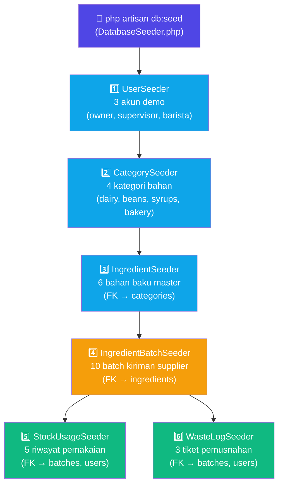

# PLAN 03 — Database Seeder & Test Data
## Modul: Sistem Inventaris Kafe — Data Demo & Seeding

> **Versi**: 1.0.0  
> **Status**: Siap Eksekusi  
> **Dibuat**: 2026-10-31  
> **Prasyarat**: [PLAN_01](./PLAN_01_MIGRATIONS_SCHEMA.md) ✅ Migration selesai | [PLAN_02](./PLAN_02_MODELS_ELOQUENT.md) ✅ Model selesai  
> **Konteks Stack**: Laravel 11, PHP 8.2+, Carbon, Eloquent ORM

---

## 1. TABEL RINGKASAN DATA SEED

| Seeder | File | Jumlah Record | Tujuan Demo |
|--------|------|--------------|-------------|
| `UserSeeder` | `UserSeeder.php` | 3 user | Demonstrasi 3 role (owner, supervisor, barista) dengan login berbeda |
| `CategorySeeder` | `CategorySeeder.php` | 4 kategori | Demonstrasi pengelompokan bahan di master data |
| `IngredientSeeder` | `IngredientSeeder.php` | 6 bahan | Demonstrasi master data bahan dengan batas minimum stok berbeda |
| `IngredientBatchSeeder` | `IngredientBatchSeeder.php` | 10 batch | **Demo semua 3 status expiry** (🔴 kritis, 🟡 warning, 🟢 aman) + semua 4 status batch |
| `StockUsageSeeder` | `StockUsageSeeder.php` | 5 riwayat | Demo pemakaian FEFO compliant & deviasi FEFO dengan alasan |
| `WasteLogSeeder` | `WasteLogSeeder.php` | 3 tiket | Demo workflow approval: pending, approved (dengan financial_loss), rejected |
| **TOTAL** | — | **31 records** | Cakupan semua skenario bisnis PRD |

### Credential Demo (Mudah Diingat untuk Presentasi)

| Role | Email | Password | Nama |
|------|-------|----------|------|
| Owner | `owner@kafe.com` | `password` | Pak Budi (Owner) |
| Supervisor | `supervisor@kafe.com` | `password` | Ibu Sari (Supervisor) |
| Barista | `barista@kafe.com` | `password` | Andi (Barista) |

---

## 2. DIAGRAM URUTAN SEEDER



> [!IMPORTANT]
> StockUsageSeeder dan WasteLogSeeder sama-sama bergantung pada IngredientBatchSeeder dan UserSeeder. Keduanya bisa dijalankan setelah batch selesai — urutan di antara keduanya tidak kritis.

---

## 3. KODE LENGKAP SETIAP SEEDER

---

### 3.1 `DatabaseSeeder.php` — Master Orchestrator

**File**: `database/seeders/DatabaseSeeder.php`

```php
<?php

namespace Database\Seeders;

use Illuminate\Database\Seeder;

class DatabaseSeeder extends Seeder
{
    /**
     * Menjalankan semua seeder dalam urutan yang benar.
     *
     * URUTAN WAJIB (karena foreign key dependency):
     * 1. Users          → tidak ada FK, bisa jalan pertama
     * 2. Categories     → tidak ada FK, bisa jalan setelah users
     * 3. Ingredients    → FK ke categories → harus setelah CategorySeeder
     * 4. IngredientBatches → FK ke ingredients → harus setelah IngredientSeeder
     * 5. StockUsages    → FK ke batches DAN users → harus setelah keduanya
     * 6. WasteLogs      → FK ke batches DAN users → harus setelah keduanya
     */
    public function run(): void
    {
        $this->call([
            UserSeeder::class,
            CategorySeeder::class,
            IngredientSeeder::class,
            IngredientBatchSeeder::class,
            StockUsageSeeder::class,
            WasteLogSeeder::class,
        ]);
    }
}
```

---

### 3.2 `UserSeeder.php` — 3 Akun Demo

**File**: `database/seeders/UserSeeder.php`

```php
<?php

namespace Database\Seeders;

use App\Models\User;
use Illuminate\Database\Seeder;
use Illuminate\Support\Facades\Hash;

class UserSeeder extends Seeder
{
    /**
     * Membuat 3 akun demo untuk presentasi kepada dosen penguji.
     *
     * Menggunakan firstOrCreate() agar seeder idempotent:
     * jika dijalankan dua kali, tidak akan membuat duplikat akun.
     *
     * Semua password = "password" (di-hash dengan bcrypt).
     */
    public function run(): void
    {
        // =====================================================================
        // AKUN OWNER
        // Akses: Semua laporan finansial, dashboard overview
        // Tidak bisa CRUD bahan atau input pemakaian
        // =====================================================================
        User::firstOrCreate(
            ['email' => 'owner@kafe.com'], // Kondisi pencarian (unique key)
            [
                'name'     => 'Pak Budi (Owner)',
                'password' => Hash::make('password'),
                'role'     => 'owner',
            ]
        );

        // =====================================================================
        // AKUN SUPERVISOR
        // Akses: CRUD master data bahan, approve pemusnahan, semua laporan
        // =====================================================================
        User::firstOrCreate(
            ['email' => 'supervisor@kafe.com'],
            [
                'name'     => 'Ibu Sari (Supervisor)',
                'password' => Hash::make('password'),
                'role'     => 'supervisor',
            ]
        );

        // =====================================================================
        // AKUN BARISTA
        // Akses: Input pemakaian harian, lapor bahan rusak
        // =====================================================================
        User::firstOrCreate(
            ['email' => 'barista@kafe.com'],
            [
                'name'     => 'Andi (Barista)',
                'password' => Hash::make('password'),
                'role'     => 'barista',
            ]
        );

        $this->command->info('✅ UserSeeder: 3 akun demo berhasil dibuat.');
    }
}
```

---

### 3.3 `CategorySeeder.php` — 4 Kelompok Bahan

**File**: `database/seeders/CategorySeeder.php`

```php
<?php

namespace Database\Seeders;

use App\Models\Category;
use Illuminate\Database\Seeder;

class CategorySeeder extends Seeder
{
    /**
     * Membuat 4 kategori bahan baku kafe.
     *
     * Slug harus unik dan URL-friendly (lowercase, tanpa spasi).
     * Menggunakan firstOrCreate() agar idempotent.
     */
    public function run(): void
    {
        $categories = [
            // ─── Produk Susu ───────────────────────────────────────────────
            [
                'name' => 'Dairy Products',
                'slug' => 'dairy',
            ],
            // ─── Biji Kopi ─────────────────────────────────────────────────
            [
                'name' => 'Coffee Beans',
                'slug' => 'beans',
            ],
            // ─── Sirup & Perisa ────────────────────────────────────────────
            [
                'name' => 'Syrups & Flavoring',
                'slug' => 'syrups',
            ],
            // ─── Makanan & Bakeri ──────────────────────────────────────────
            [
                'name' => 'Bakery & Food',
                'slug' => 'bakery',
            ],
        ];

        foreach ($categories as $category) {
            Category::firstOrCreate(
                ['slug' => $category['slug']], // Cari berdasarkan slug (unique)
                ['name' => $category['name']]
            );
        }

        $this->command->info('✅ CategorySeeder: 4 kategori berhasil dibuat.');
    }
}
```

---

### 3.4 `IngredientSeeder.php` — 6 Master Bahan Baku

**File**: `database/seeders/IngredientSeeder.php`

```php
<?php

namespace Database\Seeders;

use App\Models\Category;
use App\Models\Ingredient;
use Illuminate\Database\Seeder;

class IngredientSeeder extends Seeder
{
    /**
     * Membuat 6 master data bahan baku kafe.
     *
     * Setiap bahan memiliki:
     * - minimum_stock: batas stok yang memicu alert "stok menipis"
     * - warning_days: berapa hari sebelum expired sistem mulai waspada
     *
     * minimum_stock dan warning_days berbeda per bahan karena:
     * - Susu segar → warning lebih cepat (sensitif, cepat basi)
     * - Biji kopi  → warning lebih lambat (tahan lama, mahal jika terbuang)
     */
    public function run(): void
    {
        // Ambil ID kategori berdasarkan slug (lebih aman dari hardcode ID)
        $dairyId  = Category::where('slug', 'dairy')->value('id');
        $beansId  = Category::where('slug', 'beans')->value('id');
        $syrupsId = Category::where('slug', 'syrups')->value('id');
        $bakeryId = Category::where('slug', 'bakery')->value('id');

        $ingredients = [
            // ─── DAIRY PRODUCTS ───────────────────────────────────────────
            [
                'category_id'   => $dairyId,
                'name'          => 'Fresh Milk Diamond 1L',
                'unit'          => 'botol',
                'minimum_stock' => 5.00,
                'warning_days'  => 3,   // Susu segar: warning 3 hari sebelum expired
            ],
            [
                'category_id'   => $dairyId,
                'name'          => 'UHT Full Cream 1L',
                'unit'          => 'karton',
                'minimum_stock' => 10.00,
                'warning_days'  => 3,   // UHT: warning 3 hari (masa simpan lebih lama tapi tetap pantau)
            ],

            // ─── COFFEE BEANS ─────────────────────────────────────────────
            [
                'category_id'   => $beansId,
                'name'          => 'Espresso Beans Arabica 1kg',
                'unit'          => 'kg',
                'minimum_stock' => 2.00,
                'warning_days'  => 7,   // Kopi: warning 7 hari (lebih tahan lama, mahal)
            ],

            // ─── SYRUPS & FLAVORING ───────────────────────────────────────
            [
                'category_id'   => $syrupsId,
                'name'          => 'Caramel Syrup Monin 1L',
                'unit'          => 'botol',
                'minimum_stock' => 3.00,
                'warning_days'  => 5,
            ],
            [
                'category_id'   => $syrupsId,
                'name'          => 'Vanilla Latte Syrup 750ml',
                'unit'          => 'botol',
                'minimum_stock' => 2.00,
                'warning_days'  => 5,
            ],

            // ─── BAKERY & FOOD ────────────────────────────────────────────
            [
                'category_id'   => $bakeryId,
                'name'          => 'Croissant Frozen',
                'unit'          => 'pcs',
                'minimum_stock' => 20.00,
                'warning_days'  => 2,   // Produk frozen: warning 2 hari (sangat sensitif suhu)
            ],
        ];

        foreach ($ingredients as $ingredient) {
            Ingredient::firstOrCreate(
                [
                    'name'        => $ingredient['name'],
                    'category_id' => $ingredient['category_id'],
                ],
                [
                    'unit'          => $ingredient['unit'],
                    'minimum_stock' => $ingredient['minimum_stock'],
                    'warning_days'  => $ingredient['warning_days'],
                ]
            );
        }

        $this->command->info('✅ IngredientSeeder: 6 bahan baku berhasil dibuat.');
    }
}
```

---

### 3.5 `IngredientBatchSeeder.php` ⭐ — 10 Batch (Semua Skenario)

**File**: `database/seeders/IngredientBatchSeeder.php`

> [!IMPORTANT]
> Semua `expiry_date` menggunakan `Carbon::now()->addDays(N)` — bukan tanggal hardcode. Ini memastikan data demo **selalu relevan** kapanpun seeder dijalankan, termasuk saat presentasi ke dosen.

```php
<?php

namespace Database\Seeders;

use App\Models\Ingredient;
use App\Models\IngredientBatch;
use Carbon\Carbon;
use Illuminate\Database\Seeder;

class IngredientBatchSeeder extends Seeder
{
    /**
     * Membuat 10 batch bahan baku dengan variasi status expiry.
     *
     * TUJUAN DEMO:
     * - Memperlihatkan sistem traffic light early warning (merah/kuning/hijau)
     * - Memperlihatkan algoritma FEFO (batch terdekat expired = batch teratas)
     * - Memperlihatkan semua 4 status lifecycle batch
     *
     * SKEMA EXPIRY (relatif dari hari ini):
     * - addDays(2)  → 🔴 KRITIS  (< 3 hari)
     * - addDays(5)  → 🟡 WARNING (3-7 hari)
     * - addDays(15) → 🟢 AMAN    (> 7 hari)
     * - subDays(3)  → 🔴 KRITIS  (sudah expired, negatif)
     */
    public function run(): void
    {
        // Ambil ID bahan berdasarkan nama (lebih aman dari hardcode ID)
        $milkId      = Ingredient::where('name', 'Fresh Milk Diamond 1L')->value('id');
        $beansId     = Ingredient::where('name', 'Espresso Beans Arabica 1kg')->value('id');
        $caramelId   = Ingredient::where('name', 'Caramel Syrup Monin 1L')->value('id');
        $vanillaId   = Ingredient::where('name', 'Vanilla Latte Syrup 750ml')->value('id');
        $uhtId       = Ingredient::where('name', 'UHT Full Cream 1L')->value('id');
        $croissantId = Ingredient::where('name', 'Croissant Frozen')->value('id');

        $batches = [

            // =================================================================
            // FRESH MILK DIAMOND — 3 BATCH (Demo lengkap traffic light FEFO)
            // =================================================================

            // 🔴 BATCH A — KRITIS: expiry 2 hari lagi
            // Ini yang harus direkomendasikan FEFO pertama!
            [
                'ingredient_id' => $milkId,
                'batch_code'    => 'MILK-A-KRITIS',
                'initial_stock' => 12.00,
                'current_stock' => 3.00,    // Sisa sedikit — sudah hampir habis
                'received_date' => Carbon::now()->subDays(28)->toDateString(),
                'expiry_date'   => Carbon::now()->addDays(2)->toDateString(),   // 🔴 < 3 hari
                'cost_per_unit' => 18500.00,
                'status'        => 'active',
            ],

            // 🟡 BATCH B — WARNING: expiry 5 hari lagi
            // Rekomendasi FEFO kedua setelah Batch A habis
            [
                'ingredient_id' => $milkId,
                'batch_code'    => 'MILK-B-WARNING',
                'initial_stock' => 24.00,
                'current_stock' => 8.00,
                'received_date' => Carbon::now()->subDays(20)->toDateString(),
                'expiry_date'   => Carbon::now()->addDays(5)->toDateString(),   // 🟡 3-7 hari
                'cost_per_unit' => 18500.00,
                'status'        => 'active',
            ],

            // 🟢 BATCH C — AMAN: expiry 15 hari lagi
            // Kiriman terbaru, stok paling banyak, aman
            [
                'ingredient_id' => $milkId,
                'batch_code'    => 'MILK-C-AMAN',
                'initial_stock' => 24.00,
                'current_stock' => 12.00,
                'received_date' => Carbon::now()->subDays(5)->toDateString(),
                'expiry_date'   => Carbon::now()->addDays(15)->toDateString(),  // 🟢 > 7 hari
                'cost_per_unit' => 18500.00,
                'status'        => 'active',
            ],

            // =================================================================
            // ESPRESSO BEANS ARABICA — 1 BATCH (Stok aman, tahan lama)
            // =================================================================

            // 🟢 BATCH A — AMAN: expiry 30 hari lagi (kopi tahan lama)
            [
                'ingredient_id' => $beansId,
                'batch_code'    => 'BEANS-A-AMAN',
                'initial_stock' => 10.00,
                'current_stock' => 5.00,
                'received_date' => Carbon::now()->subDays(10)->toDateString(),
                'expiry_date'   => Carbon::now()->addDays(30)->toDateString(),  // 🟢 > 7 hari
                'cost_per_unit' => 180000.00,
                'status'        => 'active',
            ],

            // =================================================================
            // CARAMEL SYRUP MONIN — 2 BATCH (Demo warning + exhausted)
            // =================================================================

            // 🟡 BATCH A — WARNING: expiry 4 hari lagi
            [
                'ingredient_id' => $caramelId,
                'batch_code'    => 'CARAMEL-A-WARNING',
                'initial_stock' => 6.00,
                'current_stock' => 2.00,
                'received_date' => Carbon::now()->subDays(25)->toDateString(),
                'expiry_date'   => Carbon::now()->addDays(4)->toDateString(),   // 🟡 3-7 hari
                'cost_per_unit' => 145000.00,
                'status'        => 'active',
            ],

            // Status EXHAUSTED — contoh batch yang sudah habis terpakai
            [
                'ingredient_id' => $caramelId,
                'batch_code'    => 'CARAMEL-B-HABIS',
                'initial_stock' => 6.00,
                'current_stock' => 0.00,    // Sudah habis
                'received_date' => Carbon::now()->subDays(60)->toDateString(),
                'expiry_date'   => Carbon::now()->addDays(90)->toDateString(),
                'cost_per_unit' => 140000.00,
                'status'        => 'exhausted', // Lifecycle: habis terpakai
            ],

            // =================================================================
            // VANILLA LATTE SYRUP — 1 BATCH (Stok menipis, aman)
            // =================================================================

            // 🟢 BATCH A — AMAN tapi stok menipis (demo alert minimum stock)
            [
                'ingredient_id' => $vanillaId,
                'batch_code'    => 'VANILLA-A-AMAN',
                'initial_stock' => 4.00,
                'current_stock' => 1.00,    // Di bawah minimum_stock (2 botol) → alert!
                'received_date' => Carbon::now()->subDays(15)->toDateString(),
                'expiry_date'   => Carbon::now()->addDays(20)->toDateString(),  // 🟢 > 7 hari
                'cost_per_unit' => 125000.00,
                'status'        => 'active',
            ],

            // =================================================================
            // UHT FULL CREAM — 1 BATCH (Aman, stok cukup)
            // =================================================================

            [
                'ingredient_id' => $uhtId,
                'batch_code'    => 'UHT-A-AMAN',
                'initial_stock' => 24.00,
                'current_stock' => 18.00,
                'received_date' => Carbon::now()->subDays(3)->toDateString(),
                'expiry_date'   => Carbon::now()->addDays(60)->toDateString(),  // 🟢 UHT tahan lama
                'cost_per_unit' => 22000.00,
                'status'        => 'active',
            ],

            // =================================================================
            // CROISSANT FROZEN — 2 BATCH (Demo status expired + disposed)
            // =================================================================

            // Status EXPIRED — sudah lewat tanggal, belum sempat dimusnahkan
            [
                'ingredient_id' => $croissantId,
                'batch_code'    => 'CROISSANT-A-EXPIRED',
                'initial_stock' => 30.00,
                'current_stock' => 8.00,    // Masih ada stok tapi sudah expired
                'received_date' => Carbon::now()->subDays(20)->toDateString(),
                'expiry_date'   => Carbon::now()->subDays(3)->toDateString(),   // 🔴 Sudah lewat 3 hari
                'cost_per_unit' => 15000.00,
                'status'        => 'expired', // Lifecycle: lewat tanggal expired
            ],

            // Status DISPOSED — sudah resmi dimusnahkan (ada waste log-nya)
            [
                'ingredient_id' => $croissantId,
                'batch_code'    => 'CROISSANT-B-DISPOSED',
                'initial_stock' => 30.00,
                'current_stock' => 0.00,
                'received_date' => Carbon::now()->subDays(45)->toDateString(),
                'expiry_date'   => Carbon::now()->subDays(15)->toDateString(),
                'cost_per_unit' => 14000.00,
                'status'        => 'disposed', // Lifecycle: telah dimusnahkan secara resmi
            ],
        ];

        foreach ($batches as $batch) {
            IngredientBatch::firstOrCreate(
                ['batch_code' => $batch['batch_code']], // batch_code adalah unique key
                [
                    'ingredient_id' => $batch['ingredient_id'],
                    'initial_stock' => $batch['initial_stock'],
                    'current_stock' => $batch['current_stock'],
                    'received_date' => $batch['received_date'],
                    'expiry_date'   => $batch['expiry_date'],
                    'cost_per_unit' => $batch['cost_per_unit'],
                    'status'        => $batch['status'],
                ]
            );
        }

        $this->command->info('✅ IngredientBatchSeeder: 10 batch berhasil dibuat.');
        $this->command->info('   → 🔴 Kritis: MILK-A, CROISSANT-A (expired), CROISSANT-B (disposed)');
        $this->command->info('   → 🟡 Warning: MILK-B, CARAMEL-A');
        $this->command->info('   → 🟢 Aman: MILK-C, BEANS-A, VANILLA-A, UHT-A');
        $this->command->info('   → 💨 Exhausted: CARAMEL-B');
    }
}
```

---

### 3.6 `StockUsageSeeder.php` — 5 Riwayat Pemakaian

**File**: `database/seeders/StockUsageSeeder.php`

```php
<?php

namespace Database\Seeders;

use App\Models\IngredientBatch;
use App\Models\StockUsage;
use App\Models\User;
use Carbon\Carbon;
use Illuminate\Database\Seeder;

class StockUsageSeeder extends Seeder
{
    /**
     * Membuat 5 riwayat pemakaian bahan untuk demo.
     *
     * SKENARIO YANG DICAKUP:
     * 1. Pemakaian FEFO compliant — barista nurut rekomendasi sistem ✅
     * 2. Pemakaian dengan deviasi FEFO — barista pilih batch berbeda ⚠️
     *    (dengan alasan yang valid dan tercatat)
     * 3. Pemakaian oleh supervisor (bukan hanya barista)
     * 4. Pemakaian pada tanggal berbeda (riwayat multi-hari)
     */
    public function run(): void
    {
        // Ambil user berdasarkan email
        $barista    = User::where('email', 'barista@kafe.com')->first();
        $supervisor = User::where('email', 'supervisor@kafe.com')->first();

        // Ambil batch berdasarkan batch_code
        $milkBatchA   = IngredientBatch::where('batch_code', 'MILK-A-KRITIS')->first();
        $milkBatchB   = IngredientBatch::where('batch_code', 'MILK-B-WARNING')->first();
        $milkBatchC   = IngredientBatch::where('batch_code', 'MILK-C-AMAN')->first();
        $beansBatchA  = IngredientBatch::where('batch_code', 'BEANS-A-AMAN')->first();
        $caramelBatchA = IngredientBatch::where('batch_code', 'CARAMEL-A-WARNING')->first();

        $usages = [

            // =================================================================
            // SKENARIO 1: Pemakaian FEFO COMPLIANT ✅
            // Barista dengan benar memilih MILK-A (paling dekat expired)
            // =================================================================
            [
                'ingredient_batch_id' => $milkBatchA->id,
                'user_id'             => $barista->id,
                'quantity_used'       => 2.00,
                'usage_date'          => Carbon::now()->subDays(2)->toDateString(),
                'is_fefo_compliant'   => true,
                'deviation_reason'    => null,  // Tidak perlu alasan jika compliant
                'notes'               => 'Pemakaian untuk latte pagi — sesuai FEFO',
            ],

            // =================================================================
            // SKENARIO 2: Pemakaian dengan DEVIASI FEFO ⚠️
            // Barista pilih MILK-C (yang expired lebih lama) padahal ada MILK-A
            // Alasan: Batch B sudah dibuka lebih dulu di bar — valid secara operasional
            // =================================================================
            [
                'ingredient_batch_id' => $milkBatchC->id,  // Pilih yang expired lebih lama
                'user_id'             => $barista->id,
                'quantity_used'       => 1.50,
                'usage_date'          => Carbon::now()->subDays(1)->toDateString(),
                'is_fefo_compliant'   => false,             // Deviasi dari rekomendasi FEFO
                'deviation_reason'    => 'Batch MILK-B-WARNING sudah dibuka lebih dulu di bar kemarin dan harus diselesaikan terlebih dahulu untuk menghindari kontaminasi',
                'notes'               => null,
            ],

            // =================================================================
            // SKENARIO 3: Pemakaian FEFO compliant oleh SUPERVISOR
            // Supervisor kadang juga input pemakaian saat barista tidak ada
            // =================================================================
            [
                'ingredient_batch_id' => $milkBatchB->id,
                'user_id'             => $supervisor->id,
                'quantity_used'       => 3.00,
                'usage_date'          => Carbon::now()->subDays(3)->toDateString(),
                'is_fefo_compliant'   => true,
                'deviation_reason'    => null,
                'notes'               => 'Input oleh supervisor saat barista izin sakit',
            ],

            // =================================================================
            // SKENARIO 4: Pemakaian biji kopi — FEFO compliant
            // Menampilkan pemakaian bahan selain susu
            // =================================================================
            [
                'ingredient_batch_id' => $beansBatchA->id,
                'user_id'             => $barista->id,
                'quantity_used'       => 0.50,  // 500 gram
                'usage_date'          => Carbon::now()->subDays(1)->toDateString(),
                'is_fefo_compliant'   => true,
                'deviation_reason'    => null,
                'notes'               => 'Grind untuk espresso shot pagi — 0.5 kg',
            ],

            // =================================================================
            // SKENARIO 5: Pemakaian sirup caramel — FEFO compliant
            // Menampilkan pemakaian berbagai jenis bahan
            // =================================================================
            [
                'ingredient_batch_id' => $caramelBatchA->id,
                'user_id'             => $barista->id,
                'quantity_used'       => 0.50,
                'usage_date'          => Carbon::now()->toDateString(),  // Hari ini
                'is_fefo_compliant'   => true,
                'deviation_reason'    => null,
                'notes'               => 'Digunakan untuk 10 gelas caramel macchiato',
            ],
        ];

        foreach ($usages as $usage) {
            // Gunakan kombinasi unik: batch + user + tanggal + kuantitas
            // (tidak ada unique constraint di DB, jadi cek manual)
            StockUsage::firstOrCreate(
                [
                    'ingredient_batch_id' => $usage['ingredient_batch_id'],
                    'user_id'             => $usage['user_id'],
                    'usage_date'          => $usage['usage_date'],
                    'quantity_used'       => $usage['quantity_used'],
                ],
                [
                    'is_fefo_compliant' => $usage['is_fefo_compliant'],
                    'deviation_reason'  => $usage['deviation_reason'],
                    'notes'             => $usage['notes'],
                ]
            );
        }

        $this->command->info('✅ StockUsageSeeder: 5 riwayat pemakaian berhasil dibuat.');
        $this->command->info('   → ✅ FEFO Compliant: 4 pemakaian');
        $this->command->info('   → ⚠️  Deviasi FEFO: 1 pemakaian (dengan alasan tercatat)');
    }
}
```

---

### 3.7 `WasteLogSeeder.php` — 3 Tiket Pemusnahan

**File**: `database/seeders/WasteLogSeeder.php`

```php
<?php

namespace Database\Seeders;

use App\Models\IngredientBatch;
use App\Models\User;
use App\Models\WasteLog;
use Illuminate\Database\Seeder;

class WasteLogSeeder extends Seeder
{
    /**
     * Membuat 3 tiket pemusnahan untuk demo workflow approval.
     *
     * SKENARIO YANG DICAKUP:
     * 1. Tiket PENDING   → Baru dilaporkan, menunggu review supervisor
     * 2. Tiket APPROVED  → Sudah disetujui, financial_loss terhitung
     * 3. Tiket REJECTED  → Ditolak supervisor (misal: data tidak valid)
     *
     * CATATAN PENTING:
     * - financial_loss = waste_quantity × batch.cost_per_unit
     * - Dihitung MANUAL di seeder (di produksi: dihitung Service saat approve)
     * - approved_by dan financial_loss TIDAK melalui $fillable → pakai assignment langsung
     */
    public function run(): void
    {
        // Ambil user berdasarkan email
        $barista    = User::where('email', 'barista@kafe.com')->first();
        $supervisor = User::where('email', 'supervisor@kafe.com')->first();

        // Ambil batch berdasarkan batch_code
        $milkBatchA         = IngredientBatch::where('batch_code', 'MILK-A-KRITIS')->first();
        $croissantDisposed  = IngredientBatch::where('batch_code', 'CROISSANT-B-DISPOSED')->first();
        $caramelBatchA      = IngredientBatch::where('batch_code', 'CARAMEL-A-WARNING')->first();

        // =================================================================
        // TIKET 1: STATUS PENDING — Menunggu review supervisor
        // Barista baru saja lapor susu kritis yang diduga basi
        // =================================================================
        WasteLog::firstOrCreate(
            [
                'ingredient_batch_id' => $milkBatchA->id,
                'reported_by'         => $barista->id,
                'reason'              => 'Susu berbau asam dan menggumpal saat dibuka',
            ],
            [
                'waste_quantity' => 2.00,       // 2 botol yang rusak
                'financial_loss' => null,        // Belum dihitung — masih pending
                'approved_by'    => null,        // Belum ada approver
                'status'         => 'pending',
            ]
        );

        // =================================================================
        // TIKET 2: STATUS APPROVED — Sudah disetujui supervisor
        // Croissant basi yang sudah resmi dimusnahkan + kerugian tercatat
        // financial_loss = 15 pcs × Rp 14.000 = Rp 210.000
        // =================================================================
        $approvedLog = WasteLog::firstOrCreate(
            [
                'ingredient_batch_id' => $croissantDisposed->id,
                'reported_by'         => $barista->id,
                'reason'              => 'Croissant berjamur dan tidak layak dikonsumsi setelah melewati tanggal expired',
            ],
            [
                'waste_quantity' => 15.00,
                'status'         => 'approved',
            ]
        );

        // Isi kolom yang tidak ada di $fillable via direct assignment
        // (financial_loss dan approved_by hanya boleh diisi sistem, bukan dari form)
        if ($approvedLog->wasRecentlyCreated || $approvedLog->approved_by === null) {
            $approvedLog->approved_by    = $supervisor->id;
            $approvedLog->financial_loss = 15.00 * $croissantDisposed->cost_per_unit; // 15 × 14000 = 210000
            $approvedLog->save();
        }

        // =================================================================
        // TIKET 3: STATUS REJECTED — Ditolak supervisor
        // Laporan tidak valid: stok fisik ternyata masih baik setelah dicek
        // =================================================================
        WasteLog::firstOrCreate(
            [
                'ingredient_batch_id' => $caramelBatchA->id,
                'reported_by'         => $barista->id,
                'reason'              => 'Sirup terasa berbeda dari biasanya, kemungkinan kualitas menurun',
            ],
            [
                'waste_quantity' => 1.00,
                'financial_loss' => null,   // Tidak ada kerugian — ditolak
                'approved_by'    => null,   // Tidak perlu approver untuk rejected
                'status'         => 'rejected',
            ]
        );

        $this->command->info('✅ WasteLogSeeder: 3 tiket pemusnahan berhasil dibuat.');
        $this->command->info('   → ⏳ Pending  : 1 tiket (Susu MILK-A menunggu approval)');
        $this->command->info('   → ✅ Approved : 1 tiket (Croissant, financial_loss: Rp 210.000)');
        $this->command->info('   → ❌ Rejected : 1 tiket (Sirup Caramel — laporan tidak valid)');
    }
}
```

---

## 4. SKENARIO DEMO YANG DICAKUP

### 4.1 Checklist Skenario Bisnis

| # | Skenario | Status | Data Pendukung | Terlihat Di |
|---|----------|:------:|----------------|-------------|
| 1 | Tampil batch 🔴 **KRITIS** (< 3 hari) | ✅ | `MILK-A-KRITIS` (2 hari), `CROISSANT-A-EXPIRED` (sudah lewat) | Dashboard Early Warning |
| 2 | Tampil batch 🟡 **WARNING** (3–7 hari) | ✅ | `MILK-B-WARNING` (5 hari), `CARAMEL-A-WARNING` (4 hari) | Dashboard Early Warning |
| 3 | Tampil batch 🟢 **AMAN** (> 7 hari) | ✅ | `MILK-C-AMAN`, `BEANS-A-AMAN`, `UHT-A-AMAN`, `VANILLA-A-AMAN` | Daftar Batch |
| 4 | Demo urutan FEFO (batch terdekat expired = teratas) | ✅ | Milk: A → B → C saat query `fefoOrder()` | Form Pemakaian Barista |
| 5 | Demo pemakaian FEFO compliant | ✅ | `StockUsage` pemakaian 1, 3, 4, 5 | Riwayat Pemakaian |
| 6 | Demo deviasi FEFO dengan alasan | ✅ | `StockUsage` pemakaian 2 (`is_fefo_compliant: false`) | Riwayat Pemakaian, Audit |
| 7 | Demo batch status `exhausted` (habis terpakai) | ✅ | `CARAMEL-B-HABIS` | Daftar Batch (filter status) |
| 8 | Demo batch status `expired` (lewat tanggal) | ✅ | `CROISSANT-A-EXPIRED` | Dashboard Expired Alert |
| 9 | Demo batch status `disposed` (resmi dimusnahkan) | ✅ | `CROISSANT-B-DISPOSED` | Riwayat Pemusnahan |
| 10 | Demo tiket waste **pending** (menunggu approval) | ✅ | WasteLog tiket 1 (Susu MILK-A) | Dashboard Supervisor |
| 11 | Demo tiket waste **approved** + `financial_loss` terhitung | ✅ | WasteLog tiket 2 (Croissant Rp 210.000) | Laporan Finansial Owner |
| 12 | Demo tiket waste **rejected** | ✅ | WasteLog tiket 3 (Sirup Caramel) | Riwayat Pemusnahan |
| 13 | Demo alert stok di bawah minimum | ✅ | `VANILLA-A-AMAN`: current=1, minimum=2 | Dashboard Alert Stok |
| 14 | Demo login 3 role berbeda | ✅ | `owner@kafe.com`, `supervisor@kafe.com`, `barista@kafe.com` | Halaman Login |
| 15 | Input supervisor (bukan hanya barista) | ✅ | StockUsage pemakaian 3 oleh `supervisor@kafe.com` | Audit Trail |

### 4.2 Financial Loss Calculation Reference

| Tiket | Bahan | Jumlah | Cost/Unit | Financial Loss |
|-------|-------|--------|-----------|---------------|
| WasteLog #2 (approved) | Croissant Frozen | 15 pcs | Rp 14.000 | **Rp 210.000** |
| WasteLog #1 (pending) | Fresh Milk Diamond | 2 botol | Rp 18.500 | *belum dihitung* |
| WasteLog #3 (rejected) | Caramel Syrup | 1 botol | Rp 145.000 | *null* |

---

## 5. DOKUMENTASI PEMULA

Lihat file terpisah: [`docs/explanations/03_database_seeder.md`](../explanations/03_database_seeder.md)

---

## 6. AI EXECUTION PROMPT

Salin seluruh blok di bawah ini dan kirimkan ke AI coding assistant untuk mengeksekusi pembuatan semua file Seeder:

---

````
KONTEKS:
Saya punya proyek Laravel 11. Migration dan Model sudah selesai (Modul 01 & 02).
Saya perlu membuat file-file Seeder untuk data demo presentasi.

TUGAS:
Buat file-file Seeder berikut. TIMPA DatabaseSeeder.php yang sudah ada.

PENTING — ATURAN KODE:
- Semua password: Hash::make('password')
- Semua expiry_date: Carbon::now()->addDays(N) — JANGAN hardcode tanggal
- Gunakan firstOrCreate() di semua seeder — bukan create()
- Import Carbon: use Carbon\Carbon; di file yang menggunakannya

=== FILE 1: TIMPA yang ada ===
Path: database/seeders/DatabaseSeeder.php
Isi: Panggil semua seeder dalam urutan:
  UserSeeder → CategorySeeder → IngredientSeeder → IngredientBatchSeeder → StockUsageSeeder → WasteLogSeeder

=== FILE 2 ===
Path: database/seeders/UserSeeder.php
Buat 3 user dengan firstOrCreate cari by email:
  - owner@kafe.com, Hash::make('password'), role: owner, name: 'Pak Budi (Owner)'
  - supervisor@kafe.com, Hash::make('password'), role: supervisor, name: 'Ibu Sari (Supervisor)'
  - barista@kafe.com, Hash::make('password'), role: barista, name: 'Andi (Barista)'

=== FILE 3 ===
Path: database/seeders/CategorySeeder.php
Buat 4 kategori dengan firstOrCreate cari by slug:
  - name: 'Dairy Products', slug: 'dairy'
  - name: 'Coffee Beans', slug: 'beans'
  - name: 'Syrups & Flavoring', slug: 'syrups'
  - name: 'Bakery & Food', slug: 'bakery'

=== FILE 4 ===
Path: database/seeders/IngredientSeeder.php
Ambil category ID via: Category::where('slug', '...')->value('id')
Buat 6 bahan dengan firstOrCreate cari by [name, category_id]:
  - 'Fresh Milk Diamond 1L', dairy, unit: botol, min_stock: 5, warning_days: 3
  - 'UHT Full Cream 1L', dairy, unit: karton, min_stock: 10, warning_days: 3
  - 'Espresso Beans Arabica 1kg', beans, unit: kg, min_stock: 2, warning_days: 7
  - 'Caramel Syrup Monin 1L', syrups, unit: botol, min_stock: 3, warning_days: 5
  - 'Vanilla Latte Syrup 750ml', syrups, unit: botol, min_stock: 2, warning_days: 5
  - 'Croissant Frozen', bakery, unit: pcs, min_stock: 20, warning_days: 2

=== FILE 5 (PALING PENTING) ===
Path: database/seeders/IngredientBatchSeeder.php
Ambil ingredient ID via: Ingredient::where('name', '...')->value('id')
Buat 10 batch dengan firstOrCreate cari by batch_code:
  - MILK-A-KRITIS: milkId, initial:12, current:3, received: -28d, expiry: +2d, cost:18500, status:active
  - MILK-B-WARNING: milkId, initial:24, current:8, received: -20d, expiry: +5d, cost:18500, status:active
  - MILK-C-AMAN: milkId, initial:24, current:12, received: -5d, expiry: +15d, cost:18500, status:active
  - BEANS-A-AMAN: beansId, initial:10, current:5, received: -10d, expiry: +30d, cost:180000, status:active
  - CARAMEL-A-WARNING: caramelId, initial:6, current:2, received: -25d, expiry: +4d, cost:145000, status:active
  - CARAMEL-B-HABIS: caramelId, initial:6, current:0, received: -60d, expiry: +90d, cost:140000, status:exhausted
  - VANILLA-A-AMAN: vanillaId, initial:4, current:1, received: -15d, expiry: +20d, cost:125000, status:active
  - UHT-A-AMAN: uhtId, initial:24, current:18, received: -3d, expiry: +60d, cost:22000, status:active
  - CROISSANT-A-EXPIRED: croissantId, initial:30, current:8, received: -20d, expiry: -3d, cost:15000, status:expired
  - CROISSANT-B-DISPOSED: croissantId, initial:30, current:0, received: -45d, expiry: -15d, cost:14000, status:disposed

=== FILE 6 ===
Path: database/seeders/StockUsageSeeder.php
Ambil user by email. Ambil batch by batch_code.
Buat 5 stock_usage dengan firstOrCreate cari by [ingredient_batch_id, user_id, usage_date, quantity_used]:
  1. MILK-A + barista, qty:2.0, date:-2d, is_fefo_compliant:true, deviation_reason:null
  2. MILK-C + barista, qty:1.5, date:-1d, is_fefo_compliant:false, deviation_reason:'Batch MILK-B-WARNING sudah dibuka lebih dulu di bar kemarin dan harus diselesaikan terlebih dahulu untuk menghindari kontaminasi'
  3. MILK-B + supervisor, qty:3.0, date:-3d, is_fefo_compliant:true, notes:'Input oleh supervisor saat barista izin sakit'
  4. BEANS-A + barista, qty:0.5, date:-1d, is_fefo_compliant:true
  5. CARAMEL-A + barista, qty:0.5, date:today, is_fefo_compliant:true

=== FILE 7 ===
Path: database/seeders/WasteLogSeeder.php
Ambil user by email. Ambil batch by batch_code.
PENTING: approved_by dan financial_loss TIDAK di $fillable → pakai direct assignment + save()

Buat 3 waste_log dengan firstOrCreate cari by [ingredient_batch_id, reported_by, reason]:
  TIKET 1 (pending):
    batch: MILK-A-KRITIS, reported_by: barista, qty:2.0, reason:'Susu berbau asam dan menggumpal saat dibuka'
    status:pending, approved_by:null, financial_loss:null

  TIKET 2 (approved):
    batch: CROISSANT-B-DISPOSED, reported_by: barista, qty:15.0, reason:'Croissant berjamur dan tidak layak dikonsumsi setelah melewati tanggal expired'
    status:approved
    SETELAH CREATE: $log->approved_by = supervisor->id; $log->financial_loss = 15 * 14000; $log->save();

  TIKET 3 (rejected):
    batch: CARAMEL-A-WARNING, reported_by: barista, qty:1.0, reason:'Sirup terasa berbeda dari biasanya, kemungkinan kualitas menurun'
    status:rejected, approved_by:null, financial_loss:null

PERINTAH EKSEKUSI:
```bash
# Reset database dan jalankan semua seeder dari awal
php artisan migrate:fresh --seed

# ATAU jika hanya ingin re-seed tanpa reset schema:
php artisan db:seed

# Verifikasi FEFO order (batch susu harus urut A→B→C)
php artisan tinker --execute="
  \$batches = App\Models\IngredientBatch::forIngredient(
    App\Models\Ingredient::where('name', 'Fresh Milk Diamond 1L')->value('id')
  )->active()->fefoOrder()->get(['batch_code', 'expiry_date', 'status']);
  print_r(\$batches->toArray());
"

# Verifikasi early warning dashboard
php artisan tinker --execute="
  \$warning = App\Models\IngredientBatch::active()->criticalExpiry(7)->fefoOrder()
    ->with('ingredient')->get(['batch_code', 'expiry_date', 'ingredient_id']);
  print_r(\$warning->toArray());
"

# Verifikasi waste log dengan financial_loss
php artisan tinker --execute="
  print_r(App\Models\WasteLog::with(['reporter', 'approver', 'batch'])->get()->toArray());
"

# Verifikasi accessor expiry_status
php artisan tinker --execute="
  \$batch = App\Models\IngredientBatch::where('batch_code', 'MILK-A-KRITIS')->first();
  echo 'Status: ' . \$batch->expiry_status . PHP_EOL;
  echo 'Days: ' . \$batch->days_until_expiry . PHP_EOL;
  echo 'Value: ' . \$batch->total_value . PHP_EOL;
"
```

KRITERIA SUKSES SETELAH SEEDER:
- php artisan db:seed berjalan tanpa error
- Ada 3 user di tabel users
- Ada 4 kategori di tabel categories
- Ada 6 bahan di tabel ingredients
- Ada 10 batch di tabel ingredient_batches dengan status bervariasi
- MILK-A-KRITIS memiliki expiry_status = 'critical'
- MILK-B-WARNING memiliki expiry_status = 'warning'
- MILK-C-AMAN memiliki expiry_status = 'safe'
- WasteLog dengan status 'approved' memiliki financial_loss = 210000
- Login dengan owner@kafe.com / password berhasil masuk ke dashboard
````

---

> **Catatan Ponytail Sign-off**:  
> Sengaja tidak membuat Factory Laravel karena data demo ini sangat spesifik dan terkontrol — Factory lebih cocok untuk unit testing dengan data random. Risiko yang perlu diperhatikan: `firstOrCreate()` hanya idempotent selama kolom pencarian (parameter pertama) tidak berubah. Jika ada field yang ingin diperbarui di seed yang sudah dijalankan, gunakan `updateOrCreate()` sebagai gantinya.
