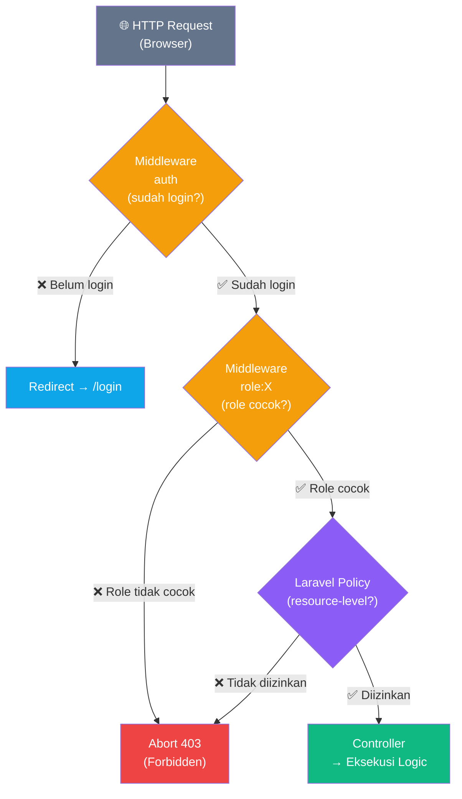
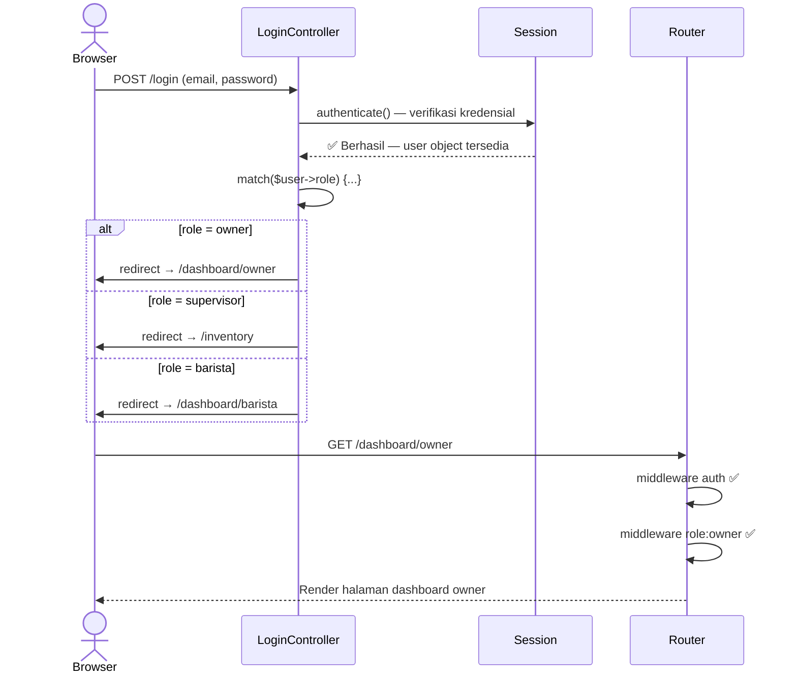

# PLAN 04 — Autentikasi Backend & RBAC Middleware
## Modul: Sistem Inventaris Kafe — Auth, Role Guard, dan Proteksi Rute

> **Versi**: 1.0.0  
> **Status**: Siap Eksekusi  
> **Dibuat**: 2026-10-31  
> **Prasyarat**: [PLAN_02](./PLAN_02_MODELS_ELOQUENT.md) ✅ Model `User` dengan kolom `role` tersedia  
> **Konteks Stack**: Laravel 11, Inertia.js, Session Cookie Auth (bukan JWT/API Token)

---

## 1. ARSITEKTUR KEAMANAN — GAMBARAN BESAR



### Tiga Lapis Keamanan

| Layer | Mekanisme | Di mana | Memeriksa |
|-------|-----------|---------|-----------|
| **Layer 1** | `auth` middleware | Semua rute | Apakah user sudah login? |
| **Layer 2** | `RoleMiddleware` | Grup rute | Apakah role user sesuai? |
| **Layer 3** | Laravel Policy | Dalam Controller | Apakah user berhak atas resource spesifik ini? |

> [!IMPORTANT]
> **Mengapa tiga lapis?** Middleware hanya bisa cek role secara umum ("supervisor bisa approve waste"). Policy bisa cek kondisi spesifik ("supervisor hanya bisa approve waste yang masih `pending`, bukan yang sudah `approved`"). Keduanya saling melengkapi — jangan hanya andalkan satu lapis.

---

## 2. MATRIKS RBAC LENGKAP

| Aksi / Rute | Owner | Supervisor | Barista | Middleware Guard |
|-------------|:-----:|:----------:|:-------:|-----------------|
| Lihat Dashboard Owner | ✅ | ❌ | ❌ | `role:owner` |
| Laporan Finansial & Export | ✅ | ❌ | ❌ | `role:owner` |
| CRUD Master Bahan (`/ingredients`) | ❌ | ✅ | ❌ | `role:supervisor` |
| CRUD Master Kategori (`/categories`) | ❌ | ✅ | ❌ | `role:supervisor` |
| Approve/Reject Waste Disposal | ❌ | ✅ | ❌ | `role:supervisor` + Policy |
| Input Batch Restock (`POST /batches`) | ❌ | ✅ | ✅ | `role:supervisor,barista` |
| Input Pemakaian Harian (`POST /stock-usages`) | ❌ | ✅ | ✅ | `role:supervisor,barista` |
| Buat Tiket Waste (`POST /waste-logs`) | ❌ | ✅ | ✅ | `role:supervisor,barista` |
| Lihat Daftar Batch & Inventory | ✅ | ✅ | ✅ | `auth` saja |
| Lihat Riwayat Stock Usage | ✅ | ✅ | ✅ | `auth` saja |
| Lihat Daftar Waste Logs | ✅ | ✅ | ✅ | `auth` saja |

---

## 3. DIAGRAM ALUR LOGIN & REDIRECT ROLE



---

## 4. SPESIFIKASI FILE PER-FILE

---

### 4.1 `RoleMiddleware.php` — Custom Middleware RBAC

**File**: `app/Http/Middleware/RoleMiddleware.php`

**Konsep**: Satu middleware universal yang menerima parameter role. Lebih bersih dari membuat middleware terpisah per role (`OwnerMiddleware`, `SupervisorMiddleware`, dst.).

```php
<?php

namespace App\Http\Middleware;

use Closure;
use Illuminate\Http\Request;
use Symfony\Component\HttpFoundation\Response;

class RoleMiddleware
{
    /**
     * Memeriksa apakah role user yang login sesuai dengan role yang diizinkan.
     *
     * CARA KERJA:
     * - Menerima parameter role yang dipisah koma: 'role:supervisor,barista'
     * - Laravel otomatis parsing koma → array saat di-use di route
     * - Jika role user TIDAK ada dalam daftar → abort 403 (Forbidden)
     * - Jika user belum login → middleware 'auth' sudah menanganinya lebih dulu
     *
     * PENGGUNAAN DI ROUTE:
     * ->middleware('role:supervisor')              // Hanya supervisor
     * ->middleware('role:supervisor,barista')      // Supervisor ATAU barista
     * ->middleware('role:owner')                   // Hanya owner
     *
     * @param Request $request
     * @param Closure $next
     * @param string ...$roles — Satu atau lebih role yang diizinkan
     * @return Response
     */
    public function handle(Request $request, Closure $next, string ...$roles): Response
    {
        // Guard: pastikan user sudah login sebelum cek role
        // (normalnya sudah ditangani middleware 'auth' di layer sebelumnya)
        if (!$request->user()) {
            return redirect()->route('login');
        }

        // Cek apakah role user ada di daftar role yang diizinkan
        if (!in_array($request->user()->role, $roles)) {
            // 403 Forbidden — user sudah login tapi tidak punya akses
            // Inertia-aware: redirect ke halaman 403 yang dirender Inertia
            abort(403, 'Akses ditolak. Role Anda tidak memiliki izin untuk halaman ini.');
        }

        return $next($request);
    }
}
```

**Registrasi di `bootstrap/app.php`** (Laravel 11 — tidak lagi pakai `Kernel.php`):

```php
<?php

use Illuminate\Foundation\Application;
use Illuminate\Foundation\Configuration\Exceptions;
use Illuminate\Foundation\Configuration\Middleware;

return Application::configure(basePath: dirname(__DIR__))
    ->withRouting(
        web: __DIR__.'/../routes/web.php',
        commands: __DIR__.'/../routes/console.php',
        health: '/up',
    )
    ->withMiddleware(function (Middleware $middleware) {
        $middleware->web(append: [
            \App\Http\Middleware\HandleInertiaRequests::class,
            \Illuminate\Http\Middleware\AddLinkHeadersForPreloadedAssets::class,
        ]);

        // =====================================================================
        // REGISTRASI CUSTOM MIDDLEWARE — TAMBAHKAN BLOK INI
        // =====================================================================
        $middleware->alias([
            // Alias 'role' → bisa dipakai sebagai ->middleware('role:supervisor')
            'role' => \App\Http\Middleware\RoleMiddleware::class,
        ]);
    })
    ->withExceptions(function (Exceptions $exceptions) {
        //
    })->create();
```

> [!NOTE]
> Di **Laravel 11**, middleware didaftarkan via `$middleware->alias()` di `bootstrap/app.php` — bukan lagi di `app/Http/Kernel.php` seperti Laravel 10 ke bawah. File `Kernel.php` sudah dihapus di Laravel 11.

---

### 4.2 `AuthenticatedSessionController.php` — Redirect Login Berbasis Role

**File**: `app/Http/Controllers/Auth/AuthenticatedSessionController.php`  
**Aksi**: **MODIFIKASI** file yang sudah ada — ubah method `store()` saja.

```php
<?php

namespace App\Http\Controllers\Auth;

use App\Http\Controllers\Controller;
use App\Http\Requests\Auth\LoginRequest;
use Illuminate\Http\RedirectResponse;
use Illuminate\Http\Request;
use Illuminate\Support\Facades\Auth;
use Illuminate\Support\Facades\Route;
use Inertia\Inertia;
use Inertia\Response;

class AuthenticatedSessionController extends Controller
{
    /**
     * Tampilkan halaman form login.
     * Tidak ada perubahan dari bawaan Laravel.
     */
    public function create(): Response
    {
        return Inertia::render('Auth/Login', [
            'canResetPassword' => Route::has('password.request'),
            'status'           => session('status'),
        ]);
    }

    /**
     * Proses login dan redirect sesuai role user.
     *
     * PERUBAHAN DARI DEFAULT LARAVEL:
     * Default Laravel: redirect ke route('dashboard') untuk semua user.
     * Versi ini: redirect ke halaman yang sesuai dengan role masing-masing.
     *
     * ALASAN:
     * - Owner tidak perlu lihat inventory harian → langsung ke laporan finansial
     * - Supervisor butuh overview inventory → langsung ke halaman inventory
     * - Barista butuh akses cepat ke form pemakaian → ke dashboard operasional
     *
     * Menggunakan intended() agar jika user mencoba akses halaman tertentu
     * sebelum login, mereka diarahkan ke halaman itu setelah berhasil login.
     * Fallback: redirect sesuai role.
     */
    public function store(LoginRequest $request): RedirectResponse
    {
        $request->authenticate();

        $request->session()->regenerate();

        /** @var \App\Models\User $user */
        $user = Auth::user();

        // Tentukan halaman tujuan berdasarkan role
        $intendedRoute = match ($user->role) {
            'owner'      => route('dashboard.owner', absolute: false),
            'supervisor' => route('inventory.index', absolute: false),
            'barista'    => route('dashboard.barista', absolute: false),
            default      => route('inventory.index', absolute: false), // fallback aman
        };

        // intended() → jika ada URL yang dicoba sebelum login, ke sana dulu.
        // Kalau tidak ada, pakai $intendedRoute sesuai role.
        return redirect()->intended($intendedRoute);
    }

    /**
     * Logout: hancurkan sesi dan redirect ke halaman utama.
     * Tidak ada perubahan dari bawaan Laravel.
     */
    public function destroy(Request $request): RedirectResponse
    {
        Auth::guard('web')->logout();

        $request->session()->invalidate();
        $request->session()->regenerateToken();

        return redirect('/');
    }
}
```

---

### 4.3 `WasteLogPolicy.php` — Policy Resource-Level untuk Approval

**File**: `app/Policies/WasteLogPolicy.php`

**Tujuan**: Middleware `role:supervisor` sudah memastikan hanya supervisor yang bisa akses endpoint approve. Policy ini menambahkan **validasi kondisi bisnis**: supervisor hanya bisa approve waste yang masih `pending`, tidak bisa approve yang sudah `approved` atau `rejected`.

```php
<?php

namespace App\Policies;

use App\Models\User;
use App\Models\WasteLog;

class WasteLogPolicy
{
    /**
     * Supervisor bisa lihat semua waste log (termasuk milik barista lain).
     * Owner dan barista juga bisa lihat — hanya dibatasi di level view.
     */
    public function view(User $user, WasteLog $wasteLog): bool
    {
        // Semua role yang authenticated boleh lihat daftar waste log
        return true;
    }

    /**
     * Barista dan Supervisor boleh buat tiket waste baru.
     * Owner tidak boleh buat tiket (hanya baca laporan).
     */
    public function create(User $user): bool
    {
        return in_array($user->role, ['supervisor', 'barista']);
    }

    /**
     * POLICY KRITIS: Siapa yang boleh APPROVE waste log?
     *
     * Syarat yang HARUS terpenuhi (semua):
     * 1. User yang approve harus SUPERVISOR (bukan barista, bukan owner)
     * 2. Waste log yang di-approve harus masih berstatus 'pending'
     *    → Tidak bisa approve yang sudah 'approved' atau 'rejected'
     * 3. Supervisor TIDAK bisa approve tiket yang dia sendiri yang buat
     *    (four-eyes principle — prinsip empat mata)
     *
     * Alasan syarat #3: mencegah supervisor membuat tiket palsu lalu
     * langsung menyetujuinya sendiri tanpa pengawasan.
     *
     * @param User $user — User yang sedang melakukan aksi approve
     * @param WasteLog $wasteLog — Tiket yang ingin di-approve
     * @return bool
     */
    public function approve(User $user, WasteLog $wasteLog): bool
    {
        return $user->role === 'supervisor'
            && $wasteLog->status === 'pending'
            && $wasteLog->reported_by !== $user->id; // Four-eyes principle
    }

    /**
     * POLICY KRITIS: Siapa yang boleh REJECT waste log?
     *
     * Syarat sama dengan approve — supervisor, masih pending, bukan pembuat sendiri.
     *
     * @param User $user
     * @param WasteLog $wasteLog
     * @return bool
     */
    public function reject(User $user, WasteLog $wasteLog): bool
    {
        return $user->role === 'supervisor'
            && $wasteLog->status === 'pending'
            && $wasteLog->reported_by !== $user->id;
    }

    /**
     * Owner tidak bisa hapus waste log (audit trail permanen).
     * Tidak ada yang bisa delete waste log — return false untuk semua.
     */
    public function delete(User $user, WasteLog $wasteLog): bool
    {
        return false; // Hard delete dilarang per business rule
    }
}
```

**Registrasi Policy di `AppServiceProvider`** (Laravel 11 — auto-discovery aktif, tapi bisa eksplisit):

```php
<?php
// app/Providers/AppServiceProvider.php

namespace App\Providers;

use App\Models\WasteLog;
use App\Policies\WasteLogPolicy;
use App\Models\Ingredient;
use App\Policies\IngredientPolicy;
use Illuminate\Support\Facades\Gate;
use Illuminate\Support\ServiceProvider;

class AppServiceProvider extends ServiceProvider
{
    public function boot(): void
    {
        // Eksplisit mapping model → policy
        // (Jika auto-discovery aktif dan naming convention diikuti, ini opsional)
        Gate::policy(WasteLog::class, WasteLogPolicy::class);
        Gate::policy(Ingredient::class, IngredientPolicy::class);
    }
}
```

---

### 4.4 `IngredientPolicy.php` — Policy CRUD Master Bahan

**File**: `app/Policies/IngredientPolicy.php`

**Tujuan**: Melindungi operasi CRUD master data bahan. Meski middleware `role:supervisor` sudah melindungi di level rute, Policy ini memungkinkan pengecekan per-resource jika diperlukan di masa depan (misalnya: supervisor hanya bisa edit bahan di kategori yang dia manage).

```php
<?php

namespace App\Policies;

use App\Models\Ingredient;
use App\Models\User;

class IngredientPolicy
{
    /**
     * Semua user yang sudah login boleh lihat daftar bahan.
     * (Dashboard barista juga menampilkan nama bahan)
     */
    public function viewAny(User $user): bool
    {
        return true;
    }

    /**
     * Semua user yang sudah login boleh lihat detail satu bahan.
     */
    public function view(User $user, Ingredient $ingredient): bool
    {
        return true;
    }

    /**
     * Hanya supervisor yang boleh membuat bahan baru.
     * Owner dan barista → false.
     */
    public function create(User $user): bool
    {
        return $user->role === 'supervisor';
    }

    /**
     * Hanya supervisor yang boleh mengedit bahan.
     *
     * Catatan: tidak ada pembatasan per-bahan (supervisor bisa edit semua bahan).
     * Jika di masa depan perlu pembatasan per-kategori, tambahkan kondisi di sini.
     */
    public function update(User $user, Ingredient $ingredient): bool
    {
        return $user->role === 'supervisor';
    }

    /**
     * Hanya supervisor yang boleh menghapus bahan.
     *
     * PERHATIAN: Di production, hapus bahan yang sudah punya batch aktif
     * harus dicegah di level Controller (cek ->batches()->exists() dulu).
     * Policy ini hanya mengecek role — bukan apakah aman untuk dihapus.
     */
    public function delete(User $user, Ingredient $ingredient): bool
    {
        return $user->role === 'supervisor';
    }
}
```

---

### 4.5 `routes/web.php` — Rute Lengkap dengan Grup Middleware

**File**: `routes/web.php`  
**Aksi**: **TIMPA** seluruh file dengan versi baru.

```php
<?php

use App\Http\Controllers\Auth\AuthenticatedSessionController;
use App\Http\Controllers\CategoryController;
use App\Http\Controllers\DashboardController;
use App\Http\Controllers\IngredientBatchController;
use App\Http\Controllers\IngredientController;
use App\Http\Controllers\ProfileController;
use App\Http\Controllers\StockUsageController;
use App\Http\Controllers\WasteLogController;
use Illuminate\Support\Facades\Route;
use Inertia\Inertia;

// =============================================================================
// PUBLIC ROUTES — Tidak perlu login
// =============================================================================

Route::get('/', function () {
    // Halaman landing / redirect ke login
    return redirect()->route('login');
});

// =============================================================================
// AUTHENTICATED ROUTES — Semua perlu login (middleware 'auth')
// =============================================================================

Route::middleware(['auth'])->group(function () {

    // ─── Profile (bawaan Laravel Breeze) ────────────────────────────────────
    Route::get('/profile', [ProfileController::class, 'edit'])->name('profile.edit');
    Route::patch('/profile', [ProfileController::class, 'update'])->name('profile.update');
    Route::delete('/profile', [ProfileController::class, 'destroy'])->name('profile.destroy');

    // ─── DASHBOARD SEMUA ROLE (auth saja, tanpa role filter) ────────────────
    // Inventory index bisa dilihat semua role (owner hanya baca, supervisor & barista lebih banyak)
    Route::get('/inventory', [IngredientBatchController::class, 'index'])
        ->name('inventory.index');

    // Daftar waste log (semua role bisa lihat, berbeda data yang ditampilkan per role)
    Route::get('/waste-logs', [WasteLogController::class, 'index'])
        ->name('waste-logs.index');

    // Riwayat pemakaian stok (semua role bisa lihat)
    Route::get('/stock-usages', [StockUsageController::class, 'index'])
        ->name('stock-usages.index');

    // ─── DASHBOARD BARISTA ───────────────────────────────────────────────────
    // Dashboard operasional: form pemakaian + early warning sederhana
    // Semua staff boleh akses (barista & supervisor butuh ini)
    Route::get('/dashboard/barista', [DashboardController::class, 'barista'])
        ->name('dashboard.barista');

    // =========================================================================
    // GRUP BARISTA & SUPERVISOR — Input operasional harian
    // =========================================================================
    Route::middleware(['role:barista,supervisor'])->group(function () {

        // Input pemakaian bahan harian (POST only — form di halaman lain)
        Route::post('/stock-usages', [StockUsageController::class, 'store'])
            ->name('stock-usages.store');

        // Input restock batch baru dari supplier
        Route::get('/batches/create', [IngredientBatchController::class, 'create'])
            ->name('batches.create');
        Route::post('/batches', [IngredientBatchController::class, 'store'])
            ->name('batches.store');

        // Buat tiket pemusnahan baru (barista lapor, supervisor juga bisa)
        Route::get('/waste-logs/create', [WasteLogController::class, 'create'])
            ->name('waste-logs.create');
        Route::post('/waste-logs', [WasteLogController::class, 'store'])
            ->name('waste-logs.store');
    });

    // =========================================================================
    // GRUP SUPERVISOR ONLY — Manajemen & Approval
    // =========================================================================
    Route::middleware(['role:supervisor'])->group(function () {

        // ─── CRUD Master Kategori ────────────────────────────────────────────
        // Resource route kecuali 'show' (detail kategori tidak diperlukan terpisah)
        Route::resource('categories', CategoryController::class)
            ->except(['show'])
            ->names([
                'index'   => 'categories.index',
                'create'  => 'categories.create',
                'store'   => 'categories.store',
                'edit'    => 'categories.edit',
                'update'  => 'categories.update',
                'destroy' => 'categories.destroy',
            ]);

        // ─── CRUD Master Bahan Baku ──────────────────────────────────────────
        Route::resource('ingredients', IngredientController::class)
            ->except(['show'])
            ->names([
                'index'   => 'ingredients.index',
                'create'  => 'ingredients.create',
                'store'   => 'ingredients.store',
                'edit'    => 'ingredients.edit',
                'update'  => 'ingredients.update',
                'destroy' => 'ingredients.destroy',
            ]);

        // ─── Manajemen Batch (edit & hapus — hanya supervisor) ──────────────
        Route::get('/batches/{batch}/edit', [IngredientBatchController::class, 'edit'])
            ->name('batches.edit');
        Route::patch('/batches/{batch}', [IngredientBatchController::class, 'update'])
            ->name('batches.update');

        // ─── Approval Workflow Waste Log ─────────────────────────────────────
        // PATCH (bukan DELETE) — mengubah status, tidak menghapus
        Route::patch('/waste-logs/{wasteLog}/approve', [WasteLogController::class, 'approve'])
            ->name('waste-logs.approve');
        Route::patch('/waste-logs/{wasteLog}/reject', [WasteLogController::class, 'reject'])
            ->name('waste-logs.reject');
    });

    // =========================================================================
    // GRUP OWNER ONLY — Laporan & Analitik Finansial
    // =========================================================================
    Route::middleware(['role:owner'])->group(function () {

        // Dashboard owner: grafik tren waste, cost analysis, summary
        Route::get('/dashboard/owner', [DashboardController::class, 'owner'])
            ->name('dashboard.owner');

        // Laporan analitik finansial (view)
        Route::get('/analytics', [DashboardController::class, 'analytics'])
            ->name('analytics.index');

        // Export laporan ke CSV/PDF
        Route::get('/analytics/export', [DashboardController::class, 'export'])
            ->name('analytics.export');
    });
});

// =============================================================================
// AUTH ROUTES — Login, logout (dari routes/auth.php bawaan Breeze)
// =============================================================================
require __DIR__.'/auth.php';
```

---

### 4.6 Cara Menggunakan Policy di Controller

**Contoh implementasi di `WasteLogController.php`**:

```php
<?php

namespace App\Http\Controllers;

use App\Models\WasteLog;
use Illuminate\Http\RedirectResponse;
use Illuminate\Http\Request;
use Illuminate\Support\Facades\Auth;
use Illuminate\Support\Facades\DB;

class WasteLogController extends Controller
{
    /**
     * Tampilkan daftar waste log — semua role bisa akses.
     * Data yang ditampilkan berbeda per role (dikontrol di query atau di frontend).
     */
    public function index()
    {
        // ...
    }

    /**
     * Proses approval waste log oleh supervisor.
     *
     * Middleware 'role:supervisor' sudah dipastikan di route.
     * Policy '$this->authorize()' menambahkan validasi kondisi bisnis:
     * - Status harus 'pending'
     * - Supervisor bukan pembuat tiket (four-eyes principle)
     */
    public function approve(Request $request, WasteLog $wasteLog): RedirectResponse
    {
        // Policy check — jika gagal → otomatis throw AuthorizationException (403)
        $this->authorize('approve', $wasteLog);

        DB::transaction(function () use ($wasteLog) {
            // Hitung kerugian finansial
            $financialLoss = $wasteLog->waste_quantity
                * $wasteLog->batch->cost_per_unit;

            // Update status dan isi kolom yang tidak ada di $fillable
            $wasteLog->status         = 'approved';
            $wasteLog->approved_by    = Auth::id();
            $wasteLog->financial_loss = $financialLoss;
            $wasteLog->save();

            // Update status batch menjadi disposed jika seluruh stok habis
            $batch = $wasteLog->batch;
            $batch->decrement('current_stock', $wasteLog->waste_quantity);

            if ($batch->fresh()->current_stock <= 0) {
                $batch->update(['status' => 'disposed']);
            }
        });

        return redirect()->route('waste-logs.index')
            ->with('success', 'Pemusnahan berhasil disetujui. Kerugian tercatat.');
    }

    /**
     * Proses penolakan waste log oleh supervisor.
     */
    public function reject(Request $request, WasteLog $wasteLog): RedirectResponse
    {
        // Policy check
        $this->authorize('reject', $wasteLog);

        $wasteLog->update(['status' => 'rejected']);

        return redirect()->route('waste-logs.index')
            ->with('info', 'Laporan pemusnahan telah ditolak.');
    }
}
```

---

## 5. PANDUAN REFERENSI CEPAT

### 5.1 Semua Kombinasi Middleware yang Digunakan

| Kombinasi | Rute | Artinya |
|-----------|------|---------|
| `['auth']` | `/inventory`, `/waste-logs`, `/stock-usages` | Semua yang sudah login |
| `['auth', 'role:barista,supervisor']` | `POST /stock-usages`, `POST /batches`, `POST /waste-logs` | Hanya staff operasional |
| `['auth', 'role:supervisor']` | `/categories/*`, `/ingredients/*`, `/waste-logs/*/approve` | Hanya supervisor |
| `['auth', 'role:owner']` | `/dashboard/owner`, `/analytics/*` | Hanya owner |

### 5.2 Daftar Semua Named Routes

| Nama Route | Method | URL | Guard |
|-----------|--------|-----|-------|
| `login` | GET | `/login` | guest |
| `login.post` | POST | `/login` | guest |
| `logout` | POST | `/logout` | auth |
| `dashboard.owner` | GET | `/dashboard/owner` | auth + role:owner |
| `dashboard.barista` | GET | `/dashboard/barista` | auth |
| `inventory.index` | GET | `/inventory` | auth |
| `categories.index` | GET | `/categories` | auth + role:supervisor |
| `categories.create` | GET | `/categories/create` | auth + role:supervisor |
| `categories.store` | POST | `/categories` | auth + role:supervisor |
| `categories.edit` | GET | `/categories/{id}/edit` | auth + role:supervisor |
| `categories.update` | PUT/PATCH | `/categories/{id}` | auth + role:supervisor |
| `categories.destroy` | DELETE | `/categories/{id}` | auth + role:supervisor |
| `ingredients.index` | GET | `/ingredients` | auth + role:supervisor |
| `ingredients.create` | GET | `/ingredients/create` | auth + role:supervisor |
| `ingredients.store` | POST | `/ingredients` | auth + role:supervisor |
| `ingredients.edit` | GET | `/ingredients/{id}/edit` | auth + role:supervisor |
| `ingredients.update` | PUT/PATCH | `/ingredients/{id}` | auth + role:supervisor |
| `ingredients.destroy` | DELETE | `/ingredients/{id}` | auth + role:supervisor |
| `batches.create` | GET | `/batches/create` | auth + role:supervisor,barista |
| `batches.store` | POST | `/batches` | auth + role:supervisor,barista |
| `batches.edit` | GET | `/batches/{id}/edit` | auth + role:supervisor |
| `batches.update` | PATCH | `/batches/{id}` | auth + role:supervisor |
| `stock-usages.index` | GET | `/stock-usages` | auth |
| `stock-usages.store` | POST | `/stock-usages` | auth + role:supervisor,barista |
| `waste-logs.index` | GET | `/waste-logs` | auth |
| `waste-logs.create` | GET | `/waste-logs/create` | auth + role:supervisor,barista |
| `waste-logs.store` | POST | `/waste-logs` | auth + role:supervisor,barista |
| `waste-logs.approve` | PATCH | `/waste-logs/{id}/approve` | auth + role:supervisor |
| `waste-logs.reject` | PATCH | `/waste-logs/{id}/reject` | auth + role:supervisor |
| `analytics.index` | GET | `/analytics` | auth + role:owner |
| `analytics.export` | GET | `/analytics/export` | auth + role:owner |

### 5.3 Cara Pass Data Auth ke Frontend (Inertia Shared Data)

Data user dan role perlu dibagikan ke semua komponen React via `HandleInertiaRequests`:

```php
<?php
// app/Http/Middleware/HandleInertiaRequests.php

namespace App\Http\Middleware;

use Illuminate\Http\Request;
use Inertia\Middleware;

class HandleInertiaRequests extends Middleware
{
    protected $rootView = 'app';

    public function version(Request $request): ?string
    {
        return parent::version($request);
    }

    /**
     * Data yang di-share ke SEMUA halaman Inertia (tersedia di usePage().props).
     * Termasuk data auth user dan role — digunakan frontend untuk tampilkan/sembunyikan menu.
     */
    public function share(Request $request): array
    {
        return [
            ...parent::share($request),
            'auth' => [
                'user' => $request->user() ? [
                    'id'   => $request->user()->id,
                    'name' => $request->user()->name,
                    'email'=> $request->user()->email,
                    'role' => $request->user()->role,  // ← Dibutuhkan frontend untuk conditional menu
                ] : null,
            ],
            // Flash messages untuk notifikasi setelah redirect
            'flash' => [
                'success' => session('success'),
                'error'   => session('error'),
                'info'    => session('info'),
            ],
        ];
    }
}
```

**Penggunaan di komponen React (TypeScript)**:

```tsx
// Akses di komponen mana saja
import { usePage } from '@inertiajs/react';

interface PageProps {
  auth: {
    user: {
      id: number;
      name: string;
      role: 'owner' | 'supervisor' | 'barista';
    } | null;
  };
}

const Navbar = () => {
  const { auth } = usePage<PageProps>().props;
  const role = auth.user?.role;

  return (
    <nav>
      {/* Tampilkan menu sesuai role */}
      {role === 'owner' && <a href="/analytics">Laporan Finansial</a>}
      {role === 'supervisor' && <a href="/ingredients">Master Bahan</a>}
      {(role === 'supervisor' || role === 'barista') && (
        <a href="/batches/create">Input Restock</a>
      )}
    </nav>
  );
};
```

> [!WARNING]
> Penyembunyian menu di frontend (React) adalah **UX saja — bukan keamanan**. Keamanan sesungguhnya ada di backend: middleware dan policy. Jangan andalkan kondisional di frontend sebagai satu-satunya perlindungan akses.

---

## 6. CATATAN KEAMANAN PENTING

### 6.1 Yang Dilindungi Backend vs Frontend

| Lapisan | Melindungi | Tidak Melindungi |
|---------|-----------|-----------------|
| **Middleware `auth`** | Akses tanpa login | Akses dengan role salah |
| **Middleware `role:X`** | Akses dengan role salah | Kondisi bisnis resource |
| **Laravel Policy** | Kondisi bisnis spesifik | Akses tanpa login |
| **Frontend conditional** | Tampilan menu | **TIDAK melindungi data!** |

### 6.2 Skenario Serangan yang Tertangani

| Skenario Serangan | Ditangani Oleh |
|------------------|----------------|
| Barista akses langsung `/analytics/export` via URL | Middleware `role:owner` → 403 |
| Barista POST ke `/waste-logs/{id}/approve` via curl | Middleware `role:supervisor` → 403 |
| Supervisor approve tiket yang dia sendiri buat | `WasteLogPolicy::approve()` → 403 |
| Supervisor approve tiket yang sudah berstatus `approved` | `WasteLogPolicy::approve()` → 403 |
| User tidak login akses apapun di `/inventory` | Middleware `auth` → redirect ke `/login` |

### 6.3 Mengapa Tidak Menggunakan `Gate::define()`?

`Gate::define()` cocok untuk izin yang bersifat global tanpa konteks resource. Untuk proyek ini:
- Kondisi approval bergantung pada **status waste log** (bukan hanya role) → butuh Policy
- Satu middleware universal `role:X` lebih bersih dan DRY dibanding banyak `Gate::define()` 
- Policy otomatis ter-inject model via route model binding

---

## 7. DOKUMENTASI PEMULA

Lihat file terpisah: [`docs/explanations/04_auth_rbac_middleware.md`](../explanations/04_auth_rbac_middleware.md)

---

## 8. AI EXECUTION PROMPT

Salin seluruh blok di bawah ini dan kirimkan ke AI coding assistant untuk mengeksekusi pembuatan semua file Auth & RBAC:

---

````
KONTEKS:
Proyek Laravel 11 dengan Inertia.js dan Breeze Auth sudah ada.
Model User memiliki kolom 'role' (enum: owner, supervisor, barista).
Saya perlu menambahkan custom RBAC middleware dan mengonfigurasi rute.

TUGAS — BUAT/MODIFIKASI file berikut:

=== FILE 1: BUAT BARU ===
Path: app/Http/Middleware/RoleMiddleware.php
Isi: Class middleware yang:
- Menerima variadic parameter string ...$roles
- Cek apakah $request->user()->role ada di array $roles
- Jika tidak ada → abort(403, 'Akses ditolak...')
- Jika ada → return $next($request)
- Guard awal: jika user null → redirect ke route('login')

=== FILE 2: MODIFIKASI ===
Path: bootstrap/app.php
Tambahkan ke dalam ->withMiddleware() yang sudah ada:
$middleware->alias(['role' => \App\Http\Middleware\RoleMiddleware::class]);
JANGAN hapus baris yang sudah ada (HandleInertiaRequests, AddLinkHeaders)

=== FILE 3: MODIFIKASI ===
Path: app/Http/Controllers/Auth/AuthenticatedSessionController.php
Ubah method store() agar setelah authenticate():
- Ambil user: $user = Auth::user();
- Gunakan match($user->role) untuk tentukan rute tujuan:
  'owner' → route('dashboard.owner')
  'supervisor' → route('inventory.index')
  'barista' → route('dashboard.barista')
  default → route('inventory.index')
- Return redirect()->intended($intendedRoute)

=== FILE 4: BUAT BARU ===
Path: app/Policies/WasteLogPolicy.php
Isi: Class policy dengan method:
- view(User, WasteLog): bool → return true (semua boleh lihat)
- create(User): bool → return in_array($user->role, ['supervisor', 'barista'])
- approve(User, WasteLog): bool → role=supervisor AND status='pending' AND reported_by != user->id
- reject(User, WasteLog): bool → sama seperti approve
- delete(User, WasteLog): bool → return false (tidak ada yang boleh hapus)

=== FILE 5: BUAT BARU ===
Path: app/Policies/IngredientPolicy.php
Isi: Class policy dengan method:
- viewAny(User): bool → return true
- view(User, Ingredient): bool → return true
- create(User): bool → return $user->role === 'supervisor'
- update(User, Ingredient): bool → return $user->role === 'supervisor'
- delete(User, Ingredient): bool → return $user->role === 'supervisor'

=== FILE 6: TIMPA ===
Path: routes/web.php
Struktur grup rute:
  Route::get('/') → redirect ke login
  Route::middleware(['auth'])->group():
    - GET /profile, PATCH /profile, DELETE /profile (ProfileController)
    - GET /inventory (IngredientBatchController@index) → name: inventory.index
    - GET /waste-logs (WasteLogController@index) → name: waste-logs.index
    - GET /stock-usages (StockUsageController@index) → name: stock-usages.index
    - GET /dashboard/barista (DashboardController@barista) → name: dashboard.barista

    Route::middleware(['role:barista,supervisor'])->group():
      - POST /stock-usages (StockUsageController@store) → name: stock-usages.store
      - GET /batches/create → name: batches.create
      - POST /batches → name: batches.store
      - GET /waste-logs/create → name: waste-logs.create
      - POST /waste-logs → name: waste-logs.store

    Route::middleware(['role:supervisor'])->group():
      - Route::resource('categories', CategoryController)->except(['show'])
      - Route::resource('ingredients', IngredientController)->except(['show'])
      - GET /batches/{batch}/edit → name: batches.edit
      - PATCH /batches/{batch} → name: batches.update
      - PATCH /waste-logs/{wasteLog}/approve → name: waste-logs.approve
      - PATCH /waste-logs/{wasteLog}/reject → name: waste-logs.reject

    Route::middleware(['role:owner'])->group():
      - GET /dashboard/owner → name: dashboard.owner
      - GET /analytics → name: analytics.index
      - GET /analytics/export → name: analytics.export

  require __DIR__.'/auth.php';

=== FILE 7: MODIFIKASI ===
Path: app/Http/Middleware/HandleInertiaRequests.php
Modifikasi method share() untuk tambahkan:
'auth' => ['user' => $request->user() ? ['id', 'name', 'email', 'role'] : null]
'flash' => ['success' => session('success'), 'error' => session('error'), 'info' => session('info')]

VERIFIKASI SETELAH IMPLEMENTASI:
```bash
# Cek semua rute terdaftar dengan benar
php artisan route:list

# Cek rute dengan filter nama
php artisan route:list --name=waste-logs

# Cek rute supervisor
php artisan route:list --name=ingredients

# Clear cache rute setelah perubahan
php artisan route:clear
php artisan config:clear

# Test middleware di Tinker
php artisan tinker --execute="
  // Simulasi: apakah 'owner' ada di ['supervisor', 'barista']?
  \$roles = ['supervisor', 'barista'];
  \$userRole = 'owner';
  var_dump(in_array(\$userRole, \$roles)); // Harus: bool(false)

  \$userRole = 'barista';
  var_dump(in_array(\$userRole, \$roles)); // Harus: bool(true)
"
```

KRITERIA SUKSES:
- php artisan route:list menampilkan semua rute dengan middleware yang benar
- Login sebagai barista@kafe.com → redirect ke /dashboard/barista
- Login sebagai supervisor@kafe.com → redirect ke /inventory
- Login sebagai owner@kafe.com → redirect ke /dashboard/owner
- Akses /analytics saat login sebagai barista → 403 Forbidden
- Akses /ingredients (GET) saat login sebagai owner → 403 Forbidden
- Akses /waste-logs/{id}/approve saat login sebagai barista → 403 Forbidden
````

---

> **Catatan Ponytail Sign-off**:  
> Sengaja tidak mengimplementasikan Gate di `AuthServiceProvider` karena Policy sudah cukup untuk kebutuhan ini — Gate lebih cocok untuk izin yang tidak terikat model. Risiko yang perlu diperhatikan: `routes/auth.php` (bawaan Breeze) masih menyertakan route `/register` — jika registrasi publik tidak diinginkan, route tersebut perlu dinonaktifkan atau dilindungi middleware `role:owner`/`role:supervisor`.
