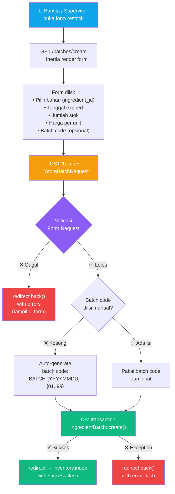
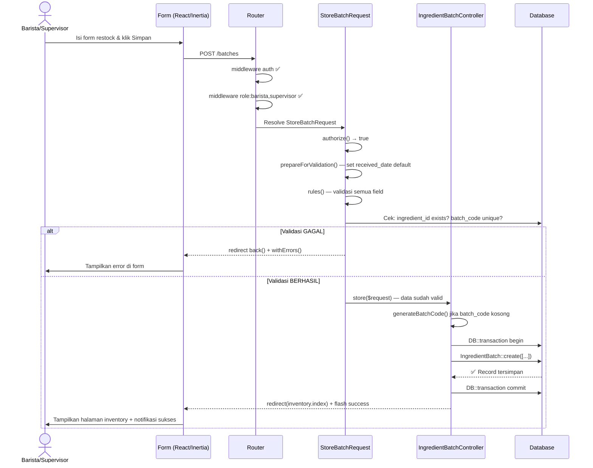

# PLAN 05 — BatchController & Alur Penerimaan Restock
## Modul: Sistem Inventaris Kafe — Controller Batch, Form Request, & Workflow Restock

> **Versi**: 1.0.0  
> **Status**: Siap Eksekusi  
> **Dibuat**: 2026-10-31  
> **Prasyarat**: [PLAN_01](./PLAN_01_MIGRATIONS_SCHEMA.md) ✅ | [PLAN_02](./PLAN_02_MODELS_ELOQUENT.md) ✅ | [PLAN_03](./PLAN_03_DATABASE_SEEDER.md) ✅ | [PLAN_04](./PLAN_04_AUTH_RBAC_MIDDLEWARE.md) ✅  
> **Konteks Stack**: Laravel 11, Eloquent ORM, Inertia.js, Form Request Validation

---

## 1. GAMBARAN ALUR RESTOCK (Business Flow)



### 1.1 Aturan Bisnis yang Wajib Diimplementasikan

| # | Aturan | Diimplementasikan Di |
|---|--------|---------------------|
| 1 | `expiry_date` HARUS lebih besar dari `received_date` | `StoreBatchRequest::rules()` + custom rule |
| 2 | `expiry_date` TIDAK boleh di masa lalu saat restock | `StoreBatchRequest::rules()` — `after:today` |
| 3 | `current_stock` = `initial_stock` saat pertama dibuat | `IngredientBatchController::store()` |
| 4 | `status` default = `'active'` saat batch baru | Eloquent default / controller assignment |
| 5 | Batch code unik di seluruh tabel | `StoreBatchRequest` — `unique:ingredient_batches` + auto-generate conflict check |
| 6 | Auto-generate batch code jika tidak diisi | `IngredientBatchController::generateBatchCode()` |
| 7 | Tidak ada hard delete batch | `destroy()` mengubah `status` → `'disposed'`, bukan `delete()` |
| 8 | `ingredient_id` harus ada di tabel `ingredients` | `StoreBatchRequest` — `exists:ingredients,id` |

---

## 2. SPESIFIKASI FILE PER-FILE

---

### 2.1 `StoreBatchRequest.php` — Validasi Form Restock Baru

**File**: `app/Http/Requests/StoreBatchRequest.php`

**Tujuan**: Memusatkan semua validasi input form penerimaan batch. Controller menjadi bersih karena semua logika validasi ada di sini.

```php
<?php

namespace App\Http\Requests;

use Illuminate\Foundation\Http\FormRequest;
use Illuminate\Validation\Rule;

class StoreBatchRequest extends FormRequest
{
    /**
     * Tentukan apakah user yang sedang login boleh membuat request ini.
     *
     * CATATAN: Proteksi role sudah ditangani di middleware (role:barista,supervisor).
     * Method ini hanya sebagai fallback tambahan — return true agar tidak double-check.
     */
    public function authorize(): bool
    {
        return true;
    }

    /**
     * Aturan validasi untuk setiap kolom input form restock.
     *
     * CATATAN PENTING:
     * - 'batch_code' bersifat OPSIONAL (nullable) — jika kosong, controller akan auto-generate
     * - 'received_date' defaultnya hari ini jika tidak diisi (dihandle di prepareForValidation)
     * - Validasi 'expiry_date' after:'received_date' memastikan urutan tanggal logis
     *
     * @return array<string, mixed>
     */
    public function rules(): array
    {
        return [
            // ─── IDENTIFIKASI BAHAN ─────────────────────────────────────────
            'ingredient_id' => [
                'required',
                'integer',
                // Pastikan ingredient_id benar-benar ada di tabel ingredients
                // Mencegah input ID sembarangan yang tidak ada di database
                Rule::exists('ingredients', 'id'),
            ],

            // ─── KODE BATCH (OPSIONAL) ──────────────────────────────────────
            'batch_code' => [
                'nullable',         // Boleh kosong — akan di-auto-generate controller
                'string',
                'max:50',
                // Jika diisi, HARUS unik di seluruh tabel ingredient_batches
                Rule::unique('ingredient_batches', 'batch_code'),
            ],

            // ─── STOK AWAL ──────────────────────────────────────────────────
            'initial_stock' => [
                'required',
                'numeric',
                'min:0.01',         // Minimal 0.01 unit — tidak boleh restock 0
                'max:99999999.99',  // Batas atas wajar untuk mencegah input keliru
            ],

            // ─── HARGA BELI PER UNIT ────────────────────────────────────────
            'cost_per_unit' => [
                'required',
                'numeric',
                'min:0',            // Boleh 0 untuk bahan gratis/sample dari supplier
                'max:99999999.99',
            ],

            // ─── TANGGAL TERIMA ─────────────────────────────────────────────
            // Defaultnya hari ini (diset di prepareForValidation)
            // Tidak boleh di masa depan — tidak logis terima barang besok
            'received_date' => [
                'required',
                'date',
                'before_or_equal:today',    // Tidak boleh tanggal masa depan
            ],

            // ─── TANGGAL KADALUWARSA (ATURAN BISNIS KRITIS) ─────────────────
            'expiry_date' => [
                'required',
                'date',
                // ATURAN 1: expiry_date HARUS setelah received_date
                // Mencegah logika terbalik (expired sebelum diterima)
                'after:received_date',
                // ATURAN 2: expiry_date HARUS di masa depan saat restock
                // Tidak masuk akal menerima barang yang sudah expired
                'after:today',
            ],

            // ─── CATATAN OPSIONAL ────────────────────────────────────────────
            'notes' => [
                'nullable',
                'string',
                'max:500',
            ],
        ];
    }

    /**
     * Pesan error kustom dalam Bahasa Indonesia.
     * Menggantikan pesan default Laravel yang berbahasa Inggris.
     *
     * @return array<string, string>
     */
    public function messages(): array
    {
        return [
            'ingredient_id.required' => 'Nama bahan wajib dipilih.',
            'ingredient_id.exists'   => 'Bahan yang dipilih tidak ditemukan dalam sistem.',

            'batch_code.unique'      => 'Kode batch ini sudah digunakan. Gunakan kode lain atau kosongkan untuk auto-generate.',
            'batch_code.max'         => 'Kode batch maksimal 50 karakter.',

            'initial_stock.required' => 'Jumlah stok awal wajib diisi.',
            'initial_stock.numeric'  => 'Jumlah stok harus berupa angka.',
            'initial_stock.min'      => 'Jumlah stok minimal 0.01 unit.',

            'cost_per_unit.required' => 'Harga beli per unit wajib diisi.',
            'cost_per_unit.numeric'  => 'Harga beli harus berupa angka.',
            'cost_per_unit.min'      => 'Harga beli tidak boleh negatif.',

            'received_date.required'        => 'Tanggal terima wajib diisi.',
            'received_date.date'            => 'Format tanggal terima tidak valid.',
            'received_date.before_or_equal' => 'Tanggal terima tidak boleh di masa depan.',

            'expiry_date.required' => 'Tanggal kedaluwarsa wajib diisi.',
            'expiry_date.date'     => 'Format tanggal kedaluwarsa tidak valid.',
            'expiry_date.after:received_date' => 'Tanggal kedaluwarsa harus setelah tanggal terima.',
            'expiry_date.after'    => 'Tanggal kedaluwarsa harus di masa depan.',

            'notes.max' => 'Catatan maksimal 500 karakter.',
        ];
    }

    /**
     * Nama kolom yang lebih ramah untuk pesan error.
     *
     * @return array<string, string>
     */
    public function attributes(): array
    {
        return [
            'ingredient_id' => 'nama bahan',
            'batch_code'    => 'kode batch',
            'initial_stock' => 'jumlah stok awal',
            'cost_per_unit' => 'harga beli per unit',
            'received_date' => 'tanggal terima',
            'expiry_date'   => 'tanggal kedaluwarsa',
        ];
    }

    /**
     * Persiapan data sebelum validasi dijalankan.
     *
     * Jika 'received_date' tidak diisi oleh user, default ke tanggal hari ini.
     * Ini membuat UX lebih baik — barista tidak perlu isi tanggal terima jika hari ini.
     */
    protected function prepareForValidation(): void
    {
        // Set received_date ke hari ini jika tidak diisi
        if (empty($this->received_date)) {
            $this->merge([
                'received_date' => now()->toDateString(),
            ]);
        }

        // Trim batch_code jika ada whitespace yang tidak sengaja diinput
        if ($this->batch_code) {
            $this->merge([
                'batch_code' => trim(strtoupper($this->batch_code)),
            ]);
        }
    }
}
```

---

### 2.2 `UpdateBatchRequest.php` — Validasi Koreksi Data Batch

**File**: `app/Http/Requests/UpdateBatchRequest.php`

**Tujuan**: Digunakan supervisor untuk mengoreksi data batch yang salah input (contoh: salah tulis harga atau tanggal expired). Aturan berbeda dari `StoreBatchRequest` karena batch code tidak perlu unik secara global jika tidak berubah.

```php
<?php

namespace App\Http\Requests;

use Illuminate\Foundation\Http\FormRequest;
use Illuminate\Validation\Rule;

class UpdateBatchRequest extends FormRequest
{
    /**
     * Hanya supervisor yang boleh update — sudah dihandle middleware route.
     */
    public function authorize(): bool
    {
        return true;
    }

    /**
     * Aturan validasi untuk update (koreksi) data batch.
     *
     * PERBEDAAN UTAMA dari StoreBatchRequest:
     * 1. batch_code: unique diabaikan untuk BATCH INI SENDIRI
     *    (menggunakan Rule::unique()->ignore() agar batch code yang sama tidak error)
     * 2. expiry_date: tidak harus 'after:today' karena mungkin koreksi batch lama
     * 3. initial_stock & cost_per_unit bisa diupdate (koreksi input salah)
     * 4. current_stock bisa diupdate langsung hanya oleh supervisor (koreksi fisik)
     *
     * @return array<string, mixed>
     */
    public function rules(): array
    {
        // Ambil batch yang sedang di-update dari route model binding
        $batchId = $this->route('batch')?->id;

        return [
            'ingredient_id' => [
                'sometimes',        // Hanya validasi jika field ini dikirim
                'required',
                'integer',
                Rule::exists('ingredients', 'id'),
            ],

            // Batch code unik KECUALI untuk batch ini sendiri
            'batch_code' => [
                'sometimes',
                'nullable',
                'string',
                'max:50',
                // ignore($batchId) → izinkan batch code yang sama dengan yang sekarang
                Rule::unique('ingredient_batches', 'batch_code')->ignore($batchId),
            ],

            'initial_stock' => [
                'sometimes',
                'required',
                'numeric',
                'min:0.01',
                'max:99999999.99',
            ],

            // Supervisor bisa koreksi current_stock jika ada selisih hitungan fisik
            'current_stock' => [
                'sometimes',
                'required',
                'numeric',
                'min:0',            // Boleh 0 (batch habis)
                'max:99999999.99',
            ],

            'cost_per_unit' => [
                'sometimes',
                'required',
                'numeric',
                'min:0',
                'max:99999999.99',
            ],

            'received_date' => [
                'sometimes',
                'required',
                'date',
                'before_or_equal:today',
            ],

            'expiry_date' => [
                'sometimes',
                'required',
                'date',
                // Tidak memaksa 'after:today' — boleh koreksi batch yang sudah expired
                // Hanya validasi bahwa expiry harus setelah received
                'after:received_date',
            ],

            'notes' => [
                'nullable',
                'string',
                'max:500',
            ],
        ];
    }

    /**
     * @return array<string, string>
     */
    public function messages(): array
    {
        return [
            'ingredient_id.exists'  => 'Bahan yang dipilih tidak ditemukan dalam sistem.',
            'batch_code.unique'     => 'Kode batch ini sudah digunakan oleh batch lain.',
            'initial_stock.min'     => 'Stok awal minimal 0.01 unit.',
            'current_stock.min'     => 'Stok saat ini tidak boleh negatif.',
            'expiry_date.after'     => 'Tanggal kedaluwarsa harus setelah tanggal terima.',
        ];
    }
}
```

---

### 2.3 `IngredientBatchController.php` ⭐ — Controller Utama

**File**: `app/Http/Controllers/IngredientBatchController.php`

```php
<?php

namespace App\Http\Controllers;

use App\Http\Requests\StoreBatchRequest;
use App\Http\Requests\UpdateBatchRequest;
use App\Models\Ingredient;
use App\Models\IngredientBatch;
use Carbon\Carbon;
use Illuminate\Http\RedirectResponse;
use Illuminate\Http\Request;
use Illuminate\Support\Facades\DB;
use Inertia\Inertia;
use Inertia\Response;

class IngredientBatchController extends Controller
{
    // =========================================================================
    // INDEX — Daftar Semua Batch dengan Filter
    // =========================================================================

    /**
     * Tampilkan daftar semua batch dengan filter opsional.
     *
     * FITUR FILTER:
     * - ?ingredient_id=N  → Filter berdasarkan bahan tertentu
     * - ?status=active    → Filter berdasarkan status batch
     * - ?expiry=critical  → Filter berdasarkan kategori expiry (critical/warning/safe)
     * - ?search=MILK      → Cari berdasarkan batch_code atau nama bahan
     *
     * DATA YANG DIKIRIM KE INERTIA:
     * - batches: paginated collection dengan accessor (expiry_status, days_until_expiry)
     * - ingredients: daftar semua bahan untuk dropdown filter
     * - filters: nilai filter aktif saat ini (untuk persistent filter di UI)
     * - summary: ringkasan statistik (total batch, kritis, warning, aman)
     *
     * DIAKSES OLEH: Semua role (auth saja)
     *
     * @param Request $request
     * @return Response
     */
    public function index(Request $request): Response
    {
        $query = IngredientBatch::query()
            ->with(['ingredient.category']); // Eager load untuk menghindari N+1

        // ─── Filter: Berdasarkan Bahan ────────────────────────────────────
        if ($request->filled('ingredient_id')) {
            $query->where('ingredient_id', $request->integer('ingredient_id'));
        }

        // ─── Filter: Berdasarkan Status Batch ────────────────────────────
        if ($request->filled('status')) {
            $query->where('status', $request->string('status'));
        }

        // ─── Filter: Berdasarkan Kategori Expiry (traffic light) ─────────
        if ($request->filled('expiry')) {
            $expiry = $request->string('expiry');
            $query = match ((string) $expiry) {
                'critical' => $query->where('status', 'active')
                                    ->criticalExpiry(3),    // < 3 hari atau sudah expired
                'warning'  => $query->where('status', 'active')
                                    ->criticalExpiry(7)
                                    ->where('expiry_date', '>', Carbon::now()->addDays(3)),
                'safe'     => $query->where('status', 'active')
                                    ->where('expiry_date', '>', Carbon::now()->addDays(7)),
                default    => $query,
            };
        }

        // ─── Filter: Pencarian Teks ───────────────────────────────────────
        if ($request->filled('search')) {
            $search = $request->string('search');
            $query->where(function ($q) use ($search) {
                $q->where('batch_code', 'like', "%{$search}%")
                  ->orWhereHas('ingredient', fn($q) =>
                        $q->where('name', 'like', "%{$search}%")
                  );
            });
        }

        // ─── Default Sort: FEFO untuk batch aktif ───────────────────────
        $query->orderBy('expiry_date', 'asc')
              ->orderBy('created_at', 'desc');

        // Paginate & append accessor ke setiap batch
        $batches = $query->paginate(15)
            ->withQueryString(); // Pertahankan query string di link paginasi

        // Append accessor (tidak otomatis masuk serialisasi JSON)
        $batches->through(function (IngredientBatch $batch) {
            return $batch->append(['expiry_status', 'days_until_expiry', 'total_value']);
        });

        // Summary card untuk dashboard (hitung sekaligus agar efisien)
        $summary = [
            'total_active'   => IngredientBatch::where('status', 'active')->count(),
            'total_critical' => IngredientBatch::active()->criticalExpiry(3)->count(),
            'total_warning'  => IngredientBatch::active()
                                    ->criticalExpiry(7)
                                    ->where('expiry_date', '>', Carbon::now()->addDays(3))
                                    ->count(),
            'total_expired'  => IngredientBatch::where('status', 'expired')->count(),
        ];

        return Inertia::render('Batches/Index', [
            'batches'     => $batches,
            'ingredients' => Ingredient::orderBy('name')->get(['id', 'name', 'unit']),
            'filters'     => $request->only(['ingredient_id', 'status', 'expiry', 'search']),
            'summary'     => $summary,
        ]);
    }

    // =========================================================================
    // CREATE — Form Tambah Batch Baru
    // =========================================================================

    /**
     * Tampilkan form penerimaan batch baru (halaman Inertia).
     *
     * DATA YANG DIKIRIM KE INERTIA:
     * - ingredients: daftar semua bahan untuk dropdown pilih bahan
     * - defaultReceivedDate: tanggal hari ini (untuk pre-fill field)
     * - suggestedBatchCode: preview kode batch yang akan di-generate
     *   (untuk transparansi ke user — bisa diabaikan jika user input manual)
     *
     * DIAKSES OLEH: Supervisor dan Barista (role:supervisor,barista)
     *
     * @return Response
     */
    public function create(): Response
    {
        return Inertia::render('Batches/Create', [
            'ingredients'        => Ingredient::orderBy('name')
                                        ->with('category')
                                        ->get(['id', 'name', 'unit', 'category_id']),
            'defaultReceivedDate'=> now()->toDateString(),
            'suggestedBatchCode' => $this->generateBatchCode(),
        ]);
    }

    // =========================================================================
    // STORE — Simpan Batch Baru ke Database
    // =========================================================================

    /**
     * Proses dan simpan data batch baru dari form penerimaan.
     *
     * ALUR EKSEKUSI:
     * 1. StoreBatchRequest otomatis memvalidasi semua input
     * 2. Tentukan batch_code: pakai input user atau auto-generate
     * 3. Bungkus dalam DB::transaction untuk keamanan atomik
     * 4. Buat record IngredientBatch baru
     * 5. Redirect ke inventory dengan flash message sukses
     *
     * BUSINESS RULES YANG DIIMPLEMENTASIKAN:
     * - current_stock = initial_stock saat pertama dibuat (stok = jumlah yang diterima)
     * - status = 'active' secara default
     * - Jika batch_code sudah diinput tapi ternyata ada race condition (duplicate),
     *   catch UniqueConstraintViolationException dan fallback ke auto-generate
     *
     * DIAKSES OLEH: Supervisor dan Barista (role:supervisor,barista)
     *
     * @param StoreBatchRequest $request — Sudah tervalidasi sebelum masuk method ini
     * @return RedirectResponse
     */
    public function store(StoreBatchRequest $request): RedirectResponse
    {
        // Tentukan batch_code: pakai input user atau auto-generate
        $batchCode = $request->filled('batch_code')
            ? strtoupper(trim($request->input('batch_code')))
            : $this->generateBatchCode();

        try {
            DB::transaction(function () use ($request, $batchCode) {
                IngredientBatch::create([
                    'ingredient_id' => $request->integer('ingredient_id'),
                    'batch_code'    => $batchCode,
                    'initial_stock' => $request->input('initial_stock'),
                    // BUSINESS RULE: current_stock = initial_stock saat pertama input
                    // Stok yang tersisa = stok yang diterima (belum ada pemakaian)
                    'current_stock' => $request->input('initial_stock'),
                    'received_date' => $request->input('received_date'),
                    'expiry_date'   => $request->input('expiry_date'),
                    'cost_per_unit' => $request->input('cost_per_unit'),
                    'status'        => 'active', // Selalu active saat baru diterima
                ]);
            });

            return redirect()
                ->route('inventory.index')
                ->with('success', "Batch {$batchCode} berhasil ditambahkan ke inventaris.");

        } catch (\Illuminate\Database\UniqueConstraintViolationException $e) {
            // Race condition: dua user input batch_code yang sama bersamaan
            // Solusi: fallback ke auto-generate dan coba ulang
            return redirect()
                ->back()
                ->withInput()
                ->with('error', 'Kode batch sudah digunakan. Sistem akan generate kode otomatis — kosongkan field kode batch dan coba lagi.');

        } catch (\Exception $e) {
            return redirect()
                ->back()
                ->withInput()
                ->with('error', 'Gagal menyimpan batch. Silakan coba lagi.');
        }
    }

    // =========================================================================
    // SHOW — Detail Satu Batch
    // =========================================================================

    /**
     * Tampilkan halaman detail satu batch.
     *
     * DATA YANG DIKIRIM KE INERTIA:
     * - batch: data batch dengan accessor + relasi ingredient, stockUsages, wasteLogs
     * - stockUsages: riwayat pemakaian batch ini (10 terbaru)
     * - wasteLogs: riwayat pemusnahan yang terkait batch ini
     *
     * DIAKSES OLEH: Semua role (auth saja)
     *
     * Route model binding otomatis resolve IngredientBatch dari {batch} di URL.
     *
     * @param IngredientBatch $batch
     * @return Response
     */
    public function show(IngredientBatch $batch): Response
    {
        // Load relasi yang diperlukan untuk halaman detail
        $batch->load([
            'ingredient.category',
            'stockUsages.user',     // Riwayat pemakaian + nama user yang catat
            'wasteLogs.reporter',   // Riwayat pemusnahan + nama pelapor
            'wasteLogs.approver',   // Nama supervisor yang approve
        ]);

        // Append semua accessor untuk halaman detail
        $batch->append(['expiry_status', 'days_until_expiry', 'total_value']);

        return Inertia::render('Batches/Show', [
            'batch'       => $batch,
            'stockUsages' => $batch->stockUsages()
                                ->with('user')
                                ->latest('usage_date')
                                ->take(10)
                                ->get(),
            'wasteLogs'   => $batch->wasteLogs()
                                ->with(['reporter', 'approver'])
                                ->latest()
                                ->get(),
        ]);
    }

    // =========================================================================
    // EDIT — Form Koreksi Data Batch (Supervisor Only)
    // =========================================================================

    /**
     * Tampilkan form edit untuk koreksi data batch yang salah input.
     *
     * HANYA SUPERVISOR yang bisa akses ini (sudah diproteksi middleware route).
     * Barista tidak bisa edit batch yang sudah dibuat.
     *
     * @param IngredientBatch $batch
     * @return Response
     */
    public function edit(IngredientBatch $batch): Response
    {
        $batch->load('ingredient.category');
        $batch->append(['expiry_status', 'days_until_expiry']);

        return Inertia::render('Batches/Edit', [
            'batch'       => $batch,
            'ingredients' => Ingredient::orderBy('name')
                                ->with('category')
                                ->get(['id', 'name', 'unit', 'category_id']),
        ]);
    }

    // =========================================================================
    // UPDATE — Simpan Koreksi Data Batch (Supervisor Only)
    // =========================================================================

    /**
     * Proses dan simpan koreksi data batch oleh supervisor.
     *
     * CATATAN KEAMANAN:
     * - Method ini tidak bisa mengubah status batch secara langsung
     * - Perubahan status (misal: expired → active) harus lewat workflow khusus
     * - current_stock bisa dikoreksi supervisor jika ada selisih hitungan fisik
     *
     * @param UpdateBatchRequest $request
     * @param IngredientBatch $batch
     * @return RedirectResponse
     */
    public function update(UpdateBatchRequest $request, IngredientBatch $batch): RedirectResponse
    {
        try {
            DB::transaction(function () use ($request, $batch) {
                $batch->update($request->validated());
            });

            return redirect()
                ->route('inventory.index')
                ->with('success', "Data batch {$batch->batch_code} berhasil diperbarui.");

        } catch (\Exception $e) {
            return redirect()
                ->back()
                ->withInput()
                ->with('error', 'Gagal memperbarui data batch. Silakan coba lagi.');
        }
    }

    // =========================================================================
    // DESTROY — "Hapus" Batch (Ubah Status, BUKAN Hard Delete)
    // =========================================================================

    /**
     * "Hapus" batch dengan mengubah status menjadi 'disposed'.
     *
     * PENTING: Ini BUKAN hard delete (DELETE FROM ...).
     * Business rule melarang penghapusan data batch karena merupakan
     * catatan historis inventaris yang diperlukan untuk audit keuangan.
     *
     * Implementasi: batch_code tetap ada di database, status berubah ke 'disposed'.
     * Data tidak bisa dihapus selamanya — hanya "diarsipkan".
     *
     * DIAKSES OLEH: Hanya Supervisor (sudah diproteksi middleware route)
     *
     * GUARD TAMBAHAN:
     * - Batch yang sudah punya stock_usages tidak bisa di-dispose langsung
     *   (ada riwayat pemakaian yang harus dipertimbangkan)
     *
     * @param IngredientBatch $batch
     * @return RedirectResponse
     */
    public function destroy(IngredientBatch $batch): RedirectResponse
    {
        // Guard: Batch yang sudah ada riwayat pemakaian tidak bisa langsung di-dispose
        if ($batch->stockUsages()->exists()) {
            return redirect()
                ->back()
                ->with('error', "Batch {$batch->batch_code} tidak bisa dihapus karena sudah memiliki riwayat pemakaian. Untuk batch yang sudah tidak terpakai, ubah status lewat laporan pemusnahan.");
        }

        // Guard: Batch yang sudah approved waste log tidak perlu di-dispose lagi
        if ($batch->status === 'disposed') {
            return redirect()
                ->back()
                ->with('info', "Batch {$batch->batch_code} sudah berstatus disposed.");
        }

        $batch->update(['status' => 'disposed']);

        return redirect()
            ->route('inventory.index')
            ->with('success', "Batch {$batch->batch_code} telah diarsipkan (disposed).");
    }

    // =========================================================================
    // PRIVATE HELPER — Auto-generate Batch Code
    // =========================================================================

    /**
     * Generate kode batch otomatis dengan format: BATCH-{YYYYMMDD}-{01..99}
     *
     * ALGORITMA:
     * 1. Ambil tanggal hari ini dalam format YYYYMMDD (contoh: 20261031)
     * 2. Buat prefix: "BATCH-20261031-"
     * 3. Cari nomor urut tertinggi yang sudah ada untuk prefix hari ini
     * 4. Tambahkan 1 dari nomor tertinggi (atau mulai dari 01 jika belum ada)
     * 5. Pad dengan leading zero: 1 → "01", 9 → "09", 10 → "10"
     *
     * Contoh hasil:
     * - Batch pertama hari ini  → "BATCH-20261031-01"
     * - Batch kedua hari ini    → "BATCH-20261031-02"
     * - Batch ke-10 hari ini    → "BATCH-20261031-10"
     *
     * EDGE CASE: Jika sudah ada 99 batch hari ini (sangat jarang), return timestamp unik.
     *
     * @return string
     */
    private function generateBatchCode(): string
    {
        $datePrefix = 'BATCH-' . now()->format('Ymd') . '-';

        // Cari kode batch terakhir hari ini yang menggunakan prefix yang sama
        $lastBatch = IngredientBatch::where('batch_code', 'like', $datePrefix . '%')
            ->orderBy('batch_code', 'desc')
            ->value('batch_code');

        if ($lastBatch) {
            // Ekstrak nomor urut dari kode terakhir
            // Contoh: "BATCH-20261031-07" → ambil "07" → int 7 → +1 → 8
            $lastSequence = (int) substr($lastBatch, -2);
            $nextSequence = $lastSequence + 1;

            // Fallback jika sudah mencapai batas 99 (sangat jarang)
            if ($nextSequence > 99) {
                return $datePrefix . now()->format('His'); // Fallback: timestamp HH:MM:SS
            }

            return $datePrefix . str_pad($nextSequence, 2, '0', STR_PAD_LEFT);
        }

        // Tidak ada batch hari ini → mulai dari 01
        return $datePrefix . '01';
    }
}
```

---

## 3. TABEL REFERENSI VALIDASI

### 3.1 Semua Aturan Validasi `StoreBatchRequest`

| Field | Tipe | Required? | Aturan Khusus | Pesan Error Kustom |
|-------|------|-----------|--------------|-------------------|
| `ingredient_id` | integer | ✅ | `exists:ingredients,id` | "Bahan yang dipilih tidak ditemukan" |
| `batch_code` | string | ❌ nullable | `unique:ingredient_batches`, max:50 | "Kode batch sudah digunakan" |
| `initial_stock` | numeric | ✅ | min:0.01, max:99999999.99 | "Minimal 0.01 unit" |
| `cost_per_unit` | numeric | ✅ | min:0, max:99999999.99 | — |
| `received_date` | date | ✅ | `before_or_equal:today` | "Tidak boleh tanggal masa depan" |
| `expiry_date` | date | ✅ | `after:received_date`, `after:today` | "Harus setelah received_date" |
| `notes` | string | ❌ nullable | max:500 | — |

### 3.2 Perbedaan `StoreBatchRequest` vs `UpdateBatchRequest`

| Aspek | StoreBatchRequest | UpdateBatchRequest |
|-------|------------------|-------------------|
| `batch_code` unique check | `unique:ingredient_batches` | `unique(...)->ignore($batchId)` |
| `expiry_date` after today | ✅ Wajib | ❌ Tidak (koreksi batch lama boleh) |
| `current_stock` | ❌ Tidak ada (= initial_stock) | ✅ Ada (koreksi stock opname) |
| Field required | Semua required | Semua `sometimes` (partial update) |
| `received_date` default | Auto-fill hari ini | Ikut input user |

---

## 4. DIAGRAM SEQUENCE — STORE BATCH



---

## 5. DATA YANG DIKIRIM KE INERTIA (Props Reference)

### 5.1 `Batches/Index` (dari `index()`)

```typescript
interface IndexProps {
  batches: {
    data: IngredientBatch[];
    links: PaginationLink[];
    meta: PaginationMeta;
  };
  ingredients: Pick<Ingredient, 'id' | 'name' | 'unit'>[];
  filters: {
    ingredient_id?: number;
    status?: 'active' | 'exhausted' | 'expired' | 'disposed';
    expiry?: 'critical' | 'warning' | 'safe';
    search?: string;
  };
  summary: {
    total_active: number;
    total_critical: number;  // < 3 hari
    total_warning: number;   // 3–7 hari
    total_expired: number;   // status expired
  };
}
```

### 5.2 `Batches/Create` (dari `create()`)

```typescript
interface CreateProps {
  ingredients: (Pick<Ingredient, 'id' | 'name' | 'unit'> & {
    category: Pick<Category, 'id' | 'name'>;
  })[];
  defaultReceivedDate: string;   // "2026-10-31"
  suggestedBatchCode: string;    // "BATCH-20261031-01"
}
```

### 5.3 `Batches/Show` (dari `show()`)

```typescript
interface ShowProps {
  batch: IngredientBatch & {
    expiry_status: 'safe' | 'warning' | 'critical';   // Accessor
    days_until_expiry: number;                          // Accessor
    total_value: number;                                // Accessor
    ingredient: Ingredient & { category: Category };
  };
  stockUsages: StockUsage[];
  wasteLogs: WasteLog[];
}
```

---

## 6. DOKUMENTASI PEMULA

Lihat file terpisah: [`docs/explanations/05_batch_restock_controller.md`](../explanations/05_batch_restock_controller.md)

---

## 7. AI EXECUTION PROMPT

Salin seluruh blok di bawah ini dan kirimkan ke AI coding assistant untuk mengeksekusi pembuatan semua file di modul ini:

---

````
KONTEKS:
Proyek Laravel 11 dengan Inertia.js. Migration, Model, Seeder, dan Auth/RBAC sudah selesai.
Saya perlu membuat Controller dan Form Request untuk alur penerimaan batch bahan baku.

TUGAS — BUAT file berikut:

=== FILE 1 ===
Path: app/Http/Requests/StoreBatchRequest.php
Perintah artisan: php artisan make:request StoreBatchRequest
Isi:
- authorize(): return true (proteksi ada di middleware)
- rules():
  * ingredient_id: required|integer|exists:ingredients,id
  * batch_code: nullable|string|max:50|unique:ingredient_batches,batch_code
  * initial_stock: required|numeric|min:0.01|max:99999999.99
  * cost_per_unit: required|numeric|min:0|max:99999999.99
  * received_date: required|date|before_or_equal:today
  * expiry_date: required|date|after:received_date|after:today
  * notes: nullable|string|max:500
- messages(): Semua pesan dalam Bahasa Indonesia
- attributes(): nama field human-readable dalam Bahasa Indonesia
- prepareForValidation():
  * Set received_date ke now()->toDateString() jika kosong
  * Trim + strtoupper batch_code jika ada

=== FILE 2 ===
Path: app/Http/Requests/UpdateBatchRequest.php
Perintah artisan: php artisan make:request UpdateBatchRequest
Isi:
- Semua field pakai 'sometimes' (partial update)
- batch_code: nullable|string|max:50|Rule::unique()->ignore($this->route('batch')?->id)
- current_stock: sometimes|required|numeric|min:0 (boleh 0)
- expiry_date: sometimes|required|date|after:received_date (TANPA after:today)
- Tidak ada field: status (status tidak bisa diubah langsung via form ini)

=== FILE 3 ===
Path: app/Http/Controllers/IngredientBatchController.php
Perintah artisan: php artisan make:controller IngredientBatchController
Isi semua method:

METHOD index(Request $request): Response
  - Query IngredientBatch::query()->with(['ingredient.category'])
  - Filter: ingredient_id, status, expiry (critical/warning/safe), search (batch_code or ingredient name)
  - Sort default: orderBy('expiry_date', 'asc')
  - Paginate 15, withQueryString()
  - Append accessor via ->through(fn($b) => $b->append([...]))
  - Summary: total_active, total_critical (criticalExpiry(3)), total_warning, total_expired
  - Return Inertia::render('Batches/Index', compact('batches', 'ingredients', 'filters', 'summary'))

METHOD create(): Response
  - Return Inertia::render('Batches/Create', dengan ingredients + defaultReceivedDate + suggestedBatchCode)
  - suggestedBatchCode dari private method generateBatchCode()

METHOD store(StoreBatchRequest $request): RedirectResponse
  - Tentukan batchCode: input user atau generateBatchCode()
  - DB::transaction: IngredientBatch::create([...])
  - current_stock = initial_stock (WAJIB sama saat pertama dibuat)
  - status = 'active'
  - Try/catch: UniqueConstraintViolationException → redirect back dengan pesan error khusus
  - Sukses → redirect(inventory.index) dengan flash success

METHOD show(IngredientBatch $batch): Response
  - Load: ingredient.category, stockUsages.user, wasteLogs.reporter, wasteLogs.approver
  - Append: expiry_status, days_until_expiry, total_value
  - Return Inertia::render('Batches/Show', compact(batch, stockUsages, wasteLogs))

METHOD edit(IngredientBatch $batch): Response
  - Load ingredient.category
  - Return Inertia::render('Batches/Edit', dengan batch dan ingredients)

METHOD update(UpdateBatchRequest $request, IngredientBatch $batch): RedirectResponse
  - DB::transaction: $batch->update($request->validated())
  - Redirect ke inventory.index dengan flash success

METHOD destroy(IngredientBatch $batch): RedirectResponse
  - LARANGAN: Tidak boleh $batch->delete() — harus update status
  - Guard 1: jika $batch->stockUsages()->exists() → redirect back dengan pesan error
  - Guard 2: jika $batch->status === 'disposed' → redirect back dengan pesan info
  - Action: $batch->update(['status' => 'disposed'])
  - Redirect ke inventory.index dengan flash success

PRIVATE METHOD generateBatchCode(): string
  - Format: 'BATCH-' . now()->format('Ymd') . '-' . str_pad($sequence, 2, '0', STR_PAD_LEFT)
  - Cari batch terakhir hari ini: where('batch_code', 'like', $datePrefix.'%')->orderBy('batch_code','desc')->value()
  - Ekstrak sequence dari 2 karakter terakhir, +1
  - Jika > 99: fallback ke now()->format('His')
  - Jika tidak ada batch hari ini: mulai dari '01'

VERIFIKASI:
```bash
php artisan make:request StoreBatchRequest
php artisan make:request UpdateBatchRequest
php artisan make:controller IngredientBatchController

# Cek route terdaftar
php artisan route:list --name=batches

# Test via Tinker: simulasi store
php artisan tinker --execute="
  \$ingredient = App\Models\Ingredient::first();
  \$batch = App\Models\IngredientBatch::create([
    'ingredient_id' => \$ingredient->id,
    'batch_code'    => 'TEST-MANUAL-01',
    'initial_stock' => 10,
    'current_stock' => 10,
    'received_date' => today()->toDateString(),
    'expiry_date'   => today()->addDays(30)->toDateString(),
    'cost_per_unit' => 15000,
    'status'        => 'active',
  ]);
  echo \$batch->expiry_status . PHP_EOL;
  echo \$batch->days_until_expiry . PHP_EOL;
  echo \$batch->total_value . PHP_EOL;
"
```

KRITERIA SUKSES:
- php artisan route:list menampilkan batches.create, batches.store, batches.edit, batches.update
- StoreBatchRequest menolak: expiry_date di masa lalu, ingredient_id tidak ada, initial_stock = 0
- Store berhasil: record baru di tabel ingredient_batches dengan current_stock = initial_stock, status = 'active'
- Destroy: batch yang punya stockUsages tidak bisa di-"hapus" (redirect back dengan pesan error)
- Destroy: batch tanpa stockUsages berhasil diubah status jadi 'disposed'
````

---

> **Catatan Ponytail Sign-off**:  
> Sengaja tidak membuat `IngredientBatchObserver` untuk otomatis update status expired — itu bisa ditambahkan via scheduled command (`php artisan schedule:run`) di modul selanjutnya jika diperlukan. Risiko yang perlu diperhatikan: `generateBatchCode()` menggunakan race condition window kecil (dua request bersamaan bisa generate kode yang sama) — ditangani oleh `UniqueConstraintViolationException` catch di `store()`, tapi UX-nya kurang bagus. Untuk production yang lebih robust, gunakan database lock atau sequence terpisah.
