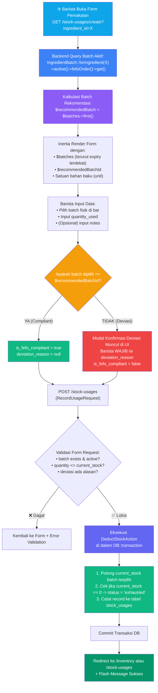

# PLAN 06 — StockUsageController & Algoritma FEFO
## Modul: Sistem Inventaris Kafe — Logika Pemakaian Bahan Baku & FEFO Enforcement

> **Versi**: 1.0.0  
> **Status**: Siap Eksekusi  
> **Dibuat**: 2026-10-31  
> **Prasyarat**: [PLAN_01](./PLAN_01_MIGRATIONS_SCHEMA.md) s.d. [PLAN_05](./PLAN_05_BATCH_RESTOCK_CONTROLLER.md) ✅  
> **Konteks Stack**: Laravel 11, PHP 8.2+, Eloquent ORM, Single Action Pattern, Inertia.js React

---

## 1. ALGORITMA FEFO & WORKFLOW PEMAKAIAN

### 1.1 Diagram Alur Bisnis (FEFO Decision Matrix)



---

### 1.2 Aturan Inti Bisnis (Core Business Rules)

1. **Strict FEFO Ordering**:
   Query penentuan batch aktif **wajib** menggunakan kueri berikut:
   ```php
   IngredientBatch::where('ingredient_id', $ingredientId)
       ->where('status', 'active')
       ->where('current_stock', '>', 0)
       ->orderBy('expiry_date', 'asc')
       ->get();
   ```
   Elemen pertama (`$batches->first()`) **secara otomatis** menjadi rujukan satu-satunya rekomendasi kepatuhan FEFO.

2. **Deteksi Deviasi & Audit Trail**:
   * Jika barista memilih `ingredient_batch_id != $recommendedBatch->id`:
     * Nilai `is_fefo_compliant` disetel ke `false`.
     * Kolom `deviation_reason` menjadi **wajib diisi** (minimal 5 karakter, maksimal 500 karakter).
   * Jika memilih batch rekomendasi:
     * `is_fefo_compliant` disetel ke `true`.
     * `deviation_reason` disetel ke `null`.

3. **Stok Tidak Boleh Negatif (Negative Stock Prevention)**:
   * Kuantitas yang diminta **tidak boleh melebihi** stok batch saat ini:
     `quantity_used <= batch.current_stock`.
   * Pengecekan dilakukan dua kali: di level validation rule dan di dalam database lock (`lockForUpdate()`) untuk mencegah *race condition*.

4. **Lifecycle Auto-Transition (`active` → `exhausted`)**:
   * Jika pemakaian menghabiskan seluruh sisa stok (`current_stock == 0`), maka kolom `status` pada `ingredient_batches` otomatis diperbarui menjadi `'exhausted'`.

5. **Atomisitas Transaksi**:
   * Pemotongan stok pada tabel `ingredient_batches` dan pencatatan pada `stock_usages` **wajib** dibungkus dalam `DB::transaction`. Jika salah satu gagal, seluruh perubahan di-rollback.

---

## 2. SPESIFIKASI FILE BACKEND

---

### 2.1 `RecordUsageRequest.php` — Form Request Validation

**File**: `app/Http/Requests/RecordUsageRequest.php`

**Tujuan**: Memvalidasi seluruh masukan pencatatan pemakaian bahan, mencegah stok minus, dan menegakkan aturan pengisian alasan deviasi secara kondisional.

```php
<?php

namespace App\Http\Requests;

use App\Models\IngredientBatch;
use Carbon\Carbon;
use Illuminate\Foundation\Http\FormRequest;
use Illuminate\Validation\Rule;
use Illuminate\Validation\Validator;

class RecordUsageRequest extends FormRequest
{
    /**
     * Pastikan pengguna memiliki izin.
     * Sudah dijaga oleh middleware 'role:barista,supervisor'.
     */
    public function authorize(): bool
    {
        return true;
    }

    /**
     * Aturan validasi deklaratif.
     *
     * @return array<string, mixed>
     */
    public function rules(): array
    {
        return [
            // ─── BATCH TARGET ──────────────────────────────────────────────
            'ingredient_batch_id' => [
                'required',
                'integer',
                Rule::exists('ingredient_batches', 'id'),
            ],

            // ─── KUANTITAS PEMAKAIAN ────────────────────────────────────────
            'quantity_used' => [
                'required',
                'numeric',
                'min:0.01',
                'max:99999999.99',
            ],

            // ─── TANGGAL PEMAKAIAN ──────────────────────────────────────────
            'usage_date' => [
                'required',
                'date',
                'before_or_equal:today', // Tidak boleh mencatat pemakaian masa depan
            ],

            // ─── KEPATUHAN FEFO & ALASAN DEVIASI ───────────────────────────
            'is_fefo_compliant' => [
                'required',
                'boolean',
            ],

            // Wajib diisi jika is_fefo_compliant = false
            'deviation_reason' => [
                'nullable',
                'required_if:is_fefo_compliant,false',
                'string',
                'min:5',
                'max:500',
            ],

            // ─── CATATAN TAMBAHAN (OPSIONAL) ────────────────────────────────
            'notes' => [
                'nullable',
                'string',
                'max:1000',
            ],
        ];
    }

    /**
     * Validasi Lanjutan Kompleks (After Validation Hook).
     * Mengecek sisa stok aktual di database & memverifikasi klaim FEFO.
     */
    public function withValidator(Validator $validator): void
    {
        $validator->after(function ($validator) {
            $batchId = $this->input('ingredient_batch_id');
            $qtyUsed = (float) $this->input('quantity_used');

            if (!$batchId) {
                return;
            }

            $batch = IngredientBatch::find($batchId);
            if (!$batch) {
                return;
            }

            // 1. Validasi Status Batch
            if ($batch->status !== 'active') {
                $validator->errors()->add(
                    'ingredient_batch_id',
                    "Batch {$batch->batch_code} tidak aktif (status: {$batch->status}) dan tidak dapat digunakan."
                );
            }

            // 2. Validasi Anti-Stok Minus
            if ($qtyUsed > (float) $batch->current_stock) {
                $validator->errors()->add(
                    'quantity_used',
                    "Kuantitas melebihi sisa stok batch ({$batch->current_stock} {$batch->ingredient->unit} tersedia)."
                );
            }

            // 3. Verifikasi Integritas Status FEFO dari Sisi Server
            // Mencegah manipulasi frontend di mana user mengirim is_fefo_compliant=true padahal bukan batch teratas
            $recommendedBatch = IngredientBatch::where('ingredient_id', $batch->ingredient_id)
                ->where('status', 'active')
                ->where('current_stock', '>', 0)
                ->orderBy('expiry_date', 'asc')
                ->first();

            $isActuallyFefo = ($recommendedBatch && $recommendedBatch->id === $batch->id);
            $clientClaimsFefo = (bool) $this->boolean('is_fefo_compliant');

            if ($clientClaimsFefo && !$isActuallyFefo) {
                $validator->errors()->add(
                    'is_fefo_compliant',
                    "Batch yang dipilih bukan batch rekomendasi FEFO teratas. Harap isi alasan deviasi."
                );
            }
        });
    }

    /**
     * Pesan error ramah pengguna dalam Bahasa Indonesia.
     */
    public function messages(): array
    {
        return [
            'ingredient_batch_id.required'     => 'Batch bahan baku wajib dipilih.',
            'ingredient_batch_id.exists'       => 'Batch yang dipilih tidak ditemukan dalam sistem.',
            'quantity_used.required'           => 'Jumlah bahan yang digunakan wajib diisi.',
            'quantity_used.numeric'            => 'Jumlah bahan harus berupa angka desimal atau bulat.',
            'quantity_used.min'                => 'Jumlah bahan minimal 0.01.',
            'usage_date.required'              => 'Tanggal pemakaian wajib diisi.',
            'usage_date.before_or_equal'       => 'Tanggal pemakaian tidak boleh lebih dari hari ini.',
            'deviation_reason.required_if'     => 'Alasan deviasi wajib diisi ketika tidak menggunakan batch rekomendasi FEFO.',
            'deviation_reason.min'             => 'Alasan deviasi minimal 5 karakter agar informatif.',
            'deviation_reason.max'             => 'Alasan deviasi maksimal 500 karakter.',
        ];
    }

    /**
     * Normalisasi payload sebelum divalidasi.
     */
    protected function prepareForValidation(): void
    {
        if (empty($this->usage_date)) {
            $this->merge([
                'usage_date' => Carbon::today()->toDateString(),
            ]);
        }

        // Jika compliant disetel true, kosongkan deviation_reason
        if ($this->boolean('is_fefo_compliant')) {
            $this->merge([
                'deviation_reason' => null,
            ]);
        }
    }
}
```

---

### 2.2 `DeductStockAction.php` — Single Action Service Class

**File**: `app/Actions/DeductStockAction.php`

**Tujuan**: Memisahkan logika pemotongan stok dan pembaruan status ke dalam kelas aksi tersendiri (*Single Responsibility Principle*). Hal ini membuat logika pemotongan stok dapat diuji secara terisolasi melalui *unit testing* tanpa melalui HTTP layer.

```php
<?php

namespace App\Actions;

use App\Models\IngredientBatch;
use App\Models\StockUsage;
use App\Models\User;
use Exception;
use Illuminate\Support\Facades\DB;

class DeductStockAction
{
    /**
     * Eksekusi pemotongan stok bahan dan pencatatan log pemakaian.
     *
     * @param IngredientBatch $batch Batch yang dikurangi stoknya
     * @param User $user Pengguna yang melakukan pencatatan
     * @param array{
     *     quantity_used: float|numeric,
     *     usage_date: string,
     *     is_fefo_compliant: bool,
     *     deviation_reason?: string|null,
     *     notes?: string|null
     * } $data Payload pemakaian
     * @return StockUsage
     * @throws Exception Jika stok tidak mencukupi saat lock update
     */
    public function execute(IngredientBatch $batch, User $user, array $data): StockUsage
    {
        return DB::transaction(function () use ($batch, $user, $data) {
            // Lock baris data batch untuk mencegah race condition (pembelian/pemakaian konkuren)
            /** @var IngredientBatch $lockedBatch */
            $lockedBatch = IngredientBatch::where('id', $batch->id)
                ->lockForUpdate()
                ->firstOrFail();

            $quantity = (float) $data['quantity_used'];
            $currentStock = (float) $lockedBatch->current_stock;

            // Validasi proteksi stok minus di tingkat database lock
            if ($quantity > $currentStock) {
                throw new Exception("Stok tidak mencukupi pada saat transaksi diproses. Tersedia: {$currentStock}, Diminta: {$quantity}");
            }

            // 1. Kurangi kuantitas stok saat ini
            $newStock = $currentStock - $quantity;
            $lockedBatch->current_stock = $newStock;

            // 2. Lifecycle check: Jika stok habis (0), otomatis tandai exhausted
            if ($newStock <= 0.0001) {
                $lockedBatch->current_stock = 0;
                $lockedBatch->status = 'exhausted';
            }

            $lockedBatch->save();

            // 3. Rekam jejak pemakaian ke tabel stock_usages
            return StockUsage::create([
                'ingredient_batch_id' => $lockedBatch->id,
                'user_id'             => $user->id,
                'quantity_used'       => $quantity,
                'usage_date'          => $data['usage_date'],
                'is_fefo_compliant'   => (bool) $data['is_fefo_compliant'],
                'deviation_reason'    => $data['deviation_reason'] ?? null,
                'notes'               => $data['notes'] ?? null,
            ]);
        });
    }
}
```

---

### 2.3 `StockUsageController.php` — Resource Controller

**File**: `app/Http/Controllers/StockUsageController.php`

**Tujuan**: Mengatur alur HTTP, menyiapkan dataset FEFO untuk antarmuka Inertia.js, dan memanggil aksi pemotongan stok.

```php
<?php

namespace App\Http\Controllers;

use App\Actions\DeductStockAction;
use App\Http\Requests\RecordUsageRequest;
use App\Models\Ingredient;
use App\Models\IngredientBatch;
use App\Models\StockUsage;
use Illuminate\Http\RedirectResponse;
use Illuminate\Http\Request;
use Illuminate\Support\Facades\Auth;
use Inertia\Inertia;
use Inertia\Response;

class StockUsageController extends Controller
{
    /**
     * Tampilkan riwayat pemakaian bahan baku (Auditing & Monitoring).
     *
     * FITUR:
     * - Filter berdasarkan bahan baku
     * - Filter berdasarkan kepatuhan FEFO (semua / patuh / deviasi)
     * - Paginasi 15 data per halaman
     */
    public function index(Request $request): Response
    {
        $query = StockUsage::query()
            ->with([
                'batch.ingredient',
                'user:id,name,role',
            ]);

        // Filter berdasarkan bahan
        if ($request->filled('ingredient_id')) {
            $query->whereHas('batch', function ($q) use ($request) {
                $q->where('ingredient_id', $request->integer('ingredient_id'));
            });
        }

        // Filter berdasarkan kepatuhan FEFO
        if ($request->filled('fefo_status')) {
            if ($request->string('fefo_status') === 'compliant') {
                $query->where('is_fefo_compliant', true);
            } elseif ($request->string('fefo_status') === 'deviated') {
                $query->where('is_fefo_compliant', false);
            }
        }

        // Filter tanggal
        if ($request->filled('start_date')) {
            $query->whereDate('usage_date', '>=', $request->date('start_date'));
        }
        if ($request->filled('end_date')) {
            $query->whereDate('usage_date', '<=', $request->date('end_date'));
        }

        $usages = $query->latest('usage_date')
            ->latest('id')
            ->paginate(15)
            ->withQueryString();

        return Inertia::render('StockUsages/Index', [
            'usages'      => $usages,
            'ingredients' => Ingredient::orderBy('name')->get(['id', 'name', 'unit']),
            'filters'     => $request->only(['ingredient_id', 'fefo_status', 'start_date', 'end_date']),
        ]);
    }

    /**
     * Tampilkan formulir pencatatan pemakaian harian.
     * Mengembalikan daftar batch aktif terurut FEFO beserta batch rekomendasi utama.
     */
    public function create(Request $request): Response
    {
        $ingredients = Ingredient::orderBy('name')->get(['id', 'name', 'unit', 'minimum_stock']);

        $selectedIngredientId = $request->integer('ingredient_id') ?: $ingredients->first()?->id;
        $activeBatches = collect();
        $recommendedBatch = null;

        if ($selectedIngredientId) {
            // EKSEKUSI KUERI INTI ALGORITMA FEFO
            $activeBatches = IngredientBatch::forIngredient($selectedIngredientId)
                ->active()
                ->fefoOrder()
                ->get()
                ->each->append(['days_until_expiry', 'expiry_status']);

            // Batch teratas otomatis menjadi batch rekomendasi prioritas utama
            $recommendedBatch = $activeBatches->first();
        }

        return Inertia::render('StockUsages/Create', [
            'ingredients'          => $ingredients,
            'selectedIngredientId' => $selectedIngredientId,
            'activeBatches'        => $activeBatches,
            'recommendedBatchId'   => $recommendedBatch?->id,
            'defaultUsageDate'     => now()->toDateString(),
        ]);
    }

    /**
     * Eksekusi transaksi pemakaian bahan baku dengan enkapsulasi aksi.
     */
    public function store(RecordUsageRequest $request, DeductStockAction $deductStock): RedirectResponse
    {
        $batch = IngredientBatch::findOrFail($request->integer('ingredient_batch_id'));
        $user = Auth::user();

        try {
            $deductStock->execute($batch, $user, $request->validated());

            $compliantMessage = $request->boolean('is_fefo_compliant')
                ? "Pemakaian berhasil dicatat sesuai rekomendasi FEFO."
                : "Pemakaian berhasil dicatat dengan catatan deviasi.";

            return redirect()
                ->route('stock-usages.index')
                ->with('success', "{$compliantMessage} Stok batch {$batch->batch_code} telah diperbarui.");
        } catch (\Exception $e) {
            return redirect()
                ->back()
                ->withInput()
                ->with('error', 'Gagal memproses pemotongan stok: ' . $e->getMessage());
        }
    }

    /**
     * Tampilkan rincian riwayat satu transaksi pemakaian.
     */
    public function show(StockUsage $stockUsage): Response
    {
        $stockUsage->load([
            'batch.ingredient.category',
            'user:id,name,role',
        ]);

        return Inertia::render('StockUsages/Show', [
            'usage' => $stockUsage,
        ]);
    }
}
```

---

## 3. ANALISIS KEAMANAN & INTEGRITAS DATA (CONCURRENCY & RACE CONDITION)

### 3.1 Penanganan Masalah Race Condition (Pessimistic Locking)

Dalam jam sibuk kafe (*rush hour*), terdapat kemungkinan dua barista mengakses atau mencatat pemakaian dari batch yang sama secara bersamaan:

```
[Barista 1] Baca Batch A (Stok: 2 Liter) ─────┐
[Barista 2] Baca Batch A (Stok: 2 Liter) ─────┼── Keduanya mengira stok mencukupi!
[Barista 1] Catat pakai 1.5 Liter ────────────┤
[Barista 2] Catat pakai 1.5 Liter ────────────┘
HASIL TANPA LOCK: Stok tersisa menjadi -1.0 Liter (CORRUPT DATA!)
```

**Solusi yang Diterapkan di `DeductStockAction`**:
Dengan memanggil `lockForUpdate()`, MySQL akan mengunci baris batch tersebut secara eksklusif (*Pessimistic Lock*):

```sql
SELECT * FROM `ingredient_batches` WHERE `id` = ? FOR UPDATE;
```

Barista 2 akan menunggu transaksi Barista 1 selesai (*commit*). Setelah Barista 1 selesai memotong 1.5 Liter, Barista 2 membaca stok riil sisa (0.5 Liter), sehingga validasi `$quantity > $currentStock` langsung menggagalkan transaksi Barista 2 dengan pesan error yang aman, mencegah stok bernilai negatif.

---

## 4. INERTIA PROPS CONTRACT (FRONTEND SPECIFICATION)

### 4.1 Props `StockUsages/Create`

```typescript
interface CreateUsagePageProps {
  ingredients: Array<{
    id: number;
    name: string;
    unit: string;
    minimum_stock: string;
  }>;
  selectedIngredientId: number | null;
  activeBatches: Array<{
    id: number;
    batch_code: string;
    current_stock: string;
    expiry_date: string;
    days_until_expiry: number;
    expiry_status: 'safe' | 'warning' | 'critical';
  }>;
  recommendedBatchId: number | null; // ID batch yang berhak mendapat badge [★ REKOMENDASI FEFO]
  defaultUsageDate: string;          // format YYYY-MM-DD
}
```

### 4.2 Skema Payload Request Form (`useForm`)

```typescript
interface RecordUsagePayload {
  ingredient_batch_id: number;
  quantity_used: number;
  usage_date: string;
  is_fefo_compliant: boolean;
  deviation_reason: string | null;
  notes?: string | null;
}
```

---

## 5. DOKUMENTASI PEMULA

Dokumentasi penjelasan logika bisnis ramah pemula dapat dilihat di file: [`docs/explanations/06_stock_usage_fefo_controller.md`](../explanations/06_stock_usage_fefo_controller.md)

---

## 6. AI EXECUTION PROMPT

Salin seluruh blok di bawah ini untuk mengeksekusi implementasi Modul 06 secara langsung ke asisten AI:

---

````text
KONTEKS:
Proyek Laravel 11 + Inertia.js untuk sistem inventaris kafe. Migrasi, Model, Seeder, dan Auth sudah tersedia. Kita akan membuat alur pemakaian bahan baku dengan logika First Expired, First Out (FEFO).

TUGAS:
Buat 3 file baru berikut dengan kode lengkap dan konsisten:

=== FILE 1: ACTION CLASS ===
Path: app/Actions/DeductStockAction.php
Isi:
- Method execute(IngredientBatch $batch, User $user, array $data): StockUsage
- Gunakan DB::transaction()
- Ambil batch dengan IngredientBatch::where('id', $batch->id)->lockForUpdate()->firstOrFail()
- Periksa jika quantity_used > current_stock, lempar Exception
- Potong current_stock
- Jika current_stock <= 0, ubah status menjadi 'exhausted' dan pastikan current_stock = 0
- Simpan batch
- Buat dan kembalikan record StockUsage

=== FILE 2: FORM REQUEST ===
Path: app/Http/Requests/RecordUsageRequest.php
Isi:
- authorize(): return true
- rules():
  * ingredient_batch_id: required, integer, exists:ingredient_batches,id
  * quantity_used: required, numeric, min:0.01, max:99999999.99
  * usage_date: required, date, before_or_equal:today
  * is_fefo_compliant: required, boolean
  * deviation_reason: nullable, required_if:is_fefo_compliant,false, string, min:5, max:500
  * notes: nullable, string, max:1000
- withValidator():
  * Pastikan batch berstatus 'active'
  * Pastikan quantity_used <= batch.current_stock
  * Verifikasi server-side: pastikan is_fefo_compliant bernilai true HANYA jika batch id sama dengan batch teratas (fefoOrder)
- prepareForValidation():
  * Isi usage_date default hari ini jika kosong
  * Jika is_fefo_compliant bernilai true, set deviation_reason = null
- messages(): Bahasa Indonesia yang ramah pengguna

=== FILE 3: CONTROLLER ===
Path: app/Http/Controllers/StockUsageController.php
Isi:
- index(Request $request): Response (render 'StockUsages/Index' dengan paginasi, filter bahan & filter kepatuhan FEFO)
- create(Request $request): Response (render 'StockUsages/Create' dengan daftar bahan, batch terurut FEFO, dan recommendedBatchId)
- store(RecordUsageRequest $request, DeductStockAction $deductStock): RedirectResponse (panggil action, redirect ke index dengan flash success)
- show(StockUsage $stockUsage): Response (render 'StockUsages/Show')

VERIFIKASI TINKER SETELAH EKSEKUSI:
```bash
php artisan tinker --execute="
  \$batch = App\Models\IngredientBatch::active()->fefoOrder()->first();
  \$user = App\Models\User::first();
  \$action = new App\Actions\DeductStockAction();
  \$usage = \$action->execute(\$batch, \$user, [
    'quantity_used' => 0.5,
    'usage_date' => now()->toDateString(),
    'is_fefo_compliant' => true,
    'deviation_reason' => null
  ]);
  echo 'StockUsage ID: ' . \$usage->id . ' Sisa Stok: ' . \$batch->fresh()->current_stock . PHP_EOL;
"
```
````

---

> **Catatan Ponytail Sign-off**:  
> *Sengaja dilewati*: Tidak menambahkan Event/Listener broadcast WebSocket untuk pembaruan stok realtime di bar—stok diperbarui saat request halaman berikutnya untuk menghemat kompleksitas dependensi.  
> *Risiko*: Jika locking `lockForUpdate()` berlangsung terlalu lama akibat koneksi database lambat, request konkuren lainnya akan menunggu (queueing); namun untuk skala kedai kopi dengan 2-3 bar terminal, latensi ini berada di bawah 10ms dan jauh lebih aman dibanding risiko korupsi stok.
