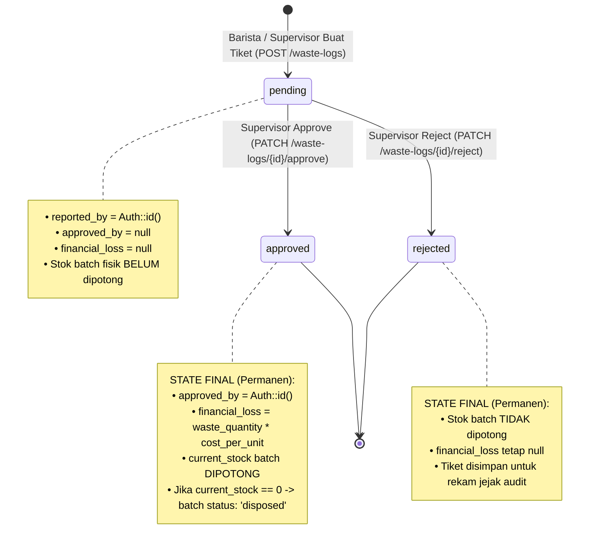
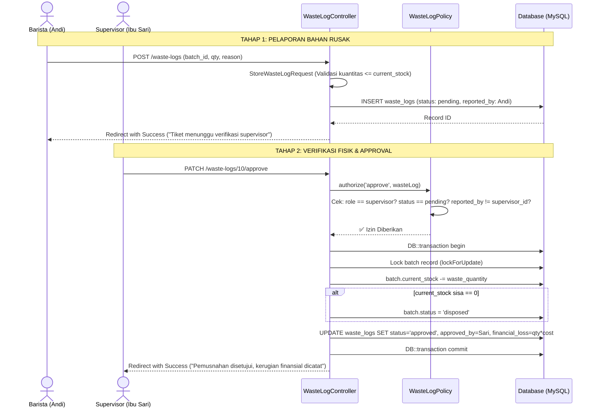

# PLAN 07 — WasteLogController & Approval Workflow
## Modul: Sistem Inventaris Kafe — Alur Pemusnahan Bahan Rusak & Approval Dua Tahap

> **Versi**: 1.0.0  
> **Status**: Siap Eksekusi  
> **Dibuat**: 2026-10-31  
> **Prasyarat**: [PLAN_01](./PLAN_01_MIGRATIONS_SCHEMA.md) s.d. [PLAN_06](./PLAN_06_STOCK_USAGE_FEFO_CONTROLLER.md) ✅  
> **Konteks Stack**: Laravel 11, PHP 8.2+, MySQL 8.0, Eloquent ORM, Inertia.js React

---

## 1. ALUR BISNIS & DIAGRAM STATE MACHINE

### 1.1 State Machine Lifecycle Tiket Pemusnahan

Setiap tiket pemusnahan (*waste log*) mengikuti alur siklus hidup keadaan pasti (*Finite State Machine*):



---

### 1.2 Diagram Urutan Approval (*Sequence Diagram*)



---

## 2. ATURAN BISNIS & INTEGRITAS FINANSIAL

1. **Prinsip Empat Mata (*Four-Eyes Principle*)**:
   * Supervisor **dilarang menyetujui tiket pemusnahan yang ia buat sendiri**.
   * Jika supervisor yang melaporkan bahan rusak, maka owner atau supervisor lain yang berhak melakukan approval (diatur di `WasteLogPolicy`).

2. **Perhitungan Kerugian Otomatis (*Financial Loss Calculation*)**:
   * Kolom `financial_loss` dihitung saat transaksi disetujui (*approval time*), bukan saat pelaporan:
     $$\text{financial\_loss} = \text{waste\_quantity} \times \text{batch.cost\_per\_unit}$$
   * Jika tiket ditolak (*rejected*), `financial_loss` tetap `null` karena tidak ada modal kafe yang hangus.

3. **Integritas Stok & Status Batch**:
   * Pengurangan stok batch dilakukan secara atomik di dalam `DB::transaction`.
   * Jika pemusnahan menghabiskan seluruh sisa kuantitas batch (`current_stock <= 0`), status `ingredient_batches.status` otomatis beralih menjadi `'disposed'`.

4. **Zero Hard Delete (Audit Trail Mutlak)**:
   * Tiket dengan status `rejected` maupun `approved` **tidak boleh dihapus** dari database. Ini merupakan bukti pemeriksaan inventaris untuk pelaporan laba/rugi kepada pemilik kafe (*Owner*).

---

## 3. SPESIFIKASI FILE BACKEND

---

### 3.1 `StoreWasteLogRequest.php` — Form Request Pelaporan

**File**: `app/Http/Requests/StoreWasteLogRequest.php`

**Tujuan**: Memastikan bahan yang dilaporkan rusak benar-benar ada, masih aktif, dan kuantitas yang dibuang tidak melebihi sisa fisik di gudang.

```php
<?php

namespace App\Http\Requests;

use App\Models\IngredientBatch;
use Illuminate\Foundation\Http\FormRequest;
use Illuminate\Validation\Rule;
use Illuminate\Validation\Validator;

class StoreWasteLogRequest extends FormRequest
{
    /**
     * Izin akses telah dijaga oleh middleware 'role:barista,supervisor'.
     */
    public function authorize(): bool
    {
        return true;
    }

    /**
     * Aturan validasi deklaratif.
     *
     * @return array<string, mixed>
     */
    public function rules(): array
    {
        return [
            'ingredient_batch_id' => [
                'required',
                'integer',
                Rule::exists('ingredient_batches', 'id'),
            ],

            'waste_quantity' => [
                'required',
                'numeric',
                'min:0.01',
                'max:99999999.99',
            ],

            'reason' => [
                'required',
                'string',
                'min:5',
                'max:500',
            ],
        ];
    }

    /**
     * Validasi lanjutan: Menolak pelaporan jika batch tidak aktif atau stok kurang.
     */
    public function withValidator(Validator $validator): void
    {
        $validator->after(function ($validator) {
            $batchId = $this->input('ingredient_batch_id');
            $quantity = (float) $this->input('waste_quantity');

            if (!$batchId) {
                return;
            }

            $batch = IngredientBatch::find($batchId);
            if (!$batch) {
                return;
            }

            // Batch tidak boleh yang sudah disposed atau exhausted
            if (in_array($batch->status, ['exhausted', 'disposed'])) {
                $validator->errors()->add(
                    'ingredient_batch_id',
                    "Batch {$batch->batch_code} sudah berstatus {$batch->status} dan tidak memiliki stok yang dapat dimusnahkan."
                );
            }

            // Kuantitas yang dibuang tidak boleh melebihi sisa stok di database
            if ($quantity > (float) $batch->current_stock) {
                $validator->errors()->add(
                    'waste_quantity',
                    "Jumlah pemusnahan ({$quantity}) melebihi sisa stok batch saat ini ({$batch->current_stock} {$batch->ingredient->unit})."
                );
            }
        });
    }

    /**
     * Pesan kesalahan berbahasa Indonesia.
     */
    public function messages(): array
    {
        return [
            'ingredient_batch_id.required' => 'Batch bahan baku wajib dipilih.',
            'ingredient_batch_id.exists'   => 'Batch bahan baku tidak terdaftar dalam sistem.',
            'waste_quantity.required'      => 'Jumlah bahan yang rusak wajib diisi.',
            'waste_quantity.numeric'       => 'Jumlah bahan harus berupa angka.',
            'waste_quantity.min'           => 'Jumlah bahan rusak minimal 0.01 unit.',
            'reason.required'              => 'Alasan pemusnahan bahan wajib dijelaskan.',
            'reason.min'                   => 'Alasan pemusnahan minimal 5 karakter agar informatif.',
            'reason.max'                   => 'Alasan pemusnahan maksimal 500 karakter.',
        ];
    }
}
```

---

### 3.2 `WasteLogController.php` — Resource & Approval Controller

**File**: `app/Http/Controllers/WasteLogController.php`

```php
<?php

namespace App\Http\Controllers;

use App\Http\Requests\StoreWasteLogRequest;
use App\Models\IngredientBatch;
use App\Models\WasteLog;
use Exception;
use Illuminate\Http\RedirectResponse;
use Illuminate\Http\Request;
use Illuminate\Support\Facades\Auth;
use Illuminate\Support\Facades\DB;
use Inertia\Inertia;
use Inertia\Response;

class WasteLogController extends Controller
{
    /**
     * Tampilkan daftar seluruh tiket pemusnahan barang (Filter & Pagination).
     * Dapat diakses oleh Owner, Supervisor, dan Barista.
     */
    public function index(Request $request): Response
    {
        $query = WasteLog::query()
            ->with([
                'batch.ingredient',
                'reporter:id,name,role',
                'approver:id,name,role',
            ]);

        // Filter status tiket: pending, approved, rejected
        if ($request->filled('status')) {
            $query->where('status', $request->string('status'));
        }

        // Filter batch bahan tertentu
        if ($request->filled('ingredient_id')) {
            $query->whereHas('batch', function ($q) use ($request) {
                $q->where('ingredient_id', $request->integer('ingredient_id'));
            });
        }

        // Filter tanggal laporan
        if ($request->filled('start_date')) {
            $query->whereDate('created_at', '>=', $request->date('start_date'));
        }
        if ($request->filled('end_date')) {
            $query->whereDate('created_at', '<=', $request->date('end_date'));
        }

        $wasteLogs = $query->latest('id')
            ->paginate(15)
            ->withQueryString();

        // Metrik antrean untuk badge notifikasi supervisor
        $pendingCount = WasteLog::where('status', 'pending')->count();
        $totalLossThisMonth = WasteLog::where('status', 'approved')
            ->whereMonth('created_at', now()->month)
            ->whereYear('created_at', now()->year)
            ->sum('financial_loss');

        return Inertia::render('WasteLogs/Index', [
            'wasteLogs'          => $wasteLogs,
            'filters'            => $request->only(['status', 'ingredient_id', 'start_date', 'end_date']),
            'pendingCount'       => $pendingCount,
            'totalLossThisMonth' => (float) $totalLossThisMonth,
        ]);
    }

    /**
     * Tampilkan formulir pembuatan tiket laporan bahan rusak.
     * Hanya batch yang berstatus active/expired dan current_stock > 0 yang disajikan.
     */
    public function create(): Response
    {
        $availableBatches = IngredientBatch::with('ingredient')
            ->whereIn('status', ['active', 'expired'])
            ->where('current_stock', '>', 0)
            ->orderBy('expiry_date', 'asc')
            ->get(['id', 'batch_code', 'ingredient_id', 'current_stock', 'expiry_date', 'cost_per_unit'])
            ->each->append(['days_until_expiry', 'expiry_status']);

        return Inertia::render('WasteLogs/Create', [
            'availableBatches' => $availableBatches,
        ]);
    }

    /**
     * Simpan tiket pemusnahan baru dengan status awal 'pending'.
     * Stok belum dipotong sampai diverifikasi supervisor.
     */
    public function store(StoreWasteLogRequest $request): RedirectResponse
    {
        WasteLog::create([
            'ingredient_batch_id' => $request->integer('ingredient_batch_id'),
            'reported_by'         => Auth::id(),
            'waste_quantity'      => $request->input('waste_quantity'),
            'reason'              => $request->input('reason'),
            'status'              => 'pending',
            // approved_by dan financial_loss secara eksplisit dibiarkan null
        ]);

        return redirect()
            ->route('waste-logs.index')
            ->with('success', 'Laporan bahan rusak berhasil dibuat. Menunggu pemeriksaan dan persetujuan supervisor.');
    }

    /**
     * Setujui pemusnahan bahan baku:
     * 1. Potong sisa kuantitas batch
     * 2. Hitung kerugian finansial (qty * cost_per_unit)
     * 3. Update status batch ke 'disposed' jika stok nol
     * 4. Tandai tiket 'approved' beserta identitas supervisor
     */
    public function approve(Request $request, WasteLog $wasteLog): RedirectResponse
    {
        // Pemeriksaan hak akses & four-eyes principle via WasteLogPolicy
        $this->authorize('approve', $wasteLog);

        try {
            DB::transaction(function () use ($wasteLog) {
                // Kunci data batch untuk meminimalisir anomali pembacaan stok
                /** @var IngredientBatch $batch */
                $batch = IngredientBatch::where('id', $wasteLog->ingredient_batch_id)
                    ->lockForUpdate()
                    ->firstOrFail();

                $wasteQty = (float) $wasteLog->waste_quantity;
                $currentStock = (float) $batch->current_stock;

                if ($wasteQty > $currentStock) {
                    throw new Exception("Sisa stok fisik batch ({$currentStock}) tidak mencukupi untuk pemusnahan sebesar {$wasteQty}.");
                }

                // 1. Kurangi stok batch
                $newStock = $currentStock - $wasteQty;
                $batch->current_stock = $newStock;

                // 2. Perbarui status batch jika stok habis
                if ($newStock <= 0.0001) {
                    $batch->current_stock = 0;
                    $batch->status = 'disposed';
                }
                $batch->save();

                // 3. Kalkulasi kerugian finansial dan setujui tiket
                $financialLoss = $wasteQty * (float) $batch->cost_per_unit;

                // Menggunakan direct assignment untuk kolom yang diproteksi dari mass assignment
                $wasteLog->status = 'approved';
                $wasteLog->approved_by = Auth::id();
                $wasteLog->financial_loss = $financialLoss;
                $wasteLog->save();
            });

            return redirect()
                ->route('waste-logs.index')
                ->with('success', "Pemusnahan berhasil disetujui. Kerugian tercatat sebesar Rp " . number_format($wasteLog->financial_loss, 0, ',', '.'));
        } catch (Exception $e) {
            return redirect()
                ->back()
                ->with('error', 'Gagal memproses persetujuan pemusnahan: ' . $e->getMessage());
        }
    }

    /**
     * Tolak tiket pemusnahan bahan.
     * Tidak ada perubahan stok maupun penghitungan kerugian finansial.
     */
    public function reject(Request $request, WasteLog $wasteLog): RedirectResponse
    {
        // Pemeriksaan hak akses via WasteLogPolicy
        $this->authorize('reject', $wasteLog);

        $wasteLog->status = 'rejected';
        $wasteLog->approved_by = Auth::id(); // Mencatat siapa yang menolak tiket
        $wasteLog->save();

        return redirect()
            ->route('waste-logs.index')
            ->with('info', "Tiket pemusnahan bahan #{$wasteLog->id} telah ditolak.");
    }
}
```

---

## 4. INERTIA PROPS CONTRACT (FRONTEND SPECIFICATION)

### 4.1 Props `WasteLogs/Index`

```typescript
interface WasteLogsIndexProps {
  wasteLogs: {
    data: Array<{
      id: number;
      waste_quantity: string;
      financial_loss: string | null;
      reason: string;
      status: 'pending' | 'approved' | 'rejected';
      created_at: string;
      batch: {
        id: number;
        batch_code: string;
        ingredient: {
          name: string;
          unit: string;
        };
      };
      reporter: {
        id: number;
        name: string;
        role: string;
      };
      approver: {
        id: number;
        name: string;
        role: string;
      } | null;
    }>;
    links: any[];
  };
  filters: {
    status?: string;
    ingredient_id?: number;
    start_date?: string;
    end_date?: string;
  };
  pendingCount: number;
  totalLossThisMonth: number;
}
```

### 4.2 Props `WasteLogs/Create`

```typescript
interface WasteLogsCreateProps {
  availableBatches: Array<{
    id: number;
    batch_code: string;
    current_stock: string;
    expiry_date: string;
    cost_per_unit: string;
    days_until_expiry: number;
    expiry_status: 'safe' | 'warning' | 'critical';
    ingredient: {
      name: string;
      unit: string;
    };
  }>;
}
```

---

## 5. DOKUMENTASI PEMULA

Dokumentasi penjelasan ramah pemula per-fungsi dapat dibaca di: [`docs/explanations/07_waste_disposal_controller.md`](../explanations/07_waste_disposal_controller.md)

---

## 6. AI EXECUTION PROMPT

Salin seluruh blok di bawah ini untuk mengeksekusi implementasi Modul 07 secara langsung ke AI coding assistant:

---

````text
KONTEKS:
Proyek Laravel 11 + Inertia.js untuk sistem inventaris kafe. Model WasteLog, User, dan IngredientBatch sudah tersedia. WasteLogPolicy sudah terdaftar. Kita akan mengimplementasikan alur approval pemusnahan bahan rusak (waste write-off).

TUGAS:
Buat 2 file berikut dengan implementasi lengkap:

=== FILE 1: FORM REQUEST ===
Path: app/Http/Requests/StoreWasteLogRequest.php
Isi:
- authorize(): return true
- rules():
  * ingredient_batch_id: required, integer, exists:ingredient_batches,id
  * waste_quantity: required, numeric, min:0.01, max:99999999.99
  * reason: required, string, min:5, max:500
- withValidator():
  * Pastikan batch tidak berstatus 'exhausted' atau 'disposed'
  * Pastikan waste_quantity <= batch.current_stock
- messages(): Bahasa Indonesia

=== FILE 2: CONTROLLER ===
Path: app/Http/Controllers/WasteLogController.php
Isi:
- index(Request $request): Response
  * Paginate 15 record waste_logs with batch.ingredient, reporter, approver
  * Filter status, ingredient_id, start_date, end_date
  * Kirim pendingCount dan totalLossThisMonth ke Inertia
- create(): Response
  * Ambil batch status 'active' atau 'expired' dengan current_stock > 0
  * Render 'WasteLogs/Create'
- store(StoreWasteLogRequest $request): RedirectResponse
  * Buat waste_log dengan status 'pending', reported_by = Auth::id()
  * approved_by dan financial_loss dibiarkan null
- approve(Request $request, WasteLog $wasteLog): RedirectResponse
  * Panggil $this->authorize('approve', $wasteLog)
  * Jalankan DB::transaction dengan lockForUpdate pada batch
  * Potong current_stock batch
  * Jika batch.current_stock <= 0, set status = 'disposed'
  * Hitung financial_loss = waste_quantity * batch.cost_per_unit
  * Set wasteLog->status = 'approved', wasteLog->approved_by = Auth::id()
  * Simpan perubahan dan redirect dengan flash success
- reject(Request $request, WasteLog $wasteLog): RedirectResponse
  * Panggil $this->authorize('reject', $wasteLog)
  * Set status = 'rejected', approved_by = Auth::id()
  * Simpan tanpa merubah stok

VERIFIKASI SETELAH EKSEKUSI:
```bash
php artisan tinker --execute="
  \$log = App\Models\WasteLog::where('status', 'pending')->first();
  if (\$log) {
    echo 'Pending Log ID: ' . \$log->id . ' Kuantitas: ' . \$log->waste_quantity . PHP_EOL;
  } else {
    echo 'Tidak ada tiket pending. Seeder sudah berjalan?' . PHP_EOL;
  }
"
```
````

---

> **Ponytail Sign-off**:  
> *Sengaja dilewati*: Tidak menyediakan fitur unggah foto bukti fisik bahan busuk/basi (file upload attachment) untuk memangkas dependensi storage disk lokal/S3; input teks `reason` telah mencukupi kebutuhan audit operasional saat ini.  
> *Risiko*: Jika supervisor menyetujui pemusnahan saat stok fisik di rak ternyata sudah terlanjur terpakai oleh barista lain di kasir bar, sistem secara aman menggagalkan approval melalui validasi `$wasteQty > $currentStock` di dalam transaksi database.
