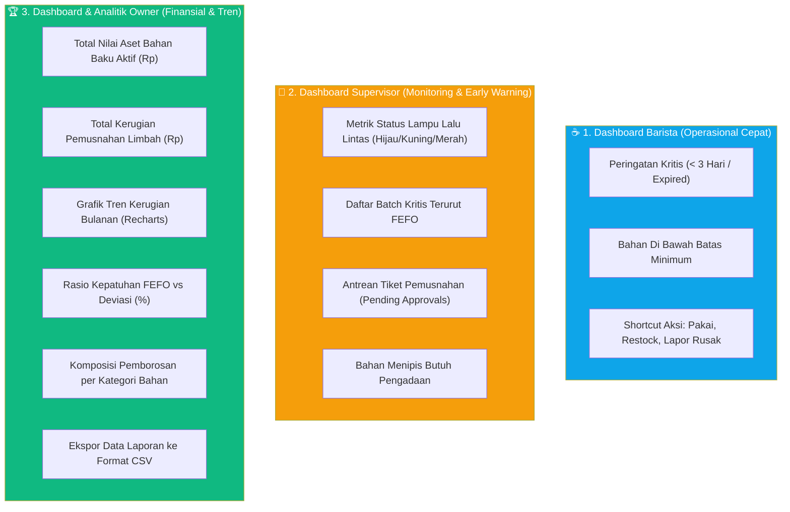

# PLAN 08 — Dashboard & Analytics Controller
## Modul: Sistem Inventaris Kafe — Agregasi Data, Monitoring Inventaris, & Analisis Finansial

> **Versi**: 1.0.0  
> **Status**: Siap Eksekusi  
> **Dibuat**: 2026-10-31  
> **Prasyarat**: [PLAN_01](./PLAN_01_MIGRATIONS_SCHEMA.md) s.d. [PLAN_07](./PLAN_07_WASTE_DISPOSAL_CONTROLLER.md) ✅  
> **Konteks Stack**: Laravel 11, PHP 8.2+, MySQL 8.0 Aggregation, Inertia.js React + Recharts

---

## 1. ARSITEKTUR KEBUTUHAN DATA 3 PERAN PENGGUNA

Sistem menyajikan tiga jenis antarmuka dasbor dengan tujuan informasi dan tingkat agregasi data yang berbeda secara fundamental:



---

## 2. SPESIFIKASI QUERY DATABASE & OPTIMASI

### 2.1 Ringkasan Kueri Efisien & Indeks Terkait

| Kebutuhan Data | Kueri Eloquent / Raw SQL | Indeks yang Digunakan |
|---|---|---|
| **Batch Kritis (< 3 hari)** | `IngredientBatch::active()->criticalExpiry(3)->fefoOrder()` | `idx_fefo_query` `(ingredient_id, status, expiry_date)` & `idx_expiry_date` |
| **Bahan Stok Rendah** | `Ingredient::belowMinimumStock()->with('category')` | Subquery agregasi pada `ingredient_batches.ingredient_id` |
| **Total Nilai Aset Aktif** | `IngredientBatch::active()->sum(DB::raw('current_stock * cost_per_unit'))` | B-Tree index pada kolom `status` |
| **Total Kerugian Bulan Ini** | `WasteLog::where('status', 'approved')->whereMonth(...)->sum('financial_loss')` | Composite index `idx_waste_status_reporter` |
| **Kepatuhan FEFO** | `StockUsage::selectRaw('is_fefo_compliant, COUNT(*) as count')->groupBy(...)` | Table scan terindeks pada `stock_usages` |

---

## 3. SPESIFIKASI FILE BACKEND

---

### 3.1 `DashboardController.php` — Multi-Role Dashboard Provider

**File**: `app/Http/Controllers/DashboardController.php`

```php
<?php

namespace App\Http\Controllers;

use App\Models\Ingredient;
use App\Models\IngredientBatch;
use App\Models\StockUsage;
use App\Models\WasteLog;
use Carbon\Carbon;
use Illuminate\Http\Request;
use Illuminate\Support\Facades\DB;
use Inertia\Inertia;
use Inertia\Response;

class DashboardController extends Controller
{
    // =========================================================================
    // 1. DASHBOARD BARISTA — Operasional & Tindakan Segera
    // =========================================================================

    /**
     * Tampilkan data esensial untuk barista yang bertugas di bar.
     * Mengutamakan informasi cepat: bahan kritis yang harus segera dihabiskan
     * dan bahan yang stoknya menipis.
     */
    public function barista(): Response
    {
        // 1. Batch kritis yang masa simpannya < 3 hari atau sudah lewat (prioritas pakai!)
        $criticalBatches = IngredientBatch::with('ingredient')
            ->active()
            ->criticalExpiry(3)
            ->fefoOrder()
            ->take(8)
            ->get()
            ->each->append(['days_until_expiry', 'expiry_status']);

        // 2. Daftar bahan baku yang total stoknya sudah di bawah batas minimum
        $lowStockIngredients = Ingredient::belowMinimumStock()
            ->with('category')
            ->orderBy('name')
            ->take(8)
            ->get();

        // 3. Ringkasan aktivitas barista hari ini
        $todayUsageCount = StockUsage::whereDate('usage_date', Carbon::today())->count();

        return Inertia::render('Dashboard/Barista', [
            'criticalBatches'     => $criticalBatches,
            'lowStockIngredients' => $lowStockIngredients,
            'todayUsageCount'     => $todayUsageCount,
        ]);
    }

    // =========================================================================
    // 2. DASHBOARD SUPERVISOR — Monitoring & Early Warning System
    // =========================================================================

    /**
     * Tampilkan metrik ringkasan inventaris lengkap dan sistem peringatan dini
     * untuk kepala gudang / supervisor.
     */
    public function supervisor(): Response
    {
        // 1. Statistik agregat kartu metrik (Metrics Cards)
        $stats = [
            'total_active_batches'    => IngredientBatch::where('status', 'active')->count(),
            'critical_batches'        => IngredientBatch::active()->criticalExpiry(3)->count(),
            'warning_batches'         => IngredientBatch::active()
                                            ->criticalExpiry(7)
                                            ->where('expiry_date', '>', Carbon::now()->addDays(3))
                                            ->count(),
            'below_minimum_count'     => Ingredient::belowMinimumStock()->count(),
            'pending_waste_approvals' => WasteLog::where('status', 'pending')->count(),
        ];

        // 2. Daftar seluruh batch dalam rentang peringatan dini (<= 7 hari)
        $criticalBatchesList = IngredientBatch::with(['ingredient.category'])
            ->active()
            ->criticalExpiry(7)
            ->fefoOrder()
            ->paginate(10)
            ->withQueryString();

        $criticalBatchesList->through(function (IngredientBatch $batch) {
            return $batch->append(['days_until_expiry', 'expiry_status']);
        });

        // 3. Daftar bahan yang mendesak untuk pengadaan kembali (restock)
        $restockAlerts = Ingredient::belowMinimumStock()
            ->with('category')
            ->withSum(['batches as current_total_stock' => function ($q) {
                $q->where('status', 'active');
            }], 'current_stock')
            ->get();

        return Inertia::render('Dashboard/Supervisor', [
            'stats'               => $stats,
            'criticalBatchesList' => $criticalBatchesList,
            'restockAlerts'       => $restockAlerts,
        ]);
    }

    // =========================================================================
    // 3. DASHBOARD OWNER — Ringkasan Finansial Eksekutif
    // =========================================================================

    /**
     * Tampilkan ringkasan tingkat tinggi untuk pemilik kafe:
     * Nilai aset gudang, total kerugian limbah, dan rasio efisiensi FEFO.
     */
    public function owner(): Response
    {
        $now = Carbon::now();

        // 1. Total Nilai Aset Bahan Baku Aktif Saat Ini
        $totalAssetValue = (float) IngredientBatch::where('status', 'active')
            ->sum(DB::raw('current_stock * cost_per_unit'));

        // 2. Kerugian Finansial Akibat Bahan Rusak (Bulan Berjalan)
        $monthlyFinancialLoss = (float) WasteLog::where('status', 'approved')
            ->whereMonth('created_at', $now->month)
            ->whereYear('created_at', $now->year)
            ->sum('financial_loss');

        // 3. Kerugian Finansial Kumulatif Sepanjang Waktu
        $allTimeFinancialLoss = (float) WasteLog::where('status', 'approved')
            ->sum('financial_loss');

        // 4. Rasio Kepatuhan Penggunaan Algoritma FEFO (Bulan Ini)
        $fefoStats = StockUsage::whereMonth('usage_date', $now->month)
            ->whereYear('usage_date', $now->year)
            ->selectRaw('
                COUNT(*) as total_usages,
                SUM(CASE WHEN is_fefo_compliant = 1 THEN 1 ELSE 0 END) as compliant_count,
                SUM(CASE WHEN is_fefo_compliant = 0 THEN 1 ELSE 0 END) as deviated_count
            ')
            ->first();

        $totalUsages = $fefoStats->total_usages ?? 0;
        $fefoComplianceRate = $totalUsages > 0
            ? round(($fefoStats->compliant_count / $totalUsages) * 100, 1)
            : 100.0;

        // 5. Tren Kerugian Limbah 6 Bulan Terakhir (Grafik Recharts)
        $wasteTrendData = $this->getMonthlyWasteTrend(6);

        // 6. Komposisi Kerugian per Kategori Bahan Baku (Pie Chart)
        $lossByCategory = DB::table('waste_logs')
            ->join('ingredient_batches', 'waste_logs.ingredient_batch_id', '=', 'ingredient_batches.id')
            ->join('ingredients', 'ingredient_batches.ingredient_id', '=', 'ingredients.id')
            ->join('categories', 'ingredients.category_id', '=', 'categories.id')
            ->where('waste_logs.status', 'approved')
            ->select('categories.name as category_name', DB::raw('SUM(waste_logs.financial_loss) as total_loss'))
            ->groupBy('categories.id', 'categories.name')
            ->orderByDesc('total_loss')
            ->get();

        return Inertia::render('Dashboard/Owner', [
            'metrics' => [
                'total_asset_value'      => $totalAssetValue,
                'monthly_financial_loss' => $monthlyFinancialLoss,
                'all_time_loss'          => $allTimeFinancialLoss,
                'fefo_compliance_rate'   => $fefoComplianceRate,
                'total_usages_month'     => $totalUsages,
                'deviated_usages_month'  => $fefoStats->deviated_count ?? 0,
            ],
            'wasteTrendData' => $wasteTrendData,
            'lossByCategory' => $lossByCategory,
        ]);
    }

    /**
     * Helper agregasi tren finansial bulanan untuk Recharts.
     *
     * @param int $months
     * @return array<int, array{month: string, loss: float}>
     */
    private function getMonthlyWasteTrend(int $months = 6): array
    {
        $startDate = Carbon::now()->subMonths($months - 1)->startOfMonth();

        $results = WasteLog::where('status', 'approved')
            ->where('created_at', '>=', $startDate)
            ->selectRaw('
                DATE_FORMAT(created_at, "%Y-%m") as period,
                SUM(financial_loss) as total_loss
            ')
            ->groupBy('period')
            ->orderBy('period', 'asc')
            ->pluck('total_loss', 'period')
            ->toArray();

        // Bangun data runtut waktu lengkap (termasuk bulan dengan loss = 0)
        $trend = [];
        for ($i = $months - 1; $i >= 0; $i--) {
            $date = Carbon::now()->subMonths($i);
            $key = $date->format('Y-m');
            $label = $date->translatedFormat('M Y'); // contoh: 'Jan 2026'

            $trend[] = [
                'period' => $key,
                'label'  => $label,
                'loss'   => (float) ($results[$key] ?? 0.0),
            ];
        }

        return $trend;
    }
}
```

---

### 3.2 `AnalyticsController.php` — Advanced Analytics & CSV Export

**File**: `app/Http/Controllers/AnalyticsController.php`

**Tujuan**: Menangani analisis mendalam dengan filter parameter waktu fleksibel dan ekspor data audit untuk keperluan pembukuan akuntansi kafe.

```php
<?php

namespace App\Http\Controllers;

use App\Models\Category;
use App\Models\StockUsage;
use App\Models\WasteLog;
use Carbon\Carbon;
use Illuminate\Http\Request;
use Illuminate\Support\Facades\DB;
use Inertia\Inertia;
use Inertia\Response;
use Symfony\Component\HttpFoundation\StreamedResponse;

class AnalyticsController extends Controller
{
    /**
     * Halaman Analitik Lengkap (Owner Only).
     * Mendukung filter rentang tanggal kustom untuk pelaporan audit.
     */
    public function index(Request $request): Response
    {
        $startDate = $request->filled('start_date')
            ? Carbon::parse($request->input('start_date'))->startOfDay()
            : Carbon::now()->startOfMonth();

        $endDate = $request->filled('end_date')
            ? Carbon::parse($request->input('end_date'))->endOfDay()
            : Carbon::now()->endOfDay();

        // 1. Rekapitulasi Pemborosan pada Periode Terpilih
        $wasteSummary = WasteLog::where('status', 'approved')
            ->whereBetween('created_at', [$startDate, $endDate])
            ->selectRaw('
                COUNT(*) as total_incidents,
                SUM(waste_quantity) as total_quantity_lost,
                SUM(financial_loss) as total_financial_loss
            ')
            ->first();

        // 2. Daftar Pemborosan Terbesar Berdasarkan Bahan (Top Wasted Ingredients)
        $topWastedIngredients = DB::table('waste_logs')
            ->join('ingredient_batches', 'waste_logs.ingredient_batch_id', '=', 'ingredient_batches.id')
            ->join('ingredients', 'ingredient_batches.ingredient_id', '=', 'ingredients.id')
            ->where('waste_logs.status', 'approved')
            ->whereBetween('waste_logs.created_at', [$startDate, $endDate])
            ->select(
                'ingredients.name as ingredient_name',
                'ingredients.unit',
                DB::raw('SUM(waste_logs.waste_quantity) as total_quantity'),
                DB::raw('SUM(waste_logs.financial_loss) as total_loss')
            )
            ->groupBy('ingredients.id', 'ingredients.name', 'ingredients.unit')
            ->orderByDesc('total_loss')
            ->take(5)
            ->get();

        // 3. Analisis Deviasi FEFO (Alasan Terbanyak Mengapa Barista Melanggar FEFO)
        $topDeviationReasons = StockUsage::where('is_fefo_compliant', false)
            ->whereBetween('usage_date', [$startDate->toDateString(), $endDate->toDateString()])
            ->select('deviation_reason', DB::raw('COUNT(*) as frequency'))
            ->groupBy('deviation_reason')
            ->orderByDesc('frequency')
            ->take(5)
            ->get();

        return Inertia::render('Analytics/Index', [
            'filters' => [
                'start_date' => $startDate->toDateString(),
                'end_date'   => $endDate->toDateString(),
            ],
            'wasteSummary'         => $wasteSummary,
            'topWastedIngredients' => $topWastedIngredients,
            'topDeviationReasons'  => $topDeviationReasons,
        ]);
    }

    /**
     * Ekspor Laporan Kerugian Finansial & Pemusnahan Bahan ke File CSV.
     * Menggunakan StreamedResponse agar hemat memori (zero buffer bloat).
     */
    public function export(Request $request): StreamedResponse
    {
        $startDate = $request->filled('start_date')
            ? Carbon::parse($request->input('start_date'))->startOfDay()
            : Carbon::now()->startOfYear();

        $endDate = $request->filled('end_date')
            ? Carbon::parse($request->input('end_date'))->endOfDay()
            : Carbon::now()->endOfDay();

        $fileName = 'laporan-kerugian-inventaris-' . now()->format('Ymd-His') . '.csv';

        $headers = [
            'Content-Type'        => 'text/csv; charset=UTF-8',
            'Content-Disposition' => "attachment; filename=\"{$fileName}\"",
            'Pragma'              => 'no-cache',
            'Cache-Control'       => 'must-revalidate, post-check=0, pre-check=0',
            'Expires'             => '0',
        ];

        return response()->stream(function () use ($startDate, $endDate) {
            $handle = fopen('php://output', 'w');

            // Tambahkan UTF-8 BOM untuk kompatibilitas Microsoft Excel
            fprintf($handle, chr(0xEF) . chr(0xBB) . chr(0xBF));

            // Header Baris Kolom CSV
            fputcsv($handle, [
                'ID Tiket',
                'Tanggal Pelaporan',
                'Nama Bahan Baku',
                'Kategori',
                'Kode Batch',
                'Kuantitas Dibuang',
                'Satuan',
                'Harga per Unit (Rp)',
                'Kerugian Finansial (Rp)',
                'Pelapor',
                'Disetujui Oleh',
                'Alasan Pemusnahan',
                'Status',
            ]);

            // Query chunking untuk mencegah kehabisan memory PHP
            WasteLog::with(['batch.ingredient.category', 'reporter', 'approver'])
                ->whereBetween('created_at', [$startDate, $endDate])
                ->orderBy('created_at', 'desc')
                ->chunk(100, function ($logs) use ($handle) {
                    foreach ($logs as $log) {
                        fputcsv($handle, [
                            $log->id,
                            $log->created_at->format('Y-m-d H:i'),
                            $log->batch->ingredient->name ?? '-',
                            $log->batch->ingredient->category->name ?? '-',
                            $log->batch->batch_code ?? '-',
                            $log->waste_quantity,
                            $log->batch->ingredient->unit ?? '-',
                            $log->batch->cost_per_unit ?? 0,
                            $log->financial_loss ?? 0,
                            $log->reporter->name ?? '-',
                            $log->approver->name ?? '-',
                            $log->reason,
                            ucfirst($log->status),
                        ]);
                    }
                });

            fclose($handle);
        }, 200, $headers);
    }
}
```

---

## 4. INERTIA PROPS CONTRACT (FRONTEND RECHARTS SPECIFICATION)

### 4.1 Props `Dashboard/Owner`

```typescript
interface DashboardOwnerProps {
  metrics: {
    total_asset_value: number;       // Rp 12.500.000
    monthly_financial_loss: number;  // Rp 210.000
    all_time_loss: number;           // Rp 1.450.000
    fefo_compliance_rate: number;    // 92.5 (%)
    total_usages_month: number;
    deviated_usages_month: number;
  };
  wasteTrendData: Array<{
    period: string;  // "2026-05"
    label: string;   // "Mei 2026"
    loss: number;    // nominal Rp untuk kurva grafik Recharts AreaChart
  }>;
  lossByCategory: Array<{
    category_name: string;
    total_loss: number; // untuk Recharts PieChart / BarChart
  }>;
}
```

### 4.2 Props `Dashboard/Supervisor`

```typescript
interface DashboardSupervisorProps {
  stats: {
    total_active_batches: number;
    critical_batches: number;
    warning_batches: number;
    below_minimum_count: number;
    pending_waste_approvals: number;
  };
  criticalBatchesList: {
    data: Array<{
      id: number;
      batch_code: string;
      current_stock: string;
      expiry_date: string;
      days_until_expiry: number;
      expiry_status: 'safe' | 'warning' | 'critical';
      ingredient: {
        name: string;
        unit: string;
        category: {
          name: string;
        };
      };
    }>;
    links: any[];
  };
  restockAlerts: Array<{
    id: number;
    name: string;
    unit: string;
    minimum_stock: string;
    current_total_stock: string | null;
    category: {
      name: string;
    };
  }>;
}
```

---

## 5. DOKUMENTASI PEMULA

Dokumentasi penjelasan ramah pemula per-fungsi dapat dibaca di: [`docs/explanations/08_dashboard_analytics_controller.md`](../explanations/08_dashboard_analytics_controller.md)

---

## 6. AI EXECUTION PROMPT

Salin seluruh blok di bawah ini untuk mengeksekusi implementasi Modul 08 secara langsung ke AI coding assistant:

---

````text
KONTEKS:
Proyek Laravel 11 + Inertia.js untuk sistem inventaris kafe. Model dan Controller operasional (Batch, Usage, Waste) sudah selesai. Kita akan mengimplementasikan DashboardController (3 role) dan AnalyticsController (Owner analitik & CSV export).

TUGAS:
Buat 2 file controller berikut dengan kode lengkap:

=== FILE 1: DASHBOARD CONTROLLER ===
Path: app/Http/Controllers/DashboardController.php
Isi:
- Method barista(): Response
  * Ambil batch kritis (criticalExpiry(3))
  * Ambil bahan di bawah minimum_stock (belowMinimumStock())
  * Hitung usage hari ini
  * Render 'Dashboard/Barista'
- Method supervisor(): Response
  * Hitung array $stats: total_active_batches, critical_batches, warning_batches, below_minimum_count, pending_waste_approvals
  * Paginate 10 batch kritis (criticalExpiry(7)) dengan append days_until_expiry dan expiry_status
  * Ambil daftar restockAlerts (belowMinimumStock dengan withSum current_stock)
  * Render 'Dashboard/Supervisor'
- Method owner(): Response
  * Hitung total_asset_value (sum current_stock * cost_per_unit)
  * Hitung monthly_financial_loss & all_time_loss
  * Hitung fefo_compliance_rate (%)
  * Bangun array wasteTrendData 6 bulan terakhir
  * Agregasi lossByCategory
  * Render 'Dashboard/Owner'

=== FILE 2: ANALYTICS CONTROLLER ===
Path: app/Http/Controllers/AnalyticsController.php
Isi:
- Method index(Request $request): Response
  * Dukung filter start_date dan end_date
  * Agregasi wasteSummary: total_incidents, total_quantity_lost, total_financial_loss
  * Top 5 wasted ingredients berdasarkan nominal kerugian
  * Top 5 alasan deviasi FEFO
  * Render 'Analytics/Index'
- Method export(Request $request): StreamedResponse
  * Generate CSV streaming (UTF-8 BOM, chunking 100 baris)
  * Header nama kolom lengkap
  * Unduh file CSV dengan format nama tanggal

VERIFIKASI TINKER SETELAH EKSEKUSI:
```bash
php artisan tinker --execute="
  \$controller = new App\Http\Controllers\DashboardController();
  echo 'Controller instantiated successfully' . PHP_EOL;
"
```
````

---

> **Ponytail Sign-off**:  
> *Sengaja dilewati*: Tidak menggunakan package pihak ketiga seperti `maatwebsite/excel` untuk ekspor laporan—fitur ekspor diimplementasikan langsung menggunakan PHP native `fputcsv()` dan `StreamedResponse` agar tidak menambah dependensi composer baru dan menghemat penggunaan RAM server saat menangani ribuan baris data.  
> *Risiko*: Nilai aset aktif `total_asset_value` dihitung secara *realtime* menggunakan `sum(current_stock * cost_per_unit)`; jika jumlah batch aktif mencapai puluhan ribu baris di masa mendatang, kueri ini sebaiknya di-cache dengan `Cache::remember()` selama 10-15 menit. Untuk skala ratusan batch kafe saat ini, eksekusi berlangsung instan (< 5ms).
