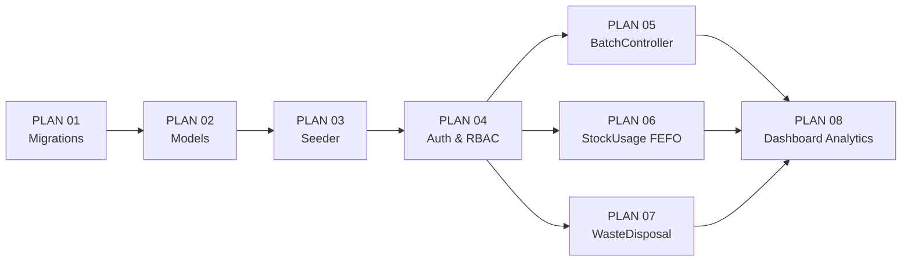

# MASTER LIST PROMPT PERENCANAAN BACKEND (PER-MODUL)
## Sistem Pemantauan Masa Kadaluwarsa dan Inventaris Kafe (Laravel 11 + Eloquent ORM + MySQL)

> **Tujuan Dokumen**: Dokumen ini merupakan katalog prompt siap pakai (*production-ready prompts*) berbasis **Prompt Engineering Patterns**. Setiap prompt dirancang untuk dijalankan ke AI coding assistant (ChatGPT, Claude, Gemini, atau Subagent) guna menghasilkan dokumen spesifikasi backend mandiri (*Backend Plan*) per-modul di folder `docs/Plan Backend/`.
>
> **Pendekatan Dual-Purpose**: Setiap plan yang dihasilkan AI memuat:
> 1. **Spesifikasi Teknis Backend**: Skema, kode PHP/Laravel, logika bisnis, dan penjelasan alur kerja yang rinci.
> 2. **Dokumentasi Penjelasan Per Fungsi**: File `docs/explanations/<modul>.md` berformat ramah pemula sesuai aturan `AGENTS.md` — setiap fungsi dijelaskan dengan tujuan, input, alur logika, dan output.

---

## DAFTAR MODUL & TARGET OUTPUT

| No | Nama Modul Backend | Persona / Layer | Target File Plan yang Dihasilkan |
| :---: | :--- | :--- | :--- |
| **01** | Database Migrations & Schema Design | Database Layer | `docs/Plan Backend/PLAN_01_MIGRATIONS_SCHEMA.md` |
| **02** | Models Eloquent & Relationships | ORM / Model Layer | `docs/Plan Backend/PLAN_02_MODELS_ELOQUENT.md` |
| **03** | Database Seeder & Test Data | Database Layer | `docs/Plan Backend/PLAN_03_DATABASE_SEEDER.md` |
| **04** | Autentikasi Backend & RBAC Middleware | Security Layer | `docs/Plan Backend/PLAN_04_AUTH_RBAC_MIDDLEWARE.md` |
| **05** | BatchController & Restock Workflow | Controller Layer | `docs/Plan Backend/PLAN_05_BATCH_RESTOCK_CONTROLLER.md` |
| **06** | StockUsageController & Algoritma FEFO | Controller Layer (Inti Bisnis) | `docs/Plan Backend/PLAN_06_STOCK_USAGE_FEFO_CONTROLLER.md` |
| **07** | WasteLogController & Approval Workflow | Controller Layer | `docs/Plan Backend/PLAN_07_WASTE_DISPOSAL_CONTROLLER.md` |
| **08** | Dashboard & Analytics Query (Owner) | Controller / Query Layer | `docs/Plan Backend/PLAN_08_DASHBOARD_ANALYTICS_CONTROLLER.md` |

---

## PANDUAN PENGGUNAAN PROMPT

1. **Pilih Modul yang Akan Dikerjakan**: Ambil salah satu prompt sesuai nomor modul yang ingin Anda rencanakan terlebih dahulu.
2. **Jalankan Prompt**: Salin (*copy*) seluruh blok teks prompt (mulai `### PERAN & OBJECTIVE` sampai akhir template) dan tempelkan ke AI coding assistant Anda.
3. **Simpan Hasilnya**: Pastikan AI menyimpan output ke direktori `docs/Plan Backend/` dengan nama file yang telah ditentukan.
4. **Alur ke Implementasi**: Gunakan bagian **AI Execution Prompt** di dalam setiap dokumen plan hasil AI untuk langsung mengeksekusi pembuatan kode nyata.

> [!IMPORTANT]
> Urutan **01 → 02 → 03 → 04** bersifat wajib berurutan (database harus ada sebelum model, model ada sebelum seeder). Modul 05–08 bisa dikerjakan paralel setelah modul 01–04 selesai.

---

```markdown
<!-- ============================================================================== -->
<!-- PROMPT 01: DATABASE MIGRATIONS & SCHEMA DESIGN                                -->
<!-- ============================================================================== -->
```

### PROMPT 01: Database Migrations & Schema Design (5 Tabel Inti)

> Gunakan prompt ini untuk menghasilkan rencana pembuatan semua file migration Laravel yang mendefinisikan struktur tabel sesuai ERD di PRD.md, lengkap dengan indeks, foreign key constraint, dan kolom enum.

```text
Anda adalah seorang Senior Backend Engineer dengan spesialisasi Laravel 11, MySQL, dan desain skema relasional. Anda sedang membantu tim mahasiswa membangun backend untuk "Sistem Pemantauan Masa Kadaluwarsa dan Inventaris Bahan Baku Kafe".

TUGAS ANDA:
Buatlah dokumen spesifikasi teknis komprehensif untuk "Modul 01: Database Migrations & Schema Design". Dokumen ini WAJIB disimpan di `docs/Plan Backend/PLAN_01_MIGRATIONS_SCHEMA.md`.

KONTEKS PROYEK:
- Stack: Laravel 11, PHP 8.2+, MySQL 8.0, Eloquent ORM
- Proyek adalah sistem inventaris kafe dengan logika FEFO (First Expired, First Out)
- Sistem memiliki 3 role pengguna: owner, supervisor, barista

SKEMA DATABASE (ERD DARI PRD.md):
Tabel yang WAJIB dibuat dalam urutan berikut (urutan penting untuk foreign key):
1. `users` — Kolom: id, name, email, password, role (enum: 'owner','supervisor','barista'), timestamps
2. `categories` — Kolom: id, name, slug, timestamps
3. `ingredients` — Kolom: id, category_id (FK→categories), name, unit, minimum_stock (decimal), warning_days (int, default 3), timestamps
4. `ingredient_batches` — Kolom: id, ingredient_id (FK→ingredients), batch_code (string, unique), initial_stock (decimal), current_stock (decimal), received_date (date), expiry_date (date), cost_per_unit (decimal), status (enum: 'active','exhausted','expired','disposed'), timestamps
5. `stock_usages` — Kolom: id, ingredient_batch_id (FK→ingredient_batches), user_id (FK→users), quantity_used (decimal), usage_date (date), is_fefo_compliant (boolean), deviation_reason (string, nullable), notes (text, nullable), timestamps
6. `waste_logs` — Kolom: id, ingredient_batch_id (FK→ingredient_batches), reported_by (FK→users), approved_by (FK→users, nullable), waste_quantity (decimal), financial_loss (decimal, nullable), reason (string), status (enum: 'pending','approved','rejected'), timestamps

BUSINESS RULES YANG WAJIB TERCERMIN DI SCHEMA:
- `expiry_date` HARUS selalu lebih besar dari `received_date` (enforced di application layer, bukan DB constraint)
- `current_stock` tidak boleh negatif (application layer validation)
- `financial_loss` = waste_quantity × cost_per_unit (computed saat status approved)
- Tidak ada soft delete bawaan Laravel pada tabel batches/waste (gunakan kolom status enum)

INDEKS WAJIB (untuk performa query FEFO):
- `ingredient_batches`: composite index pada (ingredient_id, status, expiry_date) — ini adalah index paling kritis untuk performa query FEFO
- `ingredient_batches`: index pada (expiry_date) — untuk dashboard early warning
- `stock_usages`: index pada (ingredient_batch_id, usage_date)
- `waste_logs`: index pada (status, reported_by)

FILE LARAVEL YANG WAJIB DIRENCANAKAN (nama file migration Laravel):
- `database/migrations/2026_01_01_000001_add_role_to_users_table.php` (modifikasi tabel users bawaan Laravel)
- `database/migrations/2026_01_01_000002_create_categories_table.php`
- `database/migrations/2026_01_01_000003_create_ingredients_table.php`
- `database/migrations/2026_01_01_000004_create_ingredient_batches_table.php`
- `database/migrations/2026_01_01_000005_create_stock_usages_table.php`
- `database/migrations/2026_01_01_000006_create_waste_logs_table.php`

STRUKTUR DOKUMEN OUTPUT YANG WAJIB ANDA HASILKAN:
Dokumen `docs/Plan Backend/PLAN_01_MIGRATIONS_SCHEMA.md` harus berisi:

1. RINGKASAN SKEMA & DIAGRAM ER (Mermaid erDiagram yang akurat sesuai tabel di atas)

2. SPESIFIKASI PER-MIGRATION (untuk setiap file migration):
   - Nama file migration
   - Kode lengkap PHP menggunakan Laravel 11 Schema Builder
   - Penjelasan: mengapa setiap kolom ada, tipe data yang dipilih, dan constraint yang diterapkan

3. ANALISIS INDEKS & PERFORMA:
   - Tabel daftar semua index yang dibuat
   - Penjelasan mengapa setiap index penting untuk query FEFO dan dashboard

4. CATATAN INTEGRITAS DATA:
   - Bagaimana foreign key constraint melindungi data
   - Kolom enum yang digunakan dan alasannya
   - Kolom yang sengaja nullable dan alasannya

5. DOKUMENTASI PEMULA (`docs/explanations/01_migrations_schema.md`):
   - Jelaskan setiap tabel dengan analogi dunia nyata kafe (contoh: "Tabel ingredient_batches ibarat label di setiap wadah bahan yang ditempel saat diterima dari supplier")
   - Format WAJIB per-tabel (bukan per-baris kode):
     * Tujuan tabel ini
     * Kolom-kolom penting dan artinya dalam konteks kafe
     * Hubungan dengan tabel lain

6. AI EXECUTION PROMPT (di bagian PALING AKHIR dokumen):
   Sertakan blok teks prompt siap copy-paste yang bisa langsung dijalankan ke AI coding assistant untuk MENGEKSEKUSI pembuatan seluruh file migration ini. Prompt eksekusi harus:
   - Menyebut nama file spesifik yang harus dibuat
   - Menyertakan kode lengkap atau instruksi generate `php artisan make:migration`
   - Menyebutkan perintah verifikasi: `php artisan migrate --pretend`
```

---

```markdown
<!-- ============================================================================== -->
<!-- PROMPT 02: MODELS ELOQUENT & RELATIONSHIPS                                     -->
<!-- ============================================================================== -->
```

### PROMPT 02: Models Eloquent & Relationships (5 Model Inti + Local Scopes)

> Gunakan prompt ini setelah PLAN_01 selesai. Prompt ini menghasilkan rencana pembuatan semua Model Eloquent dengan relasi, cast, scope FEFO, dan fillable protection.

```text
Anda adalah seorang Senior Laravel Backend Engineer yang ahli dalam Eloquent ORM, desain Model, dan best practice Laravel 11. Anda sedang membantu tim mahasiswa membangun backend sistem inventaris kafe.

TUGAS ANDA:
Buatlah dokumen spesifikasi teknis komprehensif untuk "Modul 02: Eloquent Models & Relationships". Dokumen ini WAJIB disimpan di `docs/Plan Backend/PLAN_02_MODELS_ELOQUENT.md`.

PRASYARAT: Tabel database sudah ada (lihat PLAN_01_MIGRATIONS_SCHEMA.md).

KONTEKS PROYEK:
- Stack: Laravel 11, PHP 8.2+, Eloquent ORM
- Terdapat 5 model inti: Category, Ingredient, IngredientBatch, StockUsage, WasteLog
- Model User sudah ada (Laravel default), perlu ditambahkan kolom role dan relasi

FILE LARAVEL YANG WAJIB DIRENCANAKAN:
- `app/Models/User.php` — Modifikasi: tambah cast role, relasi hasMany ke StockUsage dan WasteLog (reported/approved)
- `app/Models/Category.php` — Relasi: hasMany Ingredient
- `app/Models/Ingredient.php` — Relasi: belongsTo Category, hasMany IngredientBatch; scope: belowMinimumStock()
- `app/Models/IngredientBatch.php` — Relasi: belongsTo Ingredient, hasMany StockUsage, hasMany WasteLog; scope: fefoOrder(), active(), criticalExpiry()
- `app/Models/StockUsage.php` — Relasi: belongsTo IngredientBatch, belongsTo User
- `app/Models/WasteLog.php` — Relasi: belongsTo IngredientBatch, belongsTo User (reporter), belongsTo User (approver)

ATURAN WAJIB SETIAP MODEL:
1. `$fillable`: Definisikan secara eksplisit (TIDAK BOLEH menggunakan $guarded = [])
2. `$casts`: Cast kolom tanggal sebagai Carbon, boolean, dan decimal
3. `$hidden`: Sembunyikan kolom sensitif (misal: password di User)

LOCAL SCOPES WAJIB DI IngredientBatch:
- `scopeActive($query)`: Filter status = 'active' DAN current_stock > 0
- `scopeFefoOrder($query)`: orderBy('expiry_date', 'asc') — INI adalah inti algoritma FEFO
- `scopeCriticalExpiry($query, int $days = 7)`: Filter expiry_date <= Carbon::now()->addDays($days)
- `scopeForIngredient($query, int $ingredientId)`: Filter ingredient_id = $ingredientId

ACCESSOR/COMPUTED PROPERTY WAJIB:
- `IngredientBatch::getDaysUntilExpiryAttribute()`: Hitung selisih hari antara expiry_date dan today menggunakan Carbon. Return negatif jika sudah expired.
- `IngredientBatch::getExpiryStatusAttribute()`: Return string 'safe'|'warning'|'critical' berdasarkan sisa hari (>7: safe, 3-7: warning, <3 atau expired: critical)
- `IngredientBatch::getTotalValueAttribute()`: Return current_stock * cost_per_unit

STRUKTUR DOKUMEN OUTPUT YANG WAJIB ANDA HASILKAN:
Dokumen `docs/Plan Backend/PLAN_02_MODELS_ELOQUENT.md` harus berisi:

1. DIAGRAM RELASI MODEL (Mermaid classDiagram):
   - Tampilkan semua model, properti penting, dan panah relasi (hasMany, belongsTo)

2. SPESIFIKASI PER-MODEL (untuk setiap model):
   - Kode lengkap PHP Model Eloquent (class dengan namespace, use, properti, dan semua method)
   - Penjelasan setiap relasi: mengapa dibuat dan digunakan di mana
   - Penjelasan setiap $fillable: mengapa kolom tertentu dibatasi

3. PANDUAN LOCAL SCOPES (tabel referensi cepat):
   | Nama Scope | Digunakan di | Tujuan |
   | --- | --- | --- |

4. PANDUAN ACCESSOR:
   - Cara menggunakan accessor di Controller dan Inertia response
   - Contoh: `$batch->days_until_expiry`, `$batch->expiry_status`

5. DOKUMENTASI PEMULA (`docs/explanations/02_models_eloquent.md`):
   - Jelaskan konsep Eloquent Model dengan analogi "Model = Perwakilan Baris Tabel" (seperti kartu identitas setiap baris di database)
   - Jelaskan setiap Local Scope dengan analogi kafe: "scopeFefoOrder() ibarat meminta barista selalu ambil bahan yang paling dekat kedaluwarsanya dari rak depan"
   - Format: per-fungsi/per-scope (BUKAN per-baris kode)

6. AI EXECUTION PROMPT (di bagian PALING AKHIR dokumen):
   Prompt eksekusi untuk membuat semua file Model, berisi:
   - Perintah artisan: `php artisan make:model Category`, `php artisan make:model Ingredient`, dst.
   - Kode lengkap atau template untuk setiap model
   - Instruksi verifikasi via `php artisan tinker` (contoh query untuk test relasi dan scope)
```

---

```markdown
<!-- ============================================================================== -->
<!-- PROMPT 03: DATABASE SEEDER & TEST DATA                                         -->
<!-- ============================================================================== -->
```

### PROMPT 03: Database Seeder & Realistic Test Data

> Gunakan prompt ini untuk merencanakan seeder realistis yang siap demo di hadapan dosen: 3 akun user per role, beberapa kategori bahan, dan batch dengan berbagai status kedaluwarsa.

```text
Anda adalah seorang Senior Laravel Backend Engineer yang memahami kebutuhan demo presentasi proyek kampus sekaligus standar development database seeding yang benar.

TUGAS ANDA:
Buatlah dokumen spesifikasi teknis komprehensif untuk "Modul 03: Database Seeder & Test Data". Dokumen ini WAJIB disimpan di `docs/Plan Backend/PLAN_03_DATABASE_SEEDER.md`.

PRASYARAT: Migration (PLAN_01) dan Model (PLAN_02) sudah selesai.

KONTEKS PROYEK:
- Aplikasi ini akan didemokan ke dosen penguji — data harus realistis dan mencakup semua skenario bisnis
- Tiga role user: owner, supervisor, barista (masing-masing 1 akun demo)
- Credential demo yang mudah diingat: email role@kafe.com, password: "password"

DATA YANG WAJIB DI-SEED:

1. USERS (3 akun demo):
   - owner@kafe.com / password → role: owner, name: "Pak Budi (Owner)"
   - supervisor@kafe.com / password → role: supervisor, name: "Ibu Sari (Supervisor)"
   - barista@kafe.com / password → role: barista, name: "Andi (Barista)"

2. CATEGORIES (4 kategori):
   - Dairy Products (slug: dairy)
   - Coffee Beans (slug: beans)
   - Syrups & Flavoring (slug: syrups)
   - Bakery & Food (slug: bakery)

3. INGREDIENTS (minimal 6 bahan):
   - Fresh Milk Diamond 1L (Dairy, unit: botol, min_stock: 5, warning_days: 3)
   - Espresso Beans Arabica 1kg (Beans, unit: kg, min_stock: 2, warning_days: 7)
   - Caramel Syrup Monin 1L (Syrups, unit: botol, min_stock: 3, warning_days: 5)
   - Vanilla Latte Syrup 750ml (Syrups, unit: botol, min_stock: 2, warning_days: 5)
   - UHT Full Cream 1L (Dairy, unit: karton, min_stock: 10, warning_days: 3)
   - Croissant Frozen (Bakery, unit: pcs, min_stock: 20, warning_days: 2)

4. INGREDIENT_BATCHES (bervariasi status untuk demo semua skenario warning):
   Untuk Fresh Milk Diamond 1L:
   - Batch A: expiry 2 hari dari sekarang → status KRITIS 🔴 (current_stock: 3 botol)
   - Batch B: expiry 5 hari dari sekarang → status WARNING 🟡 (current_stock: 8 botol)
   - Batch C: expiry 15 hari dari sekarang → status AMAN 🟢 (current_stock: 12 botol)
   Untuk Espresso Beans:
   - Batch A: expiry 30 hari → status AMAN (current_stock: 5 kg)
   Sertakan minimal 8-10 batch total yang memperlihatkan semua 3 status (safe, warning, critical)

5. STOCK_USAGES (3-5 riwayat pemakaian):
   - Contoh pemakaian FEFO compliant (is_fefo_compliant: true)
   - Contoh pemakaian dengan deviasi (is_fefo_compliant: false, deviation_reason: "Batch B sudah dibuka lebih dulu di bar")

6. WASTE_LOGS (2-3 tiket):
   - 1 tiket pending (belum diapprove)
   - 1 tiket approved (dengan financial_loss terhitung)
   - 1 tiket rejected

FILE LARAVEL YANG WAJIB DIRENCANAKAN:
- `database/seeders/DatabaseSeeder.php` — Master seeder yang memanggil semua seeder lain dalam urutan benar
- `database/seeders/UserSeeder.php`
- `database/seeders/CategorySeeder.php`
- `database/seeders/IngredientSeeder.php`
- `database/seeders/IngredientBatchSeeder.php` — PALING PENTING: gunakan Carbon::now()->addDays(N) untuk expiry_date agar selalu relatif ke tanggal hari ini
- `database/seeders/StockUsageSeeder.php`
- `database/seeders/WasteLogSeeder.php`

ATURAN WAJIB:
- Gunakan `Carbon::now()->addDays(N)` untuk semua expiry_date (bukan tanggal hardcode) agar demo selalu relevan
- Semua user password harus di-hash dengan bcrypt: `Hash::make('password')`
- Urutan seeder WAJIB: Users → Categories → Ingredients → IngredientBatches → StockUsages → WasteLogs
- Gunakan `firstOrCreate()` bukan `create()` agar seeder idempotent (aman dijalankan berulang)

STRUKTUR DOKUMEN OUTPUT YANG WAJIB ANDA HASILKAN:
Dokumen `docs/Plan Backend/PLAN_03_DATABASE_SEEDER.md` harus berisi:

1. TABEL RINGKASAN DATA SEED:
   | Seeder | Jumlah Record | Tujuan Demo |

2. KODE LENGKAP SETIAP SEEDER FILE (PHP):
   - Kode penuh setiap seeder class, siap copy-paste
   - Komentar bahasa Indonesia yang menjelaskan setiap blok data

3. DIAGRAM URUTAN SEEDER (flowchart Mermaid):
   - Tampilkan dependency: A harus selesai sebelum B

4. SKENARIO DEMO YANG DICAKUP (tabel checklist):
   | Skenario | Dicakup? | Data Pendukung |
   | Tampil batch KRITIS merah | ✅ | Milk Batch A (2 hari) |
   | dst. |

5. DOKUMENTASI PEMULA (`docs/explanations/03_database_seeder.md`):
   - Jelaskan seeder dengan analogi "Seeder = mempersiapkan rak gudang kafe sebelum pertama kali dibuka"
   - Penjelasan per-seeder: tujuan, data yang dibuat, dan hasil yang terlihat di UI setelah dijalankan

6. AI EXECUTION PROMPT (di bagian PALING AKHIR dokumen):
   Prompt eksekusi berisi:
   - Kode lengkap semua seeder (siap copy ke file masing-masing)
   - Perintah: `php artisan db:seed` dan `php artisan migrate:fresh --seed`
   - Cara verifikasi di Tinker: `App\Models\IngredientBatch::fefoOrder()->get(['batch_code','expiry_date','status'])`
```

---

```markdown
<!-- ============================================================================== -->
<!-- PROMPT 04: AUTENTIKASI BACKEND & RBAC MIDDLEWARE                               -->
<!-- ============================================================================== -->
```

### PROMPT 04: Autentikasi Backend & RBAC Middleware/Policy

> Prompt ini menghasilkan rencana untuk sistem login Laravel, middleware role-check, dan Policy otorisasi per-aksi — lapisan keamanan yang melindungi semua controller berikutnya.

```text
Anda adalah seorang Senior Laravel Backend Engineer dengan spesialisasi keamanan aplikasi web, autentikasi, dan Role-Based Access Control (RBAC).

TUGAS ANDA:
Buatlah dokumen spesifikasi teknis komprehensif untuk "Modul 04: Autentikasi Backend & RBAC Middleware". Dokumen ini WAJIB disimpan di `docs/Plan Backend/PLAN_04_AUTH_RBAC_MIDDLEWARE.md`.

PRASYARAT: Model User dengan kolom role sudah ada (lihat PLAN_02).

KONTEKS PROYEK:
- Sistem menggunakan Inertia.js — autentikasi berbasis SESSION COOKIE (bukan API token/JWT)
- 3 peran dengan hierarki: owner > supervisor > barista
- Hak akses KRITIS yang harus dilindungi backend:
  * Approval waste disposal: HANYA supervisor (bukan barista, bukan owner)
  * Akses laporan finansial/export: HANYA owner
  * CRUD master data (bahan & kategori): HANYA supervisor
  * Input restock batch & pemakaian harian: supervisor DAN barista

MATRIKS RBAC DARI PRD.MD:
| Aksi | Owner | Supervisor | Barista |
| Approve Waste | ❌ | ✅ | ❌ |
| Lihat Laporan Finansial | ✅ | ❌ | ❌ |
| CRUD Master Bahan | ❌ | ✅ | ❌ |
| Input Batch Restock | ❌ | ✅ | ✅ |
| Input Pemakaian Harian | ❌ | ✅ | ✅ |
| Buat Tiket Waste | ❌ | ✅ | ✅ |
| Lihat Dashboard Operasional | ✅ | ✅ | ✅ |

FILE LARAVEL YANG WAJIB DIRENCANAKAN:
- `app/Http/Middleware/RoleMiddleware.php` — Custom middleware yang memeriksa kolom role user
- `app/Policies/WasteLogPolicy.php` — Policy khusus untuk aksi approve/reject waste disposal
- `app/Policies/IngredientPolicy.php` — Policy untuk CRUD master bahan
- `routes/web.php` — Rute lengkap dengan grup middleware dan nama rute
- `app/Http/Controllers/Auth/AuthenticatedSessionController.php` — Modifikasi redirect login berdasarkan role

MIDDLEWARE WAJIB DIDESAIN:
1. `RoleMiddleware` (class middleware):
   - Penggunaan: `->middleware('role:supervisor')` atau `->middleware('role:supervisor,owner')`
   - Jika akses ditolak: redirect ke halaman 403 atau kembali ke dashboard sesuai role
   - JANGAN gunakan Gate::define() yang berulang — cukup satu middleware universal

2. Login Redirect Berdasarkan Role (di AuthenticatedSessionController atau RouteServiceProvider):
   ```php
   // Setelah login berhasil:
   match($user->role) {
       'owner' => redirect()->route('dashboard.owner'),
       'supervisor' => redirect()->route('inventory.index'),
       'barista' => redirect()->route('dashboard.barista'),
   }
   ```

STRUKTUR RUTE (routes/web.php) YANG HARUS DIRENCANAKAN:
```php
// Public routes
Route::get('/login', ...)->name('login');
Route::post('/login', ...)->name('login.post');
Route::post('/logout', ...)->name('logout');

// Authenticated routes (semua perlu auth)
Route::middleware(['auth'])->group(function () {
    
    // Barista & Supervisor (semua staff operasional)
    Route::middleware(['role:barista,supervisor'])->group(function () {
        Route::post('/stock-usages', ...)->name('stock-usages.store');
        Route::post('/batches', ...)->name('batches.store');
        Route::post('/waste-logs', ...)->name('waste-logs.store');
    });

    // Supervisor only
    Route::middleware(['role:supervisor'])->group(function () {
        Route::resource('/ingredients', ...)->except(['show']);
        Route::resource('/categories', ...)->except(['show']);
        Route::patch('/waste-logs/{wasteLog}/approve', ...)->name('waste-logs.approve');
        Route::patch('/waste-logs/{wasteLog}/reject', ...)->name('waste-logs.reject');
    });

    // Owner only
    Route::middleware(['role:owner'])->group(function () {
        Route::get('/dashboard/owner', ...)->name('dashboard.owner');
        Route::get('/analytics/export', ...)->name('analytics.export');
    });

    // All authenticated (dashboard sesuai role)
    Route::get('/dashboard/barista', ...)->name('dashboard.barista');
    Route::get('/inventory', ...)->name('inventory.index');
});
```

STRUKTUR DOKUMEN OUTPUT YANG WAJIB ANDA HASILKAN:
Dokumen `docs/Plan Backend/PLAN_04_AUTH_RBAC_MIDDLEWARE.md` harus berisi:

1. DIAGRAM ALUR AUTENTIKASI & OTORISASI (Mermaid flowchart):
   - Alur: Request masuk → middleware auth → middleware role → controller → response
   - Termasuk cabang: akses ditolak (403/redirect)

2. KODE LENGKAP:
   - `RoleMiddleware.php` (kode PHP penuh, siap diimplementasikan)
   - `routes/web.php` (struktur rute lengkap dengan nama rute, middleware, dan controller method yang dituju)
   - Modifikasi `AuthenticatedSessionController.php` (bagian redirect berdasarkan role)

3. TABEL RINGKASAN PROTEKSI RUTE:
   | Rute | Method | Middleware | Controller@method |

4. PENANGANAN AKSES DITOLAK:
   - Halaman 403 yang informatif (bukan error kosong)
   - Flash message jika redirect ke dashboard sendiri

5. DOKUMENTASI PEMULA (`docs/explanations/04_auth_rbac_middleware.md`):
   - Analogi middleware: "Middleware ibarat satpam di pintu masuk — setiap tamu (request) dicek kartu identitasnya (role) sebelum diizinkan masuk ke ruangan tertentu"
   - Jelaskan mengapa role check di backend WAJIB ada meski tombol sudah disembunyikan di frontend
   - Per-fungsi: RoleMiddleware::handle(), login redirect logic

6. AI EXECUTION PROMPT (di bagian PALING AKHIR dokumen):
   Prompt eksekusi berisi:
   - Perintah artisan: `php artisan make:middleware RoleMiddleware`
   - Kode lengkap semua file
   - Perintah registrasi middleware di `bootstrap/app.php` (Laravel 11 tidak pakai Kernel.php)
   - Cara test dengan Pest: simulasikan request sebagai barista ke rute supervisor-only dan verifikasi dapat 403
```

---

```markdown
<!-- ============================================================================== -->
<!-- PROMPT 05: BATCHCONTROLLER & RESTOCK WORKFLOW                                  -->
<!-- ============================================================================== -->
```

### PROMPT 05: BatchController & Alur Penerimaan Restock Batch Baru

> Prompt ini menghasilkan rencana implementasi controller untuk menerima stok baru dari suplier, termasuk validasi tanggal kedaluwarsa, pembuatan nomor batch otomatis, dan DB transaction.

```text
Anda adalah seorang Senior Laravel Backend Engineer yang ahli dalam Controller design, Form Request Validation, dan Eloquent ORM.

TUGAS ANDA:
Buatlah dokumen spesifikasi teknis komprehensif untuk "Modul 05: BatchController & Alur Penerimaan Restock". Dokumen ini WAJIB disimpan di `docs/Plan Backend/PLAN_05_BATCH_RESTOCK_CONTROLLER.md`.

PRASYARAT: Migration, Model, Seeder, dan Auth/RBAC sudah selesai (PLAN_01 s.d. PLAN_04).

KONTEKS BISNIS (dari PRD.md):
Saat suplier mengirim bahan baru, Barista atau Supervisor mencatat penerimaan batch:
- Input form: Nama Bahan (ingredient_id), Tanggal Kedaluwarsa, Jumlah Kuantitas, Harga Beli per Unit
- Nomor batch otomatis dibuat sistem: format "BATCH-{YYYYMMDD}-{urutan 2 digit}" jika tidak diisi manual
- Setelah berhasil: stok tercatat di tabel ingredient_batches dengan status 'active'

FILE LARAVEL YANG WAJIB DIRENCANAKAN:
- `app/Http/Controllers/IngredientBatchController.php`
- `app/Http/Requests/StoreBatchRequest.php`
- `app/Http/Requests/UpdateBatchRequest.php` (untuk koreksi data batch jika salah input)

METHOD CONTROLLER YANG DIRENCANAKAN:
```php
class IngredientBatchController extends Controller
{
    public function index(Request $request): Response   // Daftar semua batch (dengan filter)
    public function create(): Response                   // Form tambah batch baru (Inertia)
    public function store(StoreBatchRequest $request): RedirectResponse  // Simpan batch baru
    public function show(IngredientBatch $batch): Response               // Detail satu batch
    public function destroy(IngredientBatch $batch): RedirectResponse    // TIDAK ADA hard delete!
}
```

VALIDASI WAJIB (StoreBatchRequest):
- `ingredient_id`: required, exists:ingredients,id
- `expiry_date`: required, date, after:received_date (kedaluwarsa harus SETELAH tanggal terima)
- `received_date`: required, date, before_or_equal:today
- `initial_stock`: required, numeric, min:0.01
- `cost_per_unit`: required, numeric, min:0
- `batch_code`: nullable, string, unique:ingredient_batches,batch_code

LOGIKA BISNIS DALAM store() METHOD:
```php
public function store(StoreBatchRequest $request): RedirectResponse
{
    return DB::transaction(function () use ($request) {
        $batchCode = $request->batch_code 
            ?? 'BATCH-' . now()->format('Ymd') . '-' . str_pad(
                IngredientBatch::whereDate('created_at', today())->count() + 1, 2, '0', STR_PAD_LEFT
            );

        IngredientBatch::create([
            ...$request->validated(),
            'batch_code'    => $batchCode,
            'current_stock' => $request->initial_stock,
            'status'        => 'active',
        ]);

        return redirect()->route('inventory.index')
            ->with('success', "Batch {$batchCode} berhasil ditambahkan.");
    });
}
```

DATA YANG DIKIRIM KE INERTIA (index response):
```php
return Inertia::render('Inventory/BatchIndex', [
    'batches' => IngredientBatch::with('ingredient.category')
        ->active()
        ->fefoOrder()
        ->paginate(15),
    'ingredients' => Ingredient::orderBy('name')->get(['id', 'name', 'unit']),
]);
```

STRUKTUR DOKUMEN OUTPUT YANG WAJIB ANDA HASILKAN:
Dokumen `docs/Plan Backend/PLAN_05_BATCH_RESTOCK_CONTROLLER.md` harus berisi:

1. DIAGRAM ALUR PENERIMAAN BATCH (Mermaid flowchart):
   - Request POST → Validation → Generate batch_code → DB::transaction → Simpan → Redirect

2. KODE LENGKAP:
   - `IngredientBatchController.php` (semua method dengan komentar)
   - `StoreBatchRequest.php` (rules() dan messages() dalam Bahasa Indonesia)

3. PENJELASAN VALIDASI:
   - Tabel: setiap aturan validasi, mengapa ada, dan pesan error yang ditampilkan ke user

4. EDGE CASES YANG DITANGANI:
   - Batch code duplikat → validasi `unique`
   - Tanggal kedaluwarsa lebih kecil dari tanggal terima → ditolak `after:received_date`
   - Kuantitas 0 → ditolak `min:0.01`

5. DOKUMENTASI PEMULA (`docs/explanations/05_batch_restock_controller.md`):
   - Analogi BatchController: "Controller ini ibarat petugas gudang yang mencatat di buku penerimaan barang setiap kali suplier datang mengantar"
   - Per-fungsi: store(), index(), generate batch_code logic

6. AI EXECUTION PROMPT (di bagian PALING AKHIR dokumen):
   - Perintah artisan: `php artisan make:controller IngredientBatchController` dan `php artisan make:request StoreBatchRequest`
   - Kode lengkap semua file
   - Test Pest: POST /batches dengan data valid → verifikasi batch tersimpan dan redirect sukses
   - Test Pest: POST /batches dengan expiry_date < received_date → verifikasi validasi gagal
```

---

```markdown
<!-- ============================================================================== -->
<!-- PROMPT 06: STOCKUSAGECONTROLLER & ALGORITMA FEFO                               -->
<!-- ============================================================================== -->
```

### PROMPT 06: StockUsageController & Implementasi Algoritma FEFO (Modul Inti)

> **Ini adalah modul paling kritis di seluruh sistem.** Prompt ini menghasilkan rencana implementasi controller pemakaian stok dengan logika rekomendasi FEFO, deteksi deviasi, pencegahan stok negatif, dan DB transaction penuh.

```text
Anda adalah seorang Senior Laravel Backend Engineer dengan spesialisasi dalam business logic yang kompleks, algoritma manajemen inventaris, dan desain sistem yang aman dan konsisten.

TUGAS ANDA:
Buatlah dokumen spesifikasi teknis PALING DETAIL untuk "Modul 06: StockUsageController & Algoritma FEFO". Ini adalah modul bisnis paling penting dalam sistem. Dokumen ini WAJIB disimpan di `docs/Plan Backend/PLAN_06_STOCK_USAGE_FEFO_CONTROLLER.md`.

PRASYARAT: Semua modul 01–05 sudah selesai.

KONTEKS BISNIS LENGKAP (dari PRD.md):
Ini adalah alur paling kompleks dalam sistem:
1. Barista memilih nama bahan yang akan dipakai
2. Backend mengembalikan DAFTAR BATCH AKTIF terurut dari expiry_date terdekat
3. Batch paling atas otomatis menjadi REKOMENDASI FEFO (ditandai badge [★ REKOMENDASI FEFO])
4. Barista memasukkan kuantitas dan mengkonfirmasi batch fisik yang digunakan
5. Jika batch yang dipilih bukan batch rekomendasi FEFO teratas → sistem WAJIB minta deviation_reason
6. Backend memotong current_stock pada batch terpilih
7. Catat ke stock_usages dengan kolom is_fefo_compliant dan deviation_reason

BUSINESS RULES KRITIS:
- `current_stock` TIDAK BOLEH negatif → validasi: `quantity_used <= batch.current_stock`
- Seluruh pemotongan stok WAJIB dalam `DB::transaction`
- `is_fefo_compliant = true` HANYA jika batch dipilih adalah batch FEFO teratas (expiry_date paling dekat) dari ingredient tersebut
- `deviation_reason` WAJIB diisi jika `is_fefo_compliant = false`
- Jika `current_stock` setelah dipotong = 0, otomatis update `status = 'exhausted'`

FILE LARAVEL YANG WAJIB DIRENCANAKAN:
- `app/Http/Controllers/StockUsageController.php`
- `app/Http/Requests/RecordUsageRequest.php`
- `app/Actions/DeductStockAction.php` — Action class terpisah yang berisi core deduction logic (testable)

METHOD CONTROLLER:
```php
class StockUsageController extends Controller
{
    public function index(): Response          // Riwayat pemakaian (untuk supervisor)
    public function create(Request $request): Response  // Form pemakaian + daftar batch FEFO
    public function store(RecordUsageRequest $request): RedirectResponse  // Proses pemakaian
    public function show(StockUsage $stockUsage): Response               // Detail satu riwayat
}
```

LOGIKA INTI FEFO DALAM create() — DATA YANG DIKIRIM KE INERTIA:
```php
public function create(Request $request): Response
{
    $ingredientId = $request->ingredient_id;
    
    // Query FEFO: batch aktif, diurutkan expiry terdekat
    $batches = IngredientBatch::where('ingredient_id', $ingredientId)
        ->active()
        ->fefoOrder()
        ->get(['id', 'batch_code', 'current_stock', 'expiry_date', 'cost_per_unit']);
    
    return Inertia::render('StockUsage/Create', [
        'ingredients' => Ingredient::orderBy('name')->get(['id', 'name', 'unit']),
        'batches'     => $batches,
        // batch pertama (index 0) adalah rekomendasi FEFO
        'fefo_recommended_batch_id' => $batches->first()?->id,
    ]);
}
```

LOGIKA INTI FEFO DALAM store() VIA DeductStockAction:
```php
// DeductStockAction.php
public function execute(IngredientBatch $batch, float $quantity, int $userId, ?string $deviationReason): StockUsage
{
    return DB::transaction(function () use ($batch, $quantity, $userId, $deviationReason) {
        // 1. Cek stok mencukupi
        if ($batch->current_stock < $quantity) {
            throw new InsufficientStockException("Stok tidak mencukupi. Tersisa: {$batch->current_stock}");
        }
        
        // 2. Tentukan apakah FEFO compliant
        $fefoTopBatch = IngredientBatch::where('ingredient_id', $batch->ingredient_id)
            ->active()
            ->fefoOrder()
            ->first();
        $isFefoCompliant = $fefoTopBatch?->id === $batch->id;
        
        // 3. Potong stok
        $batch->decrement('current_stock', $quantity);
        
        // 4. Update status jika habis
        if ($batch->fresh()->current_stock <= 0) {
            $batch->update(['status' => 'exhausted']);
        }
        
        // 5. Catat riwayat
        return StockUsage::create([
            'ingredient_batch_id' => $batch->id,
            'user_id'             => $userId,
            'quantity_used'       => $quantity,
            'usage_date'          => today(),
            'is_fefo_compliant'   => $isFefoCompliant,
            'deviation_reason'    => $isFefoCompliant ? null : $deviationReason,
        ]);
    });
}
```

VALIDASI WAJIB (RecordUsageRequest):
- `ingredient_batch_id`: required, exists:ingredient_batches,id
- `quantity_used`: required, numeric, min:0.01
- `deviation_reason`: required_if:is_fefo_compliant,false | nullable, string, max:500
- Custom validation: cek apakah quantity_used <= batch.current_stock (di withValidator() atau after())

STRUKTUR DOKUMEN OUTPUT YANG WAJIB ANDA HASILKAN:
Dokumen `docs/Plan Backend/PLAN_06_STOCK_USAGE_FEFO_CONTROLLER.md` harus berisi:

1. DIAGRAM ALUR LENGKAP FEFO (Mermaid flowchart):
   - Mulai dari "Barista pilih bahan" sampai "Stok terpotong & riwayat tercatat"
   - Tampilkan cabang: FEFO compliant vs deviasi, stok habis vs tidak habis

2. KODE LENGKAP:
   - `StockUsageController.php` (semua method)
   - `RecordUsageRequest.php` (rules, messages, withValidator untuk cek stok)
   - `DeductStockAction.php` (kode penuh dengan exception handling)
   - Custom Exception: `app/Exceptions/InsufficientStockException.php`

3. TABEL SKENARIO & RESPONSE:
   | Skenario | Input | is_fefo_compliant | Status Batch | Response |
   | Pemakaian normal FEFO | Batch terdekat, qty=2 | true | active | sukses |
   | Deviasi FEFO | Batch ke-2, reason="..." | false | active | sukses |
   | Stok habis | qty = current_stock | true | exhausted | sukses |
   | Melebihi stok | qty > current_stock | - | - | error 422 |

4. PANDUAN TESTING (Pest/PHPUnit):
   - Test case: 3 batch berbeda tanggal, pastikan batch paling dekat selalu jadi rekomendasi
   - Test case: pemakaian melebihi stok → exception ditangkap

5. DOKUMENTASI PEMULA (`docs/explanations/06_stock_usage_fefo.md`):
   - Analogi FEFO: "Sistem ini ibarat kepala gudang yang selalu bilang ke barista: 'Ambil dulu susu yang tanggal kedaluwarsanya paling dekat dari rak depan!'"
   - Jelaskan DeductStockAction dengan analogi: "Action class ini ibarat prosedur baku pengambilan barang — langkah-langkahnya tertulis dan selalu sama"
   - Per-fungsi: execute(), FEFO detection logic, stok exhaustion logic

6. AI EXECUTION PROMPT (di bagian PALING AKHIR dokumen):
   - Perintah artisan: `php artisan make:controller StockUsageController`, `php artisan make:request RecordUsageRequest`, pembuatan manual `DeductStockAction.php`
   - Kode lengkap semua file
   - Pest test commands: `php artisan test --filter=StockUsageTest`
   - Test scenario yang WAJIB lolos sebelum modul dianggap selesai
```

---

```markdown
<!-- ============================================================================== -->
<!-- PROMPT 07: WASTELOGCONTROLLER & APPROVAL WORKFLOW                              -->
<!-- ============================================================================== -->
```

### PROMPT 07: WasteLogController & Alur Approval Pemusnahan Bahan Rusak

> Prompt ini menghasilkan rencana implementasi sistem dua-langkah untuk pemusnahan bahan: Barista lapor (pending) → Supervisor approve/reject (approved/rejected) dengan kalkulasi kerugian finansial otomatis.

```text
Anda adalah seorang Senior Laravel Backend Engineer yang memahami sistem approval workflow, state machine sederhana, dan audit trail yang aman.

TUGAS ANDA:
Buatlah dokumen spesifikasi teknis komprehensif untuk "Modul 07: WasteLogController & Approval Workflow". Dokumen ini WAJIB disimpan di `docs/Plan Backend/PLAN_07_WASTE_DISPOSAL_CONTROLLER.md`.

PRASYARAT: Modul 01–04 sudah selesai. Model WasteLog sudah ada.

KONTEKS BISNIS (dari PRD.md):
- Barista menemukan bahan rusak → buat tiket waste (status: pending)
- Supervisor mengecek fisik → tekan Approve atau Reject
- Jika APPROVED: current_stock batch dikurangi sebesar waste_quantity, status batch menjadi 'disposed' jika habis, dan financial_loss dihitung: waste_quantity × cost_per_unit
- Jika REJECTED: tidak ada perubahan stok, tiket ditandai rejected
- TIDAK ADA hard delete — data waste_log tidak boleh dihapus permanen

STATE MACHINE WASTE LOG:
pending → approved (oleh Supervisor)
pending → rejected (oleh Supervisor)
(approved/rejected adalah status final, tidak bisa diubah lagi)

FILE LARAVEL YANG WAJIB DIRENCANAKAN:
- `app/Http/Controllers/WasteLogController.php`
- `app/Http/Requests/StoreWasteLogRequest.php`

METHOD CONTROLLER:
```php
class WasteLogController extends Controller
{
    public function index(): Response       // Daftar semua waste log (Supervisor & Owner)
    public function create(): Response      // Form lapor bahan rusak (Barista)
    public function store(StoreWasteLogRequest $request): RedirectResponse  // Buat tiket
    public function approve(WasteLog $wasteLog): RedirectResponse  // Approve → potong stok
    public function reject(WasteLog $wasteLog): RedirectResponse   // Reject tiket
}
```

LOGIKA APPROVE (paling kritis):
```php
public function approve(WasteLog $wasteLog): RedirectResponse
{
    // Proteksi: hanya pending yang bisa diapprove
    abort_if($wasteLog->status !== 'pending', 403, 'Tiket ini sudah diproses.');
    
    return DB::transaction(function () use ($wasteLog) {
        $batch = $wasteLog->ingredientBatch;
        
        // Hitung kerugian finansial
        $financialLoss = $wasteLog->waste_quantity * $batch->cost_per_unit;
        
        // Update waste log
        $wasteLog->update([
            'status'         => 'approved',
            'approved_by'    => auth()->id(),
            'financial_loss' => $financialLoss,
        ]);
        
        // Potong stok batch
        $newStock = max(0, $batch->current_stock - $wasteLog->waste_quantity);
        $batch->update([
            'current_stock' => $newStock,
            'status'        => $newStock <= 0 ? 'disposed' : $batch->status,
        ]);
        
        return redirect()->route('waste-logs.index')
            ->with('success', "Pemusnahan disetujui. Kerugian: Rp " . number_format($financialLoss, 0, ',', '.'));
    });
}
```

VALIDASI (StoreWasteLogRequest):
- `ingredient_batch_id`: required, exists:ingredient_batches,id
- `waste_quantity`: required, numeric, min:0.01
- Custom: waste_quantity tidak boleh melebihi current_stock batch
- `reason`: required, string, min:10, max:500

STRUKTUR DOKUMEN OUTPUT YANG WAJIB ANDA HASILKAN:
Dokumen `docs/Plan Backend/PLAN_07_WASTE_DISPOSAL_CONTROLLER.md` harus berisi:

1. DIAGRAM STATE MACHINE WASTE LOG (Mermaid stateDiagram):
   - Status: pending → approved / rejected
   - Siapa yang bisa melakukan transisi

2. DIAGRAM ALUR APPROVAL (Mermaid sequenceDiagram):
   - Actor: Barista, Supervisor, System (DB)
   - Langkah: Barista submit → DB pending → Supervisor approve → DB update stok → Response

3. KODE LENGKAP:
   - `WasteLogController.php` (semua method dengan penanganan state)
   - `StoreWasteLogRequest.php`
   - Rute di routes/web.php untuk approve dan reject

4. AUDIT TRAIL:
   - Kolom `approved_by` dan timestamp diisi otomatis saat approval
   - Mengapa financial_loss disimpan (bukan dihitung ulang) → immutability

5. EDGE CASES:
   - Approve waste yang melebihi current_stock (misal karena race condition) → gunakan max(0, ...)
   - Supervisor mencoba approve tiket yang sudah approved → abort_if() dengan pesan jelas

6. DOKUMENTASI PEMULA (`docs/explanations/07_waste_disposal.md`):
   - Analogi: "WasteLog ibarat form surat pemusnahan barang di gudang — harus ada tanda tangan supervisor sebelum barang boleh dibuang dan kerugiannya dicatat"
   - Per-fungsi: store(), approve(), reject(), financial_loss calculation

7. AI EXECUTION PROMPT (di bagian PALING AKHIR dokumen):
   - Perintah artisan dan kode lengkap
   - Pest test: Barista submit waste → verifikasi status pending; Supervisor approve → verifikasi stok berkurang dan financial_loss terhitung
   - Test: double-approve → verifikasi abort 403
```

---

```markdown
<!-- ============================================================================== -->
<!-- PROMPT 08: DASHBOARD & ANALYTICS QUERY (OWNER)                                 -->
<!-- ============================================================================== -->
```

### PROMPT 08: Dashboard Analytics Controller & Query Agregasi (Owner & Supervisor)

> Prompt ini menghasilkan rencana semua query agregasi untuk tiga dashboard berbeda: dashboard barista (operasional), dashboard supervisor (monitoring inventaris + early warning), dan dashboard owner (laporan finansial & kerugian).

```text
Anda adalah seorang Senior Laravel Backend Engineer dengan spesialisasi query optimization, database aggregation, dan perancangan Inertia.js response yang efisien.

TUGAS ANDA:
Buatlah dokumen spesifikasi teknis komprehensif untuk "Modul 08: Dashboard & Analytics Controller". Dokumen ini WAJIB disimpan di `docs/Plan Backend/PLAN_08_DASHBOARD_ANALYTICS_CONTROLLER.md`.

PRASYARAT: Semua modul 01–07 sudah selesai dan data seeder sudah ada.

KONTEKS BISNIS:
Ada 3 dashboard berbeda dengan kebutuhan data berbeda:
1. Dashboard Barista: operasional harian — bahan yang perlu segera dipakai, stok rendah
2. Dashboard Supervisor: monitoring inventaris — early warning system, batch kritis, rekapitulasi
3. Dashboard Owner: analitik finansial — total kerugian, tren waste, nilai aset aktif

FILE LARAVEL YANG WAJIB DIRENCANAKAN:
- `app/Http/Controllers/DashboardController.php` — 3 method terpisah per role
- `app/Http/Controllers/AnalyticsController.php` — Query agregasi lanjutan untuk Owner

METHOD CONTROLLER:

1. DashboardController::barista() — untuk Barista:
Kirimkan:
- Daftar bahan dengan status 'critical' (expiry < 3 hari) — untuk peringatan segera
- Daftar bahan dengan stok di bawah minimum_stock — untuk restock alert
- Shortcut link: form pemakaian, form restock, form lapor waste

2. DashboardController::supervisor() — untuk Supervisor:
Kirimkan via Inertia:
```php
'stats' => [
    'total_active_batches'   => IngredientBatch::active()->count(),
    'critical_batches'       => IngredientBatch::active()->criticalExpiry(3)->count(),
    'warning_batches'        => IngredientBatch::active()->criticalExpiry(7)->count(),
    'below_minimum_count'    => Ingredient::belowMinimumStock()->count(),
    'pending_waste_approvals' => WasteLog::where('status', 'pending')->count(),
],
'critical_batches_list' => IngredientBatch::with('ingredient.category')
    ->active()
    ->criticalExpiry(7)
    ->fefoOrder()
    ->get(),
```

3. DashboardController::owner() — untuk Owner:
Kirimkan via Inertia:
```php
'financial_stats' => [
    'total_asset_value'       => IngredientBatch::active()
        ->selectRaw('SUM(current_stock * cost_per_unit) as total')
        ->value('total'),
    'total_waste_loss_month'  => WasteLog::where('status', 'approved')
        ->whereMonth('updated_at', now()->month)
        ->sum('financial_loss'),
    'total_waste_loss_all'    => WasteLog::where('status', 'approved')->sum('financial_loss'),
    'critical_asset_at_risk'  => IngredientBatch::active()
        ->criticalExpiry(7)
        ->selectRaw('SUM(current_stock * cost_per_unit) as total')
        ->value('total'),
],
'waste_trend_monthly' => WasteLog::where('status', 'approved')
    ->selectRaw('MONTH(updated_at) as month, YEAR(updated_at) as year, SUM(financial_loss) as total_loss, COUNT(*) as total_incidents')
    ->groupByRaw('YEAR(updated_at), MONTH(updated_at)')
    ->orderByRaw('YEAR(updated_at), MONTH(updated_at)')
    ->get(),
```

PERFORMA — ANTI N+1 QUERY:
- SELALU gunakan `with(['ingredient.category'])` saat mengambil list batch
- Gunakan `selectRaw('SUM(...)')` daripada load semua model ke PHP untuk kalkulasi
- Gunakan `value()` untuk single aggregate, `get()` untuk list

STRUKTUR DOKUMEN OUTPUT YANG WAJIB ANDA HASILKAN:
Dokumen `docs/Plan Backend/PLAN_08_DASHBOARD_ANALYTICS_CONTROLLER.md` harus berisi:

1. TABEL RINGKASAN DATA PER DASHBOARD:
   | Dashboard | Data yang Dikirim | Query Utama | Digunakan Oleh |

2. KODE LENGKAP:
   - `DashboardController.php` (method barista(), supervisor(), owner())
   - Query agregasi Owner dengan penjelasan setiap `selectRaw()`

3. ANALISIS PERFORMA QUERY:
   - Daftar query yang dieksekusi per dashboard
   - Penjelasan index mana yang dimanfaatkan
   - Mengapa `selectRaw(SUM(...))` lebih baik dari `->get()->sum()`

4. FORMAT DATA UNTUK RECHARTS (Frontend Owner):
   - Struktur array `waste_trend_monthly` yang diharapkan
   - Contoh format data untuk BarChart Recharts di frontend

5. EARLY WARNING SYSTEM:
   - Penjelasan bagaimana status 🔴🟡🟢 dihitung di backend (Carbon)
   - Mengapa kalkulasi WAJIB di backend, bukan di JavaScript frontend

6. DOKUMENTASI PEMULA (`docs/explanations/08_dashboard_analytics.md`):
   - Analogi dashboard owner: "Dashboard owner ibarat laporan keuangan bulanan yang otomatis dihitung oleh sistem — owner tidak perlu membuka buku ledger manual"
   - Jelaskan setiap query agregasi: SUM(), COUNT(), GROUP BY — dengan analogi perhitungan manual yang biasa dilakukan di spreadsheet
   - Per-fungsi: barista(), supervisor(), owner(), waste_trend query

7. AI EXECUTION PROMPT (di bagian PALING AKHIR dokumen):
   - Perintah artisan: `php artisan make:controller DashboardController` dan `php artisan make:controller AnalyticsController`
   - Kode lengkap semua method
   - Cara verifikasi via Tinker: jalankan setiap query dan verifikasi hasilnya masuk akal dengan data seeder
   - Test Pest: Owner dashboard harus berisi key 'financial_stats' dan 'waste_trend_monthly'; Barista dashboard harus berisi 'critical_batches'
```

---

## RINGKASAN URUTAN EKSEKUSI YANG DIREKOMENDASIKAN



> [!NOTE]
> Modul **05, 06, dan 07** bisa dikerjakan **paralel** setelah 01–04 selesai. Modul **08** membutuhkan semua controller sebelumnya karena query-nya bergantung pada data yang diciptakan controller lain.

---

*Dibuat oleh: Antigravity AI | Proyek: Sistem Inventaris Kafe (UAS Pemrograman Lanjut)*
*Pola prompt mengikuti konvensi `docs/Plan Frontend/PROMPT_LIST_PLAN_DESIGN.md`*
