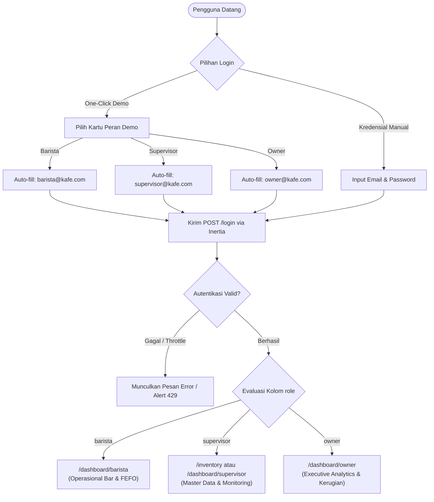

# RENCANA SPESIFIKASI DESAIN FRONTEND (PLAN 01)
## Modul 01: Autentikasi & Login Multi-Role (Barista, Supervisor, Owner)
**Target File Implementasi**:  
- `resources/js/Pages/Auth/Login.tsx`  
- `resources/js/Layouts/GuestLayout.tsx`  
**Referensi Kontrak**: [Desain.md](file:///home/lasains/ssd2/matkul/pemograman%20lanjut/projek/Desain.md), [PRD.md](file:///home/lasains/ssd2/matkul/pemograman%20lanjut/projek/PRD.md), dan [inventory.d.ts](file:///home/lasains/ssd2/matkul/pemograman%20lanjut/projek/resources/js/types/inventory.d.ts)

---

## 1. RINGKASAN FITUR & ANALISIS PERSONA

### 1.1 Latar Belakang & Masalah Bisnis
Aplikasi ini dioperasikan di lingkungan kedai kopi (*specialty coffee shop*) yang memiliki ritme kerja cepat (*fast-paced*). Dalam operasional nyata, barista berganti giliran kerja (*shift*) dan harus segera masuk ke sistem tanpa friksi untuk mencatat bahan kedaluwarsa sebelum melayani antrean pelanggan. Di sisi lain, aplikasi ini juga dinilai oleh dosen penguji dalam simulasi presentasi proyek kuliah. Oleh karena itu, antarmuka autentikasi harus memenuhi dua kebutuhan sekaligus:
1. **Keamanan Standar Industri**: Form kredensial email dan kata sandi dengan proteksi CSRF, enkripsi sesi, dan proteksi serangan *brute-force* (*rate limiting*).
2. **Kemudahan Demonstrasi Pengujian (Demo-Friendly)**: Kartu pemilih cepat akun demo (*One-Click Quick Login*) untuk 3 peran (*roles*) tanpa harus mengetik kredensial secara manual.

---

### 1.2 Analisis Persona Pengguna



| Persona | Peran (`role`) | Kebutuhan Utama pada Halaman Login | Rute Pendaratan (*Landing Page*) |
| :--- | :--- | :--- | :--- |
| **Barista** | `'barista'` | Login instan di tablet bar saat pergantian shift; interface besar dan ramah sentuhan (*touch-friendly*). | `/dashboard/barista` |
| **Supervisor** | `'supervisor'` | Akses aman untuk inspeksi stok gudang, penerimaan batch bahan, dan approval limbah (*waste*). | `/inventory` atau `/dashboard/supervisor` |
| **Owner** | `'owner'` | Akses analitik eksekutif untuk memantau nilai aset, risiko pembusukan bahan, dan kerugian finansial. | `/dashboard/owner` |

---

### 1.3 Alur Keamanan & Penanganan Session Flash
- **CSRF Token**: Dikelola secara otomatis oleh Inertia.js dan cookie `XSRF-TOKEN` Laravel.
- **Session Flash Messages**: Menampilkan notifikasi visual di atas form jika sesi kedaluwarsa (`Your session has expired`), logout berhasil (`You have been successfully logged out`), atau reset password berhasil (`status`).
- **Rate Limiting**: Laravel membatasi percobaan login (default: 5 kali per menit). Jika terpicu, UI menampilkan pesan peringatan dengan penanda waktu tunggu yang jelas.

---

## 2. STITCH-READY SCREEN SPECIFICATION (GOOGLE STITCH)

Spesifikasi berikut dirancang agar siap disalin langsung ke tool **Google Stitch** (`generate_screen_from_text`) guna menghasilkan purwarupa antarmuka visual.

### 2.1 Identitas Layar
* **Screen Title**: Specialty Coffee Multi-Role Authentication & Demo Portal
* **Target Aspect Ratio**: Desktop/Tablet Responsive (1440x900px & 1024x768px viewport)
* **Tone**: Minimalist, Warm Industrial Specialty Coffee, Modern SaaS Enterprise

### 2.2 Tata Letak & Komposisi (*Layout & Composition*)
* **Gaya Split-Screen (Desktop & Landscape Tablet)**:
  - **Sisi Kiri (Hero Brand Showcase - 45% Lebar)**:
    * Background: Gradien hangat mewah `from-[#241408] via-[#4A2C11] to-[#38210D]` dengan overlay pola garis biji kopi artisan (*subtle coffee bean line-art*).
    * Elemen Visual: Tipografi editorial modern *"Preserve Freshness, Eliminate Waste"*, ringkasan statistik mikro kafe (*Real-time FEFO Tracking, 99.4% Expiry Accuracy*), dan label identitas kafe artisan bernuansa karamel hangat (`text-brand-secondary`).
  - **Sisi Kanan (Form & Demo Hub - 55% Lebar)**:
    * Background: Kanvas susu hangat `bg-surface-canvas` (`#FAF7F2`).
    * Kontainer Utama: Kartu terpusat ramah kafe (`bg-surface-container` `#F5EFEB`, `border border-surface-border` `#EDE4DC`, `rounded-xl`, `shadow-sm`) dengan padding longgar (`p-8 sm:p-10`).
* **Gaya Single Card (Mobile & Portrait Tablet)**:
  - Hero sisi kiri disembunyikan (`hidden lg:flex`). Seluruh fokus diarahkan ke kontainer form di tengah layar dengan header logo kompak.

### 2.3 Rincian Komponen Visual (*Component Breakdown*)
1. **Brand Header**:
   - Ikon cangkir kopi modern beraksen hangat berukuran `w-10 h-10` berwarna `text-brand-primary` (`#4A2C11`).
   - Nama Sistem: `BeanFlow` / `CafePulse Monitor`.
   - Judul Form: `text-xl font-semibold text-content-high` (*"Masuk ke Akun Anda"*).
   - Subjudul: `text-sm text-content-medium` (*"Pantau stok bahan baku & rekomendasi kedaluwarsa FEFO"*).
2. **Flash Alert Banner**:
   - Wadah bersyarat `bg-emerald-50 border border-emerald-300 text-emerald-800 rounded-lg p-3 text-sm` untuk notifikasi sukses/status.
3. **Form Input Standar**:
   - **Email Input**: Label `"Alamat Email"` (`text-content-medium`), field dengan ikon pembantu `Mail` di sisi kiri, border `border-surface-border bg-surface-canvas`, fokus `ring-2 ring-brand-primary`.
   - **Password Input**: Label `"Kata Sandi"` (`text-content-medium`), field dengan ikon `Lock` di sisi kiri dan tombol toggle intip kata sandi `Eye`/`EyeOff` di sisi kanan.
   - **Opsi Form**: Baris horizontal fleksibel berisi checkbox `"Ingat saya di perangkat ini"` dan tautan sekunder `"Lupa kata sandi?"` (`text-sm text-brand-secondary hover:underline`).
4. **Tombol Aksi Utama**:
   - Tombol lebar penuh (*full-width*) `bg-brand-primary hover:bg-brand-primary-hover text-white font-medium rounded-lg py-2.5 shadow-sm transition-all flex items-center justify-center gap-2`.
   - State aktif: Menampilkan teks `"Masuk ke Sistem"`.
   - State proses: Menampilkan ikon spinner berputar (`Loader2`) dan teks `"Memverifikasi..."` dengan atribut `disabled`.
5. **Pemisah Ornamen (*Visual Divider*)**:
   - Garis tipis dengan badge tengah: `border-t border-surface-border` dengan label tengah `"Atau Masuk Cepat Akun Demo (1-Klik Tanpa Password)"` warna `text-xs text-content-subtle uppercase tracking-wider bg-surface-container px-3`.
6. **Kartu Pemilih Cepat Peran (*Quick Demo Switcher Cards*)**:
   - Grid 3 kolom horizontal (`grid grid-cols-1 sm:grid-cols-3 gap-3`).
   - Setiap kartu memiliki efek hover interaktif (`border border-surface-border bg-surface-canvas hover:border-brand-primary hover:bg-surface-container-high rounded-lg p-3 cursor-pointer transition-all text-left`):
     * **Kartu Barista**: Ikon cangkir `Coffee`, badge hijau botani `Barista` (`bg-emerald-50 text-emerald-800 border-emerald-300`), deskripsi singkat *"Operasional Bar & FEFO"*.
     * **Kartu Supervisor**: Ikon `ClipboardCheck`, badge amber karamel `Supervisor` (`bg-[#FFF7ED] text-[#C88242] border-[#FED7AA]`), deskripsi singkat *"Gudang & Approval"*.
     * **Kartu Owner**: Ikon `BarChart3`, badge perkamen `Owner` (`bg-[#EDE4DC] text-content-high border-surface-border`), deskripsi singkat *"Analisis & Finansial"*.

### 2.4 Token Warna & Gaya (Mengacu pada Desain.md)
* Canvas Background: `bg-surface-canvas` (`#FAF7F2`)
* Container Surface Base: `bg-surface-container` (`#F5EFEB`)
* Container Surface Elevated: `bg-surface-container-high` (`#EDE4DC`)
* Primary Text: `text-content-high` (`#241408`)
* Secondary/Muted Text: `text-content-medium` (`#5C3A21`)
* Subtle/Disabled Text: `text-content-subtle` (`#9C8474`)
* Form Borders: `border-surface-border` (`#EDE4DC`)
* Brand Action Button: `bg-brand-primary` (`#4A2C11`), hover `bg-brand-primary-hover` (`#38210D`)
* Brand Secondary Accent: `bg-brand-secondary` (`#C88242`)
* Brand Tertiary Alert: `bg-brand-tertiary` (`#8C3D2B`)
* Badge Barista (Aman/Operasional): `bg-emerald-50 text-emerald-800 border-emerald-300`
* Badge Supervisor (Warning/Kontrol): `bg-[#FFF7ED] text-[#C88242] border-[#FED7AA]`
* Badge Owner (Eksekutif): `bg-[#EDE4DC] text-content-high border-surface-border`

---

### 2.5 Teks Prompt Siap Pakai untuk Google Stitch

#### Prompt Bahasa Indonesia (Terstruktur & Kontekstual)
```text
Buatkan desain antarmuka layar login modern untuk aplikasi web "Sistem Inventaris & Pemantauan Kedaluwarsa Kafe (BeanFlow)" berbasis Tailwind CSS dan shadcn/ui dengan nuansa palet kafe artisan.

Layout split-screen responsif:
1. Sisi kiri (40% lebar desktop): Latar belakang gradien biji kopi sangrai (#241408 ke #4A2C11) bernuansa specialty coffee roastery, memuat logo minimalis cangkir kopi, teks headline "Preserve Freshness, Eliminate Waste", dan kartu metrik statistik mikro FEFO beraksen karamel (#C88242).
2. Sisi kanan (60% lebar desktop): Latar belakang hangat canvas susu (#FAF7F2) dengan kartu login oat latte (#F5EFEB) terpusat (rounded-xl, border #EDE4DC, shadow-sm).

Di dalam kartu login terdapat:
- Header: Logo monogram kafe warna espresso (#4A2C11), judul "Masuk ke Sistem Inventaris" (warna #241408), subjudul "Kelola masa simpan bahan baku kafe secara presisi" (#5C3A21).
- Form Login: Input email dengan ikon surat, input password dengan tombol intip mata (show/hide), checkbox "Ingat Saya", dan tombol submit espresso (#4A2C11) bertuliskan "Masuk ke Sistem".
- Pemisah visual: Garis tipis berlabel "AKUN DEMO UJI COBA DOSEN / OPERASIONAL (1-KLIK)".
- Bagian Demo Cepat: Tiga kartu tombol horizontal kecil interaktif:
  * Tombol 1 (Barista): Ikon kopi, label "Barista", email "barista@kafe.com", keterangan "Akses Bar & FEFO", badge hijau botani.
  * Tombol 2 (Supervisor): Ikon checklist, label "Supervisor", email "spv@kafe.com", keterangan "Gudang & Approval", badge karamel amber (#C88242).
  * Tombol 3 (Owner): Ikon grafik analitik, label "Owner", email "owner@kafe.com", keterangan "Analitik Finansial", badge perkamen (#EDE4DC).
Tampilan bersih, hangat, kontras tinggi, dan ramah layar sentuh tablet kasir.
```

#### English Prompt (Concise & High-Fidelity for Stitch AI)
```text
A modern, warm artisan coffee authentication web app screen for a specialty coffee inventory and expiry tracking system named "BeanFlow". Split-screen responsive layout on desktop: Left panel features a rich deep roasted espresso gradient (#241408 to #4A2C11) with artisanal coffee typography "Preserve Freshness, Eliminate Waste" and warm amber (#C88242) inventory stats. Right panel features a warm steamed milk canvas (#FAF7F2) with an oat latte container card (#F5EFEB) with border #EDE4DC. The card contains a deep roasted espresso (#4A2C11) coffee logo, title "Sign in to BeanFlow" (#241408), email input with mail icon, password input with toggle visibility eye icon, "Remember me" checkbox, and a solid deep espresso (#4A2C11) submit button. Below the form, a divider leads to a "One-Click Demo Switcher" with three distinct interactive role cards: "Barista" (coffee cup icon, botanical green badge), "Supervisor" (clipboard icon, warm caramel amber badge #C88242), and "Owner" (analytics chart icon, parchment badge #EDE4DC). Tailwind CSS styling, rounded-xl cards, high contrast, clean coffee typography, polished SaaS aesthetic.
```

---

## 3. ARSITEKTUR TEKNIS FRONTEND (REACT + INERTIA)

### 3.1 Lokasi File & Komposisi
* **Halaman Login**: `resources/js/Pages/Auth/Login.tsx`
* **Layout Guest**: `resources/js/Layouts/GuestLayout.tsx`
* **Komponen Pendukung (shadcn/ui & Radix/Lucide)**:
  - `resources/js/Components/ui/button.tsx`
  - `resources/js/Components/ui/input.tsx`
  - `resources/js/Components/ui/label.tsx`
  - `resources/js/Components/ui/checkbox.tsx`
  - `resources/js/Components/ui/card.tsx`
  - `resources/js/Components/ui/alert.tsx`
  - `lucide-react` (`Coffee`, `ClipboardCheck`, `BarChart3`, `Mail`, `Lock`, `Eye`, `EyeOff`, `Loader2`, `ShieldCheck`)

---

### 3.2 Kontrak Tipe Data TypeScript

Mengacu pada [inventory.d.ts](file:///home/lasains/ssd2/matkul/pemograman%20lanjut/projek/resources/js/types/inventory.d.ts):

```typescript
import { Role } from '@/types/inventory';
import { LucideIcon } from 'lucide-react';

/**
 * Props yang diterima halaman Login dari Laravel AuthenticatedSessionController
 */
export interface LoginPageProps {
    status?: string;
    canResetPassword?: boolean;
    errors: Record<string, string>;
}

/**
 * Struktur data akun demo untuk kemudahan pengujian
 */
export interface DemoRoleAccount {
    role: Role;
    name: string;
    email: string;
    title: string;
    description: string;
    badgeStyle: string;
    icon: LucideIcon;
    redirectTarget: string;
}

/**
 * Payload form autentikasi yang dikirimkan ke backend Laravel
 */
export interface LoginFormPayload {
    email: string;
    password: string;
    remember: boolean;
}
```

---

### 3.3 State Handling dengan Inertia `useForm` & Demo Switcher Logic

```typescript
// Cuplikan Logika State pada resources/js/Pages/Auth/Login.tsx
import { useForm } from '@inertiajs/react';
import { useState } from 'react';
import { DemoRoleAccount, LoginFormPayload } from '@/types/auth-login';

const DEMO_ACCOUNTS: DemoRoleAccount[] = [
    {
        role: 'barista',
        name: 'Bayu (Barista)',
        email: 'barista@kafe.com',
        title: 'Barista',
        description: 'Operasional Bar & Pakai Stok FEFO',
        badgeStyle: 'bg-emerald-50 text-emerald-800 border-emerald-300',
        icon: Coffee,
        redirectTarget: '/dashboard/barista',
    },
    {
        role: 'supervisor',
        name: 'Siti (Supervisor)',
        email: 'supervisor@kafe.com',
        title: 'Supervisor',
        description: 'Kelola Gudang, Restock & Approval',
        badgeStyle: 'bg-[#FFF7ED] text-[#C88242] border-[#FED7AA]',
        icon: ClipboardCheck,
        redirectTarget: '/inventory',
    },
    {
        role: 'owner',
        name: 'Pak Hendra (Owner)',
        email: 'owner@kafe.com',
        title: 'Owner',
        description: 'Analitik Finansial & Laporan Kerugian',
        badgeStyle: 'bg-[#EDE4DC] text-content-high border-surface-border',
        icon: BarChart3,
        redirectTarget: '/dashboard/owner',
    },
];

export default function Login({ status, canResetPassword }: LoginPageProps) {
    const { data, setData, post, processing, errors, reset } = useForm<LoginFormPayload>({
        email: '',
        password: '',
        remember: true,
    });

    const [showPassword, setShowPassword] = useState(false);
    const [selectedRole, setSelectedRole] = useState<Role | null>(null);

    // Eksekusi Login Manual
    const handleSubmit = (e: React.FormEvent) => {
        e.preventDefault();
        post(route('login'), {
            onFinish: () => reset('password'),
        });
    };

    // Eksekusi Login Cepat 1-Klik Akun Demo
    const handleQuickLogin = (account: DemoRoleAccount) => {
        setSelectedRole(account.role);
        // Mengisi kredensial default seeder ('password')
        setData({
            email: account.email,
            password: 'password',
            remember: true,
        });

        // Langsung kirim request autentikasi ke backend
        post(route('login'), {
            data: {
                email: account.email,
                password: 'password',
                remember: true,
            },
            onFinish: () => {
                reset('password');
                setSelectedRole(null);
            },
        });
    };

    // ... render template
}
```

---

### 3.4 Penanganan Validasi & Error Kredensial
1. **Error Spesifik Per Field**:
   - Jika `errors.email` ada, border input email berubah menjadi `border-brand-tertiary focus:ring-brand-tertiary` dan teks merah muncul di bawah input: `text-xs text-brand-tertiary mt-1`.
   - Jika `errors.password` ada, indikator error serupa ditampilkan di bawah input password.
2. **Peringatan Rate Limiting (Too Many Requests)**:
   - Jika pengguna salah memasukkan password > 5 kali, Laravel mengirimkan pesan throttle pada `errors.email` (misal: *"Too many login attempts. Please try again in 54 seconds."*).
   - Ditampilkan dalam komponen Alert bertipe destructive (`bg-[#FDF2F0] border border-[#F8C6BF] text-[#8C3D2B]`).

---

## 4. EDGE CASES & AKSESIBILITAS (A11Y)

### 4.1 State Loading & Pencegahan Double Submission
- Saat request sedang dikirim (`processing === true`):
  1. Tombol utama `"Masuk ke Sistem"` dinonaktifkan (`disabled={processing}`).
  2. Teks tombol berganti menampilkan ikon `<Loader2 className="mr-2 h-4 w-4 animate-spin" /> Memproses...`.
  3. Seluruh kartu demo dinonaktifkan (`pointer-events-none opacity-60`) agar pengguna tidak memicu beberapa request POST secara bersamaan.
  4. Input teks diblokir sementara (`readOnly={processing}`) untuk menjaga konsistensi state.

### 4.2 Responsivitas Perangkat Bar & Kasir (POS Tablets)
- **Tablet Stand (iPad / Android Tablet 10" - 1280x800)**:
  - Form berada dalam rasio proporsional, ukuran target tombol minimal `44px` x `44px` untuk kenyamanan sentuhan jari barista yang basah atau mengenakan sarung tangan operasional.
- **Layar Smartphone (Portrait 390px - 430px)**:
  - Panel visual kiri tersembunyi secara otomatis (`hidden lg:flex`).
  - Kartu pemilih demo berganti susunan dari 3 kolom horizontal menjadi 1 kolom vertikal bertumpuk agar tidak terpotong.

### 4.3 Standar Aksesibilitas (WCAG 2.1 Level AA)
- **Kontras Warna**: Teks `text-content-high` (#241408) di atas kanvas `bg-surface-canvas` (#FAF7F2) memiliki rasio kontras > 14:1 (jauh melampaui batas minimal 4.5:1). Aksen brand espresso `#4A2C11` dengan teks putih memiliki rasio kontras 10.2:1.
- **Navigasi Keyboard**:
  - Semua elemen input dan tombol demo dapat diakses penuh melalui tombol `Tab`.
  - Fokus aktif ditandai secara tegas dengan outline `focus-visible:ring-2 focus-visible:ring-brand-primary focus-visible:ring-offset-2`.
- **Screen Reader Support**:
  - Tombol intip kata sandi dilengkapi atribut `aria-label={showPassword ? "Sembunyikan kata sandi" : "Tampilkan kata sandi"}`.
  - Form dibungkus dalam tag semantik `<form onSubmit={...} aria-label="Formulir Masuk Sistem">`.

---

## 5. REKOMENDASI TAHAPAN IMPLEMENTASI KODING

1. **Langkah 1**: Perbarui `resources/js/Layouts/GuestLayout.tsx` menjadi split-screen layout modern dengan branding specialty coffee kafe.
2. **Langkah 2**: Perbarui `resources/js/Pages/Auth/Login.tsx` dengan komponen Card, input show/hide password, dan grid 3 kartu demo.
3. **Langkah 3**: Pastikan `app/Http/Controllers/Auth/AuthenticatedSessionController.php` pada method `store()` melakukan redirect cerdas berdasarkan peran:
   ```php
   // Redirect cerdas berbasis role pada AuthenticatedSessionController:
   $user = Auth::user();
   return match ($user->role) {
       'barista' => redirect()->intended(route('dashboard.barista')),
       'supervisor' => redirect()->intended(route('inventory.index')),
       'owner' => redirect()->intended(route('dashboard.owner')),
       default => redirect()->intended(route('dashboard')),
   };
   ```
4. **Langkah 4**: Pastikan `database/seeders/DatabaseSeeder.php` menyertakan 3 akun demo sesuai daftar email (`barista@kafe.com`, `supervisor@kafe.com`, `owner@kafe.com`) dengan kata sandi seragam `'password'`.
