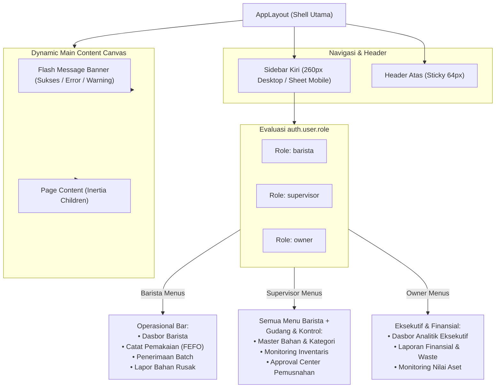

# RENCANA SPESIFIKASI DESAIN FRONTEND (PLAN 02)
## Modul 02: Shell Layout Utama & Navigasi Dinamis Berbasis RBAC (Role-Based Access Control)
**Target File Implementasi**:  
- `resources/js/Layouts/AppLayout.tsx`  
- `resources/js/Components/Sidebar.tsx`  
- `resources/js/Components/Header.tsx`  
- `resources/js/Components/UserDropdown.tsx`  
**Referensi Kontrak**: [Desain.md](file:///home/lasains/ssd2/matkul/pemograman%20lanjut/projek/Desain.md), [PRD.md](file:///home/lasains/ssd2/matkul/pemograman%20lanjut/projek/PRD.md), dan [inventory.d.ts](file:///home/lasains/ssd2/matkul/pemograman%20lanjut/projek/resources/js/types/inventory.d.ts)

---

## 1. RINGKASAN ARSITEKTUR LAYOUT & MATRIKS HAK AKSES MENU

### 1.1 Konsep Shell Layout Aplikasi
Aplikasi Sistem Inventaris & Pemantauan Kedaluwarsa Kafe menggunakan arsitektur **Application Shell Pattern** satu pintu yang membungkus seluruh halaman terautentikasi. Struktur shell terdiri dari:
1. **Sidebar Navigasi Kiri (Fixed 260px)**: Navigasi vertikal terisolasi yang hanya menampilkan menu sesuai izin peran (*role*) user yang aktif.
2. **Top Header Bar (Sticky 64px / `h-16`)**: Area informasi status sistem, breadcrumb judul halaman, penanda peran (*Role Capsule Badge*), dan menu profil pengguna.
3. **Dynamic Main Content Canvas (`bg-slate-50`)**: Area render halaman utama Inertia dengan scrolling independen dan padding konsisten.



---

### 1.2 Matriks Hak Akses Navigasi Menu (RBAC Menu Matrix)

Sistem memetakan setiap menu ke dalam kelompok navigasi (*navigation group*) yang hanya dapat dilihat oleh peran yang berwenang:

| Kelompok Navigasi | Label Menu | Rute Inertia (`route()`) | Ikon Lucide | Barista | Supervisor | Owner | Keterangan Fungsional |
| :--- | :--- | :--- | :--- | :---: | :---: | :---: | :--- |
| **Operasional Bar** | Dasbor Barista | `dashboard.barista` | `Coffee` | ✅ | ✅ | ❌ | Antarmuka kasir/bar & antrean kedaluwarsa cepat |
| **Operasional Bar** | Catat Pemakaian (FEFO) | `usage.create` | `Flame` | ✅ | ✅ | ❌ | Pengurangan stok bahan dengan rekomendasi FEFO |
| **Operasional Bar** | Penerimaan Batch | `batches.create` | `PackagePlus` | ✅ | ✅ | ❌ | Input stok bahan baru datang dari pemasok |
| **Operasional Bar** | Lapor Bahan Rusak | `waste.create` | `AlertTriangle` | ✅ | ✅ | ❌ | Tiket pengajuan pemusnahan susu basi / kemasan rusak |
| **Manajemen Inventaris** | Master Bahan & Kategori | `ingredients.index` | `Boxes` | ❌ | ✅ | ❌ | CRUD data bahan baku, satuan unit, dan ambang stok |
| **Manajemen Inventaris** | Monitoring & Kedaluwarsa| `inventory.index` | `CalendarClock` | ❌ | ✅ | ✅ | Tabel monitoring seluruh stok & lampu lalu lintas FEFO |
| **Manajemen Inventaris** | Approval Center (Waste) | `waste.index` | `CheckSquare` | ❌ | ✅ | ❌ | Otorisasi penghapusan stok rusak (*write-off*) |
| **Eksekutif & Laporan** | Dasbor Eksekutif | `dashboard.owner` | `LayoutDashboard` | ❌ | ❌ | ✅ | Metrik nilai rupiah aset dan grafik kerugian |
| **Eksekutif & Laporan** | Laporan Finansial & Waste| `reports.waste` | `TrendingDown` | ❌ | ❌ | ✅ | Analitik tren pemborosan (*waste cost analysis*) |

> [!NOTE]  
> Supervisor memiliki akses penuh ke menu operasional Barista agar dapat menggantikan tugas operasional bar (*in-store backup*) saat kedai sedang ramai (*rush hour*).

---

## 2. STITCH-READY SCREEN SPECIFICATION (GOOGLE STITCH PROMPT)

Spesifikasi berikut dirancang agar siap dimasukkan ke tool **Google Stitch** (`generate_screen_from_text`) untuk menghasilkan mockup kanvas antarmuka shell layout.

### 2.1 Identitas Layar
* **Screen Title**: Specialty Coffee SaaS Shell Layout with RBAC Navigation
* **Device Target**: Responsive Desktop (1440x900) & POS Bar Tablet (1024x768)
* **Design Philosophy**: Minimalist, Clear Visual Hierarchy, Touch-friendly (Barista ergonomis).

### 2.2 Tata Letak Desktop & Komposisi
* **Sidebar Kiri (Fixed Desktop)**:
  - Lebar: `w-64` (260px), tinggi penuh `h-screen`, `bg-white border-r border-slate-200 flex flex-col justify-between`.
  - **Header Sidebar**: Logo modern specialty coffee monogram daun kopi berwarna `emerald-600`, teks merk `"BeanFlow"`, dan sub-label `"Specialty Inventory"`.
  - **Navigasi Tengah (Scrollable)**: Navigasi dikelompokkan dengan *Group Header* berukuran `text-xs font-semibold text-slate-500 uppercase tracking-wider px-3 mb-2 mt-4`.
  - **Item Navigasi**:
    * **State Aktif**: `bg-emerald-50 text-emerald-700 font-semibold rounded-lg flex items-center gap-3 px-3.5 py-2.5 transition-colors shadow-xs`.
    * **State Inaktif**: `text-slate-600 hover:bg-slate-100 hover:text-slate-900 rounded-lg flex items-center gap-3 px-3.5 py-2.5 transition-colors font-medium text-sm`.
  - **Footer Sidebar**: Kartu informasi shift kafe aktif (*"Shift Pagi: 07:00 - 15:00"*) dan tombol bantuan/dokumentasi cepat.

* **Top Header Bar (Sticky Desktop & Mobile)**:
  - Tinggi: `h-16` (64px), posisi `sticky top-0 z-30`, `bg-white/95 backdrop-blur-sm border-b border-slate-200 px-6 flex items-center justify-between`.
  - **Sisi Kiri**:
    * Tombol hamburger drawer (khusus tablet/mobile: `lg:hidden`).
    * Breadcrumb / Judul Kontekstual Halaman Aktif (`text-base font-semibold text-slate-900`).
  - **Sisi Kanan**:
    * **Status Koneksi Online**: Indikator lampu hijau berkedip halus (*pulse green dot*) dengan label `"Sistem Sinkron"`.
    * **Role Capsule Badge**:
      - Barista: `bg-slate-100 text-slate-700 border-slate-200` (*"Barista Shift"*)
      - Supervisor: `bg-indigo-50 text-indigo-700 border-indigo-200` (*"Supervisor Gudang"*)
      - Owner: `bg-emerald-50 text-emerald-700 border-emerald-200` (*"Owner Kafe"*)
    * **User Profile Dropdown**: Avatar inisial lingkaran dengan outline halus, nama pengguna, dan menu dropdown (Pengaturan Akun, Panduan SOP, dan Logout berwarna merah).

* **Dynamic Main Content Canvas**:
  - Background: `bg-slate-50 min-h-[calc(100vh-4rem)] p-6 lg:p-8`.
  - Lebar maksimal kontainer: `max-w-7xl mx-auto`.
  - Flash notification banner menempel di bagian paling atas konten jika ada pesan status dari Laravel.

---

### 2.3 Tata Letak Mobile & Tablet Kasir (Sheet Drawer)
- Pada viewport layar sentuh `< 1024px` (iPad bar / smartphone kasir):
  - Sidebar samping desktop disembunyikan otomatis (`hidden lg:flex`).
  - Top header memunculkan tombol menu hamburger di sebelah kiri logo.
  - Saat tombol hamburger ditekan, muncul **Sheet Drawer modal slide-out dari sisi kiri** (`w-72 bg-white shadow-xl`) yang menampilkan seluruh daftar menu navigasi dengan target sentuh jari yang lega (tinggi tombol minimal `44px`).

---

### 2.4 Teks Prompt Siap Pakai untuk Google Stitch

#### Prompt Bahasa Indonesia (Terstruktur & Deskriptif)
```text
Buatkan desain antarmuka Web App Layout Shell untuk aplikasi manajemen kafe modern "BeanFlow Inventory" berbasis Tailwind CSS dan shadcn/ui.

Layout terbagi menjadi:
1. Fixed Left Sidebar (lebar 260px, latar belakang putih, border-r slate-200):
   - Bagian atas: Logo cangkir kopi monogram warna emerald-600 dengan tulisan brand "BeanFlow" dan label "Specialty Coffee Inventory".
   - Navigasi tengah: Terdapat judul kelompok "OPERASIONAL BAR" dan item menu:
     * "Dasbor Barista" (status aktif: latar emerald-50, teks emerald-700, ikon Coffee).
     * "Catat Pemakaian (FEFO)" (ikon Flame, teks slate-600).
     * "Penerimaan Batch" (ikon PackagePlus, teks slate-600).
     * "Lapor Bahan Rusak" (ikon AlertTriangle, teks slate-600).
   - Bagian bawah sidebar: Kotak info status shift kafe "Shift Pagi: 07.00 - 15.00" dan avatar singkat user.

2. Sticky Top Header (tinggi 64px, latar belakang putih semi-transparan dengan border-b slate-200):
   - Kiri: Judul halaman aktif "Dasbor Operasional Barista".
   - Kanan: Indikator titik hijau berkedip "Online Sinkron", kapsul role badge bertuliskan "Barista Shift" (latar slate-100 border slate-200), serta avatar profil user dengan panah dropdown.

3. Area Konten Utama (Main Canvas): Latar belakang bersih slate-50 (#F8FAFC) dengan padding luas, menampilkan kartu selamat datang ringkas dan notifikasi banner sukses berwarna hijau emerald muda.
Desain clean, enterprise SaaS specialty coffee, kontras tinggi, modern, dan sangat rapi.
```

#### English Prompt (High-Fidelity for Stitch AI)
```text
A modern specialty coffee inventory SaaS app shell layout called "BeanFlow". Features a 260px fixed left sidebar with crisp white background (#FFFFFF) and right border slate-200. Sidebar top displays an emerald-600 coffee leaf logo with typography "BeanFlow - Specialty Inventory". Sidebar body has clean navigation items with Lucide-style coffee icons: active item has a soft emerald-50 background, emerald-700 text, and emerald indicator; inactive items are slate-600. Navigation groups include "BAR OPERATIONS" and "INVENTORY MANAGEMENT". The top header is 64px tall, white, sticky, featuring a breadcrumb page title "Barista Operations", a live pulsing green status dot "System Live", a rounded-full role badge ("Barista Shift"), and a circular user profile dropdown. The main content background is neutral slate-50 (#F8FAFC) with a soft green flash alert banner at the top. Polished, minimalist, high contrast, clean typography.
```

---

## 3. ARSITEKTUR TEKNIS FRONTEND (REACT + INERTIA)

### 3.1 Struktur Komponen & Lokasi File
```text
resources/js/
├── Layouts/
│   └── AppLayout.tsx               # Shell utama pembungkus seluruh halaman aplikasi
├── Components/
│   ├── Layout/
│   │   ├── Sidebar.tsx             # Komponen sidebar desktop & mobile drawer
│   │   ├── Header.tsx              # Top bar sticky dengan profile & role badge
│   │   ├── UserDropdown.tsx        # Menu dropdown user & tombol logout
│   │   └── FlashBanner.tsx         # Notifikasi flash message (sukses/error)
│   └── ui/
│       ├── sheet.tsx               # Drawer mobile untuk navigasi sentuh
│       ├── badge.tsx               # Role badge kapsul
│       └── dropdown-menu.tsx       # Radix primitive dropdown
└── types/
    └── inventory.d.ts              # Kontrak User, Role, PageProps
```

---

### 3.2 Kontrak Tipe Data Navigasi TypeScript

```typescript
// resources/js/types/navigation.ts
import { Role } from '@/types/inventory';
import { LucideIcon } from 'lucide-react';

export interface NavigationItem {
    title: string;
    href: string;
    routeName: string;
    icon: LucideIcon;
    roles: Role[];           // Peran yang diizinkan melihat menu ini
    badge?: string;          // Opsional: Misal "3 Kritis" pada menu monitoring
    group: 'Operasional Bar' | 'Manajemen Inventaris' | 'Eksekutif & Laporan';
}

export interface BreadcrumbItem {
    label: string;
    href?: string;
}

export interface AppLayoutProps {
    title?: string;
    breadcrumbs?: BreadcrumbItem[];
    children: React.ReactNode;
}
```

---

### 3.3 Logika Pemfilteran Navigasi Berbasis RBAC

```typescript
// resources/js/Components/Layout/Sidebar.tsx
import { Link, usePage } from '@inertiajs/react';
import { PageProps, Role } from '@/types';
import { NavigationItem } from '@/types/navigation';
import { 
    Coffee, Flame, PackagePlus, AlertTriangle, 
    Boxes, CalendarClock, CheckSquare, 
    LayoutDashboard, TrendingDown 
} from 'lucide-react';
import { cn } from '@/lib/utils';

export const NAVIGATION_ITEMS: NavigationItem[] = [
    // Kelompok 1: Operasional Bar
    {
        title: 'Dasbor Barista',
        href: route('dashboard.barista'),
        routeName: 'dashboard.barista',
        icon: Coffee,
        roles: ['barista', 'supervisor'],
        group: 'Operasional Bar',
    },
    {
        title: 'Catat Pemakaian (FEFO)',
        href: route('usage.create'),
        routeName: 'usage.*',
        icon: Flame,
        roles: ['barista', 'supervisor'],
        group: 'Operasional Bar',
    },
    {
        title: 'Penerimaan Batch',
        href: route('batches.create'),
        routeName: 'batches.*',
        icon: PackagePlus,
        roles: ['barista', 'supervisor'],
        group: 'Operasional Bar',
    },
    {
        title: 'Lapor Bahan Rusak',
        href: route('waste.create'),
        routeName: 'waste.create',
        icon: AlertTriangle,
        roles: ['barista', 'supervisor'],
        group: 'Operasional Bar',
    },

    // Kelompok 2: Manajemen Inventaris
    {
        title: 'Master Bahan & Kategori',
        href: route('ingredients.index'),
        routeName: 'ingredients.*',
        icon: Boxes,
        roles: ['supervisor'],
        group: 'Manajemen Inventaris',
    },
    {
        title: 'Monitoring & Kedaluwarsa',
        href: route('inventory.index'),
        routeName: 'inventory.*',
        icon: CalendarClock,
        roles: ['supervisor', 'owner'],
        group: 'Manajemen Inventaris',
    },
    {
        title: 'Approval Center (Waste)',
        href: route('waste.index'),
        routeName: 'waste.index',
        icon: CheckSquare,
        roles: ['supervisor'],
        group: 'Manajemen Inventaris',
    },

    // Kelompok 3: Eksekutif & Laporan
    {
        title: 'Dasbor Eksekutif',
        href: route('dashboard.owner'),
        routeName: 'dashboard.owner',
        icon: LayoutDashboard,
        roles: ['owner'],
        group: 'Eksekutif & Laporan',
    },
    {
        title: 'Laporan Finansial & Waste',
        href: route('reports.waste'),
        routeName: 'reports.*',
        icon: TrendingDown,
        roles: ['owner'],
        group: 'Eksekutif & Laporan',
    },
];

export function SidebarContent() {
    const { auth } = usePage<PageProps>().props;
    const userRole: Role = auth.user.role;

    // Filter menu berdasarkan peran pengguna yang sedang login
    const authorizedItems = NAVIGATION_ITEMS.filter((item) =>
        item.roles.includes(userRole)
    );

    // Dapatkan daftar kelompok menu unik
    const groups = Array.from(new Set(authorizedItems.map((i) => i.group)));

    return (
        <nav className="flex-1 space-y-6 px-3 py-4">
            {groups.map((groupName) => (
                <div key={groupName} className="space-y-1">
                    <h3 className="px-3 text-xs font-semibold uppercase tracking-wider text-slate-500">
                        {groupName}
                    </h3>
                    <div className="space-y-1 pt-1">
                        {authorizedItems
                            .filter((item) => item.group === groupName)
                            .map((item) => {
                                const Icon = item.icon;
                                const isActive = route().current(item.routeName);
                                return (
                                    <Link
                                        key={item.title}
                                        href={item.href}
                                        className={cn(
                                            'flex items-center gap-3 rounded-lg px-3 py-2 text-sm font-medium transition-colors',
                                            isActive
                                                ? 'bg-emerald-50 text-emerald-700 font-semibold shadow-xs'
                                                : 'text-slate-600 hover:bg-slate-100 hover:text-slate-900'
                                        )}
                                    >
                                        <Icon className={cn('h-4 w-4', isActive ? 'text-emerald-600' : 'text-slate-500')} />
                                        <span>{item.title}</span>
                                        {item.badge && (
                                            <span className="ml-auto rounded-full bg-rose-100 px-2 py-0.5 text-xs font-semibold text-rose-700">
                                                {item.badge}
                                            </span>
                                        )}
                                    </Link>
                                );
                            })}
                    </div>
                </div>
            ))}
        </nav>
    );
}
```

---

### 3.4 Penanganan Flash Messages (Pesan Sukses & Error)

```typescript
// resources/js/Components/Layout/FlashBanner.tsx
import { usePage } from '@inertiajs/react';
import { CheckCircle2, AlertCircle, X } from 'lucide-react';
import { useState, useEffect } from 'react';

interface FlashProps {
    flash?: {
        success?: string;
        error?: string;
        warning?: string;
    };
}

export function FlashBanner() {
    const { flash } = usePage<FlashProps>().props;
    const [visible, setVisible] = useState(true);

    useEffect(() => {
        if (flash?.success || flash?.error || flash?.warning) {
            setVisible(true);
        }
    }, [flash]);

    if (!visible || (!flash?.success && !flash?.error && !flash?.warning)) {
        return null;
    }

    return (
        <div className="mb-6">
            {flash.success && (
                <div className="flex items-center justify-between rounded-lg border border-emerald-200 bg-emerald-50 p-4 text-sm text-emerald-800">
                    <div className="flex items-center gap-3">
                        <CheckCircle2 className="h-5 w-5 text-emerald-600" />
                        <span>{flash.success}</span>
                    </div>
                    <button onClick={() => setVisible(false)} className="text-emerald-700 hover:text-emerald-900">
                        <X className="h-4 w-4" />
                    </button>
                </div>
            )}
            {flash.error && (
                <div className="flex items-center justify-between rounded-lg border border-rose-200 bg-rose-50 p-4 text-sm text-rose-800">
                    <div className="flex items-center gap-3">
                        <AlertCircle className="h-5 w-5 text-rose-600" />
                        <span>{flash.error}</span>
                    </div>
                    <button onClick={() => setVisible(false)} className="text-rose-700 hover:text-rose-900">
                        <X className="h-4 w-4" />
                    </button>
                </div>
            )}
        </div>
    );
}
```

---

## 4. EDGE CASES & RESPONSIVE BEHAVIOR

### 4.1 Responsivitas Tablet Kasir (Touch Ergonomics)
- **Problem**: Layar tablet iPad di stasiun espresso sering diletakkan horizontal (*landscape* 1024x768). Jika sidebar tetap 260px, lebar tabel stok menjadi terlalu sempit.
- **Solusi UX**:
  1. Pada resolusi `1024px`, sediakan tombol mini *toggle icon* untuk menciutkan (*collapse*) sidebar menjadi **Icon-Only Sidebar** (lebar 72px dengan tooltip nama menu saat disorot/ditekan).
  2. Seluruh target tombol navigasi memiliki tinggi minimal `44px` agar mudah ditekan jari barista tanpa salah sentuh (*fat-finger prevention*).

### 4.2 Otorisasi Navigasi & Proteksi Akses URL Ilegal
- **Problem**: Jika seorang Barista sengaja mengetik URL `/dashboard/owner` atau `/inventory` di address bar browser.
- **Solusi Bertingkat**:
  1. **Frontend (Visual Isolation)**: Menu tidak pernah di-render pada DOM pohon React Barista.
  2. **Backend Middleware Guard (`EnsureRoleMiddleware`)**:
     ```php
     if ($request->user()->role !== $requiredRole) {
         return redirect()->route('dashboard.barista')
             ->with('error', 'Akses ditolak: Anda tidak memiliki izin untuk membuka halaman tersebut.');
     }
     ```
  3. **Feedback UI**: Saat ter-redirect kembali ke dashboard asalnya, `FlashBanner` langsung memunculkan notifikasi merah yang memberitahu bahwa aksi diblokir.

### 4.3 Alur Logout Aman (Session Invalidation)
- Tombol logout di dalam `UserDropdown.tsx` memicu request `Inertia.post(route('logout'))`.
- Menampilkan konfirmasi singkat atau langsung mengeksekusi POST untuk mencegah CSRF vulnerability, lalu mengarahkan kembali pengguna ke layar `Login.tsx`.

---

## 5. REKOMENDASI TAHAPAN IMPLEMENTASI KODING

1. **Langkah 1**: Buat komponen `Sidebar.tsx` dan `Header.tsx` di folder `resources/js/Components/Layout/`.
2. **Langkah 2**: Gabungkan komponen tersebut ke dalam `resources/js/Layouts/AppLayout.tsx` yang menerima properti `children` dan `title`.
3. **Langkah 3**: Buat route middleware di backend (`app/Http/Middleware/CheckRole.php`) untuk menjamin proteksi URL di tingkat server.
4. **Langkah 4**: Refactor halaman dashboard masing-masing role (`Pages/Dashboard/BaristaDashboard.tsx`, `Pages/Inventory/Index.tsx`, `Pages/Dashboard/OwnerDashboard.tsx`) agar dibungkus dengan `<AppLayout title="...">`.
