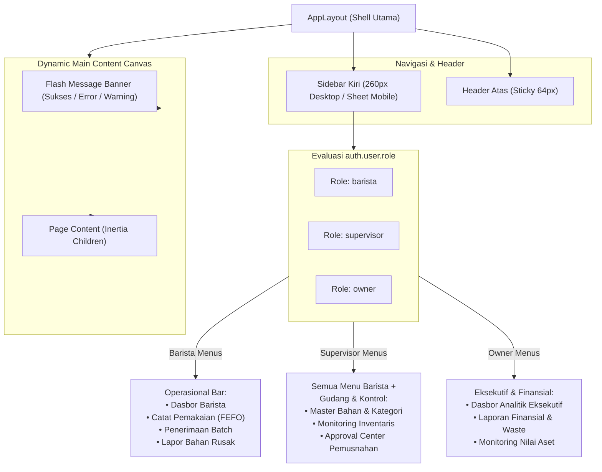

# RENCANA SPESIFIKASI DESAIN FRONTEND (PLAN 02)
## Modul 02: Shell Layout Utama & Navigasi Dinamis Berbasis RBAC (Role-Based Access Control)
**Target File Implementasi**:  
- `resources/js/Layouts/AppLayout.tsx`  
- `resources/js/Components/Sidebar.tsx`  
- `resources/js/Components/Header.tsx`  
- `resources/js/Components/UserDropdown.tsx`  
**Referensi Kontrak**: [Desain.md](file:///home/lasains/ssd2/matkul/pemograman%20lanjut/projek/Desain.md), [PRD.md](file:///home/lasains/ssd2/matkul/pemograman%20lanjut/projek/PRD.md), dan [inventory.d.ts](file:///home/lasains/ssd2/matkul/pemograman%20lanjut/projek/resources/js/types/inventory.d.ts)

---

## 1. RINGKASAN ARSITEKTUR LAYOUT & MATRIKS HAK AKSES MENU

### 1.1 Konsep Shell Layout Aplikasi (Universal Single App Shell)
Aplikasi Sistem Inventaris & Pemantauan Kedaluwarsa Kafe menggunakan arsitektur **Universal Application Shell Pattern** satu pintu yang membungkus seluruh halaman terautentikasi. **TIDAK ADA shell terpisah per role**; sistem hanya menggunakan satu komponen layout utama (`AppLayout.tsx`) yang mengevaluasi `auth.user.role` untuk merender menu dan header secara dinamis.

> [!IMPORTANT]
> **ATURAN BAKU PENGEMBANGAN UI (IN-SHELL CONTENT RULE)**:  
> Seluruh halaman modul berikutnya (Dasbor Barista, Monitoring Stok, Master Bahan, Approval Waste, dan Analitik Owner) **TIDAK BOLEH MEMBUAT ULANG SIDEBAR ATAU HEADER**. Seluruh halaman tersebut hanya merender konten isi di dalam slot kanvas utama (`<slot />` / `children`).

Struktur shell terdiri dari:
1. **Sidebar Navigasi Kiri (Fixed 260px)**: Navigasi vertikal terisolasi yang adaptif menampilkan menu sesuai izin peran (*role*) user yang aktif.
2. **Top Header Bar (Sticky 64px / `h-16`)**: Area informasi status sistem, breadcrumb judul halaman, penanda peran (*Role Capsule Badge*), dan menu profil pengguna.
3. **Dynamic Main Content Canvas (`bg-surface-canvas` `#FAF7F2`)**: Area render halaman utama Inertia dengan latar kanvas susu hangat, scrolling independen, dan padding konsisten.



---

### 1.2 Matriks Hak Akses Navigasi Menu (RBAC Menu Matrix)

Sistem memetakan setiap menu ke dalam kelompok navigasi (*navigation group*) yang hanya dapat dilihat oleh peran yang berwenang:

| Kelompok Navigasi | Label Menu | Rute Inertia (`route()`) | Ikon Lucide | Barista | Supervisor | Owner | Keterangan Fungsional |
| :--- | :--- | :--- | :--- | :---: | :---: | :---: | :--- |
| **Operasional Bar** | Dasbor Barista | `dashboard.barista` | `Coffee` | ✅ | ✅ | ❌ | Antarmuka kasir/bar & antrean kedaluwarsa cepat |
| **Operasional Bar** | Catat Pemakaian (FEFO) | `usage.create` | `Flame` | ✅ | ✅ | ❌ | Pengurangan stok bahan dengan rekomendasi FEFO |
| **Operasional Bar** | Penerimaan Batch | `batches.create` | `PackagePlus` | ✅ | ✅ | ❌ | Input stok bahan baru datang dari pemasok |
| **Operasional Bar** | Lapor Bahan Rusak | `waste.create` | `AlertTriangle` | ✅ | ✅ | ❌ | Tiket pengajuan pemusnahan susu basi / kemasan rusak |
| **Manajemen Inventaris** | Master Bahan & Kategori | `ingredients.index` | `Boxes` | ❌ | ✅ | ❌ | CRUD data bahan baku, satuan unit, dan ambang stok |
| **Manajemen Inventaris** | Monitoring & Kedaluwarsa| `inventory.index` | `CalendarClock` | ❌ | ✅ | ✅ | Tabel monitoring seluruh stok & lampu lalu lintas FEFO |
| **Manajemen Inventaris** | Approval Center (Waste) | `waste.index` | `CheckSquare` | ❌ | ✅ | ❌ | Otorisasi penghapusan stok rusak (*write-off*) |
| **Eksekutif & Laporan** | Dasbor Eksekutif | `dashboard.owner` | `LayoutDashboard` | ❌ | ❌ | ✅ | Metrik nilai rupiah aset dan grafik kerugian |
| **Eksekutif & Laporan** | Laporan Finansial & Waste| `reports.waste` | `TrendingDown` | ❌ | ❌ | ✅ | Analitik tren pemborosan (*waste cost analysis*) |

> [!NOTE]  
> Supervisor memiliki akses penuh ke menu operasional Barista agar dapat menggantikan tugas operasional bar (*in-store backup*) saat kedai sedang ramai (*rush hour*).

---

## 2. SPESIFIKASI MOCKUP STITCH UI & STRUKTUR SHELL LAYOUT

Mockup visual antarmuka shell layout telah diunduh dari proyek Google Stitch (ID: `3585613475449128159`) dan disimpan secara lokal di direktori `docs/stitch/`:

| Role Pengguna | Screen ID Stitch | File HTML Mockup | File Screenshot Mockup |
| :--- | :--- | :--- | :--- |
| **Owner** | `da7d8f739e8241d4a9d7b82ac0bac667` | [owner_app_shell.html](file:///home/lasains/ssd2/matkul/pemograman%20lanjut/projek/docs/stitch/owner_app_shell.html) | [owner_app_shell.png](file:///home/lasains/ssd2/matkul/pemograman%20lanjut/projek/docs/stitch/owner_app_shell.png) |
| **Supervisor** | `8a31c179b67d4697b73830bf444b0241` | [supervisor_app_shell.html](file:///home/lasains/ssd2/matkul/pemograman%20lanjut/projek/docs/stitch/supervisor_app_shell.html) | [supervisor_app_shell.png](file:///home/lasains/ssd2/matkul/pemograman%20lanjut/projek/docs/stitch/supervisor_app_shell.png) |
| **Barista** | `3668a1580cd8426e8f120554e37cde0f` | [barista_app_shell.html](file:///home/lasains/ssd2/matkul/pemograman%20lanjut/projek/docs/stitch/barista_app_shell.html) | [barista_app_shell.png](file:///home/lasains/ssd2/matkul/pemograman%20lanjut/projek/docs/stitch/barista_app_shell.png) |

### 2.1 Dekonstruksi DOM Mockup Stitch ke Komponen React
Ketiga file shell di atas mengimplementasikan layout grid responsif yang terbagi menjadi:

1. **Sidebar Kiri Fixed (`<aside class="w-64 bg-[#F5EFEB] border-r border-[#EDE4DC] flex flex-col justify-between h-screen fixed top-0 left-0 z-40">`)**:
   - **Header Monogram Logo**: 
     - Logo cangkir biji kopi (`w-9 h-9 rounded-xl bg-[#4A2C11] flex items-center justify-center text-[#EDE4DC]`)
     - Label merek: `"BeanFlow"` (`text-lg font-extrabold tracking-tight text-[#241408]`) dengan subteks `"FEFO Specialty Bar"` (`text-[11px] text-[#9C8474] font-medium tracking-wide`).
   - **Daftar Menu Sesuai Peran (RBAC Active Links)**:
     - Group Header: `text-[10px] font-bold uppercase tracking-wider text-[#9C8474] px-3 mb-2 mt-4`
     - Menu Aktif: `bg-[#EDE4DC] text-[#4A2C11] font-bold rounded-xl flex items-center gap-3 px-3.5 py-2.5 shadow-xs border border-[#4A2C11]/10`
     - Menu Standby: `text-[#5C3A21] hover:bg-[#EDE4DC]/60 hover:text-[#241408] rounded-xl flex items-center gap-3 px-3.5 py-2.5 font-medium text-sm transition-all`
   - **Footer Sidebar Context Card**:
     - Menampilkan status shift operasional: `"Shift Pagi: 07.00 - 15.00 WIB"` dengan avatar inisial barista/supervisor/owner.

2. **Top Header Bar Sticky (`<header class="h-16 sticky top-0 z-30 bg-[#FAF7F2]/90 backdrop-blur-md border-b border-[#EDE4DC] px-6 flex items-center justify-between">`)**:
   - **Left Kicker & Title Area**:
     - Tombol Hamburger Drawer mobile (`lg:hidden p-2 rounded-lg text-[#4A2C11] hover:bg-[#EDE4DC]`)
     - Breadcrumb dinamis (`text-xs font-semibold uppercase tracking-wider text-[#9C8474]`) dan Page Title (`text-base font-bold text-[#241408]`).
   - **Right Live Status & User Profile Area**:
     - **Status Koneksi Live Dot**: `<span class="w-2.5 h-2.5 rounded-full bg-emerald-500 animate-pulse"></span>` + label `"Sistem FEFO Aktif"` (`text-xs font-medium text-[#5C3A21]`).
     - **Role Capsule Badge**:
       * Barista: `<span class="px-2.5 py-1 rounded-full text-xs font-bold bg-emerald-50 text-emerald-800 border border-emerald-200">Barista On-Duty</span>`
       * Supervisor: `<span class="px-2.5 py-1 rounded-full text-xs font-bold bg-amber-50 text-[#C88242] border border-amber-200">Supervisor Kafe</span>`
       * Owner: `<span class="px-2.5 py-1 rounded-full text-xs font-bold bg-indigo-50 text-indigo-900 border border-indigo-200">Owner / Pemilik</span>`
     - **User Dropdown Avatar**: Lingkaran avatar inisial nama dengan border `#EDE4DC` dan popover menu profil/logout.

3. **In-Shell Content View (`<main class="lg:pl-64 min-h-screen bg-[#FAF7F2] p-6 lg:p-8">`)**:
   - Wadah kanvas utama tempat seluruh halaman konten modul di-render melalui `<slot />` / `children`.
      - Owner: `bg-[#EDE4DC] text-content-high border-surface-border` (*"Owner Kafe"*)
    * **User Profile Dropdown**: Avatar inisial lingkaran dengan outline halus, nama pengguna, dan menu dropdown (Pengaturan Akun, Panduan SOP, dan Logout berwarna terakota `text-brand-tertiary`).

* **Dynamic Main Content Canvas**:
  - Background: `bg-surface-canvas min-h-[calc(100vh-4rem)] p-6 lg:p-8`.
  - Lebar maksimal kontainer: `max-w-7xl mx-auto`.
  - Flash notification banner menempel di bagian paling atas konten jika ada pesan status dari Laravel.

---

### 2.3 Tata Letak Mobile & Tablet Kasir (Sheet Drawer)
- Pada viewport layar sentuh `< 1024px` (iPad bar / smartphone kasir):
  - Sidebar samping desktop disembunyikan otomatis (`hidden lg:flex`).
  - Top header memunculkan tombol menu hamburger di sebelah kiri logo.
  - Saat tombol hamburger ditekan, muncul **Sheet Drawer modal slide-out dari sisi kiri** (`w-72 bg-surface-container shadow-xl border-r border-surface-border`) yang menampilkan seluruh daftar menu navigasi dengan target sentuh jari yang lega (tinggi tombol minimal `44px`).

---

### 2.4 Teks Prompt Siap Pakai untuk Google Stitch

> [!NOTE]
> Ini adalah satu-satunya prompt untuk menghasilkan kerangka dasar antarmuka (Universal App Shell). Semua prompt modul fitur lain (`PLAN_03` s/d `PLAN_07`) dirancang sebagai **In-Shell Content View** yang hanya mengisi area `<slot />` utama.

#### Prompt Bahasa Indonesia (Terstruktur & Deskriptif)
```text
Buatkan desain antarmuka Web App Layout Shell tunggal (Universal Shell) untuk aplikasi inventaris kafe "BeanFlow Inventory" berbasis Tailwind CSS dan palet warm artisan specialty coffee.

Layout terbagi menjadi:
1. Fixed Left Sidebar (lebar 260px, latar oat latte #F5EFEB, border-r unbleached parchment #EDE4DC):
   - Header: Monogram cangkir espresso #4A2C11, judul brand "BeanFlow", dan sub-label "Specialty Coffee Inventory".
   - Navigasi: Menu dinamis RBAC dengan active item berlatar #EDE4DC teks espresso #4A2C11, inactive item teks mocha #5C3A21.
   - Footer: Kotak info shift kafe aktif "Shift Pagi: 07.00 - 15.00" dan avatar mini.

2. Sticky Top Header (tinggi 64px, latar oat latte semi-transparan #F5EFEB dengan border-b #EDE4DC):
   - Kiri: Judul halaman aktif "Barista Operations" (teks #241408).
   - Kanan: Indikator status titik hijau berkedip "Sistem Sinkron", kapsul role badge adaptif ("Barista Shift" / "Supervisor Gudang" / "Owner Kafe"), serta avatar profil user dengan dropdown arrow.

3. Main Canvas (Dynamic Viewport): Latar belakang hangat kanvas susu #FAF7F2 dengan padding p-8. Di tengah kanvas terdapat kotak dashed border tipis dengan label jelas: "<slot /> Area Konten Halaman Dinamis" yang menandakan seluruh modul halaman lain akan dimuat di dalam area ini.

Desain sangat bersih, estetika warm coffee shop (espresso, caramel, oat milk), tipografi tajam, dan tanpa elemen dekoratif berlebih.
```

#### English Prompt (High-Fidelity for Stitch AI)
```text
A unified specialty coffee inventory SaaS app shell layout called "BeanFlow". Features a 260px fixed left sidebar with warm oat latte background (#F5EFEB) and right border unbleached parchment (#EDE4DC). Sidebar top displays a deep roasted espresso (#4A2C11) coffee leaf logo with typography "BeanFlow - Specialty Inventory". Sidebar body has clean navigation items with Lucide-style coffee icons: active item has a parchment background (#EDE4DC), deep espresso (#4A2C11) text, and active indicator; inactive items are muted mocha (#5C3A21). Navigation groups include "BAR OPERATIONS" and "INVENTORY MANAGEMENT". The top header is 64px tall, oat latte, sticky, featuring a breadcrumb page title "Barista Operations", a live pulsing green status dot "System Live", a rounded-full role badge ("Barista Shift"), and a circular user profile dropdown. The main content background is warm steamed milk canvas (#FAF7F2) containing a clean dashed container labeled "<slot /> Dynamic Content Viewport" to represent the slot for all child pages. Polished, warm artisan coffee aesthetic, high contrast, clean typography.
```

---

## 3. ARSITEKTUR TEKNIS FRONTEND (REACT + INERTIA)

### 3.1 Struktur Komponen & Lokasi File
```text
resources/js/
├── Layouts/
│   └── AppLayout.tsx               # Shell utama pembungkus seluruh halaman aplikasi
├── Components/
│   ├── Layout/
│   │   ├── Sidebar.tsx             # Komponen sidebar desktop & mobile drawer
│   │   ├── Header.tsx              # Top bar sticky dengan profile & role badge
│   │   ├── UserDropdown.tsx        # Menu dropdown user & tombol logout
│   │   └── FlashBanner.tsx         # Notifikasi flash message (sukses/error)
│   └── ui/
│       ├── sheet.tsx               # Drawer mobile untuk navigasi sentuh
│       ├── badge.tsx               # Role badge kapsul
│       └── dropdown-menu.tsx       # Radix primitive dropdown
└── types/
    └── inventory.d.ts              # Kontrak User, Role, PageProps
```

---

### 3.2 Kontrak Tipe Data Navigasi TypeScript

```typescript
// resources/js/types/navigation.ts
import { Role } from '@/types/inventory';
import { LucideIcon } from 'lucide-react';

export interface NavigationItem {
    title: string;
    href: string;
    routeName: string;
    icon: LucideIcon;
    roles: Role[];           // Peran yang diizinkan melihat menu ini
    badge?: string;          // Opsional: Misal "3 Kritis" pada menu monitoring
    group: 'Operasional Bar' | 'Manajemen Inventaris' | 'Eksekutif & Laporan';
}

export interface BreadcrumbItem {
    label: string;
    href?: string;
}

export interface AppLayoutProps {
    title?: string;
    breadcrumbs?: BreadcrumbItem[];
    children: React.ReactNode;
}
```

---

### 3.3 Logika Pemfilteran Navigasi Berbasis RBAC

```typescript
// resources/js/Components/Layout/Sidebar.tsx
import { Link, usePage } from '@inertiajs/react';
import { PageProps, Role } from '@/types';
import { NavigationItem } from '@/types/navigation';
import { 
    Coffee, Flame, PackagePlus, AlertTriangle, 
    Boxes, CalendarClock, CheckSquare, 
    LayoutDashboard, TrendingDown 
} from 'lucide-react';
import { cn } from '@/lib/utils';

export const NAVIGATION_ITEMS: NavigationItem[] = [
    // Kelompok 1: Operasional Bar
    {
        title: 'Dasbor Barista',
        href: route('dashboard.barista'),
        routeName: 'dashboard.barista',
        icon: Coffee,
        roles: ['barista', 'supervisor'],
        group: 'Operasional Bar',
    },
    {
        title: 'Catat Pemakaian (FEFO)',
        href: route('usage.create'),
        routeName: 'usage.*',
        icon: Flame,
        roles: ['barista', 'supervisor'],
        group: 'Operasional Bar',
    },
    {
        title: 'Penerimaan Batch',
        href: route('batches.create'),
        routeName: 'batches.*',
        icon: PackagePlus,
        roles: ['barista', 'supervisor'],
        group: 'Operasional Bar',
    },
    {
        title: 'Lapor Bahan Rusak',
        href: route('waste.create'),
        routeName: 'waste.create',
        icon: AlertTriangle,
        roles: ['barista', 'supervisor'],
        group: 'Operasional Bar',
    },

    // Kelompok 2: Manajemen Inventaris
    {
        title: 'Master Bahan & Kategori',
        href: route('ingredients.index'),
        routeName: 'ingredients.*',
        icon: Boxes,
        roles: ['supervisor'],
        group: 'Manajemen Inventaris',
    },
    {
        title: 'Monitoring & Kedaluwarsa',
        href: route('inventory.index'),
        routeName: 'inventory.*',
        icon: CalendarClock,
        roles: ['supervisor', 'owner'],
        group: 'Manajemen Inventaris',
    },
    {
        title: 'Approval Center (Waste)',
        href: route('waste.index'),
        routeName: 'waste.index',
        icon: CheckSquare,
        roles: ['supervisor'],
        group: 'Manajemen Inventaris',
    },

    // Kelompok 3: Eksekutif & Laporan
    {
        title: 'Dasbor Eksekutif',
        href: route('dashboard.owner'),
        routeName: 'dashboard.owner',
        icon: LayoutDashboard,
        roles: ['owner'],
        group: 'Eksekutif & Laporan',
    },
    {
        title: 'Laporan Finansial & Waste',
        href: route('reports.waste'),
        routeName: 'reports.*',
        icon: TrendingDown,
        roles: ['owner'],
        group: 'Eksekutif & Laporan',
    },
];

export function SidebarContent() {
    const { auth } = usePage<PageProps>().props;
    const userRole: Role = auth.user.role;

    // Filter menu berdasarkan peran pengguna yang sedang login
    const authorizedItems = NAVIGATION_ITEMS.filter((item) =>
        item.roles.includes(userRole)
    );

    // Dapatkan daftar kelompok menu unik
    const groups = Array.from(new Set(authorizedItems.map((i) => i.group)));

    return (
        <nav className="flex-1 space-y-6 px-3 py-4">
            {groups.map((groupName) => (
                <div key={groupName} className="space-y-1">
                    <h3 className="px-3 text-xs font-semibold uppercase tracking-wider text-content-subtle">
                        {groupName}
                    </h3>
                    <div className="space-y-1 pt-1">
                        {authorizedItems
                            .filter((item) => item.group === groupName)
                            .map((item) => {
                                const Icon = item.icon;
                                const isActive = route().current(item.routeName);
                                return (
                                    <Link
                                        key={item.title}
                                        href={item.href}
                                        className={cn(
                                            'flex items-center gap-3 rounded-lg px-3 py-2 text-sm font-medium transition-colors',
                                            isActive
                                                ? 'bg-surface-container-high text-brand-primary font-semibold shadow-xs'
                                                : 'text-content-medium hover:bg-surface-container-high hover:text-content-high'
                                        )}
                                    >
                                        <Icon className={cn('h-4 w-4', isActive ? 'text-brand-primary' : 'text-content-subtle')} />
                                        <span>{item.title}</span>
                                        {item.badge && (
                                            <span className="ml-auto rounded-full bg-[#FDF2F0] px-2 py-0.5 text-xs font-semibold text-[#8C3D2B]">
                                                {item.badge}
                                            </span>
                                        )}
                                    </Link>
                                );
                            })}
                    </div>
                </div>
            ))}
        </nav>
    );
}
```

---

### 3.4 Penanganan Flash Messages (Pesan Sukses & Error)

```typescript
// resources/js/Components/Layout/FlashBanner.tsx
import { usePage } from '@inertiajs/react';
import { CheckCircle2, AlertCircle, X } from 'lucide-react';
import { useState, useEffect } from 'react';

interface FlashProps {
    flash?: {
        success?: string;
        error?: string;
        warning?: string;
    };
}

export function FlashBanner() {
    const { flash } = usePage<FlashProps>().props;
    const [visible, setVisible] = useState(true);

    useEffect(() => {
        if (flash?.success || flash?.error || flash?.warning) {
            setVisible(true);
        }
    }, [flash]);

    if (!visible || (!flash?.success && !flash?.error && !flash?.warning)) {
        return null;
    }

    return (
        <div className="mb-6">
            {flash.success && (
                <div className="flex items-center justify-between rounded-lg border border-emerald-300 bg-emerald-50 p-4 text-sm text-emerald-800">
                    <div className="flex items-center gap-3">
                        <CheckCircle2 className="h-5 w-5 text-emerald-700" />
                        <span>{flash.success}</span>
                    </div>
                    <button onClick={() => setVisible(false)} className="text-emerald-800 hover:text-emerald-950">
                        <X className="h-4 w-4" />
                    </button>
                </div>
            )}
            {flash.error && (
                <div className="flex items-center justify-between rounded-lg border border-[#F8C6BF] bg-[#FDF2F0] p-4 text-sm text-[#8C3D2B]">
                    <div className="flex items-center gap-3">
                        <AlertCircle className="h-5 w-5 text-[#8C3D2B]" />
                        <span>{flash.error}</span>
                    </div>
                    <button onClick={() => setVisible(false)} className="text-[#8C3D2B] hover:text-[#5C3A21]">
                        <X className="h-4 w-4" />
                    </button>
                </div>
            )}
        </div>
    );
}
```

---

## 4. EDGE CASES & RESPONSIVE BEHAVIOR

### 4.1 Responsivitas Tablet Kasir (Touch Ergonomics)
- **Problem**: Layar tablet iPad di stasiun espresso sering diletakkan horizontal (*landscape* 1024x768). Jika sidebar tetap 260px, lebar tabel stok menjadi terlalu sempit.
- **Solusi UX**:
  1. Pada resolusi `1024px`, sediakan tombol mini *toggle icon* untuk menciutkan (*collapse*) sidebar menjadi **Icon-Only Sidebar** (lebar 72px dengan tooltip nama menu saat disorot/ditekan).
  2. Seluruh target tombol navigasi memiliki tinggi minimal `44px` agar mudah ditekan jari barista tanpa salah sentuh (*fat-finger prevention*).

### 4.2 Otorisasi Navigasi & Proteksi Akses URL Ilegal
- **Problem**: Jika seorang Barista sengaja mengetik URL `/dashboard/owner` atau `/inventory` di address bar browser.
- **Solusi Bertingkat**:
  1. **Frontend (Visual Isolation)**: Menu tidak pernah di-render pada DOM pohon React Barista.
  2. **Backend Middleware Guard (`EnsureRoleMiddleware`)**:
     ```php
     if ($request->user()->role !== $requiredRole) {
         return redirect()->route('dashboard.barista')
             ->with('error', 'Akses ditolak: Anda tidak memiliki izin untuk membuka halaman tersebut.');
     }
     ```
  3. **Feedback UI**: Saat ter-redirect kembali ke dashboard asalnya, `FlashBanner` langsung memunculkan notifikasi merah yang memberitahu bahwa aksi diblokir.

### 4.3 Alur Logout Aman (Session Invalidation)
- Tombol logout di dalam `UserDropdown.tsx` memicu request `Inertia.post(route('logout'))`.
- Menampilkan konfirmasi singkat atau langsung mengeksekusi POST untuk mencegah CSRF vulnerability, lalu mengarahkan kembali pengguna ke layar `Login.tsx`.

---

## 5. REKOMENDASI TAHAPAN IMPLEMENTASI KODING

1. **Langkah 1**: Buat komponen `Sidebar.tsx` dan `Header.tsx` di folder `resources/js/Components/Layout/`.
2. **Langkah 2**: Gabungkan komponen tersebut ke dalam `resources/js/Layouts/AppLayout.tsx` yang menerima properti `children` dan `title`.
3. **Langkah 3**: Buat route middleware di backend (`app/Http/Middleware/CheckRole.php`) untuk menjamin proteksi URL di tingkat server.
4. **Langkah 4**: Refactor halaman dashboard masing-masing role (`Pages/Dashboard/BaristaDashboard.tsx`, `Pages/Inventory/Index.tsx`, `Pages/Dashboard/OwnerDashboard.tsx`) agar dibungkus dengan `<AppLayout title="...">`.
