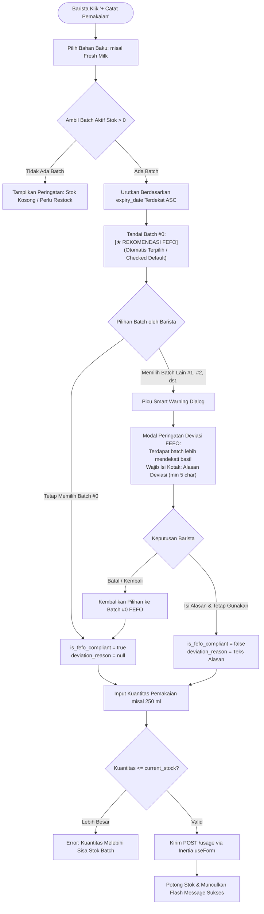

# RENCANA SPESIFIKASI DESAIN FRONTEND (PLAN 03)
## Modul 03: Dasbor Operasional Barista & Form Pemakaian Stok Berbasis FEFO Interaktif
**Target File Implementasi**:  
- `resources/js/Pages/Barista/Dashboard.tsx`  
- `resources/js/Pages/Usage/CreateUsageModal.tsx`  
- `resources/js/Components/SmartWarningDialog.tsx`  
**Referensi Kontrak**: [Desain.md](file:///home/lasains/ssd2/matkul/pemograman%20lanjut/projek/Desain.md), [PRD.md](file:///home/lasains/ssd2/matkul/pemograman%20lanjut/projek/PRD.md), dan [inventory.d.ts](file:///home/lasains/ssd2/matkul/pemograman%20lanjut/projek/resources/js/types/inventory.d.ts)

---

## 1. RINGKASAN ALUR KERJA BARISTA & LOGIKA BISNIS FEFO SEMI-OTOMATIS

### 1.1 Persona Barista & Kebutuhan Antarmuka Cepat
Barista bertugas meracik minuman di stasiun espresso pada jam sibuk (*rush hour*). Dalam kondisi tangan basah, antrean pelanggan panjang, dan ritme kerja cepat:
1. **Prinsip 1-Detik (Glanceable UI)**: Barista harus memahami sisa stok susu segar atau biji kopi dan status kedaluwarsanya dalam 1 detik pandang.
2. **Minimasi Klik (Frictionless)**: Tombol aksi utama harus besar (*touch-friendly*), aksi pemakaian bahan harus dapat diselesaikan dalam maksimal 3 langkah cepat.
3. **Mengapa FEFO Semi-Otomatis (Bukan Full Otomatis)?**
   - *Full Otomatis (Sistem Memaksa Potong Batch Terlama)*: Sering kali gagal di dunia nyata kafe karena barista fisik bisa jadi sudah membuka karton susu lain di chiller bar. Jika sistem memaksakan batch terlama secara kaku tanpa konfirmasi fisik, data inventaris di sistem akan meleset dari kondisi fisik (*inventory drift*).
   - *Semi-Otomatis dengan Smart Warning*: Sistem otomatis memilih dan merekomendasikan batch terdekat kedaluwarsa secara default, namun memberi keleluasaan barista memilih batch fisik lain dengan syarat wajib memasukkan **Alasan Deviasi**.

---

### 1.2 Diagram Alur Logika FEFO & Smart Warning



---

## 2. STITCH-READY SCREEN SPECIFICATION (GOOGLE STITCH PROMPT)

Spesifikasi berikut dirancang agar siap dimasukkan ke Google Stitch guna menghasilkan purwarupa visual 3 layar interaktif operasional bar.

### 2.1 Identitas Modul Layar
* **Judul Modul**: Barista Operational Console & Interactive FEFO Usage Engine
* **Target Viewport**: Responsive POS Bar Tablet (1024x768 / iPad) & Desktop Stasiun Barista
* **Aksen Desain**: Emerald Green (Utama), Slate Neutral (Dasbor), Amber (Peringatan Deviasi).

---

### 2.2 Rincian Tiga Layar Visual

#### Layar 1: Dasbor Operasional Barista (`Pages/Barista/Dashboard.tsx`)
1. **Header Stasiun Barista**:
   - Sambutan shift aktif: *"Halo, Bayu (Barista) • Shift Pagi Bar"* lengkap dengan indikator jam operasional dan status sinkronisasi online.
2. **Kartu Aksi Cepat (Quick Action Cards - 3 Kolom)**:
   - **Tombol Hijau Emerald**: `[+ Catat Pemakaian Bahan]` (Ikon `Flame` / `Coffee`, ukuran besar, tinggi min 64px, efek hover elevasi).
   - **Tombol Biru Slate**: `[+ Penerimaan Restock Baru]` (Ikon `PackagePlus`, membuka modal input batch baru).
   - **Tombol Kuning/Merah Lembut**: `[! Lapor Bahan Rusak/Basi]` (Ikon `AlertTriangle`, membuka modal pengajuan waste).
3. **Grid Bahan Paling Sering Digunakan di Bar (Quick Bar Ingredients)**:
   - Kartu-kartu bahan cepat (*Fresh Milk Diamond 1L*, *Espresso Blend House 1kg*, *Karamel Sirup Monin 700ml*, *Oat Milk Oatside 1L*).
   - Setiap kartu menampilkan:
     * Nama bahan dan kategori.
     * Sisa stok gabungan saat ini (contoh: *"4.200 ml"* atau *"8.500 gram"*).
     * Indikator Lampu Lalu Lintas Kedaluwarsa Terdekat:
       - 🟢 Hijau: *"Batch terdekat aman (14 hari lagi)"*
       - 🟡 Kuning: *"Batch B-02 expired dalam 4 hari!"*
       - 🔴 Merah: *"Segera pakai! Batch B-01 expired BESOK"*
     * Tombol aksi instan: `[Pakai Bahan Ini]` yang langsung membuka Modal Pemakaian dengan bahan otomatis terpilih.

---

#### Layar 2: Modal Form Pemakaian Bahan FEFO (`Pages/Usage/CreateUsageModal.tsx`)
1. **Dialog Container**:
   - Modal pop-up lebar sedang (`max-w-xl bg-surface-container rounded-xl shadow-xl border border-surface-border p-6`).
   - Judul: *"Catat Pemakaian Bahan Baku (FEFO)"* (`text-content-high`).
   - Subjudul: *"Pastikan fisik bahan yang diambil sesuai urutan kedaluwarsa terdekat."* (`text-content-medium`).
2. **Dropdown Pemilih Bahan (`Select`)**:
   - Pilihan nama bahan baku (dilengkapi sisa stok total dan satuan).
3. **RadioGroup Kartu Batch Interaktif (FEFO Batch Cards)**:
   - Menampilkan daftar batch aktif dari bahan yang dipilih:
     * **Kartu Batch Teratas (FEFO Recommended)**:
       - Border tebal `border-brand-primary bg-surface-container-high ring-1 ring-brand-primary`.
       - Badge kapsul mencolok: `[★ REKOMENDASI FEFO - Prioritas Pakai]` warna deep espresso (`bg-brand-primary text-surface-canvas font-semibold`).
       - Kode batch, tanggal kedaluwarsa, dan sisa stok fisik (contoh: *"Batch #BM-20261025 • Exp: 03 Nov 2026 (3 hari lagi) • Sisa: 1.000 ml"*).
     * **Kartu Batch Lainnya**:
       - Border normal `border-surface-border bg-surface-canvas hover:border-brand-secondary`.
       - Menampilkan kode batch dan tanggal kedaluwarsa yang lebih lama (contoh: *"Batch #BM-20261028 • Exp: 12 Nov 2026 (12 hari lagi) • Sisa: 2.000 ml"*).
4. **Input Kuantitas Pemakaian**:
   - Field input angka besar (`h-12 text-lg font-semibold bg-surface-canvas border-surface-border text-content-high`) dengan suffix satuan di dalam kotak (contoh: `[ 250 ] ml`).
   - Keterangan pembantu: *"Sisa stok setelah pemakaian: 750 ml"*.
5. **Catatan Operasional (Opsional)**:
   - Textarea singkat untuk keterangan racikan menu (contoh: *"Untuk 8 cup Iced Latte shift pagi"*).
6. **Footer Aksi**:
   - Tombol Batal (`text-content-medium hover:bg-surface-container-high`).
   - Tombol Submit Espresso: `[Konfirmasi & Kurangi Stok]` (`bg-brand-primary hover:bg-brand-primary-hover text-white`).

---

#### Layar 3: Pop-up AlertDialog Smart Warning Deviasi FEFO (`Components/SmartWarningDialog.tsx`)
1. **Pemicu Dialog**:
   - Terbuka otomatis saat barista mengklik radio card batch yang bukan nomor 1 (batch dengan kedaluwarsa lebih lama).
2. **Visual Warning Box**:
   - Header warna amber/kuning karamel hangat (`bg-[#FFF7ED] border border-[#FED7AA] rounded-lg p-4 flex gap-3 items-start`).
   - Ikon segitiga peringatan `AlertTriangle` warna karamel `text-[#C88242]`.
   - Judul peringatan: `text-[#5C3A21] font-semibold` (*"Peringatan Deviasi FEFO"*).
   - Teks penjelasan komparasi:
     > *"Anda memilih batch **#BM-20261028** (Exp: 12 Nov 2026), padahal terdapat batch **#BM-20261025** yang kedaluwarsa lebih cepat (**3 hari lagi**)."*
3. **Kotak Input Wajib: Alasan Deviasi**:
   - Label: *"Alasan tidak menggunakan batch kedaluwarsa terdekat (Wajib diisi):"*
   - Textarea dengan placeholder: *"Contoh: Kemasan batch ini sudah terlanjur terbuka di chiller bar..."*
   - Indikator validasi: Penanda panjang karakter `(Karakter: 0/5 minimal)` berwarna terakota (`text-brand-tertiary`) jika belum 5 karakter.
4. **Tombol Keputusan**:
   - Tombol Abu-abu Netral: `[Batal & Gunakan Rekomendasi FEFO]` (Mengembalikan pilihan ke batch #1).
   - Tombol Amber Tegas: `[Tetap Gunakan Batch Ini]` (`bg-brand-secondary hover:bg-brand-secondary-hover text-white`, hanya aktif jika alasan >= 5 karakter).

---

### 2.3 Teks Prompt Siap Pakai untuk Google Stitch

#### Prompt Bahasa Indonesia (Terstruktur untuk Stitch)
```text
Buatkan 3 antarmuka layar operasional bar modern untuk modul "FEFO Inventory Barista" pada aplikasi kafe "BeanFlow" dengan tema warna warm artisan coffee:

Layar 1 (Dasbor Barista):
Latar belakang kanvas susu hangat #FAF7F2. Di atas terdapat bar sambutan shift barista dengan indikator online. Di bawahnya ada 3 kartu aksi cepat besar: tombol espresso "+ Catat Pemakaian Bahan" (#4A2C11), tombol kontainer parchment "+ Penerimaan Restock Baru" (#EDE4DC), dan tombol amber karamel "! Lapor Bahan Rusak" (#C88242). Di bawahnya terdapat grid 4 kartu "Bahan Cepat Bar" (Fresh Milk Diamond, Espresso Blend, Sirup Karamel, Oat Milk) lengkap dengan sisa stok ml/gram, badge lampu lalu lintas kedaluwarsa (Merah Terracotta #8C3D2B, Kuning Amber #C88242, Hijau Segar #059669), dan tombol "Pakai Cepat".

Layar 2 (Modal Form Pemakaian Bahan FEFO):
Modal pop-up oat latte #F5EFEB terpusat (rounded-xl, border #EDE4DC, shadow-lg). Berisi dropdown pilih bahan, diikuti daftar pilihan batch kartu interaktif (RadioGroup):
- Kartu batch teratas (Rekomendasi FEFO) memiliki border espresso tebal #4A2C11, latar parchment #EDE4DC, dan badge espresso pekat bertuliskan "[★ REKOMENDASI FEFO - Prioritas Pakai]".
- Kartu batch kedua memiliki border parchment biasa dengan tanggal expired lebih lama.
Di bawah daftar batch terdapat input kuantitas angka besar dengan label satuan "ml", teks sisa stok otomatis, dan tombol espresso #4A2C11 "Konfirmasi & Kurangi Stok".

Layar 3 (AlertDialog Smart Warning Deviasi FEFO):
Modal dialog peringatan bernuansa karamel hangat (#FFF7ED) dengan border amber (#FED7AA). Menampilkan ikon segitiga peringatan, teks peringatan "Peringatan Deviasi FEFO: Ada batch yang kedaluwarsa lebih cepat!", kotak textarea wajib untuk mengisi "Alasan Deviasi" (dengan counter minimal 5 karakter), tombol batal "Kembali ke Rekomendasi FEFO", dan tombol amber karamel tegas "Tetap Gunakan Batch Ini".
```

#### English Prompt (High-Fidelity for Stitch AI)
```text
A high-fidelity 3-screen UI set for a specialty coffee inventory app named "BeanFlow", focusing on Barista FEFO Operations with warm coffee aesthetics:
1. Screen 1 (Barista Dashboard): Warm steamed milk canvas (#FAF7F2) background. Top greeting banner "Shift Barista Console • Morning Shift". Three prominent quick-action touch buttons: deep espresso "#4A2C11" "+ Record Ingredient Usage", parchment "#EDE4DC" "+ Receive Restock", and amber caramel "#C88242" "! Report Spoiled Material". Below is a grid of 4 quick-bar ingredient cards (Fresh Milk, Espresso Beans, Caramel Syrup, Oat Milk) showing stock numbers, traffic-light expiry badges (Botanical Green Safe, Amber Caramel Warning, Terracotta Critical), and an instant "Use Now" button.
2. Screen 2 (FEFO Stock Usage Modal): Warm oat latte modal dialog (#F5EFEB, rounded-xl, shadow-xl). Contains an ingredient selector, followed by an interactive RadioGroup of batch cards. The top card has an active deep espresso border (#4A2C11), parchment tint (#EDE4DC), and a bold capsule badge "[★ FEFO RECOMMENDATION - Use First]". The other batch card has a neutral parchment border with a later expiry date. Below is a large numeric quantity input with "ml" suffix, preview of remaining stock, and a full-width deep roasted espresso submit button.
3. Screen 3 (Smart Warning Deviation Dialog): A prominent amber alert modal (#FFF7ED background, #FED7AA border). Warning triangle icon, headline "FEFO Deviation Warning: Older batch available!", comparison summary of dates, required textarea for "Reason for Deviation" with a 5-character validation counter, secondary button "Revert to FEFO", and a solid spun amber confirmation button "Confirm Non-FEFO Selection". Tailwind CSS styling, touch-friendly, high contrast.
```

---

## 3. ARSITEKTUR TEKNIS FRONTEND (REACT + INERTIA)

### 3.1 Lokasi File & Relasi Komponen
```text
resources/js/
├── Pages/
│   ├── Barista/
│   │   └── Dashboard.tsx               # Dasbor utama operasional barista
│   └── Usage/
│       └── CreateUsageModal.tsx        # Modal form pemakaian bahan FEFO
├── Components/
│   ├── SmartWarningDialog.tsx          # Pop-up dialog peringatan deviasi FEFO
│   └── Barista/
│       ├── QuickActionCards.tsx        # 3 Tombol aksi cepat bar
│       └── PopularIngredientsGrid.tsx  # Grid bahan favorit bar
```

---

### 3.2 Kontrak Tipe Data TypeScript

Mengacu pada [`resources/js/types/inventory.d.ts`](file:///home/lasains/ssd2/matkul/pemograman%20lanjut/projek/resources/js/types/inventory.d.ts):

```typescript
// resources/js/types/usage.ts
import { Ingredient, IngredientBatch } from '@/types/inventory';

export interface BaristaDashboardProps {
    popularIngredients: (Ingredient & {
        nearest_batch?: IngredientBatch;
        active_batches_count: number;
    })[];
    recentUsagesToday: {
        id: number;
        ingredient_name: string;
        batch_code: string;
        quantity: number;
        unit: string;
        time_ago: string;
        is_fefo_compliant: boolean;
    }[];
}

export interface StockUsageFormData {
    ingredient_batch_id: number | null;
    quantity_used: number | '';
    is_fefo_compliant: boolean;
    deviation_reason: string;
    notes: string;
}
```

---

### 3.3 Logika Deteksi Deviasi & Form Handling Inertia

```typescript
// resources/js/Pages/Usage/CreateUsageModal.tsx
import { useState, useEffect } from 'react';
import { useForm } from '@inertiajs/react';
import { Ingredient, IngredientBatch } from '@/types/inventory';
import { SmartWarningDialog } from '@/Components/SmartWarningDialog';
import { Dialog, DialogContent, DialogHeader, DialogTitle } from '@/Components/ui/dialog';
import { Button } from '@/Components/ui/button';
import { RadioGroup, RadioGroupItem } from '@/Components/ui/radio-group';
import { Label } from '@/Components/ui/label';
import { Input } from '@/Components/ui/input';
import { cn } from '@/lib/utils';
import { Flame, Check, AlertCircle } from 'lucide-react';

interface Props {
    isOpen: boolean;
    onClose: () => void;
    ingredients: Ingredient[];
    preselectedIngredientId?: number;
}

export function CreateUsageModal({ isOpen, onClose, ingredients, preselectedIngredientId }: Props) {
    const [selectedIngredient, setSelectedIngredient] = useState<Ingredient | null>(null);
    const [activeBatches, setActiveBatches] = useState<IngredientBatch[]>([]);
    const [warningDialogOpen, setWarningDialogOpen] = useState(false);
    const [pendingBatchId, setPendingBatchId] = useState<number | null>(null);

    const { data, setData, post, processing, errors, reset } = useForm({
        ingredient_batch_id: null as number | null,
        quantity_used: '' as number | '',
        is_fefo_compliant: true,
        deviation_reason: '',
        notes: '',
    });

    // Otomatis urutkan batch berdasarkan tanggal kedaluwarsa terdekat (FEFO Order)
    useEffect(() => {
        if (selectedIngredient && selectedIngredient.batches) {
            const sorted = [...selectedIngredient.batches]
                .filter((b) => b.status === 'active' && b.current_stock > 0)
                .sort((a, b) => new Date(a.expiry_date).getTime() - new Date(b.expiry_date).getTime());

            setActiveBatches(sorted);

            if (sorted.length > 0) {
                // Batch #0 otomatis terpilih sebagai rekomendasi FEFO default
                setData('ingredient_batch_id', sorted[0].id);
                setData('is_fefo_compliant', true);
                setData('deviation_reason', '');
            }
        }
    }, [selectedIngredient]);

    // Handler saat barista memilih batch fisik di RadioGroup
    const handleBatchSelection = (batchId: number) => {
        const fefoRecommendedBatch = activeBatches[0];

        if (fefoRecommendedBatch && batchId !== fefoRecommendedBatch.id) {
            // TERDETEKSI DEVIASI: Barista memilih batch bukan rekomendasi pertama
            setPendingBatchId(batchId);
            setWarningDialogOpen(true);
        } else {
            // Sesuai Rekomendasi FEFO
            setData((prev) => ({
                ...prev,
                ingredient_batch_id: batchId,
                is_fefo_compliant: true,
                deviation_reason: '',
            }));
        }
    };

    // Konfirmasi dari Smart Warning Dialog
    const handleConfirmDeviation = (reason: string) => {
        if (pendingBatchId) {
            setData((prev) => ({
                ...prev,
                ingredient_batch_id: pendingBatchId,
                is_fefo_compliant: false,
                deviation_reason: reason,
            }));
        }
        setWarningDialogOpen(false);
        setPendingBatchId(null);
    };

    // Batal deviasi -> Kembali ke batch rekomendasi FEFO
    const handleCancelDeviation = () => {
        if (activeBatches.length > 0) {
            setData((prev) => ({
                ...prev,
                ingredient_batch_id: activeBatches[0].id,
                is_fefo_compliant: true,
                deviation_reason: '',
            }));
        }
        setWarningDialogOpen(false);
        setPendingBatchId(null);
    };

    const handleSubmit = (e: React.FormEvent) => {
        e.preventDefault();
        post(route('usage.store'), {
            onSuccess: () => {
                reset();
                onClose();
            },
        });
    };

    // ... Render form modal & sub-komponen
}
```

---

### 3.4 Komponen Smart Warning Dialog

```typescript
// resources/js/Components/SmartWarningDialog.tsx
import { useState } from 'react';
import {
    AlertDialog,
    AlertDialogContent,
    AlertDialogHeader,
    AlertDialogTitle,
    AlertDialogDescription,
    AlertDialogFooter,
} from '@/Components/ui/alert-dialog';
import { Button } from '@/Components/ui/button';
import { Textarea } from '@/Components/ui/textarea';
import { AlertTriangle } from 'lucide-react';
import { IngredientBatch } from '@/types/inventory';

interface SmartWarningProps {
    isOpen: boolean;
    fefoBatch?: IngredientBatch;
    selectedBatch?: IngredientBatch;
    onConfirm: (reason: string) => void;
    onCancel: () => void;
}

export function SmartWarningDialog({
    isOpen,
    fefoBatch,
    selectedBatch,
    onConfirm,
    onCancel,
}: SmartWarningProps) {
    const [reason, setReason] = useState('');
    const isValidReason = reason.trim().length >= 5;

    return (
        <AlertDialog open={isOpen}>
            <AlertDialogContent className="max-w-md border-amber-300 bg-amber-50/70">
                <AlertDialogHeader>
                    <div className="flex items-center gap-3">
                        <div className="rounded-full bg-[#FFF7ED] p-2 text-[#C88242]">
                            <AlertTriangle className="h-6 w-6" />
                        </div>
                        <AlertDialogTitle className="text-content-high font-bold text-lg">
                            Peringatan Deviasi FEFO
                        </AlertDialogTitle>
                    </div>
                    <AlertDialogDescription className="text-content-medium text-sm pt-2">
                        Anda memilih batch <strong>{selectedBatch?.batch_code}</strong> (Exp: {selectedBatch?.expiry_date}), 
                        padahal ada batch <strong>{fefoBatch?.batch_code}</strong> yang kedaluwarsa lebih dekat 
                        (<strong>Exp: {fefoBatch?.expiry_date}</strong>).
                    </AlertDialogDescription>
                </AlertDialogHeader>

                <div className="my-3 space-y-2">
                    <label className="text-xs font-semibold text-content-high uppercase tracking-wide">
                        Alasan Deviasi Fisik (Wajib):
                    </label>
                    <Textarea
                        value={reason}
                        onChange={(e) => setReason(e.target.value)}
                        placeholder="Contoh: Kemasan batch ini sudah terlanjur dibuka di bar chiller..."
                        className="bg-surface-canvas border-surface-border text-content-high text-sm focus:ring-brand-secondary"
                        rows={3}
                    />
                    <div className="flex justify-between text-xs">
                        <span className={isValidReason ? 'text-emerald-800 font-medium' : 'text-brand-tertiary font-medium'}>
                            {isValidReason ? '✓ Alasan valid' : '* Minimal 5 karakter'}
                        </span>
                        <span className="text-content-subtle">{reason.trim().length}/5 min</span>
                    </div>
                </div>

                <AlertDialogFooter className="gap-2 sm:gap-0">
                    <Button variant="outline" onClick={onCancel} className="text-content-medium border-surface-border hover:bg-surface-container-high">
                        Batal & Gunakan FEFO
                    </Button>
                    <Button
                        disabled={!isValidReason}
                        onClick={() => onConfirm(reason)}
                        className="bg-brand-secondary hover:bg-brand-secondary-hover text-white font-semibold disabled:opacity-50"
                    >
                        Tetap Gunakan Batch Ini
                    </Button>
                </AlertDialogFooter>
            </AlertDialogContent>
        </AlertDialog>
    );
}
```

---

## 4. EDGE CASES & ERROR HANDLING

### 4.1 Kuantitas Melebihi `current_stock`
- **Pengecekan di Klien (*Client-Side Guard*)**:
  Saat barista mengetik angka pemakaian, sistem langsung menghitung sisa stok:
  ```typescript
  const selectedBatch = activeBatches.find(b => b.id === data.ingredient_batch_id);
  const isOverStock = Number(data.quantity_used) > (selectedBatch?.current_stock ?? 0);
  ```
  Jika `isOverStock === true`:
  - Input border menjadi terakota tebal (`border-brand-tertiary focus:ring-brand-tertiary`).
  - Muncul teks peringatan: *"Kuantitas (xxx) melebihi stok fisik batch yang tersedia (yyy)"* (`text-brand-tertiary`).
  - Tombol Submit dinonaktifkan (`disabled={isOverStock || processing}`).

### 4.2 Kasus Bahan Tanpa Batch Aktif (Stok Habis Total)
- Jika bahan yang dipilih memiliki `activeBatches.length === 0`:
  - RadioGroup disembunyikan.
  - Tampilkan kartu *Empty State*: Box abu-abu dengan ikon `PackageX`, teks *"Semua batch bahan ini sudah habis atau kedaluwarsa"*.
  - Tampilkan tombol cepat `[+ Restock Batch Baru]` yang langsung mengarahkan ke modal penerimaan barang.

### 4.3 Barista Menutup Dialog Peringatan Tanpa Mengisi Alasan
- Jika barista menekan tombol silang (X), menekan area luar (*backdrop click*), atau menekan `Escape`:
  - Dialog tertutup secara otomatis dan state `ingredient_batch_id` langsung **dibalikkan (*revert*)** ke ID batch nomor 1 (`activeBatches[0].id`).
  - Barista tidak akan pernah bisa menyimpan data non-FEFO tanpa melewati pencatatan alasan deviasi.

### 4.4 Dukungan Angka Desimal
- Untuk bahan dengan satuan berat/volume presisi (seperti *Espresso Beans* dalam satuan gram), input mendukung angka desimal dengan atribut `step="0.1"` atau `step="any"` agar barista dapat mencatat dosis *espresso basket* yang presisi (misal: `18.5 gram`).

---

## 5. REKOMENDASI TAHAPAN IMPLEMENTASI KODING

1. **Langkah 1**: Buat komponen `SmartWarningDialog.tsx` di `resources/js/Components/`.
2. **Langkah 2**: Buat modal form `CreateUsageModal.tsx` dengan RadioGroup batch dan validasi kuantitas stok.
3. **Langkah 3**: Buat halaman `resources/js/Pages/Barista/Dashboard.tsx` yang memuat kartu aksi cepat dan grid bahan favorit bar.
4. **Langkah 4**: Pastikan controller backend `StockUsageController.php` memvalidasi input di dalam transaksi database (`DB::transaction`) dan menyimpan kolom `is_fefo_compliant` serta `deviation_reason` dengan tepat.
