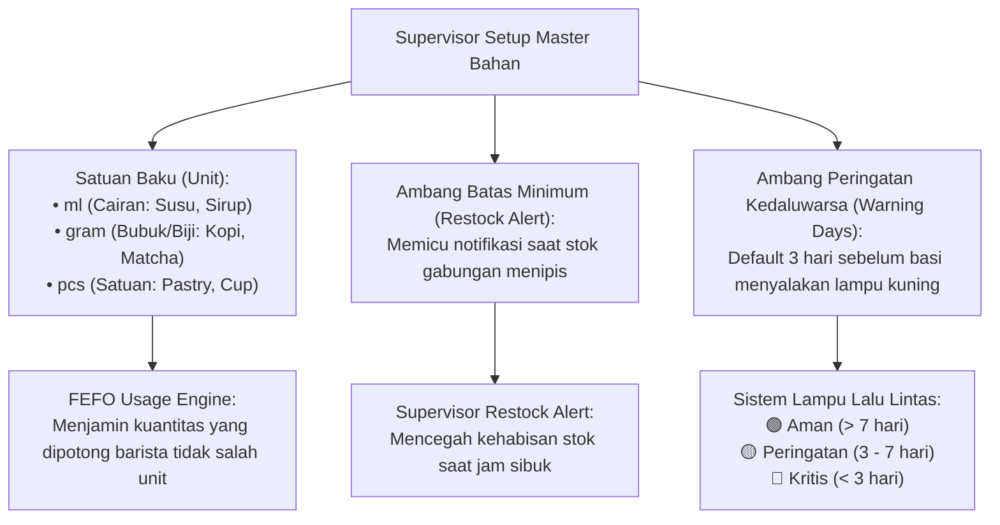

# RENCANA SPESIFIKASI DESAIN FRONTEND (PLAN 04)
## Modul 04: Manajemen Master Data Bahan Baku & Kategori
**Target File Implementasi**:  
- `resources/js/Pages/Master/Ingredients/Index.tsx`  
- `resources/js/Pages/Master/Ingredients/IngredientModal.tsx`  
- `resources/js/Pages/Master/Categories/CategoryModal.tsx`  
**Referensi Kontrak**: [Desain.md](file:///home/lasains/ssd2/matkul/pemograman%20lanjut/projek/Desain.md), [PRD.md](file:///home/lasains/ssd2/matkul/pemograman%20lanjut/projek/PRD.md), dan [inventory.d.ts](file:///home/lasains/ssd2/matkul/pemograman%20lanjut/projek/resources/js/types/inventory.d.ts)

---

## 1. RINGKASAN FITUR MASTER DATA & OTORISASI SUPERVISOR

### 1.1 Peran Strategis Supervisor & Batasan Akses (RBAC)
Supervisor adalah penanggung jawab konsistensi data operasional dan gudang (*warehouse guardian*). Modul Master Data memiliki aturan hak akses yang ketat:
* **Supervisor (`role: supervisor`)**: **Full Access (CRUD)** — Berhak menambah, mengubah, mengelompokkan kategori, mengatur ambang batas restock, dan mengarsipkan bahan.
* **Barista (`role: barista`)**: **View Only / No Access** — Barista hanya melihat bahan saat mencatat pemakaian; dilarang mengubah parameter master bahan agar satuan ukur tidak kacau.
* **Owner (`role: owner`)**: **View Only** — Owner melihat master bahan sebagai referensi aset, tanpa perlu mengotak-atik parameter teknis harian.

---

### 1.2 Mengapa Konsistensi Master Data Krusial bagi Kafe?



1. **Integritas Satuan Unit (`unit`)**:  
   Kesalahan memilih satuan (misalnya susu dicatat `gram` padahal resep espresso menggunakan `ml`) akan merusak kalkulasi FEFO. Master data mengunci satuan ini.
2. **Ambang Batas Stok Minimum (`minimum_stock`)**:  
   Ketika total saldo stok dari seluruh batch aktif suatu bahan jatuh di bawah angka ini, sistem otomatis memunculkan badge peringatan restock.
3. **Ambang Hari Peringatan Kedaluwarsa (`warning_days`)**:  
   Setiap bahan memiliki karakteristik daya tahan berbeda (misal: *fresh milk* memiliki batas warning 3 hari, sedangkan *syrup* botolan 14 hari). Pengaturan ini menentukan kapan status batch berubah dari Hijau (Aman) menjadi Kuning (Segera Pakai).

---

## 2. STITCH-READY SCREEN SPECIFICATION (GOOGLE STITCH PROMPT)

Spesifikasi berikut dirancang agar siap dimasukkan ke Google Stitch guna menghasilkan purwarupa visual modul master data.

### 2.1 Identitas Modul Layar
* **Screen Title**: Specialty Coffee Master Ingredient & Category Catalog
* **Target Viewport**: Responsive Desktop (1440x900) & Supervisor Tablet (1024x768)
* **Tone & Palette**: Clean Professional Enterprise SaaS, Slate-50 background, Emerald-600 accents, high-contrast borders (`border-slate-200`).

---

### 2.2 Rincian Tiga Layar Visual

#### Layar 1: Tabel Utama Master Data Bahan (`Master/Ingredients/Index.tsx`)
1. **Header Halaman**:
   - Judul: `text-xl font-semibold text-slate-900` (*"Katalog Master Bahan Baku"*).
   - Subjudul: `text-sm text-slate-500` (*"Kelola nama bahan, kategori, satuan standar, dan parameter kedaluwarsa"*).
2. **Bilah Filter & Aksi Cepat (*Toolbar*)**:
   - **Search Input**: Input pencarian dengan ikon `Search` di kiri dan tombol reset (*"Cari nama bahan baku..."*).
   - **Filter Kategori (Dropdown / Tabs)**: Filter cepat (*Semua Kategori*, *Dairy*, *Beans*, *Syrup*, *Bakery*, *Packaging*).
   - **Tombol Sekunder**: `[+ Kelola Kategori]` (border slate-200, membuka modal manajemen kategori).
   - **Tombol Utama Hijau**: `[+ Tambah Bahan Baku Baru]` (`bg-emerald-600 hover:bg-emerald-700 text-white font-medium shadow-sm`).
3. **Data Table Master Bahan (shadcn/ui Table)**:
   - Header Tabel (`bg-slate-50 border-b border-slate-200 text-xs font-semibold text-slate-700 uppercase tracking-wider`):
     * **Nama Bahan Baku**: Nama bahan + teks kecil ID / slug.
     * **Kategori**: Badge kategori (contoh: *Dairy* berlatar biru muda, *Beans* berlatar cokelat/amber muda).
     * **Satuan**: Badge netral kapsul (`ml`, `gram`, `pcs`).
     * **Total Saldo Stok**: Nilai agregat seluruh batch aktif (contoh: `4.500 ml`).
     * **Ambang Restock**: Angka batas minimum (contoh: `1.000 ml`).
     * **Warning Days**: Ambang hari peringatan dini (contoh: `3 hari`).
     * **Batch Aktif**: Jumlah batch yang sedang aktif di gudang (contoh: `3 Batch`).
     * **Aksi**: Tombol Edit (`Pencil`) dan Dropdown aksi (*Nonaktifkan / Arsip*).
4. **Footer Tabel**:
   - Ringkasan data (*"Menampilkan 12 dari 12 bahan baku"*) dan kontrol paginasi jika data banyak.

---

#### Layar 2: Modal Form Tambah/Ubah Bahan Baku (`Master/Ingredients/IngredientModal.tsx`)
1. **Kontainer Dialog**:
   - Modal pop-up putih terpusat (`max-w-lg bg-white rounded-xl shadow-xl border border-slate-200 p-6`).
   - Judul dinamis: *"Tambah Bahan Baku Baru"* atau *"Ubah Data: Fresh Milk Diamond 1L"*.
2. **Komponen Form Input**:
   - **Nama Bahan Baku (`name`)**: Input teks wajib (contoh: *"Fresh Milk Diamond 1L"*).
   - **Kategori (`category_id`)**: Select dropdown yang memuat opsi kategori aktif (*Dairy / Susu*, *Coffee Beans*, dll.).
   - **Satuan Standar (`unit`)**: Radio button atau Select pilihan tunggal yang tegas:
     * `ml` (Mililiter - Cairan)
     * `gram` (Gram - Bubuk / Biji)
     * `pcs` (Pieces - Satuan barang)
     * *Helper text*: *"Satuan ini akan digunakan secara permanen pada pencatatan FEFO dan tidak dapat diubah jika sudah ada transaksi."*
   - **Ambang Batas Minimum Restock (`minimum_stock`)**:
     * Input angka dengan suffix satuan dinamis sesuai pilihan di atas.
     * *Helper text*: *"Peringatan restock akan menyala jika total persediaan di bawah angka ini."*
   - **Ambang Hari Peringatan Kedaluwarsa (`warning_days`)**:
     * Input angka (hari). Default diset ke `3`.
     * *Helper text*: *"Lampu kuning (Segera Pakai) akan menyala sekian hari sebelum tanggal kedaluwarsa batch."*
3. **Footer Tombol**:
   - Tombol Batal (`variant="outline"`).
   - Tombol Simpan Hijau: `[Simpan Bahan Baku]`.

---

#### Layar 3: Modal Kelola Kategori Bahan (`Master/Categories/CategoryModal.tsx`)
1. **Kontainer Dialog**:
   - Dialog ukuran sedang (`max-w-md bg-white rounded-xl p-6`).
   - Judul: *"Kelola Kategori Bahan Baku"*.
2. **Form Cepat Tambah Kategori**:
   - Baris horizontal: Input teks *"Nama Kategori Baru"* + Tombol `[+ Tambah]`.
3. **Daftar Kategori Saat Ini (List Table)**:
   - Baris daftar kategori (Dairy, Beans, Syrup, Bakery, Packaging).
   - Setiap baris memiliki: Nama kategori, jumlah bahan terdaftar (misal: *"6 bahan"*), tombol edit nama, dan tombol hapus (ikon tempat sampah, dinonaktifkan jika kategori masih memiliki bahan terdaftar).

---

### 2.3 Teks Prompt Siap Pakai untuk Google Stitch

#### Prompt Bahasa Indonesia (Terstruktur & Kontekstual)
```text
Buatkan 3 antarmuka layar manajemen data master untuk modul "Katalog Master Bahan Baku & Kategori" pada aplikasi kafe "BeanFlow":

Layar 1 (Tabel Utama Master Bahan):
Latar belakang bersih slate-50. Header memuat judul "Katalog Master Bahan Baku" dan subjudul penjelasan. Toolbar di atas tabel memiliki input pencarian dengan ikon search, dropdown filter kategori bahan, tombol outline "+ Kelola Kategori", dan tombol hijau emerald utama "+ Tambah Bahan Baku Baru".
Tabel data bergaya modern shadcn/ui dengan border slate-200. Kolom tabel memuat:
- Nama Bahan (misal: Fresh Milk Diamond 1L, Espresso Blend House, Karamel Sirup Monin).
- Badge Kategori (Dairy berlatar biru, Beans berlatar amber, Syrup berlatar ungu).
- Badge Satuan Unit (ml, gram, pcs).
- Total Saldo Stok (angka tebal, misal: 4.500 ml).
- Ambang Batas Stok Minimum (misal: Min 1.000 ml).
- Ambang Hari Warning Kedaluwarsa (misal: 3 Hari).
- Jumlah Batch Aktif (misal: 2 Batch).
- Tombol Aksi (ikon pensil Edit dan titik tiga).

Layar 2 (Modal Form Tambah/Edit Bahan Baku):
Modal dialog putih terpusat (rounded-xl, border slate-200). Form input berisi:
- Input teks "Nama Bahan Baku" (placeholder: misal Fresh Milk Diamond 1L).
- Dropdown select "Kategori Bahan" (pilihan: Dairy, Beans, Syrup, Bakery).
- Pilihan segmented "Satuan Standar" (pilihan eksklusif: ml, gram, pcs) dengan catatan panduan kecil.
- Input angka "Ambang Batas Stok Minimum" dengan label satuan di sebelahnya.
- Input angka "Ambang Hari Peringatan Kedaluwarsa" (default 3 hari) dengan penjelasan lampu kuning.
- Footer tombol Batal dan tombol hijau emerald "Simpan Bahan Baku".

Layar 3 (Modal Cepat Kelola Kategori):
Dialog ringkas untuk menambah kategori baru dan melihat daftar kategori yang ada (Dairy, Coffee Beans, Flavoring Syrup, Bakery, Cup & Packaging) lengkap dengan jumlah bahan per kategori.
```

#### English Prompt (High-Fidelity for Stitch AI)
```text
A modern specialty coffee web app UI set for "Master Ingredients & Categories Management" in the BeanFlow app:
1. Screen 1 (Master Ingredients Table): Clean neutral slate-50 background. Top action toolbar features a search input with magnifying glass icon, category filter dropdown, secondary button "+ Manage Categories", and a prominent emerald-600 button "+ Add New Ingredient". A crisp data table with subtle slate-200 borders displaying columns: Ingredient Name with subtitle, Category Badge (Dairy in soft blue, Beans in soft amber, Syrup in purple), Unit Capsule (ml, gram, pcs), Total Stock (bold text), Minimum Threshold, Warning Days threshold, Active Batches count, and row action icons (Edit pencil & dropdown menu).
2. Screen 2 (Add/Edit Ingredient Modal): Centered clean white dialog card (rounded-xl, shadow-xl). Contains fields: text input "Ingredient Name", category select dropdown, segmented unit selector (ml, gram, pcs) with descriptive helper text, numeric input "Minimum Reorder Stock" with dynamic unit suffix, and numeric input "Expiry Warning Days" (default 3 days) explaining the early warning trigger. Bottom actions: neutral "Cancel" and primary emerald "Save Ingredient".
3. Screen 3 (Category Manager Modal): Compact dialog with an inline quick-add input for new categories and a neat list of existing categories showing assigned ingredient counts and subtle edit/delete icons. Polished, minimalist, high contrast, typography hierarchy.
```

---

## 3. ARSITEKTUR TEKNIS FRONTEND (REACT + INERTIA)

### 3.1 Lokasi File & Komposisi Komponen
```text
resources/js/
├── Pages/
│   └── Master/
│       ├── Ingredients/
│       │   ├── Index.tsx               # Halaman tabel utama master bahan
│       │   └── IngredientModal.tsx     # Modal form tambah & edit bahan
│       └── Categories/
│           └── CategoryModal.tsx       # Modal manajemen kategori
├── Components/
│   ├── ui/
│   │   ├── table.tsx                   # shadcn Table primitif
│   │   ├── dialog.tsx                  # shadcn Dialog primitif
│   │   └── select.tsx                  # shadcn Select primitif
│   └── ConfirmDialog.tsx               # Dialog konfirmasi aksi berbahaya
```

---

### 3.2 Kontrak Tipe Data TypeScript

Mengacu pada [`resources/js/types/inventory.d.ts`](file:///home/lasains/ssd2/matkul/pemograman%20lanjut/projek/resources/js/types/inventory.d.ts):

```typescript
// resources/js/types/master.ts
import { Category, Ingredient } from '@/types/inventory';

export interface IngredientWithStats extends Ingredient {
    active_batches_count: number;
    total_current_stock: number;
    category: Category;
}

export interface MasterIngredientsIndexProps {
    ingredients: IngredientWithStats[];
    categories: Category[];
    filters: {
        search?: string;
        category?: string;
    };
}

export interface IngredientFormData {
    name: string;
    category_id: number | '';
    unit: 'ml' | 'gram' | 'pcs';
    minimum_stock: number | '';
    warning_days: number | '';
}

export interface CategoryFormData {
    name: string;
}
```

---

### 3.3 Form Handling Dual-Mode (Create & Edit) dengan Inertia `useForm`

```typescript
// resources/js/Pages/Master/Ingredients/IngredientModal.tsx
import { useEffect } from 'react';
import { useForm } from '@inertiajs/react';
import { Category, Ingredient } from '@/types/inventory';
import { IngredientFormData } from '@/types/master';
import { Dialog, DialogContent, DialogHeader, DialogTitle, DialogFooter } from '@/Components/ui/dialog';
import { Button } from '@/Components/ui/button';
import { Input } from '@/Components/ui/input';
import { Label } from '@/Components/ui/label';
import { Select, SelectContent, SelectItem, SelectTrigger, SelectValue } from '@/Components/ui/select';
import InputError from '@/Components/InputError';

interface Props {
    isOpen: boolean;
    onClose: () => void;
    categories: Category[];
    ingredientToEdit?: Ingredient | null; // null jika mode Tambah Baru
}

export function IngredientModal({ isOpen, onClose, categories, ingredientToEdit }: Props) {
    const isEditMode = Boolean(ingredientToEdit);

    const { data, setData, post, put, processing, errors, reset, clearErrors } =
        useForm<IngredientFormData>({
            name: '',
            category_id: '',
            unit: 'ml',
            minimum_stock: '',
            warning_days: 3,
        });

    // Populate data jika sedang dalam mode edit
    useEffect(() => {
        if (ingredientToEdit) {
            setData({
                name: ingredientToEdit.name,
                category_id: ingredientToEdit.category_id,
                unit: ingredientToEdit.unit as 'ml' | 'gram' | 'pcs',
                minimum_stock: ingredientToEdit.minimum_stock,
                warning_days: ingredientToEdit.warning_days,
            });
        } else {
            reset();
            setData('warning_days', 3);
        }
        clearErrors();
    }, [ingredientToEdit, isOpen]);

    const handleSubmit = (e: React.FormEvent) => {
        e.preventDefault();

        if (isEditMode && ingredientToEdit) {
            // Mode Update: PUT /ingredients/{id}
            put(route('ingredients.update', ingredientToEdit.id), {
                onSuccess: () => {
                    reset();
                    onClose();
                },
            });
        } else {
            // Mode Create: POST /ingredients
            post(route('ingredients.store'), {
                onSuccess: () => {
                    reset();
                    onClose();
                },
            });
        }
    };

    return (
        <Dialog open={isOpen} onOpenChange={onClose}>
            <DialogContent className="max-w-lg bg-white rounded-xl">
                <DialogHeader>
                    <DialogTitle className="text-slate-900 text-lg font-semibold">
                        {isEditMode ? `Ubah Bahan: ${ingredientToEdit?.name}` : 'Tambah Bahan Baku Baru'}
                    </DialogTitle>
                </DialogHeader>

                <form onSubmit={handleSubmit} className="space-y-4 pt-2">
                    {/* Input Nama Bahan */}
                    <div>
                        <Label htmlFor="name">Nama Bahan Baku</Label>
                        <Input
                            id="name"
                            value={data.name}
                            onChange={(e) => setData('name', e.target.value)}
                            placeholder="Contoh: Fresh Milk Diamond 1L"
                            className="mt-1"
                        />
                        <InputError message={errors.name} className="mt-1" />
                    </div>

                    {/* Select Kategori */}
                    <div>
                        <Label htmlFor="category_id">Kategori Bahan</Label>
                        <Select
                            value={String(data.category_id)}
                            onValueChange={(val) => setData('category_id', Number(val))}
                        >
                            <SelectTrigger className="mt-1">
                                <SelectValue placeholder="Pilih Kategori" />
                            </SelectTrigger>
                            <SelectContent>
                                {categories.map((cat) => (
                                    <SelectItem key={cat.id} value={String(cat.id)}>
                                        {cat.name}
                                    </SelectItem>
                                ))}
                            </SelectContent>
                        </Select>
                        <InputError message={errors.category_id} className="mt-1" />
                    </div>

                    {/* Satuan Unit */}
                    <div>
                        <Label htmlFor="unit">Satuan Ukuran Standar (Unit)</Label>
                        <Select
                            value={data.unit}
                            onValueChange={(val: 'ml' | 'gram' | 'pcs') => setData('unit', val)}
                            disabled={isEditMode} // Kunci unit jika sedang edit untuk menjaga integritas batch
                        >
                            <SelectTrigger className="mt-1">
                                <SelectValue />
                            </SelectTrigger>
                            <SelectContent>
                                <SelectItem value="ml">Mililiter (ml) — Untuk Cairan / Susu / Sirup</SelectItem>
                                <SelectItem value="gram">Gram (gram) — Untuk Biji Kopi / Bubuk Matcha</SelectItem>
                                <SelectItem value="pcs">Pieces (pcs) — Untuk Pastry / Cup Plastik</SelectItem>
                            </SelectContent>
                        </Select>
                        {isEditMode && (
                            <p className="text-xs text-slate-500 mt-1">
                                * Satuan unit dikunci demi menjaga keutuhan riwayat pemotongan batch FEFO.
                            </p>
                        )}
                        <InputError message={errors.unit} className="mt-1" />
                    </div>

                    {/* Ambang Batas Stok Minimum & Warning Days */}
                    <div className="grid grid-cols-1 sm:grid-cols-2 gap-4">
                        <div>
                            <Label htmlFor="minimum_stock">Batas Minimum Restock</Label>
                            <div className="relative mt-1">
                                <Input
                                    id="minimum_stock"
                                    type="number"
                                    min="0"
                                    value={data.minimum_stock}
                                    onChange={(e) => setData('minimum_stock', Number(e.target.value))}
                                    placeholder="0"
                                    className="pr-12"
                                />
                                <span className="absolute right-3 top-2.5 text-xs font-semibold text-slate-400 uppercase">
                                    {data.unit}
                                </span>
                            </div>
                            <InputError message={errors.minimum_stock} className="mt-1" />
                        </div>

                        <div>
                            <Label htmlFor="warning_days">Ambang Hari Warning</Label>
                            <div className="relative mt-1">
                                <Input
                                    id="warning_days"
                                    type="number"
                                    min="1"
                                    value={data.warning_days}
                                    onChange={(e) => setData('warning_days', Number(e.target.value))}
                                    placeholder="3"
                                    className="pr-12"
                                />
                                <span className="absolute right-3 top-2.5 text-xs font-semibold text-slate-400">
                                    Hari
                                </span>
                            </div>
                            <InputError message={errors.warning_days} className="mt-1" />
                        </div>
                    </div>

                    <DialogFooter className="pt-4">
                        <Button type="button" variant="outline" onClick={onClose} disabled={processing}>
                            Batal
                        </Button>
                        <Button type="submit" disabled={processing} className="bg-emerald-600 hover:bg-emerald-700">
                            {processing ? 'Menyimpan...' : isEditMode ? 'Simpan Perubahan' : 'Tambah Bahan'}
                        </Button>
                    </DialogFooter>
                </form>
            </DialogContent>
        </Dialog>
    );
}
```

---

## 4. EDGE CASES & PERLINDUNGAN DATA

### 4.1 Proteksi Penghapusan Bahan yang Memiliki Batch Aktif
- **Masalah Integritas Relasional**:  
  Jika Supervisor menghapus baris bahan baku yang masih memiliki stok aktif di tabel `ingredient_batches`, database akan memunculkan *foreign key constraint error* atau membuat data batch menjadi yatim (*orphan records*).
- **Solusi Pencegahan**:
  1. Frontend memeriksa `ingredient.active_batches_count`:
     - Jika `active_batches_count > 0`: Tombol hapus dinonaktifkan atau diganti dengan tombol *"Arsipkan / Nonaktifkan"*.
     - Jika pengguna tetap mencoba, munculkan dialog pencegahan:
       > *"Bahan ini masih memiliki X batch aktif di gudang. Habiskan atau musnahkan seluruh batch terlebih dahulu sebelum menghapus bahan."*
  2. Backend Laravel melengkapi validasi di method `destroy()`:
     ```php
     if ($ingredient->batches()->where('current_stock', '>', 0)->exists()) {
         return back()->with('error', 'Tidak dapat menghapus bahan yang masih memiliki stok aktif.');
     }
     ```

### 4.2 Pencegahan Satuan Berubah pada Bahan yang Sudah Memiliki Transaksi
- Jika bahan sudah pernah memiliki batch atau transaksi pemakaian dalam satuan `ml`, mengubah satuannya menjadi `gram` akan menyebabkan kekacauan matematis (misal: sisa stok 1000 ml tiba-tiba dihitung 1000 gram).
- Oleh karena itu, pada **Mode Edit**, elemen pilihan satuan `unit` di-disabled secara permanen dengan penjelas bantuan visual.

### 4.3 Validasi Nilai Negatif & Nol
- Input `minimum_stock` dibatasi `min="0"` (tidak boleh bernilai negatif).
- Input `warning_days` dibatasi `min="1"` (ambang peringatan minimal 1 hari sebelum basi, tidak boleh 0 atau minus).

---

## 5. REKOMENDASI TAHAPAN IMPLEMENTASI KODING

1. **Langkah 1**: Buat komponen tabel master data di `resources/js/Pages/Master/Ingredients/Index.tsx`.
2. **Langkah 2**: Buat form modal `IngredientModal.tsx` dengan penanganan mode ganda (Create & Edit) serta penguncian unit pada mode edit.
3. **Langkah 3**: Buat modal pendukung `CategoryModal.tsx` untuk pengelolaan kategori bahan secara cepat.
4. **Langkah 4**: Pastikan backend `IngredientController.php` menerapkan Form Request `StoreIngredientRequest` dan `UpdateIngredientRequest` dengan validasi server-side yang ketat.
