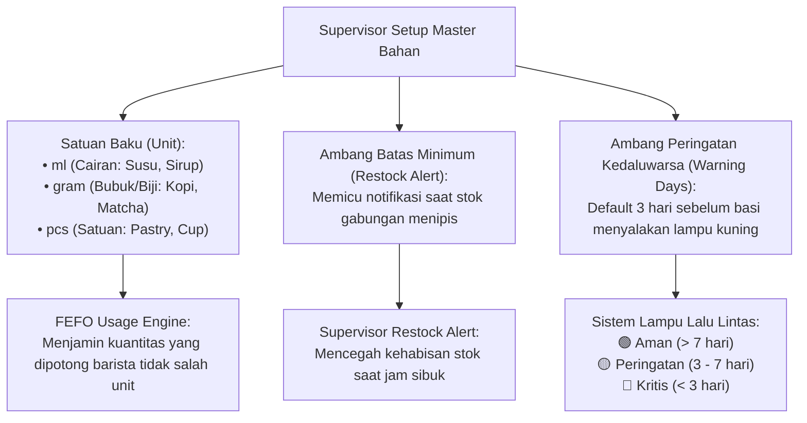

# RENCANA SPESIFIKASI DESAIN FRONTEND (PLAN 04)
## Modul 04: Manajemen Master Data Bahan Baku & Kategori (Persona Supervisor)
**Target File Implementasi**:  
- `resources/js/Pages/Master/Ingredients/Index.tsx` — Halaman A: Katalog Master Bahan Baku  
- `resources/js/Pages/Master/Categories/Index.tsx` — Halaman B: Manajemen Kategori Bahan Baku  
- `resources/js/Pages/Master/Ingredients/IngredientDrawer.tsx` — Slide-Over Drawer Tambah/Ubah Bahan  
**Referensi Kontrak**: [Desain.md](file:///home/lasains/ssd2/matkul/pemograman%20lanjut/projek/Desain.md), [PRD.md](file:///home/lasains/ssd2/matkul/pemograman%20lanjut/projek/PRD.md), dan [inventory.d.ts](file:///home/lasains/ssd2/matkul/pemograman%20lanjut/projek/resources/js/types/inventory.d.ts)

---

## 1. RINGKASAN FITUR MASTER DATA & OTORISASI SUPERVISOR

### 1.1 Peran Strategis Supervisor & Batasan Akses (RBAC)
Supervisor adalah penanggung jawab konsistensi data operasional dan gudang (*warehouse guardian*). Modul Master Data memiliki aturan hak akses yang ketat:
* **Supervisor (`role: supervisor`)**: **Full Access (CRUD)** — Berhak menambah, mengubah, mengelompokkan kategori, mengatur ambang batas restock, dan mengarsipkan bahan.
* **Barista (`role: barista`)**: **View Only / No Access** — Barista hanya melihat bahan saat mencatat pemakaian; dilarang mengubah parameter master bahan agar satuan ukur tidak kacau.
* **Owner (`role: owner`)**: **View Only** — Owner melihat master bahan sebagai referensi aset, tanpa perlu mengotak-atik parameter teknis harian.

---

### 1.2 Mengapa Konsistensi Master Data Krusial bagi Kafe?



1. **Integritas Satuan Unit (`unit`)**:  
   Kesalahan memilih satuan (misalnya susu dicatat `gram` padahal resep espresso menggunakan `ml`) akan merusak kalkulasi FEFO. Master data mengunci satuan ini.
2. **Ambang Batas Stok Minimum (`minimum_stock`)**:  
   Ketika total saldo stok dari seluruh batch aktif suatu bahan jatuh di bawah angka ini, sistem otomatis memunculkan badge peringatan restock.
3. **Ambang Hari Peringatan Kedaluwarsa (`warning_days`)**:  
   Setiap bahan memiliki karakteristik daya tahan berbeda (misal: *fresh milk* memiliki batas warning 3 hari, sedangkan *syrup* botolan 14 hari). Pengaturan ini menentukan kapan status batch berubah dari Hijau (Aman) menjadi Kuning (Segera Pakai).

---

## 2. SPESIFIKASI MOCKUP STITCH UI & BLUEPRINT 2 HALAMAN MASTER DATA

Mockup antarmuka visual master data supervisor telah selesai dibuat dan diunduh dari proyek Google Stitch (ID: `3585613475449128159`), tersimpan di direktori `docs/stitch/`:

| Halaman Supervisor | Screen ID Stitch | File HTML Mockup | File Screenshot Mockup |
| :--- | :--- | :--- | :--- |
| **Katalog Master Bahan Baku** | `91ac9e8cd5ff40f9892938c936064120` | [supervisor_katalog_master_bahan.html](file:///home/lasains/ssd2/matkul/pemograman%20lanjut/projek/docs/stitch/supervisor_katalog_master_bahan.html) | [supervisor_katalog_master_bahan.png](file:///home/lasains/ssd2/matkul/pemograman%20lanjut/projek/docs/stitch/supervisor_katalog_master_bahan.png) |
| **Manajemen Kategori Bahan** | `da851b6873324c9ea890f5e47815e8bf` | [supervisor_kategori_bahan.html](file:///home/lasains/ssd2/matkul/pemograman%20lanjut/projek/docs/stitch/supervisor_kategori_bahan.html) | [supervisor_kategori_bahan.png](file:///home/lasains/ssd2/matkul/pemograman%20lanjut/projek/docs/stitch/supervisor_kategori_bahan.png) |

---

### 2.1 Halaman A: Katalog Master Bahan Baku (`Pages/Master/Ingredients/Index.tsx`)
**Route**: `ingredients.index`  
**Mockup Acuan**: [supervisor_katalog_master_bahan.html](file:///home/lasains/ssd2/matkul/pemograman%20lanjut/projek/docs/stitch/supervisor_katalog_master_bahan.html)

#### Komponen Kanvas & Elemen Interaktif:
1. **Toolbar Navigasi & Filter Pills**:
   - Header Halaman: `"Katalog Master Bahan Baku"` dengan subteks panduan standar satuan & ambang kedaluwarsa.
   - Kategori Pills Filter: `[Semua (12)]`, `[Susu & Dairy (4)]`, `[Biji Kopi (3)]`, `[Sirup & Rasa (3)]`, `[Kemasan (2)]`. Pill aktif: `bg-[#4A2C11] text-white font-bold`, pill inaktif: `bg-[#F5EFEB] text-[#5C3A21] hover:bg-[#EDE4DC]`.
   - Bilah Pencarian: Search input dengan ikon kaca pembesar dan tombol primer `[+ Tambah Bahan Baku]` (`bg-[#4A2C11] text-white`).
2. **Tabel Master Bahan Baku (`IngredientTable.tsx`)**:
   - Di dalam kartu oat latte: `bg-[#F5EFEB] rounded-2xl border border-[#EDE4DC] overflow-hidden shadow-xs`.
   - Kolom Tabel:
     1. **Nama Bahan Baku**: Teks nama tebal + SKU vendor (misal: *Fresh Milk Diamond • SKU: DIA-102*).
     2. **Kategori**: Badge kapsul (*Dairy* emerald lembut, *Beans* amber, *Syrup* ungu lembut).
     3. **Satuan Standar**: Badge netral parchment (`ml`, `gram`, `pcs`).
     4. **Total Saldo Stok**: Total volume/berat dari seluruh batch aktif (misal: `8.700 ml`).
     5. **Ambang Restock**: Batas minimum restock (misal: `Min. 3.000 ml`).
     6. **Ambang Warning**: Ambang peringatan kedaluwarsa (misal: `3 hari`).
     7. **Batch Aktif**: Jumlah batch terdaftar di rak chiller (misal: `3 Batch Aktif`).
     8. **Aksi**: Tombol `[Ubah]` (Ikon Pensil) untuk membuka slide-over drawer pengubahan data.
3. **Slide-Over Drawer Tambah/Ubah Bahan (`IngredientDrawer.tsx`)**:
   - Panel meluncur dari kanan (`w-full sm:w-[480px] bg-[#F5EFEB] border-l border-[#EDE4DC] shadow-2xl p-6 h-full overflow-y-auto`).
   - Form fields: Nama Bahan (`name`), Kategori (`category_id`), Satuan Standar (`unit` via segmented toggle `ml` / `gram` / `pcs`), Ambang Minimum Restock (`minimum_stock`), Ambang Hari Peringatan (`warning_days`), dan tombol simpan espresso `[Simpan Bahan Baku]`.

---

### 2.2 Halaman B: Manajemen Kategori Bahan (`Pages/Master/Categories/Index.tsx`)
**Route**: `categories.index`  
**Mockup Acuan**: [supervisor_kategori_bahan.html](file:///home/lasains/ssd2/matkul/pemograman%20lanjut/projek/docs/stitch/supervisor_kategori_bahan.html)  
**Layout Model**: **2-Kolom Berdampingan (35% Form Tambah/Ubah : 65% Grid Kartu Kategori)**

#### Kolom Kiri: Form Tambah Kategori Baru (`lg:col-span-4 bg-[#F5EFEB] p-6 rounded-2xl border border-[#EDE4DC] space-y-4`):
1. **Nama Kategori (`name`)**: Input teks (misal: *Plant-Based Milk* atau *Sirup & Perasa*).
2. **Slug URL (`slug`)**: Auto-generated dari nama kategori (misal: `plant-based-milk`).
3. **Pilihan Palet Aksen**: Pilihan warna badge kategori kafe (Emerald, Amber, Terracotta, Indigo, Purple).
4. **Deskripsi Kategori (`description`)**: Textarea ringkasan cakupan bahan.
5. **Tombol Simpan**: `[Simpan Kategori Baru]` (`bg-[#4A2C11] text-white py-3 rounded-xl font-bold`).

#### Kolom Kanan: Grid Kartu Kategori Aktif (`lg:col-span-8 space-y-4`):
- Grid kartu kategori:
  - Setiap kartu menampilkan nama kategori, badge warna, jumlah bahan baku terdaftar, dan jumlah batch aktif berjalan.
  - Tombol aksi: `[Ubah Nama / Warna]` dan `[Lihat Daftar Bahan]`.

---

## 3. ARSITEKTUR TEKNIS FRONTEND (REACT + INERTIA)

### 3.1 Lokasi File & Komposisi Komponen
```text
resources/js/
├── Pages/
│   └── Master/
│       ├── Ingredients/
│       │   ├── Index.tsx               # Halaman A: Katalog master bahan baku
│       │   └── IngredientDrawer.tsx    # Slide-over drawer tambah & edit bahan
│       └── Categories/
│           └── Index.tsx               # Halaman B: Manajemen kategori bahan baku
├── Components/
│   ├── Master/
│   │   ├── CategoryPills.tsx           # Filter pill kategori cepat
│   │   ├── IngredientTable.tsx         # Tabel master bahan dengan badge satuan & ambang
│   │   └── CategoryCardGrid.tsx        # Grid kartu kategori aktif
│   └── ConfirmDialog.tsx               # Dialog konfirmasi aksi nonaktifkan bahan

---

### 3.2 Kontrak Tipe Data TypeScript

Mengacu pada [`resources/js/types/inventory.d.ts`](file:///home/lasains/ssd2/matkul/pemograman%20lanjut/projek/resources/js/types/inventory.d.ts):

```typescript
// resources/js/types/master.ts
import { Category, Ingredient } from '@/types/inventory';

export interface IngredientWithStats extends Ingredient {
    active_batches_count: number;
    total_current_stock: number;
    category: Category;
}

export interface MasterIngredientsIndexProps {
    ingredients: IngredientWithStats[];
    categories: Category[];
    filters: {
        search?: string;
        category?: string;
    };
}

export interface IngredientFormData {
    name: string;
    category_id: number | '';
    unit: 'ml' | 'gram' | 'pcs';
    minimum_stock: number | '';
    warning_days: number | '';
}

export interface CategoryFormData {
    name: string;
}
```

---

### 3.3 Form Handling Dual-Mode (Create & Edit) dengan Inertia `useForm`

```typescript
// resources/js/Pages/Master/Ingredients/IngredientModal.tsx
import { useEffect } from 'react';
import { useForm } from '@inertiajs/react';
import { Category, Ingredient } from '@/types/inventory';
import { IngredientFormData } from '@/types/master';
import { Dialog, DialogContent, DialogHeader, DialogTitle, DialogFooter } from '@/Components/ui/dialog';
import { Button } from '@/Components/ui/button';
import { Input } from '@/Components/ui/input';
import { Label } from '@/Components/ui/label';
import { Select, SelectContent, SelectItem, SelectTrigger, SelectValue } from '@/Components/ui/select';
import InputError from '@/Components/InputError';

interface Props {
    isOpen: boolean;
    onClose: () => void;
    categories: Category[];
    ingredientToEdit?: Ingredient | null; // null jika mode Tambah Baru
}

export function IngredientModal({ isOpen, onClose, categories, ingredientToEdit }: Props) {
    const isEditMode = Boolean(ingredientToEdit);

    const { data, setData, post, put, processing, errors, reset, clearErrors } =
        useForm<IngredientFormData>({
            name: '',
            category_id: '',
            unit: 'ml',
            minimum_stock: '',
            warning_days: 3,
        });

    // Populate data jika sedang dalam mode edit
    useEffect(() => {
        if (ingredientToEdit) {
            setData({
                name: ingredientToEdit.name,
                category_id: ingredientToEdit.category_id,
                unit: ingredientToEdit.unit as 'ml' | 'gram' | 'pcs',
                minimum_stock: ingredientToEdit.minimum_stock,
                warning_days: ingredientToEdit.warning_days,
            });
        } else {
            reset();
            setData('warning_days', 3);
        }
        clearErrors();
    }, [ingredientToEdit, isOpen]);

    const handleSubmit = (e: React.FormEvent) => {
        e.preventDefault();

        if (isEditMode && ingredientToEdit) {
            // Mode Update: PUT /ingredients/{id}
            put(route('ingredients.update', ingredientToEdit.id), {
                onSuccess: () => {
                    reset();
                    onClose();
                },
            });
        } else {
            // Mode Create: POST /ingredients
            post(route('ingredients.store'), {
                onSuccess: () => {
                    reset();
                    onClose();
                },
            });
        }
    };

    return (
        <Dialog open={isOpen} onOpenChange={onClose}>
            <DialogContent className="max-w-lg bg-surface-container border-surface-border rounded-xl">
                <DialogHeader>
                    <DialogTitle className="text-content-high text-lg font-semibold">
                        {isEditMode ? `Ubah Bahan: ${ingredientToEdit?.name}` : 'Tambah Bahan Baku Baru'}
                    </DialogTitle>
                </DialogHeader>

                <form onSubmit={handleSubmit} className="space-y-4 pt-2">
                    {/* Input Nama Bahan */}
                    <div>
                        <Label htmlFor="name">Nama Bahan Baku</Label>
                        <Input
                            id="name"
                            value={data.name}
                            onChange={(e) => setData('name', e.target.value)}
                            placeholder="Contoh: Fresh Milk Diamond 1L"
                            className="mt-1"
                        />
                        <InputError message={errors.name} className="mt-1" />
                    </div>

                    {/* Select Kategori */}
                    <div>
                        <Label htmlFor="category_id">Kategori Bahan</Label>
                        <Select
                            value={String(data.category_id)}
                            onValueChange={(val) => setData('category_id', Number(val))}
                        >
                            <SelectTrigger className="mt-1">
                                <SelectValue placeholder="Pilih Kategori" />
                            </SelectTrigger>
                            <SelectContent>
                                {categories.map((cat) => (
                                    <SelectItem key={cat.id} value={String(cat.id)}>
                                        {cat.name}
                                    </SelectItem>
                                ))}
                            </SelectContent>
                        </Select>
                        <InputError message={errors.category_id} className="mt-1" />
                    </div>

                    {/* Satuan Unit */}
                    <div>
                        <Label htmlFor="unit">Satuan Ukuran Standar (Unit)</Label>
                        <Select
                            value={data.unit}
                            onValueChange={(val: 'ml' | 'gram' | 'pcs') => setData('unit', val)}
                            disabled={isEditMode} // Kunci unit jika sedang edit untuk menjaga integritas batch
                        >
                            <SelectTrigger className="mt-1">
                                <SelectValue />
                            </SelectTrigger>
                            <SelectContent>
                                <SelectItem value="ml">Mililiter (ml) — Untuk Cairan / Susu / Sirup</SelectItem>
                                <SelectItem value="gram">Gram (gram) — Untuk Biji Kopi / Bubuk Matcha</SelectItem>
                                <SelectItem value="pcs">Pieces (pcs) — Untuk Pastry / Cup Plastik</SelectItem>
                            </SelectContent>
                        </Select>
                        {isEditMode && (
                            <p className="text-xs text-slate-500 mt-1">
                                * Satuan unit dikunci demi menjaga keutuhan riwayat pemotongan batch FEFO.
                            </p>
                        )}
                        <InputError message={errors.unit} className="mt-1" />
                    </div>

                    {/* Ambang Batas Stok Minimum & Warning Days */}
                    <div className="grid grid-cols-1 sm:grid-cols-2 gap-4">
                        <div>
                            <Label htmlFor="minimum_stock">Batas Minimum Restock</Label>
                            <div className="relative mt-1">
                                <Input
                                    id="minimum_stock"
                                    type="number"
                                    min="0"
                                    value={data.minimum_stock}
                                    onChange={(e) => setData('minimum_stock', Number(e.target.value))}
                                    placeholder="0"
                                    className="pr-12"
                                />
                                <span className="absolute right-3 top-2.5 text-xs font-semibold text-slate-400 uppercase">
                                    {data.unit}
                                </span>
                            </div>
                            <InputError message={errors.minimum_stock} className="mt-1" />
                        </div>

                        <div>
                            <Label htmlFor="warning_days">Ambang Hari Warning</Label>
                            <div className="relative mt-1">
                                <Input
                                    id="warning_days"
                                    type="number"
                                    min="1"
                                    value={data.warning_days}
                                    onChange={(e) => setData('warning_days', Number(e.target.value))}
                                    placeholder="3"
                                    className="pr-12"
                                />
                                <span className="absolute right-3 top-2.5 text-xs font-semibold text-slate-400">
                                    Hari
                                </span>
                            </div>
                            <InputError message={errors.warning_days} className="mt-1" />
                        </div>
                    </div>

                    <DialogFooter className="pt-4">
                        <Button type="button" variant="outline" onClick={onClose} disabled={processing} className="border-surface-border text-content-medium hover:bg-surface-container-high">
                            Batal
                        </Button>
                        <Button type="submit" disabled={processing} className="bg-brand-primary hover:bg-brand-primary-hover text-white">
                            {processing ? 'Menyimpan...' : isEditMode ? 'Simpan Perubahan' : 'Tambah Bahan'}
                        </Button>
                    </DialogFooter>
                </form>
            </DialogContent>
        </Dialog>
    );
}
```

---

## 4. EDGE CASES & PERLINDUNGAN DATA

### 4.1 Proteksi Penghapusan Bahan yang Memiliki Batch Aktif
- **Masalah Integritas Relasional**:  
  Jika Supervisor menghapus baris bahan baku yang masih memiliki stok aktif di tabel `ingredient_batches`, database akan memunculkan *foreign key constraint error* atau membuat data batch menjadi yatim (*orphan records*).
- **Solusi Pencegahan**:
  1. Frontend memeriksa `ingredient.active_batches_count`:
     - Jika `active_batches_count > 0`: Tombol hapus dinonaktifkan atau diganti dengan tombol *"Arsipkan / Nonaktifkan"*.
     - Jika pengguna tetap mencoba, munculkan dialog pencegahan:
       > *"Bahan ini masih memiliki X batch aktif di gudang. Habiskan atau musnahkan seluruh batch terlebih dahulu sebelum menghapus bahan."*
  2. Backend Laravel melengkapi validasi di method `destroy()`:
     ```php
     if ($ingredient->batches()->where('current_stock', '>', 0)->exists()) {
         return back()->with('error', 'Tidak dapat menghapus bahan yang masih memiliki stok aktif.');
     }
     ```

### 4.2 Pencegahan Satuan Berubah pada Bahan yang Sudah Memiliki Transaksi
- Jika bahan sudah pernah memiliki batch atau transaksi pemakaian dalam satuan `ml`, mengubah satuannya menjadi `gram` akan menyebabkan kekacauan matematis (misal: sisa stok 1000 ml tiba-tiba dihitung 1000 gram).
- Oleh karena itu, pada **Mode Edit**, elemen pilihan satuan `unit` di-disabled secara permanen dengan penjelas bantuan visual.

### 4.3 Validasi Nilai Negatif & Nol
- Input `minimum_stock` dibatasi `min="0"` (tidak boleh bernilai negatif).
- Input `warning_days` dibatasi `min="1"` (ambang peringatan minimal 1 hari sebelum basi, tidak boleh 0 atau minus).

---

## 5. REKOMENDASI TAHAPAN IMPLEMENTASI KODING

1. **Langkah 1**: Buat komponen tabel master data di `resources/js/Pages/Master/Ingredients/Index.tsx`.
2. **Langkah 2**: Buat form modal `IngredientModal.tsx` dengan penanganan mode ganda (Create & Edit) serta penguncian unit pada mode edit.
3. **Langkah 3**: Buat modal pendukung `CategoryModal.tsx` untuk pengelolaan kategori bahan secara cepat.
4. **Langkah 4**: Pastikan backend `IngredientController.php` menerapkan Form Request `StoreIngredientRequest` dan `UpdateIngredientRequest` dengan validasi server-side yang ketat.

---
