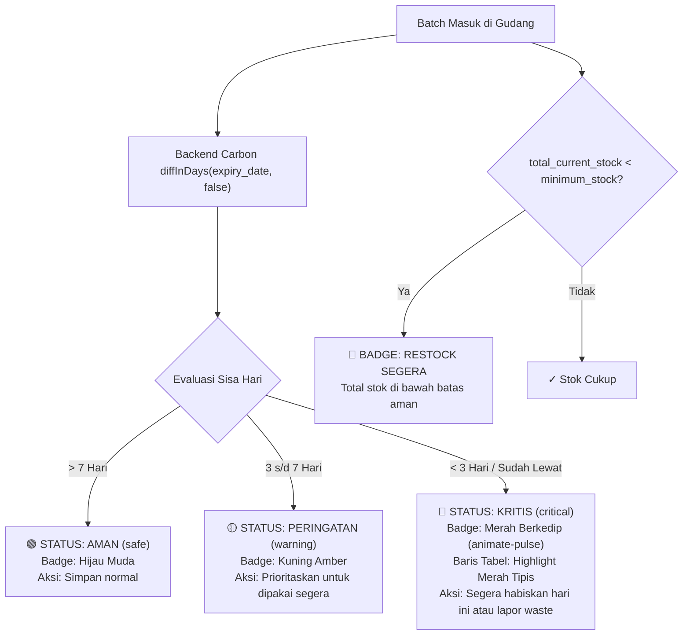

# RENCANA SPESIFIKASI DESAIN FRONTEND (PLAN 05)
## Modul 05: Monitoring Inventaris Bahan & Sistem Peringatan Dini Kedaluwarsa (Early Warning System)
**Target File Implementasi**:  
- `resources/js/Pages/Inventory/Index.tsx`  
- `resources/js/Components/ExpiryBadge.tsx`  
- `resources/js/Pages/Inventory/RestockModal.tsx`  
**Referensi Kontrak**: [Desain.md](file:///home/lasains/ssd2/matkul/pemograman%20lanjut/projek/Desain.md), [PRD.md](file:///home/lasains/ssd2/matkul/pemograman%20lanjut/projek/PRD.md), dan [inventory.d.ts](file:///home/lasains/ssd2/matkul/pemograman%20lanjut/projek/resources/js/types/inventory.d.ts)

---

## 1. RINGKASAN FITUR MONITORING & LOGIKA PERHITUNGAN KEDALUWARSA

### 1.1 Nilai Bisnis: Pencegahan Kerugian Bahan Basi (*Food Safety & Anti-Waste*)
Di industri kafe, susu segar (*dairy*), sirup perisa, dan kue (*pastry*) memiliki umur simpan (*shelf-life*) yang sangat terbatas. Keterlambatan menyadari tanggal kedaluwarsa berakibat fatal:
1. **Risiko Kesehatan Pelanggan (Food Safety)**: Susu basi yang tidak sengaja ter-steam ke dalam cangkir cappuccino pelanggan.
2. **Kerugian Finansial Tersembunyi (Dead Stock Loss)**: Bahan menumpuk di bagian belakang rak gudang dan basi sebelum sempat digunakan.

Sistem Peringatan Dini (*Early Warning System*) berfungsi sebagai pusat kendali (*command center*) bagi Supervisor dan Barista untuk memantau status setiap tumpukan batch fisik secara transparan dan terukur.

---

### 1.2 Logika Perhitungan Hari Kedaluwarsa & Sistem Lampu Lalu Lintas



#### Aturan Standar Perhitungan Kedaluwarsa:
Backend menghitung selisih tanggal menggunakan pustaka `Carbon`:
```php
$today = Carbon::today();
$expiry = Carbon::parse($batch->expiry_date);
// Menggunakan false agar jika tanggal hari ini sudah melewati expiry, hasilnya negatif
$daysUntilExpiry = (int) $today->diffInDays($expiry, false);

if ($daysUntilExpiry < 3) {
    $urgencyStatus = 'critical';
} elseif ($daysUntilExpiry <= 7) {
    $urgencyStatus = 'warning';
} else {
    $urgencyStatus = 'safe';
}
```

---

## 2. SPESIFIKASI MOCKUP STITCH UI & BLUEPRINT 2 HALAMAN SUPERVISOR INVENTARIS

Seluruh mockup visual monitoring inventaris & audit kepatuhan FEFO supervisor telah diunduh dari proyek Google Stitch (ID: `3585613475449128159`), tersimpan lokal di direktori `docs/stitch/`:

| Halaman Supervisor | Screen ID Stitch | File HTML Mockup | File Screenshot Mockup |
| :--- | :--- | :--- | :--- |
| **Monitoring Inventaris & Kedaluwarsa** | `ad27ee7c173644a9b0e4bf96a820437d` | [supervisor_monitoring_inventaris.html](file:///home/lasains/ssd2/matkul/pemograman%20lanjut/projek/docs/stitch/supervisor_monitoring_inventaris.html) | [supervisor_monitoring_inventaris.png](file:///home/lasains/ssd2/matkul/pemograman%20lanjut/projek/docs/stitch/supervisor_monitoring_inventaris.png) |
| **Riwayat Audit & Kepatuhan FEFO** | `ad99b93ea1504c949462308c40045938` | [supervisor_riwayat_audit_fefo.html](file:///home/lasains/ssd2/matkul/pemograman%20lanjut/projek/docs/stitch/supervisor_riwayat_audit_fefo.html) | [supervisor_riwayat_audit_fefo.png](file:///home/lasains/ssd2/matkul/pemograman%20lanjut/projek/docs/stitch/supervisor_riwayat_audit_fefo.png) |

---

### 2.1 Halaman A: Monitoring Inventaris & Kedaluwarsa (`Pages/Inventory/Index.tsx`)
**Route**: `inventory.index`  
**Mockup Acuan**: [supervisor_monitoring_inventaris.html](file:///home/lasains/ssd2/matkul/pemograman%20lanjut/projek/docs/stitch/supervisor_monitoring_inventaris.html)

#### Komponen Kanvas & Hierarki Tampilan:
1. **Empat Kartu Ringkasan Metrik Status Cepat (`QuickExpiryStats.tsx`)**:
   - `grid grid-cols-1 sm:grid-cols-2 lg:grid-cols-4 gap-4`:
     - **Total Batch Aktif**: `bg-[#F5EFEB] border border-[#EDE4DC] p-4.5 rounded-xl` (misal: *38 Batch Berjalan*).
     - **🟢 Batch Aman**: `bg-emerald-50 border border-emerald-200 text-emerald-800` (Masa simpan > 7 hari, misal: *28 Batch*).
     - **🟡 Peringatan Segera Pakai**: `bg-[#FFF7ED] border border-[#FED7AA] text-[#C88242]` (Kedaluwarsa 3–7 hari, misal: *7 Batch*).
     - **🔴 Kritis / Expired**: `bg-[#FDF2F0] border border-[#F8C6BF] text-[#8C3D2B]` (Kedaluwarsa < 3 hari, misal: *3 Batch*).
2. **Toolbar Filter & Segmented Traffic-Light Tabs (`ExpiryFilterTabs.tsx`)**:
   - Filter Tabs: `[Semua Batch (38)]`, `[🟢 Aman (28)]`, `[🟡 Segera Pakai (7)]`, `[🔴 Kritis (3)]`. Tab aktif berlatar `#4A2C11` dengan teks putih.
   - Tombol Aksi Restock: `[+ Restock Batch Baru]` (`bg-[#4A2C11] text-white`) yang mengarahkan ke form penerimaan batch.
3. **Tabel Expandable Batch Inventaris Chiller (`ExpandableBatchTable.tsx`)**:
   - Tabel di dalam kontainer `bg-[#F5EFEB] rounded-2xl border border-[#EDE4DC] overflow-hidden`:
     - **Baris Induk (Bahan Baku)**: Tombol panah Chevron expand, nama bahan (misal: *Fresh Milk Diamond • SKU: DIA-102*), kategori, total saldo stok di bar (misal: *4.500 ml*), batch terdekat expired, dan status urgensi lampu lalu lintas.
     - **Sub-Baris Anak (Detail Batch Fisik di Rak Chiller)**:
       * Menampilkan setiap nomor batch fisik (misal: `BCH-20241026-A3F2`).
       * Tanggal kedaluwarsa & countdown sisa hari (misal: `Exp: 26 Okt 2024 • 1 Hari Tersisa`).
       * Lokasi fisik penyimpanan (misal: `Lokasi: Chiller Bar Utama (03.5°C)`).
       * Sisa kuantitas per batch (misal: `2.500 ml`).
       * Rekomendasi aksi: `[Pakai Lebih Dulu]` atau `[Buat Tiket Waste]` jika sudah lewat tanggal aman.

---

### 2.2 Halaman B: Riwayat Audit & Kepatuhan FEFO (`Pages/Audit/FefoLog.tsx`)
**Route**: `audit.fefo`  
**Mockup Acuan**: [supervisor_riwayat_audit_fefo.html](file:///home/lasains/ssd2/matkul/pemograman%20lanjut/projek/docs/stitch/supervisor_riwayat_audit_fefo.html)

#### Komponen Kanvas & Fitur Audit:
1. **Header & Filter Audit**:
   - Judul: `"Buku Log Riwayat Audit & Kepatuhan SOP FEFO"`.
   - Filter Barista (`All` atau filter per nama barista), Filter Status (`Semua`, `Hanya Patuh`, `Hanya Deviasi`), dan Range Periode Bulan.
2. **Tiga Kartu KPI Kepatuhan SOP (`FefoKpiCards.tsx`)**:
   - `grid grid-cols-1 md:grid-cols-3 gap-4`:
     - **Total Transaksi Pemakaian**: Akumulasi frekuensi pemotongan stok bulan ini.
     - **Rasio Kepatuhan FEFO**: Persentase kepatuhan (misal: `94.2% Patuh Standar FEFO`).
     - **Total Kejadian Deviasi**: Jumlah insiden pengambilan batch di luar urutan (misal: `8 Insiden Deviasi Terverifikasi`).
3. **Grafik Recharts Rasio Kepatuhan (`FefoComplianceDonut.tsx`)**:
   - Diagram Donat Recharts menampilkan proporsi transaksi Patuh FEFO (Hijau botani `#059669`) vs Deviasi FEFO (Amber karamel `#C88242`).
4. **Tabel Riwayat Audit Transaksional (`FefoAuditLogTable.tsx`)**:
   - Kolom: Waktu & Jam Transaksi, Nama Barista On-Duty, Bahan Baku & Kode Batch Terpilih, Kuantitas Pemakaian, Status Kepatuhan (`✓ Patuh FEFO` / `⚠ Deviasi FEFO`), dan Alasan Deviasi Fisik yang dicatat langsung oleh barista.

## 3. ARSITEKTUR TEKNIS FRONTEND (REACT + INERTIA)

### 3.1 Lokasi File & Komposisi
```text
resources/js/
├── Pages/
│   └── Inventory/
│       ├── Index.tsx                   # Halaman tabel utama monitoring inventaris
│       └── RestockModal.tsx            # Modal form pencatatan batch restock baru
├── Components/
│   ├── ExpiryBadge.tsx                 # Komponen indikator lampu lalu lintas kedaluwarsa
│   └── Inventory/
│       ├── ExpirySummaryCards.tsx      # 4 Kartu metrik ringkasan atas
│       └── BatchRow.tsx                # Baris sub-tabel batch fisik dengan expandable logic
└── types/
    └── inventory.d.ts                  # Kontrak data TypeScript
```

---

### 3.2 Kontrak Tipe Data TypeScript

Mengacu pada [`resources/js/types/inventory.d.ts`](file:///home/lasains/ssd2/matkul/pemograman%20lanjut/projek/resources/js/types/inventory.d.ts):

```typescript
// resources/js/types/monitoring.ts
import { Ingredient, IngredientBatch, UrgencyStatus } from '@/types/inventory';

export interface ExpiryMetrics {
    total_active_batches: number;
    safe_batches_count: number;
    warning_batches_count: number;
    critical_batches_count: number;
}

export interface InventoryIndexProps {
    ingredients: (Ingredient & {
        total_current_stock: number;
        is_understock: boolean;
        batches: IngredientBatch[];
    })[];
    metrics: ExpiryMetrics;
    filters: {
        search?: string;
        urgency?: UrgencyStatus | 'all';
    };
}

export interface RestockFormData {
    ingredient_id: number | '';
    batch_code: string;
    received_date: string;
    expiry_date: string;
    initial_stock: number | '';
    cost_per_unit: number | '';
}
```

---

### 3.3 Komponen Lampu Lalu Lintas `ExpiryBadge.tsx`

```tsx
// resources/js/Components/ExpiryBadge.tsx
import { UrgencyStatus } from '@/types/inventory';
import { cn } from '@/lib/utils';
import { AlertTriangle, CheckCircle2, AlertOctagon } from 'lucide-react';

interface ExpiryBadgeProps {
    daysUntilExpiry?: number;
    urgencyStatus?: UrgencyStatus;
    className?: string;
}

export function ExpiryBadge({ daysUntilExpiry = 0, urgencyStatus = 'safe', className }: ExpiryBadgeProps) {
    // 🔴 Status Kritis / Sudah Basi
    if (urgencyStatus === 'critical' || daysUntilExpiry < 3) {
        const label =
            daysUntilExpiry < 0
                ? `Kedaluwarsa (${Math.abs(daysUntilExpiry)} hari lalu)`
                : daysUntilExpiry === 0
                ? 'Kedaluwarsa HARI INI!'
                : daysUntilExpiry === 1
                ? 'Kedaluwarsa BESOK!'
                : `${daysUntilExpiry} hari lagi (Kritis)`;

        return (
            <span
                className={cn(
                    'inline-flex items-center gap-1.5 rounded-full border border-[#F8C6BF] bg-[#FDF2F0] px-2.5 py-1 text-xs font-semibold text-[#8C3D2B] animate-pulse',
                    className
                )}
            >
                <AlertOctagon className="h-3.5 w-3.5 text-rose-600" />
                <span>🔴 {label}</span>
            </span>
        );
    }

    // 🟡 Status Peringatan Dini (Segera Pakai)
    if (urgencyStatus === 'warning' || daysUntilExpiry <= 7) {
        return (
            <span
                className={cn(
                    'inline-flex items-center gap-1.5 rounded-full border border-amber-200 bg-amber-50 px-2.5 py-1 text-xs font-medium text-amber-800',
                    className
                )}
            >
                <AlertTriangle className="h-3.5 w-3.5 text-amber-600" />
                <span>🟡 Segera Pakai ({daysUntilExpiry} hari lagi)</span>
            </span>
        );
    }

    // 🟢 Status Aman
    return (
        <span
            className={cn(
                'inline-flex items-center gap-1.5 rounded-full border border-emerald-200 bg-emerald-50 px-2.5 py-1 text-xs font-medium text-emerald-800',
                className
            )}
        >
            <CheckCircle2 className="h-3.5 w-3.5 text-emerald-600" />
            <span>🟢 Aman ({daysUntilExpiry} hari lagi)</span>
        </span>
    );
}
```

---

### 3.4 Form Handling Restock Batch Baru dengan Inertia `useForm`

```typescript
// resources/js/Pages/Inventory/RestockModal.tsx
import { useState } from 'react';
import { useForm } from '@inertiajs/react';
import { Ingredient } from '@/types/inventory';
import { RestockFormData } from '@/types/monitoring';
import { Dialog, DialogContent, DialogHeader, DialogTitle, DialogFooter } from '@/Components/ui/dialog';
import { Button } from '@/Components/ui/button';
import { Input } from '@/Components/ui/input';
import { Label } from '@/Components/ui/label';
import { Select, SelectContent, SelectItem, SelectTrigger, SelectValue } from '@/Components/ui/select';
import InputError from '@/Components/InputError';

interface Props {
    isOpen: boolean;
    onClose: () => void;
    ingredients: Ingredient[];
}

export function RestockModal({ isOpen, onClose, ingredients }: Props) {
    const today = new Date().toISOString().split('T')[0];

    const { data, setData, post, processing, errors, reset } = useForm<RestockFormData>({
        ingredient_id: '',
        batch_code: '',
        received_date: today,
        expiry_date: '',
        initial_stock: '',
        cost_per_unit: '',
    });

    const selectedIngredient = ingredients.find((i) => i.id === Number(data.ingredient_id));

    // Generator Kode Batch Otomatis: BATCH-YYYYMMDD-RAND
    const handleGenerateBatchCode = () => {
        const rand = Math.floor(100 + Math.random() * 900);
        const code = `BATCH-${today.replace(/-/g, '')}-${rand}`;
        setData('batch_code', code);
    };

    // Kalkulasi Total Nilai Faktur Batch
    const totalBatchCost =
        Number(data.initial_stock || 0) * Number(data.cost_per_unit || 0);

    const handleSubmit = (e: React.FormEvent) => {
        e.preventDefault();
        post(route('batches.store'), {
            onSuccess: () => {
                reset();
                onClose();
            },
        });
    };

    return (
        <Dialog open={isOpen} onOpenChange={onClose}>
            <DialogContent className="max-w-lg bg-surface-container border-surface-border rounded-xl">
                <DialogHeader>
                    <DialogTitle className="text-content-high font-semibold text-lg">
                        Penerimaan Batch Baru (Restock)
                    </DialogTitle>
                </DialogHeader>

                <form onSubmit={handleSubmit} className="space-y-4 pt-2">
                    {/* Pilih Bahan Baku */}
                    <div>
                        <Label htmlFor="ingredient_id">Pilih Bahan Baku</Label>
                        <Select
                            value={String(data.ingredient_id)}
                            onValueChange={(val) => setData('ingredient_id', Number(val))}
                        >
                            <SelectTrigger className="mt-1">
                                <SelectValue placeholder="-- Pilih Bahan Baku Kafe --" />
                            </SelectTrigger>
                            <SelectContent>
                                {ingredients.map((item) => (
                                    <SelectItem key={item.id} value={String(item.id)}>
                                        {item.name} ({item.unit})
                                    </SelectItem>
                                ))}
                            </SelectContent>
                        </Select>
                        <InputError message={errors.ingredient_id} className="mt-1" />
                    </div>

                    {/* Nomor Kode Batch */}
                    <div>
                        <div className="flex justify-between items-center">
                            <Label htmlFor="batch_code">Nomor Kode Batch</Label>
                            <button
                                type="button"
                                onClick={handleGenerateBatchCode}
                                className="text-xs text-brand-secondary hover:underline font-medium"
                            >
                                + Generate Otomatis
                            </button>
                        </div>
                        <Input
                            id="batch_code"
                            value={data.batch_code}
                            onChange={(e) => setData('batch_code', e.target.value)}
                            placeholder="Contoh: BATCH-20261031-01"
                            className="mt-1 bg-surface-canvas border-surface-border text-content-high"
                        />
                        <InputError message={errors.batch_code} className="mt-1" />
                    </div>

                    {/* Tanggal Terima & Tanggal Kedaluwarsa */}
                    <div className="grid grid-cols-1 sm:grid-cols-2 gap-4">
                        <div>
                            <Label htmlFor="received_date">Tanggal Terima</Label>
                            <Input
                                id="received_date"
                                type="date"
                                value={data.received_date}
                                onChange={(e) => setData('received_date', e.target.value)}
                                className="mt-1 bg-surface-canvas border-surface-border text-content-high"
                            />
                            <InputError message={errors.received_date} className="mt-1" />
                        </div>
                        <div>
                            <Label htmlFor="expiry_date">Tanggal Kedaluwarsa</Label>
                            <Input
                                id="expiry_date"
                                type="date"
                                min={data.received_date || today}
                                value={data.expiry_date}
                                onChange={(e) => setData('expiry_date', e.target.value)}
                                className="mt-1 bg-surface-canvas border-surface-border text-content-high"
                            />
                            <InputError message={errors.expiry_date} className="mt-1" />
                        </div>
                    </div>

                    {/* Kuantitas Masuk & Harga Beli Satuan */}
                    <div className="grid grid-cols-1 sm:grid-cols-2 gap-4">
                        <div>
                            <Label htmlFor="initial_stock">Kuantitas Masuk</Label>
                            <div className="relative mt-1">
                                <Input
                                    id="initial_stock"
                                    type="number"
                                    min="1"
                                    value={data.initial_stock}
                                    onChange={(e) => setData('initial_stock', Number(e.target.value))}
                                    placeholder="0"
                                    className="pr-12 bg-surface-canvas border-surface-border text-content-high"
                                />
                                <span className="absolute right-3 top-2.5 text-xs font-semibold text-content-subtle uppercase">
                                    {selectedIngredient?.unit || 'unit'}
                                </span>
                            </div>
                            <InputError message={errors.initial_stock} className="mt-1" />
                        </div>
                        <div>
                            <Label htmlFor="cost_per_unit">Harga Beli Satuan (Rp)</Label>
                            <Input
                                id="cost_per_unit"
                                type="number"
                                min="0"
                                value={data.cost_per_unit}
                                onChange={(e) => setData('cost_per_unit', Number(e.target.value))}
                                placeholder="Rp 0"
                                className="mt-1 bg-surface-canvas border-surface-border text-content-high"
                            />
                            <InputError message={errors.cost_per_unit} className="mt-1" />
                        </div>
                    </div>

                    {/* Live Calculator Total Nilai Faktur */}
                    <div className="rounded-lg border border-surface-border bg-surface-container-high p-3 flex justify-between items-center text-sm">
                        <span className="text-content-medium font-medium">Total Nilai Faktur Batch:</span>
                        <span className="text-content-high font-bold text-base">
                            Rp {totalBatchCost.toLocaleString('id-ID')}
                        </span>
                    </div>

                    <DialogFooter className="pt-2">
                        <Button type="button" variant="outline" onClick={onClose} disabled={processing} className="border-surface-border text-content-medium hover:bg-surface-container-high">
                            Batal
                        </Button>
                        <Button type="submit" disabled={processing} className="bg-brand-primary hover:bg-brand-primary-hover text-white">
                            {processing ? 'Menyimpan...' : 'Simpan & Terbitkan Batch'}
                        </Button>
                    </DialogFooter>
                </form>
            </DialogContent>
        </Dialog>
    );
}
```

---

## 4. EDGE CASES & OPTIMASI PERFORMA

### 4.1 Penanganan Batch yang Sudah Habis (`current_stock === 0`)
- Secara *default*, sub-tabel hanya menampilkan batch dengan status `'active'` dan `current_stock > 0`.
- Disediakan tombol saklar toggle kecil: `[ ] Tampilkan Batch Habis (Exhausted)` untuk kebutuhan audit historis tanpa mengotori pandangan operasional harian.

### 4.2 Validasi Tanggal Kedaluwarsa yang Lebih Lampau daripada Tanggal Terima
- Input `expiry_date` dikunci dengan atribut `min={data.received_date || today}`.
- Jika pengguna memaksa manipulasi nilai di browser, form request Laravel di backend menolaknya dengan aturan validasi:
  ```php
  'expiry_date' => ['required', 'date', 'after_or_equal:received_date'],
  ```

### 4.3 Skeleton Loading saat Filter Tabs Diubah
- Untuk mencegah pergeseran tata letak (*Cumulative Layout Shift - CLS*) saat pengguna mengklik tab `[🔴 Kritis]`, antarmuka merender baris bayangan (*Skeleton Row Animation*) selama status Inertia dalam kondisi `processing`.

---

## 5. REKOMENDASI TAHAPAN IMPLEMENTASI KODING

1. **Langkah 1**: Buat komponen `ExpiryBadge.tsx` di `resources/js/Components/`.
2. **Langkah 2**: Buat modal restock `RestockModal.tsx` lengkap dengan kalkulasi nilai rupiah dan generator kode batch.
3. **Langkah 3**: Buat halaman utama `resources/js/Pages/Inventory/Index.tsx` dengan kartu metrik ringkasan dan expandable sub-table.
4. **Langkah 4**: Pastikan backend `BatchController.php` memvalidasi input batch baru dan menghitung `urgency_status` secara tepat saat data dikirim ke frontend.
