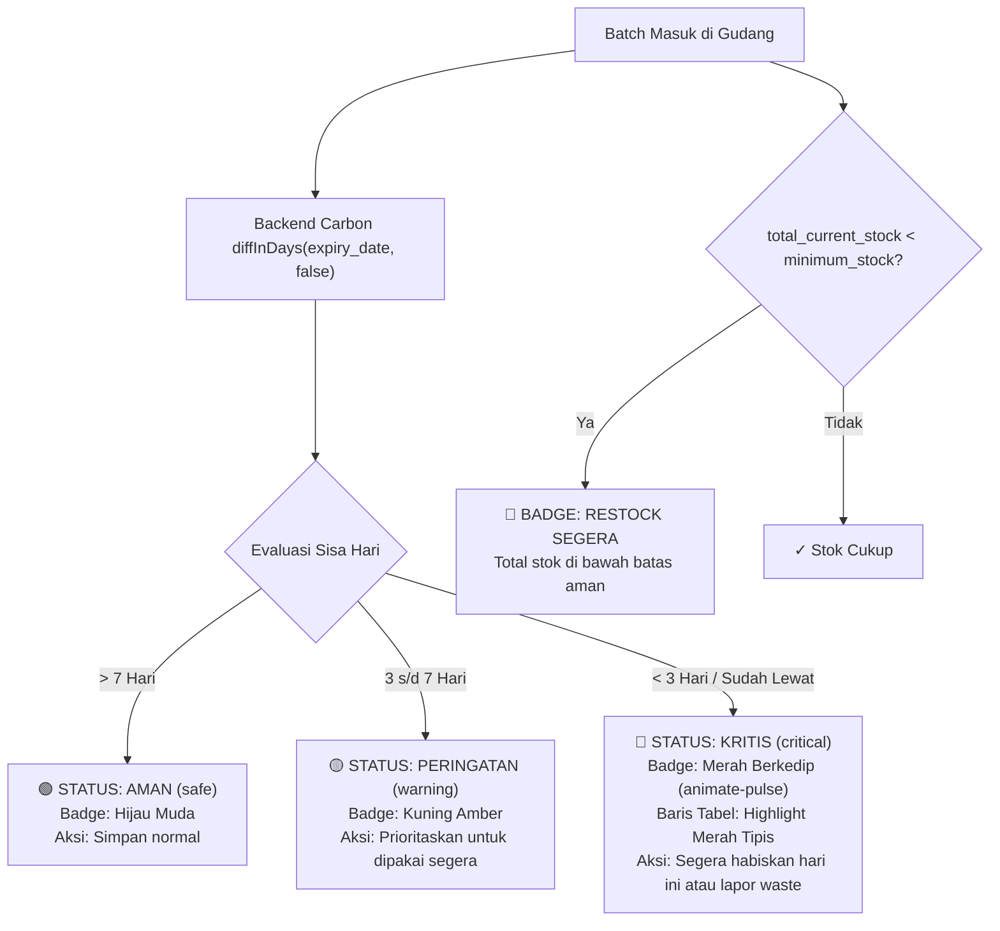

# RENCANA SPESIFIKASI DESAIN FRONTEND (PLAN 05)
## Modul 05: Monitoring Inventaris Bahan & Sistem Peringatan Dini Kedaluwarsa (Early Warning System)
**Target File Implementasi**:  
- `resources/js/Pages/Inventory/Index.tsx`  
- `resources/js/Components/ExpiryBadge.tsx`  
- `resources/js/Pages/Inventory/RestockModal.tsx`  
**Referensi Kontrak**: [Desain.md](file:///home/lasains/ssd2/matkul/pemograman%20lanjut/projek/Desain.md), [PRD.md](file:///home/lasains/ssd2/matkul/pemograman%20lanjut/projek/PRD.md), dan [inventory.d.ts](file:///home/lasains/ssd2/matkul/pemograman%20lanjut/projek/resources/js/types/inventory.d.ts)

---

## 1. RINGKASAN FITUR MONITORING & LOGIKA PERHITUNGAN KEDALUWARSA

### 1.1 Nilai Bisnis: Pencegahan Kerugian Bahan Basi (*Food Safety & Anti-Waste*)
Di industri kafe, susu segar (*dairy*), sirup perisa, dan kue (*pastry*) memiliki umur simpan (*shelf-life*) yang sangat terbatas. Keterlambatan menyadari tanggal kedaluwarsa berakibat fatal:
1. **Risiko Kesehatan Pelanggan (Food Safety)**: Susu basi yang tidak sengaja ter-steam ke dalam cangkir cappuccino pelanggan.
2. **Kerugian Finansial Tersembunyi (Dead Stock Loss)**: Bahan menumpuk di bagian belakang rak gudang dan basi sebelum sempat digunakan.

Sistem Peringatan Dini (*Early Warning System*) berfungsi sebagai pusat kendali (*command center*) bagi Supervisor dan Barista untuk memantau status setiap tumpukan batch fisik secara transparan dan terukur.

---

### 1.2 Logika Perhitungan Hari Kedaluwarsa & Sistem Lampu Lalu Lintas



#### Aturan Standar Perhitungan Kedaluwarsa:
Backend menghitung selisih tanggal menggunakan pustaka `Carbon`:
```php
$today = Carbon::today();
$expiry = Carbon::parse($batch->expiry_date);
// Menggunakan false agar jika tanggal hari ini sudah melewati expiry, hasilnya negatif
$daysUntilExpiry = (int) $today->diffInDays($expiry, false);

if ($daysUntilExpiry < 3) {
    $urgencyStatus = 'critical';
} elseif ($daysUntilExpiry <= 7) {
    $urgencyStatus = 'warning';
} else {
    $urgencyStatus = 'safe';
}
```

---

## 2. STITCH-READY SCREEN SPECIFICATION (GOOGLE STITCH PROMPT)

Spesifikasi berikut dirancang agar siap dimasukkan ke Google Stitch untuk menghasilkan purwarupa visual antarmuka monitoring inventaris.

### 2.1 Identitas Modul Layar
* **Screen Title**: Specialty Coffee Inventory Early Warning & Batch Monitoring Hub
* **Target Viewport**: Desktop (1440x900) & Supervisor POS Tablet (1024x768)
* **Design Philosophy**: Glanceable, High-Contrast Indicators, Minimalist Slate Background (`bg-slate-50`), Emerald Accents, High Traffic-Light Alertness.

---

### 2.2 Rincian Dua Layar Visual

#### Layar 1: Tabel Utama Monitoring Inventaris (`Pages/Inventory/Index.tsx`)
1. **Header Metrik Status Cepat (4 Kartu Ringkasan Atas)**:
   - **Kartu 1 (Total Batch Aktif)**: Ikon `Boxes`, angka tebal (misal: *38 Batch*), label *Total Batch Berjalan*.
   - **Kartu 2 (Batch Aman 🟢)**: Border hijau tipis, latar `bg-emerald-50/50`, angka hijau (misal: *28 Batch*), label *Masa Simpan > 7 Hari*.
   - **Kartu 3 (Peringatan Segera Pakai 🟡)**: Border kuning tipis, latar `bg-amber-50/50`, angka amber (misal: *7 Batch*), label *Kedaluwarsa 3-7 Hari*.
   - **Kartu 4 (Kritis / Basi 🔴)**: Border merah tipis, latar `bg-rose-50/50`, angka merah tebal (misal: *3 Batch*), label *Kritis (< 3 Hari / Basi)*.
2. **Toolbar Pencarian & Filter Cepat**:
   - **Search Bar**: Input pencarian bahan atau kode batch (*"Cari nama bahan baku / kode batch..."*).
   - **Filter Tabs Status Lampu Lalu Lintas**:
     * `[Semua Batch (38)]`
     * `[🟢 Aman (28)]`
     * `[🟡 Segera Pakai (7)]`
     * `[🔴 Kritis (3)]`
   - **Tombol Utama Hijau**: `[+ Restock Batch Baru]` (`bg-emerald-600 hover:bg-emerald-700 text-white font-medium shadow-sm flex items-center gap-2`).
3. **Tabel Hierarki Bahan & Batch (Expandable Table)**:
   - **Baris Induk (Bahan Baku)**:
     * Tombol Chevron panah (`ChevronRight` / `ChevronDown`) untuk membuka daftar batch fisik di bawahnya.
     * Nama Bahan (misal: *Fresh Milk Diamond 1L*), Kategori (Badge *Dairy*).
     * Total Saldo Stok Fisik saat ini (misal: *4.200 ml*).
     * Status Stok Minimum: Jika di bawah ambang, muncul badge merah `[Restock Segera]`.
     * Urgensi Terdekat: Badge batch yang paling mendesak dari bahan tersebut.
   - **Sub-Tabel Anak (Daftar Batch Fisik Saat Baris Diexpand)**:
     * Latar belakang baris: `bg-slate-50/80` (atau `bg-rose-50/40` jika batch berstatus kritis).
     * Kode Batch (misal: `#BM-20261025`).
     * Tanggal Penerimaan (misal: *25 Okt 2026*).
     * Tanggal Kedaluwarsa (misal: *03 Nov 2026*).
     * Sisa Stok / Stok Awal (misal: *1.000 / 2.000 ml* dengan visual *progress bar* stok tipis).
     * Badge Status Kedaluwarsa (`ExpiryBadge`):
       - 🟢 Aman: `bg-emerald-50 text-emerald-700 border-emerald-200` (*"12 hari lagi"*).
       - 🟡 Segera Pakai: `bg-amber-50 text-amber-700 border-amber-200` (*"4 hari lagi"*).
       - 🔴 Kritis: `bg-rose-50 text-rose-700 border-rose-200 animate-pulse font-semibold` (*"BESOK"* atau *"Kedaluwarsa!"*).
     * Kolom Aksi Cepat: Tombol pintas `[Pakai]` atau `[Lapor Rusak]`.

---

#### Layar 2: Modal Form Penerimaan Batch Baru (`Pages/Inventory/RestockModal.tsx`)
1. **Kontainer Dialog**:
   - Modal pop-up putih bersih terpusat (`max-w-lg bg-white rounded-xl shadow-xl border border-slate-200 p-6`).
   - Judul: *"Penerimaan Batch Bahan Baku Baru (Restock)"*.
   - Subjudul: *"Catat faktur masuk dari pemasok untuk pemantauan masa kedaluwarsa presisi."*
2. **Elemen Form Input**:
   - **Pilih Bahan Baku (`ingredient_id`)**: Select dropdown dinamis lengkap dengan satuan unit (misal: *Fresh Milk Diamond 1L (ml)*).
   - **Kode Batch (`batch_code`)**:
     * Input teks dengan tombol bantu `[Generate Otomatis]`.
     * Format otomatis: `BATCH-YYYYMMDD-[KODE]` (contoh: `BM-20261031-001`).
   - **Tanggal Terima (`received_date`)**: Datepicker kalender, otomatis terisi tanggal hari ini.
   - **Tanggal Kedaluwarsa (`expiry_date`)**:
     * Datepicker kalender dengan validasi proteksi `min={received_date}`.
     * Indikator preview instan: *"Masa simpan batch ini: 14 hari kedepan (Status: 🟢 Aman)"*.
   - **Kuantitas Masuk (`initial_stock`)**:
     * Input angka besar dengan suffix unit bahan (misal: `[ 5000 ] ml`).
   - **Harga Beli Satuan (`cost_per_unit`)**:
     * Input angka berformat rupiah (misal: `Rp 24.000` per kemasan/unit).
3. **Kalkulator Nilai Total Faktur (Live Calculator Banner)**:
   - Box ringkasan abu-abu lembut di bawah form:
     > *"Estimasi Nilai Belanja Batch: **Rp 120.000** (5 x Rp 24.000)"*
4. **Footer Aksi**:
   - Tombol Batal (`variant="outline"`).
   - Tombol Hijau: `[Simpan & Terbitkan Batch]`.

---

### 2.3 Teks Prompt Siap Pakai untuk Google Stitch

#### Prompt Bahasa Indonesia (Terstruktur & Deskriptif)
```text
Buatkan 2 antarmuka layar manajemen inventaris untuk modul "Monitoring Inventaris & Early Warning Kedaluwarsa" pada aplikasi kafe "BeanFlow":

Layar 1 (Tabel Utama Monitoring Inventaris):
Latar belakang bersih slate-50. Di bagian atas terdapat 4 kartu metrik statistik ringkas:
- Kartu 1: Total Batch Aktif (38 Batch).
- Kartu 2: Batch Aman beraksen hijau (28 Batch, sisa > 7 hari).
- Kartu 3: Peringatan Segera Pakai beraksen kuning (7 Batch, sisa 3-7 hari).
- Kartu 4: Kritis / Basi beraksen merah muda (3 Batch, sisa < 3 hari).
Di bawah kartu terdapat toolbar pencarian, filter tab status berbentuk pills ("Semua Batch", "🟢 Aman", "🟡 Segera Pakai", "🔴 Kritis"), dan tombol hijau utama "+ Restock Batch Baru".
Tabel inventaris hierarki: baris induk bahan (Fresh Milk Diamond 1L, Espresso Beans House) memiliki ikon chevron untuk membuka daftar batch fisik di bawahnya. Sub-tabel batch menampilkan: Kode Batch (#BM-20261025), Tanggal Masuk, Tanggal Expired, Progress Bar sisa stok (1.000 / 2.000 ml), dan Badge Lampu Lalu Lintas:
- Badge Hijau: "Aman (12 hari lagi)"
- Badge Kuning: "Segera Pakai (4 hari lagi)"
- Badge Merah Berkedip: "Kritis (Besok!)" dengan highlight baris merah lembut.

Layar 2 (Modal Form Restock Batch Baru):
Dialog pop-up putih terpusat (rounded-xl, border slate-200). Berisi:
- Dropdown pilih bahan baku kafe.
- Input kode batch faktur dengan tombol kecil "Otomatis".
- Baris tanggal bersebelahan: Tanggal Terima (hari ini) dan Tanggal Expired (kalender).
- Input kuantitas masuk angka besar dengan satuan ml/gram.
- Input harga beli satuan rupiah.
- Banner ringkasan kalkulasi otomatis: "Total Nilai Belanja: Rp 120.000".
- Tombol batal dan tombol hijau "Simpan & Terbitkan Batch".
Desain minimalis modern SaaS, kontras tinggi, sangat rapi.
```

#### English Prompt (High-Fidelity for Stitch AI)
```text
A high-fidelity 2-screen UI set for a specialty coffee inventory monitoring system named "BeanFlow":
1. Screen 1 (Inventory Expiry Monitoring Table): Clean slate-50 background. Top section features 4 summary metric cards: Total Active Batches (38), Safe Batches in soft emerald tint (>7 days, 28), Warning Batches in soft amber tint (3-7 days, 7), and Critical Batches in soft rose tint (<3 days / expired, 3). Below is a search bar, segmented status filter tabs ("All", "Safe", "Warning", "Critical"), and an emerald-600 action button "+ Restock New Batch". An expandable data table where parent ingredient rows can be clicked to reveal child batch sub-rows. Batch rows show: Batch Code (#BM-20261025), Inbound Date, Expiry Date, Stock Progress Bar (1,000 / 2,000 ml), and Traffic-Light Badges:
- Green Badge: "Safe (12d left)"
- Yellow Badge: "Use Soon (4d left)"
- Red Pulsing Badge: "Critical (Tomorrow!)" with subtle rose-50 row tint.
2. Screen 2 (Inbound Restock Batch Modal): Centered clean white modal (rounded-xl, shadow-xl). Contains fields: ingredient selector, batch number with "Auto-generate" button, two-column dates (Received Date and Expiry Date with datepicker), quantity input with unit badge, unit cost in Rupiah, and a summary card calculating "Total Inbound Value: Rp 120,000". Emerald primary submit button. Clean typography, high contrast, polished SaaS layout.
```

---

## 3. ARSITEKTUR TEKNIS FRONTEND (REACT + INERTIA)

### 3.1 Lokasi File & Komposisi
```text
resources/js/
├── Pages/
│   └── Inventory/
│       ├── Index.tsx                   # Halaman tabel utama monitoring inventaris
│       └── RestockModal.tsx            # Modal form pencatatan batch restock baru
├── Components/
│   ├── ExpiryBadge.tsx                 # Komponen indikator lampu lalu lintas kedaluwarsa
│   └── Inventory/
│       ├── ExpirySummaryCards.tsx      # 4 Kartu metrik ringkasan atas
│       └── BatchRow.tsx                # Baris sub-tabel batch fisik dengan expandable logic
└── types/
    └── inventory.d.ts                  # Kontrak data TypeScript
```

---

### 3.2 Kontrak Tipe Data TypeScript

Mengacu pada [`resources/js/types/inventory.d.ts`](file:///home/lasains/ssd2/matkul/pemograman%20lanjut/projek/resources/js/types/inventory.d.ts):

```typescript
// resources/js/types/monitoring.ts
import { Ingredient, IngredientBatch, UrgencyStatus } from '@/types/inventory';

export interface ExpiryMetrics {
    total_active_batches: number;
    safe_batches_count: number;
    warning_batches_count: number;
    critical_batches_count: number;
}

export interface InventoryIndexProps {
    ingredients: (Ingredient & {
        total_current_stock: number;
        is_understock: boolean;
        batches: IngredientBatch[];
    })[];
    metrics: ExpiryMetrics;
    filters: {
        search?: string;
        urgency?: UrgencyStatus | 'all';
    };
}

export interface RestockFormData {
    ingredient_id: number | '';
    batch_code: string;
    received_date: string;
    expiry_date: string;
    initial_stock: number | '';
    cost_per_unit: number | '';
}
```

---

### 3.3 Komponen Lampu Lalu Lintas `ExpiryBadge.tsx`

```tsx
// resources/js/Components/ExpiryBadge.tsx
import { UrgencyStatus } from '@/types/inventory';
import { cn } from '@/lib/utils';
import { AlertTriangle, CheckCircle2, AlertOctagon } from 'lucide-react';

interface ExpiryBadgeProps {
    daysUntilExpiry?: number;
    urgencyStatus?: UrgencyStatus;
    className?: string;
}

export function ExpiryBadge({ daysUntilExpiry = 0, urgencyStatus = 'safe', className }: ExpiryBadgeProps) {
    // 🔴 Status Kritis / Sudah Basi
    if (urgencyStatus === 'critical' || daysUntilExpiry < 3) {
        const label =
            daysUntilExpiry < 0
                ? `Kedaluwarsa (${Math.abs(daysUntilExpiry)} hari lalu)`
                : daysUntilExpiry === 0
                ? 'Kedaluwarsa HARI INI!'
                : daysUntilExpiry === 1
                ? 'Kedaluwarsa BESOK!'
                : `${daysUntilExpiry} hari lagi (Kritis)`;

        return (
            <span
                className={cn(
                    'inline-flex items-center gap-1.5 rounded-full border border-rose-200 bg-rose-50 px-2.5 py-1 text-xs font-semibold text-rose-700 animate-pulse',
                    className
                )}
            >
                <AlertOctagon className="h-3.5 w-3.5 text-rose-600" />
                <span>🔴 {label}</span>
            </span>
        );
    }

    // 🟡 Status Peringatan Dini (Segera Pakai)
    if (urgencyStatus === 'warning' || daysUntilExpiry <= 7) {
        return (
            <span
                className={cn(
                    'inline-flex items-center gap-1.5 rounded-full border border-amber-200 bg-amber-50 px-2.5 py-1 text-xs font-medium text-amber-800',
                    className
                )}
            >
                <AlertTriangle className="h-3.5 w-3.5 text-amber-600" />
                <span>🟡 Segera Pakai ({daysUntilExpiry} hari lagi)</span>
            </span>
        );
    }

    // 🟢 Status Aman
    return (
        <span
            className={cn(
                'inline-flex items-center gap-1.5 rounded-full border border-emerald-200 bg-emerald-50 px-2.5 py-1 text-xs font-medium text-emerald-800',
                className
            )}
        >
            <CheckCircle2 className="h-3.5 w-3.5 text-emerald-600" />
            <span>🟢 Aman ({daysUntilExpiry} hari lagi)</span>
        </span>
    );
}
```

---

### 3.4 Form Handling Restock Batch Baru dengan Inertia `useForm`

```typescript
// resources/js/Pages/Inventory/RestockModal.tsx
import { useState } from 'react';
import { useForm } from '@inertiajs/react';
import { Ingredient } from '@/types/inventory';
import { RestockFormData } from '@/types/monitoring';
import { Dialog, DialogContent, DialogHeader, DialogTitle, DialogFooter } from '@/Components/ui/dialog';
import { Button } from '@/Components/ui/button';
import { Input } from '@/Components/ui/input';
import { Label } from '@/Components/ui/label';
import { Select, SelectContent, SelectItem, SelectTrigger, SelectValue } from '@/Components/ui/select';
import InputError from '@/Components/InputError';

interface Props {
    isOpen: boolean;
    onClose: () => void;
    ingredients: Ingredient[];
}

export function RestockModal({ isOpen, onClose, ingredients }: Props) {
    const today = new Date().toISOString().split('T')[0];

    const { data, setData, post, processing, errors, reset } = useForm<RestockFormData>({
        ingredient_id: '',
        batch_code: '',
        received_date: today,
        expiry_date: '',
        initial_stock: '',
        cost_per_unit: '',
    });

    const selectedIngredient = ingredients.find((i) => i.id === Number(data.ingredient_id));

    // Generator Kode Batch Otomatis: BATCH-YYYYMMDD-RAND
    const handleGenerateBatchCode = () => {
        const rand = Math.floor(100 + Math.random() * 900);
        const code = `BATCH-${today.replace(/-/g, '')}-${rand}`;
        setData('batch_code', code);
    };

    // Kalkulasi Total Nilai Faktur Batch
    const totalBatchCost =
        Number(data.initial_stock || 0) * Number(data.cost_per_unit || 0);

    const handleSubmit = (e: React.FormEvent) => {
        e.preventDefault();
        post(route('batches.store'), {
            onSuccess: () => {
                reset();
                onClose();
            },
        });
    };

    return (
        <Dialog open={isOpen} onOpenChange={onClose}>
            <DialogContent className="max-w-lg bg-white rounded-xl">
                <DialogHeader>
                    <DialogTitle className="text-slate-900 font-semibold text-lg">
                        Penerimaan Batch Baru (Restock)
                    </DialogTitle>
                </DialogHeader>

                <form onSubmit={handleSubmit} className="space-y-4 pt-2">
                    {/* Pilih Bahan Baku */}
                    <div>
                        <Label htmlFor="ingredient_id">Pilih Bahan Baku</Label>
                        <Select
                            value={String(data.ingredient_id)}
                            onValueChange={(val) => setData('ingredient_id', Number(val))}
                        >
                            <SelectTrigger className="mt-1">
                                <SelectValue placeholder="-- Pilih Bahan Baku Kafe --" />
                            </SelectTrigger>
                            <SelectContent>
                                {ingredients.map((item) => (
                                    <SelectItem key={item.id} value={String(item.id)}>
                                        {item.name} ({item.unit})
                                    </SelectItem>
                                ))}
                            </SelectContent>
                        </Select>
                        <InputError message={errors.ingredient_id} className="mt-1" />
                    </div>

                    {/* Nomor Kode Batch */}
                    <div>
                        <div className="flex justify-between items-center">
                            <Label htmlFor="batch_code">Nomor Kode Batch</Label>
                            <button
                                type="button"
                                onClick={handleGenerateBatchCode}
                                className="text-xs text-emerald-600 hover:text-emerald-700 font-medium"
                            >
                                + Generate Otomatis
                            </button>
                        </div>
                        <Input
                            id="batch_code"
                            value={data.batch_code}
                            onChange={(e) => setData('batch_code', e.target.value)}
                            placeholder="Contoh: BATCH-20261031-01"
                            className="mt-1"
                        />
                        <InputError message={errors.batch_code} className="mt-1" />
                    </div>

                    {/* Tanggal Terima & Tanggal Kedaluwarsa */}
                    <div className="grid grid-cols-1 sm:grid-cols-2 gap-4">
                        <div>
                            <Label htmlFor="received_date">Tanggal Terima</Label>
                            <Input
                                id="received_date"
                                type="date"
                                value={data.received_date}
                                onChange={(e) => setData('received_date', e.target.value)}
                                className="mt-1"
                            />
                            <InputError message={errors.received_date} className="mt-1" />
                        </div>
                        <div>
                            <Label htmlFor="expiry_date">Tanggal Kedaluwarsa</Label>
                            <Input
                                id="expiry_date"
                                type="date"
                                min={data.received_date || today}
                                value={data.expiry_date}
                                onChange={(e) => setData('expiry_date', e.target.value)}
                                className="mt-1"
                            />
                            <InputError message={errors.expiry_date} className="mt-1" />
                        </div>
                    </div>

                    {/* Kuantitas Masuk & Harga Beli Satuan */}
                    <div className="grid grid-cols-1 sm:grid-cols-2 gap-4">
                        <div>
                            <Label htmlFor="initial_stock">Kuantitas Masuk</Label>
                            <div className="relative mt-1">
                                <Input
                                    id="initial_stock"
                                    type="number"
                                    min="1"
                                    value={data.initial_stock}
                                    onChange={(e) => setData('initial_stock', Number(e.target.value))}
                                    placeholder="0"
                                    className="pr-12"
                                />
                                <span className="absolute right-3 top-2.5 text-xs font-semibold text-slate-400 uppercase">
                                    {selectedIngredient?.unit || 'unit'}
                                </span>
                            </div>
                            <InputError message={errors.initial_stock} className="mt-1" />
                        </div>
                        <div>
                            <Label htmlFor="cost_per_unit">Harga Beli Satuan (Rp)</Label>
                            <Input
                                id="cost_per_unit"
                                type="number"
                                min="0"
                                value={data.cost_per_unit}
                                onChange={(e) => setData('cost_per_unit', Number(e.target.value))}
                                placeholder="Rp 0"
                                className="mt-1"
                            />
                            <InputError message={errors.cost_per_unit} className="mt-1" />
                        </div>
                    </div>

                    {/* Live Calculator Total Nilai Faktur */}
                    <div className="rounded-lg border border-slate-200 bg-slate-50 p-3 flex justify-between items-center text-sm">
                        <span className="text-slate-600 font-medium">Total Nilai Faktur Batch:</span>
                        <span className="text-slate-900 font-bold text-base">
                            Rp {totalBatchCost.toLocaleString('id-ID')}
                        </span>
                    </div>

                    <DialogFooter className="pt-2">
                        <Button type="button" variant="outline" onClick={onClose} disabled={processing}>
                            Batal
                        </Button>
                        <Button type="submit" disabled={processing} className="bg-emerald-600 hover:bg-emerald-700">
                            {processing ? 'Menyimpan...' : 'Simpan & Terbitkan Batch'}
                        </Button>
                    </DialogFooter>
                </form>
            </DialogContent>
        </Dialog>
    );
}
```

---

## 4. EDGE CASES & OPTIMASI PERFORMA

### 4.1 Penanganan Batch yang Sudah Habis (`current_stock === 0`)
- Secara *default*, sub-tabel hanya menampilkan batch dengan status `'active'` dan `current_stock > 0`.
- Disediakan tombol saklar toggle kecil: `[ ] Tampilkan Batch Habis (Exhausted)` untuk kebutuhan audit historis tanpa mengotori pandangan operasional harian.

### 4.2 Validasi Tanggal Kedaluwarsa yang Lebih Lampau daripada Tanggal Terima
- Input `expiry_date` dikunci dengan atribut `min={data.received_date || today}`.
- Jika pengguna memaksa manipulasi nilai di browser, form request Laravel di backend menolaknya dengan aturan validasi:
  ```php
  'expiry_date' => ['required', 'date', 'after_or_equal:received_date'],
  ```

### 4.3 Skeleton Loading saat Filter Tabs Diubah
- Untuk mencegah pergeseran tata letak (*Cumulative Layout Shift - CLS*) saat pengguna mengklik tab `[🔴 Kritis]`, antarmuka merender baris bayangan (*Skeleton Row Animation*) selama status Inertia dalam kondisi `processing`.

---

## 5. REKOMENDASI TAHAPAN IMPLEMENTASI KODING

1. **Langkah 1**: Buat komponen `ExpiryBadge.tsx` di `resources/js/Components/`.
2. **Langkah 2**: Buat modal restock `RestockModal.tsx` lengkap dengan kalkulasi nilai rupiah dan generator kode batch.
3. **Langkah 3**: Buat halaman utama `resources/js/Pages/Inventory/Index.tsx` dengan kartu metrik ringkasan dan expandable sub-table.
4. **Langkah 4**: Pastikan backend `BatchController.php` memvalidasi input batch baru dan menghitung `urgency_status` secara tepat saat data dikirim ke frontend.
