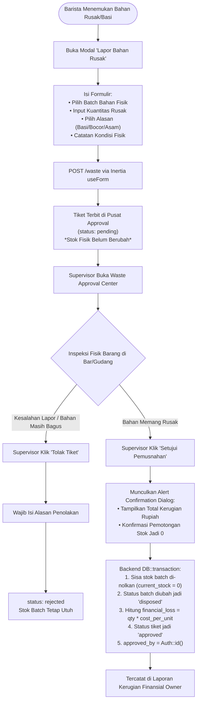

# RENCANA SPESIFIKASI DESAIN FRONTEND (PLAN 06)
## Modul 06: Pelaporan & Approval Pemusnahan Bahan Rusak/Basi (Waste Write-Off Center)
**Target File Implementasi**:  
- `resources/js/Pages/Waste/ReportModal.tsx`  
- `resources/js/Pages/Waste/Index.tsx`  
- `resources/js/Components/WasteApprovalDialog.tsx`  
**Referensi Kontrak**: [Desain.md](file:///home/lasains/ssd2/matkul/pemograman%20lanjut/projek/Desain.md), [PRD.md](file:///home/lasains/ssd2/matkul/pemograman%20lanjut/projek/PRD.md), dan [inventory.d.ts](file:///home/lasains/ssd2/matkul/pemograman%20lanjut/projek/resources/js/types/inventory.d.ts)

---

## 1. RINGKASAN ALUR BISNIS AUDIT WASTE & PENCEGAHAN HARD DELETE

### 1.1 Larangan Mutlak *Hard Delete* pada Bahan Rusak
Dalam tata kelola operasional kafe profesional, **DILARANG KERAS melakukan penghapusan data fisik (*Hard Delete* / `DELETE FROM`)** pada stok bahan yang rusak, asam, berjamur, atau kedaluwarsa:
1. **Integritas Audit Finansial**: Setiap gram biji kopi atau mililiter susu yang dibuang merupakan aset modal kafe (*Cost of Goods Sold / COGS*). Jika baris batch dihapus begitu saja dari database, pemilik kafe tidak akan pernah tahu ke mana modal kafe hilang (*unaccounted inventory shrinkage*).
2. **Pemisahan Wewenang 2-Faktor (*Separation of Duties*)**:
   - **Barista**: Hanya memiliki wewenang **Membuat Laporan / Tiket** (`status: pending`). Barista tidak boleh memotong stok sendiri agar terhindar dari manipulasi barang hilang.
   - **Supervisor**: Bertindak sebagai validator independen yang melakukan inspeksi fisik di gudang, lalu **Menyetujui (*Approve*)** atau **Menolak (*Reject*)** tiket pemusnahan.

---

### 1.2 Diagram Alur Pelaporan & Approval Pemusnahan



---

## 2. SPESIFIKASI MOCKUP STITCH UI & MASTER-DETAIL WORKSPACE SUPERVISOR

Mockup visual pusat verifikasi pemusnahan bahan rusak (*Waste Write-Off & Supervisor Approval Center*) telah diunduh dari proyek Google Stitch (ID: `3585613475449128159`), tersimpan lokal di direktori `docs/stitch/`:

| Halaman Supervisor | Screen ID Stitch | File HTML Mockup | File Screenshot Mockup |
| :--- | :--- | :--- | :--- |
| **Waste Write-Off & Approval Center** | `aa8d221d7130411ca144e9d4a04f50fd` | [supervisor_waste_approval_center.html](file:///home/lasains/ssd2/matkul/pemograman%20lanjut/projek/docs/stitch/supervisor_waste_approval_center.html) | [supervisor_waste_approval_center.png](file:///home/lasains/ssd2/matkul/pemograman%20lanjut/projek/docs/stitch/supervisor_waste_approval_center.png) |

---

### 2.1 Arsitektur Antarmuka Master-Detail Berdampingan (`Pages/Waste/Index.tsx`)
**Route**: `waste.index`  
**Mockup Acuan**: [supervisor_waste_approval_center.html](file:///home/lasains/ssd2/matkul/pemograman%20lanjut/projek/docs/stitch/supervisor_waste_approval_center.html)  
**Layout Model**: **Workspace Terpadu Master-Detail (Kolom Kiri 8-Grid Antrean : Kolom Kanan 4-Grid Verifikasi Langsung)**

Supervisor tidak perlu membuka-tutup modal pop-up yang mengganggu alur audit; cukup mengklik baris tiket di tabel antrean kiri, maka detail verifikasi fisik, kalkulasi kerugian otomatis, dan tombol aksi otorisasi langsung aktif di panel kanan.

#### Komponen Kanvas & Hierarki UI:

1. **Header & 3 Kartu Metrik Kerugian Finansial (`WasteMetricsSummary.tsx`)**:
   - `grid grid-cols-1 md:grid-cols-3 gap-4 mb-6`:
     - **Kartu 1 (Tiket Pending Menunggu Verifikasi 🟡)**:
       - `bg-[#F5EFEB] border border-[#EDE4DC] p-5 rounded-2xl`
       - Angka tebal amber: `4 Tiket Pending` (`text-[#C88242] font-bold font-mono text-2xl`)
       - Subteks: *"Menunggu inspeksi fisik di bar / chiller"*
     - **Kartu 2 (Estimasi Beban Kerugian Pending 🔴)**:
       - `bg-[#F5EFEB] border border-[#EDE4DC] p-5 rounded-2xl`
       - Nilai rupiah tebal terakota: `Rp 148.000` (`text-[#8C3D2B] font-bold font-mono text-2xl`)
       - Subteks: *"Potensi kerugian yang belum dibukukan ke jurnal"*
     - **Kartu 3 (Total Kerugian Terverifikasi Bulan Ini 📜)**:
       - `bg-[#F5EFEB] border border-[#EDE4DC] p-5 rounded-2xl`
       - Nilai rupiah moka: `Rp 420.500` (`text-[#4A2C11] font-bold font-mono text-2xl`)
       - Subteks: *"18 tiket pemusnahan resmi telah disetujui"*

2. **Kolom Kiri: Antrean Tiket Pemusnahan (`xl:col-span-8 space-y-4`)**:
   - **Filter Segmented Status**:
     - `[🟡 Menunggu Verifikasi (4)]`
     - `[🟢 Riwayat Disetujui (18)]`
     - `[⚪ Ditolak (2)]`
   - **Tabel Antrean Tiket (`WasteQueueTable.tsx`)**:
     - Wadah kontainer oat latte `bg-[#F5EFEB] rounded-2xl border border-[#EDE4DC] overflow-hidden`.
     - Kolom Tabel:
       1. **Waktu Pengajuan**: Tanggal & jam lapor (misal: *Hari ini, 08.15 WIB*).
       2. **Barista Pelapor**: Nama barista pembuat laporan tiket (misal: *Bayu Pratama • Bar Utama*).
       3. **Bahan & Batch**: Nama bahan baku dan kode batch fisik (misal: *Fresh Milk Diamond 1L • #BCH-20241026-A3F2*).
       4. **Kuantitas Diajukan**: Jumlah bahan yang rusak/basi (misal: *1.000 ml*).
       5. **Alasan Kerusakan**: Badge kategori kerusakan (*Susu Menggumpal & Basi* atau *Segel Rusak*).
       6. **Beban Finansial**: Nilai kerugian terhitung otomatis (*Rp 24.000* berteks merah terakota tebal).
       7. **Aksi**: Tombol sentuh `[Pilih untuk Verifikasi]` yang mengubah tiket aktif di panel kanan.

3. **Kolom Kanan: Panel Verifikasi Pemusnahan Fisik (`xl:col-span-4 bg-[#F5EFEB] p-6 rounded-2xl border-2 border-[#4A2C11]/30 shadow-sm space-y-5`)**:
   - Menampilkan detail lengkap tiket yang sedang dipilih supervisor (`WasteVerificationPanel.tsx`):
     - **Header Panel**: Label status tiket (Badge Amber *"Pending Verifikasi SPV"*).
     - **Rincian Bahan & Batch**: Nama bahan, nomor batch, tanggal penerimaan, dan tanggal kedaluwarsa fisik.
     - **Alasan & Catatan Barista**: Kutipan laporan lapangan dari barista pelapor (misal: *"Susu sudah menggumpal dan berbau asam saat karton dibuka pagi ini"*).
     - **Kalkulasi Kerugian Finansial Real-Time**:
       - Rumus transparan: `Kuantitas Rusak (1.000 ml) × Harga Modal Satuan (Rp 24/ml)`.
       - Kartu beban laba rugi terakota: `Kerugian Finansial: Rp 24.000` (`text-xl font-bold font-mono text-[#8C3D2B]`).
     - **Dua Tombol Aksi Otorisasi Transaksional**:
       - **Tombol Tolak (Reject)**: `[Tolak Pengajuan]` (`border border-[#EDE4DC] bg-white hover:bg-[#FDF2F0] text-[#8C3D2B] py-3 rounded-xl font-bold flex-1`) yang memunculkan input alasan penolakan.
       - **Tombol Setujui (Approve Write-Off)**: `[Setujui Pemusnahan Stok]` (`bg-[#4A2C11] hover:bg-[#241408] text-white py-3 rounded-xl font-bold flex-1 shadow-md`) yang memicu eksekusi pemotongan saldo stok batch menjadi 0 di dalam `DB::transaction`.

---

## 4. ARSITEKTUR TEKNIS FRONTEND (REACT + INERTIA)

### 4.1 Lokasi File & Relasi Komponen
```text
resources/js/
├── Pages/
│   └── Waste/
│       ├── ReportModal.tsx             # Modal form pelaporan bahan rusak untuk Barista
│       └── Index.tsx                   # Halaman tabel approval tiket waste untuk Supervisor
├── Components/
│   ├── WasteApprovalDialog.tsx         # Dialog konfirmasi persetujuan (Setujui)
│   └── WasteRejectDialog.tsx           # Dialog konfirmasi penolakan tiket (Tolak)
└── types/
    └── inventory.d.ts                  # Kontrak WasteLog, WasteStatus, IngredientBatch
```

---

### 4.2 Kontrak Tipe Data TypeScript

Mengacu pada [`resources/js/types/inventory.d.ts`](file:///home/lasains/ssd2/matkul/pemograman%20lanjut/projek/resources/js/types/inventory.d.ts):

```typescript
// resources/js/types/waste.ts
import { WasteLog, WasteStatus, IngredientBatch, User } from '@/types/inventory';

export interface WasteTicketWithDetails extends WasteLog {
    batch: IngredientBatch & {
        ingredient: {
            name: string;
            unit: string;
        };
    };
    reporter: User;
    approver?: User | null;
}

export interface WasteIndexProps {
    pendingTickets: WasteTicketWithDetails[];
    historyTickets: WasteTicketWithDetails[];
    metrics: {
        pending_count: number;
        pending_financial_loss: number;
        monthly_approved_loss: number;
    };
    filters: {
        status?: WasteStatus | 'all';
    };
}

export interface ReportWasteFormData {
    ingredient_batch_id: number | '';
    waste_quantity: number | '';
    reason: string;
    notes: string;
}
```

---

### 4.3 Form Pelaporan Barista (`useForm`)

```typescript
// resources/js/Pages/Waste/ReportModal.tsx
import { useForm } from '@inertiajs/react';
import { IngredientBatch } from '@/types/inventory';
import { ReportWasteFormData } from '@/types/waste';
import { Dialog, DialogContent, DialogHeader, DialogTitle, DialogFooter } from '@/Components/ui/dialog';
import { Button } from '@/Components/ui/button';
import { Input } from '@/Components/ui/input';
import { Label } from '@/Components/ui/label';
import { Textarea } from '@/Components/ui/textarea';
import { Select, SelectContent, SelectItem, SelectTrigger, SelectValue } from '@/Components/ui/select';
import InputError from '@/Components/InputError';

interface Props {
    isOpen: boolean;
    onClose: () => void;
    activeBatches: (IngredientBatch & { ingredient?: { name: string; unit: string } })[];
}

export function ReportModal({ isOpen, onClose, activeBatches }: Props) {
    const { data, setData, post, processing, errors, reset } = useForm<ReportWasteFormData>({
        ingredient_batch_id: '',
        waste_quantity: '',
        reason: 'Masa Simpan Kedaluwarsa (Expired)',
        notes: '',
    });

    const selectedBatch = activeBatches.find((b) => b.id === Number(data.ingredient_batch_id));
    const isOverQuantity =
        Boolean(selectedBatch) && Number(data.waste_quantity) > (selectedBatch?.current_stock ?? 0);

    const handleSubmit = (e: React.FormEvent) => {
        e.preventDefault();
        post(route('waste.store'), {
            onSuccess: () => {
                reset();
                onClose();
            },
        });
    };

    return (
        <Dialog open={isOpen} onOpenChange={onClose}>
            <DialogContent className="max-w-lg bg-surface-container border-surface-border rounded-xl">
                <DialogHeader>
                    <DialogTitle className="text-content-high font-semibold text-lg">
                        Lapor Bahan Baku Rusak / Basi
                    </DialogTitle>
                </DialogHeader>

                <form onSubmit={handleSubmit} className="space-y-4 pt-2">
                    {/* Pilih Batch Fisik */}
                    <div>
                        <Label htmlFor="ingredient_batch_id">Pilih Batch Bahan Bermasalah</Label>
                        <Select
                            value={String(data.ingredient_batch_id)}
                            onValueChange={(val) => setData('ingredient_batch_id', Number(val))}
                        >
                            <SelectTrigger className="mt-1">
                                <SelectValue placeholder="-- Pilih Batch Bahan --" />
                            </SelectTrigger>
                            <SelectContent>
                                {activeBatches.map((b) => (
                                    <SelectItem key={b.id} value={String(b.id)}>
                                        {b.ingredient?.name} — #{b.batch_code} (Sisa: {b.current_stock}{' '}
                                        {b.ingredient?.unit})
                                    </SelectItem>
                                ))}
                            </SelectContent>
                        </Select>
                        <InputError message={errors.ingredient_batch_id} className="mt-1" />
                    </div>

                    {/* Kuantitas Rusak */}
                    <div>
                        <Label htmlFor="waste_quantity">Kuantitas yang Rusak / Terbuang</Label>
                        <div className="relative mt-1">
                            <Input
                                id="waste_quantity"
                                type="number"
                                min="0.1"
                                step="any"
                                value={data.waste_quantity}
                                onChange={(e) => setData('waste_quantity', Number(e.target.value))}
                                placeholder="0"
                                className="pr-14"
                            />
                            <span className="absolute right-3 top-2.5 text-xs font-semibold text-slate-400 uppercase">
                                {selectedBatch?.ingredient?.unit || 'unit'}
                            </span>
                        </div>
                        {isOverQuantity && (
                            <p className="text-xs text-rose-600 mt-1 font-medium">
                                * Kuantitas rusak melebihi sisa stok fisik batch ({selectedBatch?.current_stock}{' '}
                                {selectedBatch?.ingredient?.unit}).
                            </p>
                        )}
                        <InputError message={errors.waste_quantity} className="mt-1" />
                    </div>

                    {/* Alasan Pemusnahan */}
                    <div>
                        <Label htmlFor="reason">Alasan Kerusakan</Label>
                        <Select value={data.reason} onValueChange={(val) => setData('reason', val)}>
                            <SelectTrigger className="mt-1">
                                <SelectValue />
                            </SelectTrigger>
                            <SelectContent>
                                <SelectItem value="Masa Simpan Kedaluwarsa (Expired)">
                                    Masa Simpan Kedaluwarsa (Expired)
                                </SelectItem>
                                <SelectItem value="Kemasan Bocor / Rusak / Segel Terbuka">
                                    Kemasan Bocor / Rusak / Segel Terbuka
                                </SelectItem>
                                <SelectItem value="Bau Asam / Menggumpal / Rasa Berubah">
                                    Bau Asam / Menggumpal / Rasa Berubah
                                </SelectItem>
                                <SelectItem value="Terkontaminasi Fisik (Jatuh / Serangga)">
                                    Terkontaminasi Fisik (Jatuh / Serangga)
                                </SelectItem>
                                <SelectItem value="Lainnya">Lainnya (Jelaskan di catatan)</SelectItem>
                            </SelectContent>
                        </Select>
                        <InputError message={errors.reason} className="mt-1" />
                    </div>

                    {/* Catatan Tambahan */}
                    <div>
                        <Label htmlFor="notes">Catatan Kondisi Fisik (Opsional)</Label>
                        <Textarea
                            id="notes"
                            value={data.notes}
                            onChange={(e) => setData('notes', e.target.value)}
                            placeholder="Contoh: Susu menggumpal saat di-froth pagi hari..."
                            rows={3}
                            className="mt-1"
                        />
                        <InputError message={errors.notes} className="mt-1" />
                    </div>

                    <DialogFooter className="pt-2">
                        <Button type="button" variant="outline" onClick={onClose} disabled={processing}>
                            Batal
                        </Button>
                        <Button
                            type="submit"
                            disabled={processing || isOverQuantity || !data.ingredient_batch_id}
                            className="bg-amber-600 hover:bg-amber-700 text-white"
                        >
                            {processing ? 'Mengirim...' : 'Kirim Tiket ke Supervisor'}
                        </Button>
                    </DialogFooter>
                </form>
            </DialogContent>
        </Dialog>
    );
}
```

---

### 4.4 Logika Aksi Approval & Dialog Konfirmasi

```typescript
// resources/js/Components/WasteApprovalDialog.tsx
import { router } from '@inertiajs/react';
import {
    AlertDialog,
    AlertDialogContent,
    AlertDialogHeader,
    AlertDialogTitle,
    AlertDialogDescription,
    AlertDialogFooter,
} from '@/Components/ui/alert-dialog';
import { Button } from '@/Components/ui/button';
import { AlertOctagon } from 'lucide-react';
import { WasteTicketWithDetails } from '@/types/waste';
import { useState } from 'react';

interface Props {
    ticket: WasteTicketWithDetails | null;
    isOpen: boolean;
    onClose: () => void;
}

export function WasteApprovalDialog({ ticket, isOpen, onClose }: Props) {
    const [isSubmitting, setIsSubmitting] = useState(false);

    if (!ticket) return null;

    const handleApprove = () => {
        setIsSubmitting(true);
        router.post(
            route('waste.approve', ticket.id),
            {},
            {
                onFinish: () => {
                    setIsSubmitting(false);
                    onClose();
                },
            }
        );
    };

    return (
        <AlertDialog open={isOpen}>
            <AlertDialogContent className="max-w-md border-[#F8C6BF] bg-surface-container">
                <AlertDialogHeader>
                    <div className="flex items-center gap-3">
                        <div className="rounded-full bg-[#FDF2F0] p-2 text-[#8C3D2B]">
                            <AlertOctagon className="h-6 w-6" />
                        </div>
                        <AlertDialogTitle className="text-content-high font-bold text-lg">
                            Setujui Pemusnahan Stok?
                        </AlertDialogTitle>
                    </div>
                    <AlertDialogDescription className="text-content-medium text-sm pt-2">
                        Anda akan menyetujui pemusnahan:{' '}
                        <strong>
                            {ticket.waste_quantity} {ticket.batch.ingredient.unit} {ticket.batch.ingredient.name}
                        </strong>{' '}
                        (Batch #{ticket.batch.batch_code}).
                    </AlertDialogDescription>
                </AlertDialogHeader>

                <div className="my-3 rounded-lg border border-[#F8C6BF] bg-[#FDF2F0]/80 p-3 text-xs text-[#8C3D2B] space-y-1">
                    <p className="font-semibold text-[#8C3D2B]">⚠️ Peringatan Dampak Finansial:</p>
                    <p>
                        Stok fisik batch akan langsung dipotong menjadi <strong>0</strong> dan kerugian finansial
                        sebesar{' '}
                        <strong className="text-[#8C3D2B] font-mono">
                            Rp {ticket.financial_loss.toLocaleString('id-ID')}
                        </strong>{' '}
                        akan dibukukan ke laporan kerugian kafe secara permanen.
                    </p>
                </div>

                <AlertDialogFooter className="gap-2 sm:gap-0">
                    <Button variant="outline" onClick={onClose} disabled={isSubmitting} className="border-surface-border text-content-medium hover:bg-surface-container-high">
                        Batal
                    </Button>
                    <Button
                        onClick={handleApprove}
                        disabled={isSubmitting}
                        className="bg-brand-primary hover:bg-brand-primary-hover text-white font-semibold"
                    >
                        {isSubmitting ? 'Memproses...' : 'Ya, Setujui & Hapusbukukan Stok'}
                    </Button>
                </AlertDialogFooter>
            </AlertDialogContent>
        </AlertDialog>
    );
}
```

---

## 5. EDGE CASES & INTEGRITAS TRANSAKSI

### 5.1 Kuantitas Rusak Melebihi Sisa Stok Batch
- **Client-Side Guard**: Form submit otomatis dinonaktifkan (`disabled={isOverQuantity}`) jika angka yang diinput > sisa stok fisik batch.
- **Server-Side Guard**: Request divalidasi di Laravel Form Request dengan aturan:
  ```php
  'waste_quantity' => ['required', 'numeric', 'min:0.1', function ($attribute, $value, $fail) use ($batch) {
      if ($value > $batch->current_stock) {
          $fail('Kuantitas yang dilaporkan melebihi saldo stok fisik batch yang ada.');
      }
  }],
  ```

### 5.2 Supervisor Menolak Tiket (`status: rejected`)
- Jika supervisor menolak tiket (misal: barista salah mengira susu dingin sebagai susu basi):
  - Sistem membuka dialog penolakan (`WasteRejectDialog`).
  - Supervisor **wajib mengisi kotak teks: Alasan Penolakan** (minimal 5 karakter).
  - Status tiket berubah menjadi `rejected`, stok fisik batch **TIDAK berubah**, dan tidak ada kerugian finansial yang dibukukan.

### 5.3 Integritas Database Transaction (`DB::transaction`)
Eksekusi approval di backend Laravel wajib dibungkus dalam transaksi basis data atomik:
```php
DB::transaction(function () use ($wasteLog, $supervisorId) {
    $batch = $wasteLog->batch;

    // 1. Nol-kan sisa stok batch
    $batch->update([
        'current_stock' => 0,
        'status' => 'disposed',
    ]);

    // 2. Hitung kerugian pasti dan setujui tiket
    $wasteLog->update([
        'status' => 'approved',
        'approved_by' => $supervisorId,
        'financial_loss' => $wasteLog->waste_quantity * $batch->cost_per_unit,
    ]);
});
```

---

## 6. REKOMENDASI TAHAPAN IMPLEMENTASI KODING

1. **Langkah 1**: Buat modal form pelaporan `resources/js/Pages/Waste/ReportModal.tsx`.
2. **Langkah 2**: Buat dialog persetujuan `WasteApprovalDialog.tsx` dan penolakan `WasteRejectDialog.tsx`.
3. **Langkah 3**: Buat halaman tabel `resources/js/Pages/Waste/Index.tsx` untuk supervisor dengan metrik kerugian finansial.
4. **Langkah 4**: Implementasikan controller backend `WasteLogController.php` dengan transaksi database `DB::transaction` pada fungsi `store()`, `approve()`, dan `reject()`.
