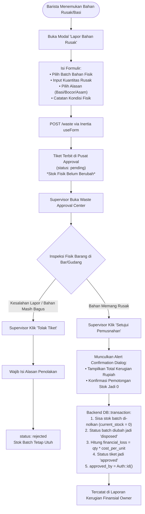

# RENCANA SPESIFIKASI DESAIN FRONTEND (PLAN 06)
## Modul 06: Pelaporan & Approval Pemusnahan Bahan Rusak/Basi (Waste Write-Off Center)
**Target File Implementasi**:  
- `resources/js/Pages/Waste/ReportModal.tsx`  
- `resources/js/Pages/Waste/Index.tsx`  
- `resources/js/Components/WasteApprovalDialog.tsx`  
**Referensi Kontrak**: [Desain.md](file:///home/lasains/ssd2/matkul/pemograman%20lanjut/projek/Desain.md), [PRD.md](file:///home/lasains/ssd2/matkul/pemograman%20lanjut/projek/PRD.md), dan [inventory.d.ts](file:///home/lasains/ssd2/matkul/pemograman%20lanjut/projek/resources/js/types/inventory.d.ts)

---

## 1. RINGKASAN ALUR BISNIS AUDIT WASTE & PENCEGAHAN HARD DELETE

### 1.1 Larangan Mutlak *Hard Delete* pada Bahan Rusak
Dalam tata kelola operasional kafe profesional, **DILARANG KERAS melakukan penghapusan data fisik (*Hard Delete* / `DELETE FROM`)** pada stok bahan yang rusak, asam, berjamur, atau kedaluwarsa:
1. **Integritas Audit Finansial**: Setiap gram biji kopi atau mililiter susu yang dibuang merupakan aset modal kafe (*Cost of Goods Sold / COGS*). Jika baris batch dihapus begitu saja dari database, pemilik kafe tidak akan pernah tahu ke mana modal kafe hilang (*unaccounted inventory shrinkage*).
2. **Pemisahan Wewenang 2-Faktor (*Separation of Duties*)**:
   - **Barista**: Hanya memiliki wewenang **Membuat Laporan / Tiket** (`status: pending`). Barista tidak boleh memotong stok sendiri agar terhindar dari manipulasi barang hilang.
   - **Supervisor**: Bertindak sebagai validator independen yang melakukan inspeksi fisik di gudang, lalu **Menyetujui (*Approve*)** atau **Menolak (*Reject*)** tiket pemusnahan.

---

### 1.2 Diagram Alur Pelaporan & Approval Pemusnahan



---

## 2. STITCH-READY SCREEN SPECIFICATION (GOOGLE STITCH PROMPT)

Spesifikasi berikut dirancang agar siap dimasukkan ke Google Stitch guna menghasilkan purwarupa visual modul pemusnahan limbah (*waste disposal*).

### 2.1 Identitas Modul Layar
* **Screen Title**: Specialty Coffee Waste Write-Off & Supervisor Approval Center
* **Target Viewport**: Desktop (1440x900) & Supervisor Tablet (1024x768)
* **Visual Identity**: Slate-50 Background, Amber (Pending), Rose/Red (Financial Loss & Critical), Emerald (Approved).

---

### 2.2 Rincian Tiga Layar Visual

#### Layar 1: Modal Form Lapor Bahan Rusak untuk Barista (`Pages/Waste/ReportModal.tsx`)
1. **Kontainer Dialog**:
   - Modal pop-up putih terpusat (`max-w-lg bg-white rounded-xl shadow-xl border border-slate-200 p-6`).
   - Judul: *"Lapor Bahan Baku Rusak / Basi (Disposal Ticket)"*.
   - Subjudul: *"Tiket akan ditinjau dan diverifikasi oleh Supervisor sebelum stok dihapusbukukan."*
2. **Elemen Form Input**:
   - **Pilih Batch Bahan Baku (`ingredient_batch_id`)**:
     * Dropdown yang menampilkan batch aktif dengan sisa stok dan tanggal kedaluwarsa (misal: *Fresh Milk Diamond 1L - Batch #BM-20261025 (Exp: 03 Nov 2026, Sisa: 1.000 ml)*).
   - **Kuantitas Rusak (`waste_quantity`)**:
     * Input angka besar dengan satuan unit dinamis (misal: `[ 1000 ] ml`).
     * Validasi instan: Angka tidak boleh melebihi sisa stok fisik batch terpilih.
   - **Alasan Pemusnahan (`reason`)**:
     * Select dropdown dengan opsi standar kafe:
       - `Masa Simpan Kedaluwarsa (Expired)`
       - `Kemasan Bocor / Rusak / Segel Terbuka`
       - `Bau Asam / Menggumpal / Rasa Tidak Layak`
       - `Terkontaminasi Fisik (Jatuh / Serangga)`
       - `Lainnya (Tulis di Catatan)`
   - **Catatan Detail Kondisi Fisik (`notes`)**:
     * Textarea: *"Contoh: Susu terasa asam saat di-steam pagi ini, sudah berbusa kasar di dalam chiller."*
3. **Footer Tombol**:
   - Tombol Batal (`variant="outline"`).
   - Tombol Amber/Red: `[Kirim Tiket ke Supervisor]`.

---

#### Layar 2: Approval Center DataTable untuk Supervisor (`Pages/Waste/Index.tsx`)
1. **Header & Ringkasan Metrik Kerugian (3 Kartu Metrik Atas)**:
   - **Kartu 1 (Tiket Menunggu Approval 🟡)**: Angka tebal (misal: *4 Tiket Pending*), label *Menunggu Verifikasi Fisik*.
   - **Kartu 2 (Estimasi Kerugian Pending 🔴)**: Nilai rupiah tebal warna merah (`text-rose-600 font-bold font-mono text-xl`, misal: *Rp 148.000*), label *Potensi Beban Kerugian*.
   - **Kartu 3 (Total Kerugian Terverifikasi Bulan Ini)**: Nilai rupiah (misal: *Rp 420.500*), label *Total Bahan Rusak Disetujui*.
2. **Toolbar & Filter Tab Status**:
   - Filter Tabs:
     * `[🟡 Menunggu Approval (4)]`
     * `[🟢 Disetujui (18)]`
     * `[⚪ Ditolak (2)]`
3. **DataTable Tiket Pemusnahan (shadcn/ui Table)**:
   - Kolom Tabel:
     * **Tanggal & Jam**: Waktu lapor (misal: *31 Okt 2026, 08:15 WIB*).
     * **Pelapor**: Nama Barista (misal: *Bayu Pratama*).
     * **Bahan & Batch**: Nama bahan baku + nomor batch (misal: *Fresh Milk Diamond 1L - #BM-20261025*).
     * **Kuantitas Rusak**: Angka + satuan (misal: *1.000 ml*).
     * **Alasan Kerusakan**: Kapsul badge alasan (misal: *Bau Asam / Menggumpal*).
     * **Estimasi Kerugian Finansial**: Nilai rupiah tebal merah mono (misal: `Rp 24.000`), dihitung otomatis dari harga beli per unit.
     * **Status Tiket**: Badge `Pending` (Kuning amber), `Approved` (Hijau emerald), atau `Rejected` (Abu-abu netral).
     * **Tombol Aksi**:
       - Tombol Hijau: `[✓ Setujui]` (Membuka dialog konfirmasi approval).
       - Tombol Abu-abu: `[✕ Tolak]` (Membuka modal input alasan penolakan).

---

#### Layar 3: Dialog Konfirmasi Persetujuan Pemusnahan (`Components/WasteApprovalDialog.tsx`)
1. **Kontainer Dialog**:
   - AlertDialog terpusat (`max-w-md bg-white rounded-xl border border-rose-200 p-6`).
2. **Header Peringatan Tegas**:
   - Ikon lingkaran merah `AlertOctagon` (`text-rose-600 bg-rose-50 p-2.5 rounded-full`).
   - Judul: `text-rose-950 font-bold text-lg` (*"Konfirmasi Pemusnahan Bahan Baku"*).
3. **Ringkasan Dampak Finansial**:
   - Kotak ringkasan berlatar kemerahan tipis:
     > *"Anda akan menyetujui pemusnahan **1.000 ml Fresh Milk Diamond 1L** (Batch #BM-20261025). Tindakan ini akan **memotong stok fisik batch menjadi 0** dan mencatatkan kerugian finansial sebesar **Rp 24.000** ke buku kas kafe."*
4. **Footer Aksi**:
   - Tombol Batal (`variant="outline"`).
   - Tombol Merah/Hijau Tegas: `[Ya, Setujui Pemusnahan Stok]`.

---

### 2.3 Teks Prompt Siap Pakai untuk Google Stitch

#### Prompt Bahasa Indonesia (Terstruktur & Kontekstual)
```text
Buatkan 3 antarmuka layar web untuk modul "Pelaporan & Approval Pemusnahan Bahan Basi (Waste Write-Off Center)" pada aplikasi kafe "BeanFlow":

Layar 1 (Modal Barista - Lapor Bahan Rusak):
Modal pop-up putih terpusat (rounded-xl, border slate-200, shadow-lg). Berisi formulir pelaporan:
- Dropdown pilih batch bahan yang bermasalah (menampilkan nama bahan, nomor batch, sisa stok, dan tanggal kedaluwarsa).
- Input kuantitas rusak dengan satuan ml/gram (misal: 1000 ml).
- Dropdown alasan pemusnahan: "Masa Simpan Kedaluwarsa (Expired)", "Kemasan Bocor/Rusak", "Bau Asam/Menggumpal", "Terkontaminasi Fisik".
- Textarea catatan detail kondisi fisik bahan baku.
- Tombol Batal dan tombol amber "+ Ajukan Tiket Pemusnahan".

Layar 2 (Halaman Supervisor - Waste Approval Center):
Latar belakang bersih slate-50. Bagian atas memuat 3 kartu ringkasan:
- Kartu 1: Tiket Pending Menunggu Verifikasi (4 Tiket).
- Kartu 2: Potensi Kerugian Finansial Pending beraksen teks merah monospaced tebal "Rp 148.000".
- Kartu 3: Total Kerugian Disetujui Bulan Ini "Rp 420.500".
Di bawahnya terdapat filter tabs status ("Menunggu Approval", "Disetujui", "Ditolak").
Tabel daftar tiket memuat kolom: Tanggal/Jam, Nama Barista Pelapor, Bahan & Kode Batch, Kuantitas Dibuang, Badge Alasan, Estimasi Kerugian Finansial (teks merah tebal font-mono), Badge Status Pending kuning, serta tombol aksi hijau "✓ Setujui" dan tombol outline "✕ Tolak".

Layar 3 (Dialog Konfirmasi Persetujuan Supervisor):
Modal AlertDialog peringatan dengan ikon tanda seru merah. Berisi penjelasan tegas bahwa persetujuan akan memotong stok batch fisik menjadi 0 dan membukukan kerugian finansial sebesar Rp 24.000 secara permanen. Tombol batal dan tombol hijau "Ya, Setujui Pemusnahan".
Desain bersih, modern SaaS specialty coffee, kontras tinggi, dan ramah tablet.
```

#### English Prompt (High-Fidelity for Stitch AI)
```text
A comprehensive 3-screen UI set for a specialty coffee waste management module named "BeanFlow Waste Write-Off Center":
1. Screen 1 (Barista Waste Report Modal): Centered clean white dialog card (rounded-xl, shadow-xl). Contains fields: batch selector showing ingredient name, batch code, and remaining stock; quantity wasted numeric input with unit badge (ml/gram); disposal reason select dropdown (Expired, Leaking Packaging, Sour/Curdled Odor, Contamination); descriptive notes textarea; secondary cancel button and primary amber button "+ Submit Waste Ticket".
2. Screen 2 (Supervisor Approval Dashboard): Neutral slate-50 canvas. Top section features 3 metric cards: Pending Waste Tickets count (4), Potential Financial Loss highlighted in bold red monospace font "Rp 148,000", and Total Approved Waste this Month. Below are segmented status filter tabs ("Pending Approval", "Approved History", "Rejected"). Crisp data table with columns: Timestamp, Barista Reporter Name, Ingredient & Batch Code, Wasted Quantity, Reason Badge, Financial Loss in red bold monospace, Amber Pending Badge, and quick action buttons: emerald "✓ Approve" and outline "✕ Reject".
3. Screen 3 (Approval Confirmation Alert Dialog): Prominent confirmation alert dialog with a red warning hexagon icon. Summary warning box explaining that approval will irreversibly set physical batch stock to 0 and record a financial loss of Rp 24,000 to the cafe's ledger. Cancel button and solid primary confirmation button "Confirm Waste Write-Off". Polished SaaS aesthetic, high typography contrast.
```

---

## 4. ARSITEKTUR TEKNIS FRONTEND (REACT + INERTIA)

### 4.1 Lokasi File & Relasi Komponen
```text
resources/js/
├── Pages/
│   └── Waste/
│       ├── ReportModal.tsx             # Modal form pelaporan bahan rusak untuk Barista
│       └── Index.tsx                   # Halaman tabel approval tiket waste untuk Supervisor
├── Components/
│   ├── WasteApprovalDialog.tsx         # Dialog konfirmasi persetujuan (Setujui)
│   └── WasteRejectDialog.tsx           # Dialog konfirmasi penolakan tiket (Tolak)
└── types/
    └── inventory.d.ts                  # Kontrak WasteLog, WasteStatus, IngredientBatch
```

---

### 4.2 Kontrak Tipe Data TypeScript

Mengacu pada [`resources/js/types/inventory.d.ts`](file:///home/lasains/ssd2/matkul/pemograman%20lanjut/projek/resources/js/types/inventory.d.ts):

```typescript
// resources/js/types/waste.ts
import { WasteLog, WasteStatus, IngredientBatch, User } from '@/types/inventory';

export interface WasteTicketWithDetails extends WasteLog {
    batch: IngredientBatch & {
        ingredient: {
            name: string;
            unit: string;
        };
    };
    reporter: User;
    approver?: User | null;
}

export interface WasteIndexProps {
    pendingTickets: WasteTicketWithDetails[];
    historyTickets: WasteTicketWithDetails[];
    metrics: {
        pending_count: number;
        pending_financial_loss: number;
        monthly_approved_loss: number;
    };
    filters: {
        status?: WasteStatus | 'all';
    };
}

export interface ReportWasteFormData {
    ingredient_batch_id: number | '';
    waste_quantity: number | '';
    reason: string;
    notes: string;
}
```

---

### 4.3 Form Pelaporan Barista (`useForm`)

```typescript
// resources/js/Pages/Waste/ReportModal.tsx
import { useForm } from '@inertiajs/react';
import { IngredientBatch } from '@/types/inventory';
import { ReportWasteFormData } from '@/types/waste';
import { Dialog, DialogContent, DialogHeader, DialogTitle, DialogFooter } from '@/Components/ui/dialog';
import { Button } from '@/Components/ui/button';
import { Input } from '@/Components/ui/input';
import { Label } from '@/Components/ui/label';
import { Textarea } from '@/Components/ui/textarea';
import { Select, SelectContent, SelectItem, SelectTrigger, SelectValue } from '@/Components/ui/select';
import InputError from '@/Components/InputError';

interface Props {
    isOpen: boolean;
    onClose: () => void;
    activeBatches: (IngredientBatch & { ingredient?: { name: string; unit: string } })[];
}

export function ReportModal({ isOpen, onClose, activeBatches }: Props) {
    const { data, setData, post, processing, errors, reset } = useForm<ReportWasteFormData>({
        ingredient_batch_id: '',
        waste_quantity: '',
        reason: 'Masa Simpan Kedaluwarsa (Expired)',
        notes: '',
    });

    const selectedBatch = activeBatches.find((b) => b.id === Number(data.ingredient_batch_id));
    const isOverQuantity =
        Boolean(selectedBatch) && Number(data.waste_quantity) > (selectedBatch?.current_stock ?? 0);

    const handleSubmit = (e: React.FormEvent) => {
        e.preventDefault();
        post(route('waste.store'), {
            onSuccess: () => {
                reset();
                onClose();
            },
        });
    };

    return (
        <Dialog open={isOpen} onOpenChange={onClose}>
            <DialogContent className="max-w-lg bg-white rounded-xl">
                <DialogHeader>
                    <DialogTitle className="text-slate-900 font-semibold text-lg">
                        Lapor Bahan Baku Rusak / Basi
                    </DialogTitle>
                </DialogHeader>

                <form onSubmit={handleSubmit} className="space-y-4 pt-2">
                    {/* Pilih Batch Fisik */}
                    <div>
                        <Label htmlFor="ingredient_batch_id">Pilih Batch Bahan Bermasalah</Label>
                        <Select
                            value={String(data.ingredient_batch_id)}
                            onValueChange={(val) => setData('ingredient_batch_id', Number(val))}
                        >
                            <SelectTrigger className="mt-1">
                                <SelectValue placeholder="-- Pilih Batch Bahan --" />
                            </SelectTrigger>
                            <SelectContent>
                                {activeBatches.map((b) => (
                                    <SelectItem key={b.id} value={String(b.id)}>
                                        {b.ingredient?.name} — #{b.batch_code} (Sisa: {b.current_stock}{' '}
                                        {b.ingredient?.unit})
                                    </SelectItem>
                                ))}
                            </SelectContent>
                        </Select>
                        <InputError message={errors.ingredient_batch_id} className="mt-1" />
                    </div>

                    {/* Kuantitas Rusak */}
                    <div>
                        <Label htmlFor="waste_quantity">Kuantitas yang Rusak / Terbuang</Label>
                        <div className="relative mt-1">
                            <Input
                                id="waste_quantity"
                                type="number"
                                min="0.1"
                                step="any"
                                value={data.waste_quantity}
                                onChange={(e) => setData('waste_quantity', Number(e.target.value))}
                                placeholder="0"
                                className="pr-14"
                            />
                            <span className="absolute right-3 top-2.5 text-xs font-semibold text-slate-400 uppercase">
                                {selectedBatch?.ingredient?.unit || 'unit'}
                            </span>
                        </div>
                        {isOverQuantity && (
                            <p className="text-xs text-rose-600 mt-1 font-medium">
                                * Kuantitas rusak melebihi sisa stok fisik batch ({selectedBatch?.current_stock}{' '}
                                {selectedBatch?.ingredient?.unit}).
                            </p>
                        )}
                        <InputError message={errors.waste_quantity} className="mt-1" />
                    </div>

                    {/* Alasan Pemusnahan */}
                    <div>
                        <Label htmlFor="reason">Alasan Kerusakan</Label>
                        <Select value={data.reason} onValueChange={(val) => setData('reason', val)}>
                            <SelectTrigger className="mt-1">
                                <SelectValue />
                            </SelectTrigger>
                            <SelectContent>
                                <SelectItem value="Masa Simpan Kedaluwarsa (Expired)">
                                    Masa Simpan Kedaluwarsa (Expired)
                                </SelectItem>
                                <SelectItem value="Kemasan Bocor / Rusak / Segel Terbuka">
                                    Kemasan Bocor / Rusak / Segel Terbuka
                                </SelectItem>
                                <SelectItem value="Bau Asam / Menggumpal / Rasa Berubah">
                                    Bau Asam / Menggumpal / Rasa Berubah
                                </SelectItem>
                                <SelectItem value="Terkontaminasi Fisik (Jatuh / Serangga)">
                                    Terkontaminasi Fisik (Jatuh / Serangga)
                                </SelectItem>
                                <SelectItem value="Lainnya">Lainnya (Jelaskan di catatan)</SelectItem>
                            </SelectContent>
                        </Select>
                        <InputError message={errors.reason} className="mt-1" />
                    </div>

                    {/* Catatan Tambahan */}
                    <div>
                        <Label htmlFor="notes">Catatan Kondisi Fisik (Opsional)</Label>
                        <Textarea
                            id="notes"
                            value={data.notes}
                            onChange={(e) => setData('notes', e.target.value)}
                            placeholder="Contoh: Susu menggumpal saat di-froth pagi hari..."
                            rows={3}
                            className="mt-1"
                        />
                        <InputError message={errors.notes} className="mt-1" />
                    </div>

                    <DialogFooter className="pt-2">
                        <Button type="button" variant="outline" onClick={onClose} disabled={processing}>
                            Batal
                        </Button>
                        <Button
                            type="submit"
                            disabled={processing || isOverQuantity || !data.ingredient_batch_id}
                            className="bg-amber-600 hover:bg-amber-700 text-white"
                        >
                            {processing ? 'Mengirim...' : 'Kirim Tiket ke Supervisor'}
                        </Button>
                    </DialogFooter>
                </form>
            </DialogContent>
        </Dialog>
    );
}
```

---

### 4.4 Logika Aksi Approval & Dialog Konfirmasi

```typescript
// resources/js/Components/WasteApprovalDialog.tsx
import { router } from '@inertiajs/react';
import {
    AlertDialog,
    AlertDialogContent,
    AlertDialogHeader,
    AlertDialogTitle,
    AlertDialogDescription,
    AlertDialogFooter,
} from '@/Components/ui/alert-dialog';
import { Button } from '@/Components/ui/button';
import { AlertOctagon } from 'lucide-react';
import { WasteTicketWithDetails } from '@/types/waste';
import { useState } from 'react';

interface Props {
    ticket: WasteTicketWithDetails | null;
    isOpen: boolean;
    onClose: () => void;
}

export function WasteApprovalDialog({ ticket, isOpen, onClose }: Props) {
    const [isSubmitting, setIsSubmitting] = useState(false);

    if (!ticket) return null;

    const handleApprove = () => {
        setIsSubmitting(true);
        router.post(
            route('waste.approve', ticket.id),
            {},
            {
                onFinish: () => {
                    setIsSubmitting(false);
                    onClose();
                },
            }
        );
    };

    return (
        <AlertDialog open={isOpen}>
            <AlertDialogContent className="max-w-md border-rose-200 bg-white">
                <AlertDialogHeader>
                    <div className="flex items-center gap-3">
                        <div className="rounded-full bg-rose-100 p-2 text-rose-600">
                            <AlertOctagon className="h-6 w-6" />
                        </div>
                        <AlertDialogTitle className="text-slate-900 font-bold text-lg">
                            Setujui Pemusnahan Stok?
                        </AlertDialogTitle>
                    </div>
                    <AlertDialogDescription className="text-slate-600 text-sm pt-2">
                        Anda akan menyetujui pemusnahan:{' '}
                        <strong>
                            {ticket.waste_quantity} {ticket.batch.ingredient.unit} {ticket.batch.ingredient.name}
                        </strong>{' '}
                        (Batch #{ticket.batch.batch_code}).
                    </AlertDialogDescription>
                </AlertDialogHeader>

                <div className="my-3 rounded-lg border border-rose-200 bg-rose-50/60 p-3 text-xs text-rose-900 space-y-1">
                    <p className="font-semibold text-rose-950">⚠️ Peringatan Dampak Finansial:</p>
                    <p>
                        Stok fisik batch akan langsung dipotong menjadi <strong>0</strong> dan kerugian finansial
                        sebesar{' '}
                        <strong className="text-rose-700 font-mono">
                            Rp {ticket.financial_loss.toLocaleString('id-ID')}
                        </strong>{' '}
                        akan dibukukan ke laporan kerugian kafe secara permanen.
                    </p>
                </div>

                <AlertDialogFooter className="gap-2 sm:gap-0">
                    <Button variant="outline" onClick={onClose} disabled={isSubmitting}>
                        Batal
                    </Button>
                    <Button
                        onClick={handleApprove}
                        disabled={isSubmitting}
                        className="bg-emerald-600 hover:bg-emerald-700 text-white font-semibold"
                    >
                        {isSubmitting ? 'Memproses...' : 'Ya, Setujui & Hapusbukukan Stok'}
                    </Button>
                </AlertDialogFooter>
            </AlertDialogContent>
        </AlertDialog>
    );
}
```

---

## 5. EDGE CASES & INTEGRITAS TRANSAKSI

### 5.1 Kuantitas Rusak Melebihi Sisa Stok Batch
- **Client-Side Guard**: Form submit otomatis dinonaktifkan (`disabled={isOverQuantity}`) jika angka yang diinput > sisa stok fisik batch.
- **Server-Side Guard**: Request divalidasi di Laravel Form Request dengan aturan:
  ```php
  'waste_quantity' => ['required', 'numeric', 'min:0.1', function ($attribute, $value, $fail) use ($batch) {
      if ($value > $batch->current_stock) {
          $fail('Kuantitas yang dilaporkan melebihi saldo stok fisik batch yang ada.');
      }
  }],
  ```

### 5.2 Supervisor Menolak Tiket (`status: rejected`)
- Jika supervisor menolak tiket (misal: barista salah mengira susu dingin sebagai susu basi):
  - Sistem membuka dialog penolakan (`WasteRejectDialog`).
  - Supervisor **wajib mengisi kotak teks: Alasan Penolakan** (minimal 5 karakter).
  - Status tiket berubah menjadi `rejected`, stok fisik batch **TIDAK berubah**, dan tidak ada kerugian finansial yang dibukukan.

### 5.3 Integritas Database Transaction (`DB::transaction`)
Eksekusi approval di backend Laravel wajib dibungkus dalam transaksi basis data atomik:
```php
DB::transaction(function () use ($wasteLog, $supervisorId) {
    $batch = $wasteLog->batch;

    // 1. Nol-kan sisa stok batch
    $batch->update([
        'current_stock' => 0,
        'status' => 'disposed',
    ]);

    // 2. Hitung kerugian pasti dan setujui tiket
    $wasteLog->update([
        'status' => 'approved',
        'approved_by' => $supervisorId,
        'financial_loss' => $wasteLog->waste_quantity * $batch->cost_per_unit,
    ]);
});
```

---

## 6. REKOMENDASI TAHAPAN IMPLEMENTASI KODING

1. **Langkah 1**: Buat modal form pelaporan `resources/js/Pages/Waste/ReportModal.tsx`.
2. **Langkah 2**: Buat dialog persetujuan `WasteApprovalDialog.tsx` dan penolakan `WasteRejectDialog.tsx`.
3. **Langkah 3**: Buat halaman tabel `resources/js/Pages/Waste/Index.tsx` untuk supervisor dengan metrik kerugian finansial.
4. **Langkah 4**: Implementasikan controller backend `WasteLogController.php` dengan transaksi database `DB::transaction` pada fungsi `store()`, `approve()`, dan `reject()`.
