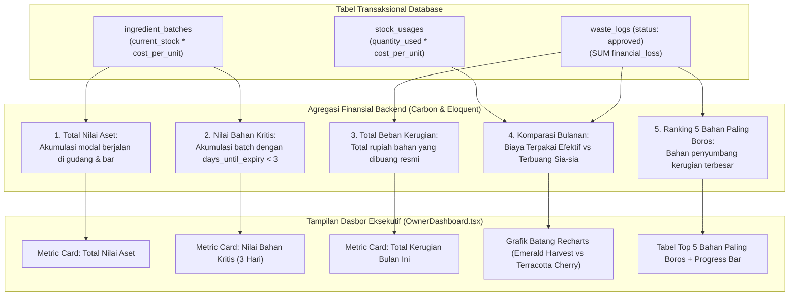

# RENCANA SPESIFIKASI DESAIN FRONTEND (PLAN 07)
## Modul 07: Halaman Eksekutif & Finansial Owner (3 Halaman Tersendiri)
**Target File Implementasi**:  
- `resources/js/Pages/Dashboard/OwnerDashboard.tsx` — Halaman A: Dasbor Analitik & Finansial Eksekutif  
- `resources/js/Pages/Reports/WasteReport.tsx` — Halaman B: Laporan Waste & Biaya Limbah  
- `resources/js/Pages/Reports/InventoryValuation.tsx` — Halaman C: Evaluasi Pembelian & Valuasi Aset  
- `resources/js/Components/MetricCard.tsx` — Komponen kartu metrik KPI  
- `resources/js/Components/Charts/UsageVsWasteChart.tsx` — Grafik Recharts komparasi biaya  
- `resources/js/Components/Dashboard/TopWasteTable.tsx` — Tabel ranking bahan paling boros  
**Referensi Kontrak**: [Desain.md](file:///home/lasains/ssd2/matkul/pemograman%20lanjut/projek/Desain.md), [PRD.md](file:///home/lasains/ssd2/matkul/pemograman%20lanjut/projek/PRD.md), dan [inventory.d.ts](file:///home/lasains/ssd2/matkul/pemograman%20lanjut/projek/resources/js/types/inventory.d.ts)

---

## 1. RINGKASAN KEBUTUHAN INFORMASI EKSEKUTIF OWNER & KPI FINANSIAL

### 1.1 Persona Pemilik Kafe (*The Helicopter View*)
Pemilik kafe (*Owner*) tidak berkutat pada urusan teknis seperti menimbang gram biji kopi atau menginput nomor faktur pemasok. Fokus utama Owner adalah **kesehatan kas, efisiensi modal bahan, dan meminimalkan kebocoran laba akibat bahan basi**:
1. **Berapa total uang kafe yang saat ini mengendap di gudang?** (Total Nilai Aset Bahan).
2. **Berapa potensi modal yang akan hangus jika tidak segera terjual dalam 3 hari ke depan?** (Nilai Bahan Kritis).
3. **Berapa kerugian riil akibat bahan terbuang sia-sia bulan ini?** (Total Kerugian Limbah / *Waste Loss*).
4. **Bahan baku apa yang paling sering basi dan menyebabkan kerugian terbesar?** (Evaluasi negosiasi vendor dan kuantitas pemesanan).

---

### 1.2 Diagram Alur Agregasi Finansial & KPI Inventaris



---

## 2. SPESIFIKASI MOCKUP STITCH UI & BLUEPRINT 3 HALAMAN EKSEKUTIF OWNER

Seluruh mockup visual antarmuka eksekutif & finansial Owner telah diunduh dari proyek Google Stitch (ID: `3585613475449128159`), tersimpan lokal di direktori `docs/stitch/`:

| Halaman Eksekutif Owner | Screen ID Stitch | File HTML Mockup | File Screenshot Mockup |
| :--- | :--- | :--- | :--- |
| **Dasbor Finansial & Analitik Eksekutif** | `796e463a5c104a1b993c49db3e203834` | [owner_dasbor_finansial_analitik.html](file:///home/lasains/ssd2/matkul/pemograman%20lanjut/projek/docs/stitch/owner_dasbor_finansial_analitik.html) | [owner_dasbor_finansial_analitik.png](file:///home/lasains/ssd2/matkul/pemograman%20lanjut/projek/docs/stitch/owner_dasbor_finansial_analitik.png) |
| **Evaluasi Pembelian & Valuasi Aset** | `9b57f48422ab4267a65c489cc6cd1e3e` | [owner_evaluasi_pembelian.html](file:///home/lasains/ssd2/matkul/pemograman%20lanjut/projek/docs/stitch/owner_evaluasi_pembelian.html) | [owner_evaluasi_pembelian.png](file:///home/lasains/ssd2/matkul/pemograman%20lanjut/projek/docs/stitch/owner_evaluasi_pembelian.png) |
| **Laporan Audit Waste & Biaya Limbah** | `2b3fa0e1b622411b8b06ed729e95306a` | [owner_laporan_waste_audit.html](file:///home/lasains/ssd2/matkul/pemograman%20lanjut/projek/docs/stitch/owner_laporan_waste_audit.html) | [owner_laporan_waste_audit.png](file:///home/lasains/ssd2/matkul/pemograman%20lanjut/projek/docs/stitch/owner_laporan_waste_audit.png) |

---

### 2.1 Halaman A: Dasbor Analitik & Finansial Eksekutif (`Pages/Dashboard/OwnerDashboard.tsx`)
**Route**: `dashboard.owner`  
**Mockup Acuan**: [owner_dasbor_finansial_analitik.html](file:///home/lasains/ssd2/matkul/pemograman%20lanjut/projek/docs/stitch/owner_dasbor_finansial_analitik.html)

#### Komponen Kanvas & Hierarki Tampilan:
1. **Header Dasbor & Filter Periode (`DashboardHeader.tsx`)**:
   - Judul: `"Dasbor Analitik & Finansial Eksekutif"` (`text-2xl md:text-3xl font-extrabold tracking-tight text-[#241408]`).
   - Subjudul: *"Pemantauan real-time valuasi aset persediaan gudang, proyeksi resiko bahan kritis, dan pengendalian rasio limbah (shrinkage) kafe secara terpusat."*
   - Kicker Kanan: Dropdown Pilihan Periode Bulan & Tombol Cetak / Ekspor Laporan.
2. **Tiga Kartu Metrik KPI Finansial Utama (`ExecutiveMetricCards.tsx`)**:
   - `grid grid-cols-1 md:grid-cols-3 gap-5`:
     - **Kartu 1 (Total Nilai Aset Persediaan Gudang)**:
       - Wadah: `bg-[#F5EFEB] p-6 rounded-2xl border border-[#EDE4DC] shadow-sm`
       - Nilai Rupiah: `text-3xl font-extrabold tracking-tight text-[#241408] font-mono` (misal: `Rp 48.250.000`)
       - Badge status: `[Aktif di 38 Batch Gudang & Bar]` (`bg-emerald-50 text-emerald-800 border-emerald-200`)
     - **Kartu 2 (Modal Bahan Kritis < 3 Hari)**:
       - Wadah: `bg-[#F5EFEB] p-6 rounded-2xl border border-[#F8C6BF] border-t-4 border-t-[#8C3D2B] shadow-sm`
       - Nilai Rupiah: `text-3xl font-extrabold tracking-tight text-[#8C3D2B] font-mono` (misal: `Rp 1.450.000`)
       - Subteks: *"Akumulasi modal bahan beresiko basi dalam < 3 hari ke depan"*
     - **Kartu 3 (Total Kerugian Limbah / Waste Bulan Ini)**:
       - Wadah: `bg-[#F5EFEB] p-6 rounded-2xl border border-[#EDE4DC] shadow-sm`
       - Nilai Rupiah: `text-3xl font-extrabold tracking-tight text-[#8C3D2B] font-mono` (misal: `Rp 420.500`)
       - Subteks: *"Rasio pemborosan 0.87% dari total perputaran bahan bulan ini"*
3. **Komparasi Finansial 2 Kolom Berdampingan (`grid grid-cols-1 lg:grid-cols-12 gap-6`)**:
   - **Kolom Kiri 7-Grid: Grafik Recharts Biaya Terpakai vs Terbuang (`UsageVsWasteChart.tsx`)**:
     - Diagram Batang Ganda Recharts:
       - Batang Hijau Harvest (`#059669`): Nilai bahan terpakai efektif dalam penjualan minuman.
       - Batang Terracotta Cherry (`#8C3D2B`): Nilai bahan rusak/basi yang dibuang.
       - Garis ambang batas toleransi waste bulanan (Line dashed amber `#C88242`).
   - **Kolom Kanan 5-Grid: Tabel 5 Bahan Paling Boros (`TopWasteRanking.tsx`)**:
     - Daftar ranking bahan penyumbang kerugian terbesar (Fresh Milk Diamond 1L, Croissant Butter, Monin Caramel, Oatside 1L, Anchor Whipping Cream).
     - Menampilkan volume terbuang, nominal kerugian rupiah, dan persentase progress bar terakota tipis.
     - Callout Rekomendasi Pintar BeanFlow di bagian bawah kartu: *"Kurangi order mingguan Fresh Milk Diamond sebesar 10% untuk mempercepat rotasi stok."*

---

### 2.2 Halaman B: Laporan Audit Waste & Biaya Limbah (`Pages/Reports/WasteReport.tsx`)
**Route**: `reports.waste`  
**Mockup Acuan**: [owner_laporan_waste_audit.html](file:///home/lasains/ssd2/matkul/pemograman%20lanjut/projek/docs/stitch/owner_laporan_waste_audit.html)

#### Komponen Kanvas & Fitur Audit:
1. **Header Kanvas & Toolbar Ekspor**:
   - Judul: `"Laporan Audit Waste & Biaya Limbah"`.
   - Tombol Aksi: `[Ekspor CSV]` (memicu download data tabular) dan `[Cetak PDF]` (memicu `window.print()` dengan styling print-friendly `@media print`).
2. **Ringkasan Metrik Audit Pemusnahan (`WasteAuditStats.tsx`)**:
   - Total Rupiah Kerugian Limbah (misal: `Rp 1.840.000`).
   - Total Volume Bahan Terbuang (misal: `14.500 ml & 3.200 gram`).
   - Total Tiket Pemusnahan yang Disetujui SPV (misal: `12 Tiket Resmi`).
3. **Distribusi Kerugian per Kategori Bahan (`WasteDistributionChart.tsx`)**:
   - Visualisasi persentase kerugian per kategori: Dairy (62%), Bakery (23%), Syrup (10%), Beans (5%).
4. **Tabel Riwayat Resmi Pemusnahan Bahan (`OfficialDisposalLogTable.tsx`)**:
   - Kolom: Tanggal Pemusnahan, Nama Bahan & Nomor Batch Fisik, Kuantitas Dibuang, Beban Kerugian Rupiah (`financial_loss`), Alasan Kerusakan, Barista Pelapor, dan Supervisor yang Menyetujui.

---

### 2.3 Halaman C: Evaluasi Pembelian & Valuasi Aset (`Pages/Reports/InventoryValuation.tsx`)
**Route**: `reports.inventory`  
**Mockup Acuan**: [owner_evaluasi_pembelian.html](file:///home/lasains/ssd2/matkul/pemograman%20lanjut/projek/docs/stitch/owner_evaluasi_pembelian.html)

#### Komponen Kanvas & Analisis Pengadaan:
1. **Header Kanvas & Total Modal Berjalan**:
   - Judul: `"Evaluasi Pembelian & Valuasi Aset"`.
   - Ringkasan Aset Gudang: `Total Nilai Modal Gudang: Rp 48.250.000` (tersebar di 38 batch aktif).
2. **Tiga Kartu Metrik Efisiensi Pengadaan (`ProcurementHealthCards.tsx`)**:
   - **Tingkat Efisiensi Modal Stok**: `96.2% Terpakai Optimal` (Hijau emerald).
   - **Rasio Bahan Terbuang**: `3.8% Terbuang Basi` (Target kafe < 5%).
   - **Bahan Terdeteksi Over-Stock**: `2 Bahan Berisiko` (Peringatan segera atur ulang kuantitas PO).
3. **Tabel Rekomendasi Penyesuaian Pesanan Vendor (`ProcurementRecommendationTable.tsx`)**:
   - Kolom: Nama Bahan Baku, Kategori, Rata-rata Pembelian/Bulan, Pemakaian Riil Meja Bar, Rasio Waste %, dan Rekomendasi Pintar:
     - 🟢 `[✓ Kuantitas Sangat Ideal]`: Porsi pemesanan sudah selaras dengan konsumsi pelanggan.
     - 🟡 `[⚠ Turunkan Volume Order (-15%)]`: Pembelian berlebih, bahan sering menumpuk di chiller.
     - 🔴 `[🔴 Batasi PO: Risiko Expired Cepat]`: Sisa stok sering melewati tanggal aman sebelum habis.

## 3. ARSITEKTUR TEKNIS FRONTEND (REACT + RECHARTS + INERTIA)

### 3.1 Lokasi File & Komposisi
```text
resources/js/
├── Pages/
│   ├── Dashboard/
│   │   └── OwnerDashboard.tsx          # Halaman A: Dasbor analitik & finansial Owner
│   └── Reports/
│       ├── WasteReport.tsx             # Halaman B: Laporan audit waste & biaya limbah
│       └── InventoryValuation.tsx      # Halaman C: Evaluasi pembelian & valuasi aset
├── Components/
│   ├── MetricCard.tsx                  # Komponen kartu metrik eksekutif serbaguna
│   ├── Dashboard/
│   │   └── TopWasteTable.tsx           # Komponen tabel 5 bahan paling boros
│   ├── Reports/
│   │   ├── WasteAuditTable.tsx         # Tabel log audit pemusnahan resmi
│   │   ├── CategoryLossBreakdown.tsx   # Distribusi bar persentase kerugian per kategori
│   │   └── ProcurementRecommendationTable.tsx # Tabel evaluasi order & anti over-purchasing
│   └── Charts/
│       └── UsageVsWasteChart.tsx       # Komponen grafik Recharts batang ganda
└── types/
    └── inventory.d.ts                  # Kontrak data TypeScript
```

---

### 3.2 Kontrak Tipe Data TypeScript

Mengacu pada [`resources/js/types/inventory.d.ts`](file:///home/lasains/ssd2/matkul/pemograman%20lanjut/projek/resources/js/types/inventory.d.ts):

```typescript
// resources/js/types/analytics.ts
import { DashboardMetrics } from '@/types/inventory';

export interface MonthlyComparisonData {
    month: string;           // 'Jan', 'Feb', 'Mar', dst.
    usage_cost: number;      // Biaya bahan terpakai efektif (Rp)
    waste_cost: number;      // Biaya bahan basi terbuang (Rp)
    efficiency_rate: number; // Persentase efisiensi (misal: 98.5%)
}

export interface TopWasteItem {
    ingredient_name: string;
    category_name: string;
    waste_quantity: number;
    unit: string;
    financial_loss: number;
    loss_percentage: number; // Persentase kontribusi terhadap total kerugian (misal: 34.2%)
}

export interface OwnerDashboardProps {
    metrics: DashboardMetrics;
    monthlyComparison: MonthlyComparisonData[];
    topWasteIngredients: TopWasteItem[];
    currentPeriod: {
        month: number;
        year: number;
    };
}
```

---

### 3.3 Komponen Grafik Recharts `UsageVsWasteChart.tsx`

```tsx
// resources/js/Components/Charts/UsageVsWasteChart.tsx
import {
    BarChart,
    Bar,
    XAxis,
    YAxis,
    CartesianGrid,
    Tooltip,
    ResponsiveContainer,
    Legend,
} from 'recharts';
import { MonthlyComparisonData } from '@/types/analytics';

interface Props {
    data: MonthlyComparisonData[];
}

// Formatter Rupiah Singkat untuk Sumbu Y (misal: 10Jt, 20Jt)
const formatYAxis = (value: number) => {
    if (value >= 1_000_000) {
        return `Rp ${(value / 1_000_000).toFixed(0)} Jt`;
    }
    if (value >= 1_000) {
        return `Rp ${(value / 1_000).toFixed(0)} Rb`;
    }
    return `Rp ${value}`;
};

// Custom Floating Tooltip
const CustomTooltip = ({ active, payload, label }: any) => {
    if (active && payload && payload.length) {
        const usage = payload[0].value;
        const waste = payload[1].value;
        const efficiency = ((usage / (usage + waste)) * 100).toFixed(1);

        return (
            <div className="rounded-xl border border-surface-border bg-surface-container p-3.5 shadow-lg text-xs space-y-2">
                <p className="font-bold text-content-high border-b border-surface-border pb-1 text-sm">
                    Periode: {label} 2026
                </p>
                <div className="flex items-center justify-between gap-4">
                    <span className="flex items-center gap-1.5 text-emerald-800">
                        <span className="h-2.5 w-2.5 rounded-full bg-emerald-600" />
                        Bahan Terpakai:
                    </span>
                    <span className="font-semibold font-mono text-content-high">
                        Rp {usage.toLocaleString('id-ID')}
                    </span>
                </div>
                <div className="flex items-center justify-between gap-4">
                    <span className="flex items-center gap-1.5 text-brand-tertiary">
                        <span className="h-2.5 w-2.5 rounded-full bg-brand-tertiary" />
                        Limbah Terbuang:
                    </span>
                    <span className="font-semibold font-mono text-brand-tertiary">
                        Rp {waste.toLocaleString('id-ID')}
                    </span>
                </div>
                <div className="pt-1 border-t border-surface-border flex justify-between font-medium">
                    <span className="text-content-medium">Efisiensi Bahan:</span>
                    <span className="text-emerald-700 font-bold">{efficiency}%</span>
                </div>
            </div>
        );
    }
    return null;
};

export function UsageVsWasteChart({ data }: Props) {
    return (
        <div className="w-full h-[320px]">
            <ResponsiveContainer width="100%" height="100%">
                <BarChart
                    data={data}
                    margin={{ top: 10, right: 10, left: -10, bottom: 0 }}
                    barGap={4}
                >
                    <CartesianGrid strokeDasharray="3 3" vertical={false} stroke="#EDE4DC" />
                    <XAxis
                        dataKey="month"
                        stroke="#9C8474"
                        fontSize={12}
                        tickLine={false}
                        axisLine={{ stroke: '#EDE4DC' }}
                    />
                    <YAxis
                        stroke="#9C8474"
                        fontSize={11}
                        tickLine={false}
                        axisLine={false}
                        tickFormatter={formatYAxis}
                    />
                    <Tooltip content={<CustomTooltip />} />
                    <Legend
                        verticalAlign="top"
                        align="right"
                        iconType="circle"
                        wrapperStyle={{ paddingBottom: '16px', fontSize: '12px' }}
                    />
                    <Bar
                        name="Bahan Terpakai (COGS)"
                        dataKey="usage_cost"
                        fill="#059669"
                        radius={[4, 4, 0, 0]}
                        maxBarSize={32}
                    />
                    <Bar
                        name="Limbah Terbuang (Waste)"
                        dataKey="waste_cost"
                        fill="#8C3D2B"
                        radius={[4, 4, 0, 0]}
                        maxBarSize={32}
                    />
                </BarChart>
            </ResponsiveContainer>
        </div>
    );
}
```

---

### 3.4 Komponen Tabel 5 Bahan Paling Boros `TopWasteTable.tsx`

```tsx
// resources/js/Components/Dashboard/TopWasteTable.tsx
import { TopWasteItem } from '@/types/analytics';

interface Props {
    items: TopWasteItem[];
}

export function TopWasteTable({ items }: Props) {
    if (!items || items.length === 0) {
        return (
            <div className="py-12 text-center text-sm text-slate-500">
                🎉 Belum ada catatan bahan terbuang pada periode ini.
            </div>
        );
    }

    return (
        <div className="divide-y divide-slate-100">
            {items.map((item, index) => (
                <div key={item.ingredient_name} className="py-3 flex flex-col gap-1.5">
                    <div className="flex items-center justify-between text-sm">
                        <div className="flex items-center gap-2.5">
                            <span className="flex h-5 w-5 items-center justify-center rounded-full bg-surface-container-high text-xs font-semibold text-content-high">
                                {index + 1}
                            </span>
                            <div>
                                <span className="font-semibold text-content-high block leading-tight">
                                    {item.ingredient_name}
                                </span>
                                <span className="text-xs text-content-subtle">
                                    {item.waste_quantity.toLocaleString('id-ID')} {item.unit} • {item.category_name}
                                </span>
                            </div>
                        </div>
                        <div className="text-right">
                            <span className="font-mono font-bold text-brand-tertiary block leading-tight">
                                Rp {item.financial_loss.toLocaleString('id-ID')}
                            </span>
                            <span className="text-xs text-content-subtle">{item.loss_percentage}% dari total</span>
                        </div>
                    </div>
                    {/* Visual Progress Bar Kontribusi Kerugian */}
                    <div className="w-full h-1.5 bg-surface-container-high rounded-full overflow-hidden">
                        <div
                            className="h-full bg-brand-tertiary rounded-full"
                            style={{ width: `${Math.min(item.loss_percentage, 100)}%` }}
                        />
                    </div>
                </div>
            ))}
        </div>
    );
}
```

---

## 4. EDGE CASES & DATA PRESENTATION

### 4.1 Kasus Bulan Baru / Data Belum Ada (*Empty State*)
- Jika kafe baru beroperasi atau awal bulan belum ada transaksi:
  - Grafik Recharts tidak boleh rusak (*crash*).
  - Tampilkan wadah kosong dengan border putus-putus (`border-dashed border-slate-200 rounded-xl p-8 text-center`):
    * Ikon `BarChart3` warna abu-abu lembut.
    * Teks: *"Belum ada data pemakaian dan limbah tercatat untuk periode ini. Grafik akan terisi otomatis seiring pencatatan operasional bar."*

### 4.2 Kondisi Ideal Tanpa Pemborosan (*Zero Food Waste*)
- Jika `monthly_waste_loss === 0`:
  - Kartu Metrik 3 menampilkan teks hijau ceria: `Rp 0`.
  - Subteks: *"🌟 Luar Biasa! Efisiensi bahan 100% (Zero Waste tercapai)."*

### 4.3 Navigasi Pergantian Periode (Inertia Visit)
- Saat Owner mengubah dropdown bulan atau tahun:
  ```typescript
  import { router } from '@inertiajs/react';

  const handlePeriodChange = (month: number, year: number) => {
      router.get(
          route('dashboard.owner'),
          { month, year },
          { preserveState: true, preserveScroll: true }
      );
  };
  ```

---

## 5. REKOMENDASI TAHAPAN IMPLEMENTASI KODING

1. **Langkah 1**: Buat komponen `MetricCard.tsx` di `resources/js/Components/`.
2. **Langkah 2**: Buat komponen grafik `UsageVsWasteChart.tsx` menggunakan `recharts`.
3. **Langkah 3**: Buat komponen tabel ranking `TopWasteTable.tsx`.
4. **Langkah 4**: Gabungkan seluruh komponen ke dalam halaman [`resources/js/Pages/Dashboard/OwnerDashboard.tsx`](file:///home/lasains/ssd2/matkul/pemograman%20lanjut/projek/resources/js/Pages/Dashboard/OwnerDashboard.tsx).
5. **Langkah 5**: Buat kueri agregasi finansial di `DashboardController.php` pada backend Laravel dengan relasi `StockUsage` dan `WasteLog`.

---
