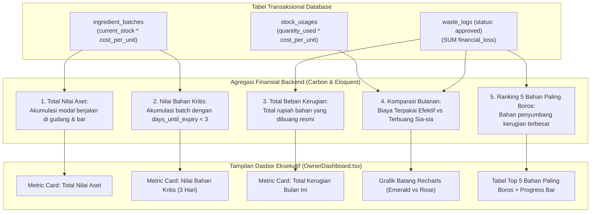

# RENCANA SPESIFIKASI DESAIN FRONTEND (PLAN 07)
## Modul 07: Dasbor Analitik & Finansial Eksekutif (Khusus Persona Owner)
**Target File Implementasi**:  
- `resources/js/Pages/Dashboard/OwnerDashboard.tsx`  
- `resources/js/Components/MetricCard.tsx`  
- `resources/js/Components/Charts/UsageVsWasteChart.tsx`  
- `resources/js/Components/Dashboard/TopWasteTable.tsx`  
**Referensi Kontrak**: [Desain.md](file:///home/lasains/ssd2/matkul/pemograman%20lanjut/projek/Desain.md), [PRD.md](file:///home/lasains/ssd2/matkul/pemograman%20lanjut/projek/PRD.md), dan [inventory.d.ts](file:///home/lasains/ssd2/matkul/pemograman%20lanjut/projek/resources/js/types/inventory.d.ts)

---

## 1. RINGKASAN KEBUTUHAN INFORMASI EKSEKUTIF OWNER & KPI FINANSIAL

### 1.1 Persona Pemilik Kafe (*The Helicopter View*)
Pemilik kafe (*Owner*) tidak berkutat pada urusan teknis seperti menimbang gram biji kopi atau menginput nomor faktur pemasok. Fokus utama Owner adalah **kesehatan kas, efisiensi modal bahan, dan meminimalkan kebocoran laba akibat bahan basi**:
1. **Berapa total uang kafe yang saat ini mengendap di gudang?** (Total Nilai Aset Bahan).
2. **Berapa potensi modal yang akan hangus jika tidak segera terjual dalam 3 hari ke depan?** (Nilai Bahan Kritis).
3. **Berapa kerugian riil akibat bahan terbuang sia-sia bulan ini?** (Total Kerugian Limbah / *Waste Loss*).
4. **Bahan baku apa yang paling sering basi dan menyebabkan kerugian terbesar?** (Evaluasi negosiasi vendor dan kuantitas pemesanan).

---

### 1.2 Diagram Alur Agregasi Finansial & KPI Inventaris



---

## 2. STITCH-READY SCREEN SPECIFICATION (GOOGLE STITCH PROMPT)

Spesifikasi berikut dirancang agar siap dimasukkan ke Google Stitch untuk menghasilkan purwarupa visual dasbor analitik eksekutif.

### 2.1 Identitas Modul Layar
* **Screen Title**: Executive Specialty Coffee Inventory & Financial Analytics Dashboard
* **Target Viewport**: Desktop (1440x900) & iPad Pro / Tablet Owner (1024x768)
* **Visual Tone**: Clean Modern SaaS Enterprise, Slate-50 Background, Emerald (Aset & Terpakai), Rose (Kerugian & Kritis), Slate-900 Bold Typography.

---

### 2.2 Rincian Tiga Blok Antarmuka Dasbor

#### Blok 1: Toolbar Header & 3 Executive Metric Cards
1. **Header Dasbor & Filter Rentang Waktu**:
   - Judul: `text-2xl font-bold tracking-tight text-slate-900` (*"Dasbor Analitik & Finansial"*).
   - Subjudul: `text-sm text-slate-500` (*"Ringkasan nilai aset bahan, evaluasi masa kedaluwarsa, dan efisiensi modal kafe"*).
   - Filter Bar Kanan:
     * Select Dropdown Bulan (Januari – Desember, default bulan aktif).
     * Select Dropdown Tahun (2026).
     * Tombol Sekunder: `[Unduh Laporan Finansial]` dengan ikon `Download`.
2. **Grid 3 Kartu Metrik Utama (`grid grid-cols-1 md:grid-cols-3 gap-6`)**:
   - **Kartu 1 (Total Nilai Aset Bahan Baku)**:
     * Container: `bg-white p-6 rounded-xl border border-slate-200 shadow-sm flex flex-col justify-between`.
     * Baris Atas: Label `text-xs font-semibold uppercase tracking-wider text-slate-500` (*Total Nilai Aset Persediaan*) dan ikon koin/dompet `Wallet` berlatar `p-2 bg-emerald-50 text-emerald-600 rounded-lg`.
     * Nilai Utama: `text-3xl font-bold tracking-tight text-slate-900 font-mono` (misal: `Rp 48.250.000`).
     * Baris Bawah: Badge hijau halus (*"Aktif di 38 Batch Gudang & Bar"*).
   - **Kartu 2 (Nilai Bahan Kritis < 3 Hari)**:
     * Container: `bg-white p-6 rounded-xl border border-rose-200 shadow-sm flex flex-col justify-between relative overflow-hidden`.
     * Aksen: Garis batas atas merah tipis (`border-t-4 border-rose-500`).
     * Baris Atas: Label (*Modal Bahan Kritis*) dan ikon `AlertOctagon` berlatar `p-2 bg-rose-50 text-rose-600 rounded-lg`.
     * Nilai Utama: `text-3xl font-bold tracking-tight text-rose-700 font-mono` (misal: `Rp 1.450.000`).
     * Baris Bawah: Keterangan urgensi (*"Beresiko basi dalam 3 hari ke depan"*).
   - **Kartu 3 (Total Beban Kerugian Limbah Bulan Ini)**:
     * Container: `bg-white p-6 rounded-xl border border-slate-200 shadow-sm flex flex-col justify-between`.
     * Baris Atas: Label (*Total Kerugian Bahan Rusak*) dan ikon `TrendingDown` berlatar `p-2 bg-rose-50 text-rose-600 rounded-lg`.
     * Nilai Utama: `text-3xl font-bold tracking-tight text-rose-600 font-mono` (misal: `Rp 420.500`).
     * Baris Bawah: Rasio pemborosan (*"0.87% dari total perputaran bahan bulan ini"*).

---

#### Blok 2: Grafik Batang Komparasi Bulanan (Recharts)
- Grid layout: 60% lebar layar desktop (`lg:col-span-3`).
- Container: `bg-white p-6 rounded-xl border border-slate-200 shadow-sm`.
- Header Grafik:
  * Judul: `text-base font-semibold text-slate-900` (*"Komparasi Biaya Bahan: Terpakai vs Terbuang Sia-sia"*).
  * Legend Interaktif:
    * Kotak Hijau Emerald: *"Nilai Bahan Terpakai Efektif (COGS)"*
    * Kotak Merah Rose: *"Nilai Bahan Terbuang Sia-sia (Waste Loss)"*
- Visual Grafik Batang Ganda (*Dual Bar Chart*):
  * Sumbu X: Nama-nama bulan (Jan, Feb, Mar, Apr, Mei, Jun, ...).
  * Sumbu Y: Nominal Rupiah (Rp 0, Rp 10Jt, Rp 20Jt, Rp 30Jt, Rp 40Jt).
  * Batang Hijau (`fill="#059669"`, radius atas `rounded-t-sm`).
  * Batang Merah (`fill="#F43F5E"`, radius atas `rounded-t-sm`).
  * Tooltip Melayang Interaktif (*Floating Custom Tooltip*):
    - Background putih, border slate-200, shadow-lg, padding 12px.
    - Menampilkan nama bulan, nominal bahan terpakai, nominal bahan rusak, dan indikator persentase efisiensi (misal: *"Efisiensi Pemakaian: 98.4%"*).

---

#### Blok 3: Peringkat 5 Bahan Paling Boros (Top 5 Waste Ingredients)
- Grid layout: 40% lebar layar desktop (`lg:col-span-2`).
- Container: `bg-white p-6 rounded-xl border border-slate-200 shadow-sm`.
- Header:
  * Judul: `text-base font-semibold text-slate-900` (*"5 Bahan Penyumbang Kerugian Terbesar"*).
  * Subjudul: `text-xs text-slate-500` (*"Evaluasi kuantitas restock dan durasi simpan bahan berikut"*).
- Tabel Sederhana Bersih:
  * Kolom: Nomor urut (1-5), Nama Bahan & Kategori, Kuantitas Dibuang, dan Total Kerugian Rupiah.
  * Setiap baris memiliki **Visual Progress Bar Tipis** di bawah nominal rupiah yang menggambarkan persentase kontribusi bahan tersebut terhadap total kerugian (misal: *Fresh Milk Diamond 1L* menyumbang 52% dari seluruh kerugian kafe).

---

### 2.3 Teks Prompt Siap Pakai untuk Google Stitch

#### Prompt Bahasa Indonesia (Terstruktur & Deskriptif)
```text
Buatkan desain antarmuka layar dasbor eksekutif untuk modul "Dasbor Analitik & Finansial Kafe" pada aplikasi "BeanFlow" khusus persona Owner:

Latar belakang kanvas bersih slate-50 (#F8FAFC).
Bagian Header:
- Judul halaman tebal "Dasbor Analitik & Finansial Eksekutif" dan subjudul penjelasan.
- Toolbar kanan: dropdown pilihan bulan ("Oktober 2026") dan tombol outline dengan ikon download "Unduh Laporan Keuangan".

Bagian Atas (3 Kartu Metrik Eksekutif):
- Kartu 1: Total Nilai Aset Bahan Baku (Angka besar monospaced "Rp 48.250.000", ikon dompet hijau emerald, label persediaan aktif di 38 batch).
- Kartu 2: Modal Bahan Kritis Berisiko (Border atas merah tipis, angka monospaced "Rp 1.450.000" warna merah rose, ikon peringatan, label "Expired dalam < 3 hari").
- Kartu 3: Beban Kerugian Limbah Bulan Ini (Angka monospaced "Rp 420.500" warna merah rose, ikon tren turun, label rasio limbah 0.87%).

Bagian Bawah (Layout 2 Kolom Berdampingan):
1. Kolom Kiri (60% lebar): Card grafik batang ganda Recharts "Komparasi Biaya: Terpakai vs Limbah Terbuang". Batang hijau emerald untuk bahan terpakai dan batang merah rose untuk bahan basi per bulan (Januari - Oktober). Terdapat legenda warna yang rapi dan garis grid latar belakang yang sangat halus.
2. Kolom Kanan (40% lebar): Card tabel "5 Bahan Paling Boros Bulan Ini". Daftar 5 baris:
   - Rank 1: Fresh Milk Diamond 1L (Terbuang 6.000 ml • Rugi Rp 144.000 • progress bar merah 34%)
   - Rank 2: Croissant Butter Pastry (Terbuang 8 pcs • Rugi Rp 120.000 • progress bar merah 28%)
   - Rank 3: Sirup Karamel Monin (Terbuang 400 ml • Rugi Rp 68.000 • progress bar merah 16%)
   - Rank 4: Oat Milk Oatside (Terbuang 1.500 ml • Rugi Rp 52.500 • progress bar merah 12%)
   - Rank 5: Whipping Cream Anchor (Terbuang 500 ml • Rugi Rp 36.000 • progress bar merah 10%)
Tampilan sangat bersih, tipografi angka tajam, kontras tinggi, elegan ala dashboard SaaS finansial modern.
```

#### English Prompt (High-Fidelity for Stitch AI)
```text
An executive financial analytics dashboard for a specialty coffee inventory system named "BeanFlow", tailored for the cafe Owner persona:
Neutral slate-50 background. Top header features the page title "Executive Financial & Inventory Analytics" with month-picker dropdown and an "Export PDF Report" button.
Top row features 3 bold executive metric cards:
1. "Total Inventory Asset Value" with bold monospaced rupiah amount "Rp 48,250,000", emerald wallet icon badge, and active batch counter.
2. "At-Risk Critical Asset Value" with subtle top rose border, red monospace "Rp 1,450,000", alert icon, subtext "Expiring in < 3 days".
3. "Total Waste Loss This Month" with red monospace "Rp 420,500", trending down icon, and waste efficiency ratio subtext (0.87%).

Bottom section features a 2-column responsive layout:
- Left Column (60% width): Recharts dual-bar comparison chart "Monthly Usage vs. Waste Loss". Emerald bars for effectively consumed ingredients vs soft rose bars for wasted/spoiled stock across Jan - Oct, with clean legends and subtle stroke-slate-100 gridlines.
- Right Column (40% width): Clean card listing "Top 5 Wasted Ingredients". Shows 5 ranked rows (e.g. Fresh Milk Diamond, Butter Croissant, Caramel Syrup) with quantity wasted, rupiah loss amount, and a slim red progress bar showing percentage of total loss. High contrast, clean Inter typography, polished financial SaaS aesthetic.
```

---

## 3. ARSITEKTUR TEKNIS FRONTEND (REACT + RECHARTS + INERTIA)

### 3.1 Lokasi File & Komposisi
```text
resources/js/
├── Pages/
│   └── Dashboard/
│       └── OwnerDashboard.tsx          # Halaman utama dasbor analitik Owner
├── Components/
│   ├── MetricCard.tsx                  # Komponen kartu metrik eksekutif serbaguna
│   ├── Dashboard/
│   │   └── TopWasteTable.tsx           # Komponen tabel 5 bahan paling boros
│   └── Charts/
│       └── UsageVsWasteChart.tsx       # Komponen grafik Recharts batang ganda
└── types/
    └── inventory.d.ts                  # Kontrak data TypeScript
```

---

### 3.2 Kontrak Tipe Data TypeScript

Mengacu pada [`resources/js/types/inventory.d.ts`](file:///home/lasains/ssd2/matkul/pemograman%20lanjut/projek/resources/js/types/inventory.d.ts):

```typescript
// resources/js/types/analytics.ts
import { DashboardMetrics } from '@/types/inventory';

export interface MonthlyComparisonData {
    month: string;           // 'Jan', 'Feb', 'Mar', dst.
    usage_cost: number;      // Biaya bahan terpakai efektif (Rp)
    waste_cost: number;      // Biaya bahan basi terbuang (Rp)
    efficiency_rate: number; // Persentase efisiensi (misal: 98.5%)
}

export interface TopWasteItem {
    ingredient_name: string;
    category_name: string;
    waste_quantity: number;
    unit: string;
    financial_loss: number;
    loss_percentage: number; // Persentase kontribusi terhadap total kerugian (misal: 34.2%)
}

export interface OwnerDashboardProps {
    metrics: DashboardMetrics;
    monthlyComparison: MonthlyComparisonData[];
    topWasteIngredients: TopWasteItem[];
    currentPeriod: {
        month: number;
        year: number;
    };
}
```

---

### 3.3 Komponen Grafik Recharts `UsageVsWasteChart.tsx`

```tsx
// resources/js/Components/Charts/UsageVsWasteChart.tsx
import {
    BarChart,
    Bar,
    XAxis,
    YAxis,
    CartesianGrid,
    Tooltip,
    ResponsiveContainer,
    Legend,
} from 'recharts';
import { MonthlyComparisonData } from '@/types/analytics';

interface Props {
    data: MonthlyComparisonData[];
}

// Formatter Rupiah Singkat untuk Sumbu Y (misal: 10Jt, 20Jt)
const formatYAxis = (value: number) => {
    if (value >= 1_000_000) {
        return `Rp ${(value / 1_000_000).toFixed(0)} Jt`;
    }
    if (value >= 1_000) {
        return `Rp ${(value / 1_000).toFixed(0)} Rb`;
    }
    return `Rp ${value}`;
};

// Custom Floating Tooltip
const CustomTooltip = ({ active, payload, label }: any) => {
    if (active && payload && payload.length) {
        const usage = payload[0].value;
        const waste = payload[1].value;
        const efficiency = ((usage / (usage + waste)) * 100).toFixed(1);

        return (
            <div className="rounded-xl border border-slate-200 bg-white p-3.5 shadow-lg text-xs space-y-2">
                <p className="font-bold text-slate-900 border-b border-slate-100 pb-1 text-sm">
                    Periode: {label} 2026
                </p>
                <div className="flex items-center justify-between gap-4">
                    <span className="flex items-center gap-1.5 text-emerald-700">
                        <span className="h-2.5 w-2.5 rounded-full bg-emerald-600" />
                        Bahan Terpakai:
                    </span>
                    <span className="font-semibold font-mono text-slate-900">
                        Rp {usage.toLocaleString('id-ID')}
                    </span>
                </div>
                <div className="flex items-center justify-between gap-4">
                    <span className="flex items-center gap-1.5 text-rose-700">
                        <span className="h-2.5 w-2.5 rounded-full bg-rose-500" />
                        Limbah Terbuang:
                    </span>
                    <span className="font-semibold font-mono text-rose-600">
                        Rp {waste.toLocaleString('id-ID')}
                    </span>
                </div>
                <div className="pt-1 border-t border-slate-100 flex justify-between font-medium">
                    <span className="text-slate-500">Efisiensi Bahan:</span>
                    <span className="text-emerald-600 font-bold">{efficiency}%</span>
                </div>
            </div>
        );
    }
    return null;
};

export function UsageVsWasteChart({ data }: Props) {
    return (
        <div className="w-full h-[320px]">
            <ResponsiveContainer width="100%" height="100%">
                <BarChart
                    data={data}
                    margin={{ top: 10, right: 10, left: -10, bottom: 0 }}
                    barGap={4}
                >
                    <CartesianGrid strokeDasharray="3 3" vertical={false} stroke="#F1F5F9" />
                    <XAxis
                        dataKey="month"
                        stroke="#94A3B8"
                        fontSize={12}
                        tickLine={false}
                        axisLine={{ stroke: '#E2E8F0' }}
                    />
                    <YAxis
                        stroke="#94A3B8"
                        fontSize={11}
                        tickLine={false}
                        axisLine={false}
                        tickFormatter={formatYAxis}
                    />
                    <Tooltip content={<CustomTooltip />} />
                    <Legend
                        verticalAlign="top"
                        align="right"
                        iconType="circle"
                        wrapperStyle={{ paddingBottom: '16px', fontSize: '12px' }}
                    />
                    <Bar
                        name="Bahan Terpakai (COGS)"
                        dataKey="usage_cost"
                        fill="#059669"
                        radius={[4, 4, 0, 0]}
                        maxBarSize={32}
                    />
                    <Bar
                        name="Limbah Terbuang (Waste)"
                        dataKey="waste_cost"
                        fill="#F43F5E"
                        radius={[4, 4, 0, 0]}
                        maxBarSize={32}
                    />
                </BarChart>
            </ResponsiveContainer>
        </div>
    );
}
```

---

### 3.4 Komponen Tabel 5 Bahan Paling Boros `TopWasteTable.tsx`

```tsx
// resources/js/Components/Dashboard/TopWasteTable.tsx
import { TopWasteItem } from '@/types/analytics';

interface Props {
    items: TopWasteItem[];
}

export function TopWasteTable({ items }: Props) {
    if (!items || items.length === 0) {
        return (
            <div className="py-12 text-center text-sm text-slate-500">
                🎉 Belum ada catatan bahan terbuang pada periode ini.
            </div>
        );
    }

    return (
        <div className="divide-y divide-slate-100">
            {items.map((item, index) => (
                <div key={item.ingredient_name} className="py-3 flex flex-col gap-1.5">
                    <div className="flex items-center justify-between text-sm">
                        <div className="flex items-center gap-2.5">
                            <span className="flex h-5 w-5 items-center justify-center rounded-full bg-slate-100 text-xs font-semibold text-slate-700">
                                {index + 1}
                            </span>
                            <div>
                                <span className="font-semibold text-slate-900 block leading-tight">
                                    {item.ingredient_name}
                                </span>
                                <span className="text-xs text-slate-500">
                                    {item.waste_quantity.toLocaleString('id-ID')} {item.unit} • {item.category_name}
                                </span>
                            </div>
                        </div>
                        <div className="text-right">
                            <span className="font-mono font-bold text-rose-600 block leading-tight">
                                Rp {item.financial_loss.toLocaleString('id-ID')}
                            </span>
                            <span className="text-xs text-slate-500">{item.loss_percentage}% dari total</span>
                        </div>
                    </div>
                    {/* Visual Progress Bar Kontribusi Kerugian */}
                    <div className="w-full h-1.5 bg-slate-100 rounded-full overflow-hidden">
                        <div
                            className="h-full bg-rose-500 rounded-full"
                            style={{ width: `${Math.min(item.loss_percentage, 100)}%` }}
                        />
                    </div>
                </div>
            ))}
        </div>
    );
}
```

---

## 4. EDGE CASES & DATA PRESENTATION

### 4.1 Kasus Bulan Baru / Data Belum Ada (*Empty State*)
- Jika kafe baru beroperasi atau awal bulan belum ada transaksi:
  - Grafik Recharts tidak boleh rusak (*crash*).
  - Tampilkan wadah kosong dengan border putus-putus (`border-dashed border-slate-200 rounded-xl p-8 text-center`):
    * Ikon `BarChart3` warna abu-abu lembut.
    * Teks: *"Belum ada data pemakaian dan limbah tercatat untuk periode ini. Grafik akan terisi otomatis seiring pencatatan operasional bar."*

### 4.2 Kondisi Ideal Tanpa Pemborosan (*Zero Food Waste*)
- Jika `monthly_waste_loss === 0`:
  - Kartu Metrik 3 menampilkan teks hijau ceria: `Rp 0`.
  - Subteks: *"🌟 Luar Biasa! Efisiensi bahan 100% (Zero Waste tercapai)."*

### 4.3 Navigasi Pergantian Periode (Inertia Visit)
- Saat Owner mengubah dropdown bulan atau tahun:
  ```typescript
  import { router } from '@inertiajs/react';

  const handlePeriodChange = (month: number, year: number) => {
      router.get(
          route('dashboard.owner'),
          { month, year },
          { preserveState: true, preserveScroll: true }
      );
  };
  ```

---

## 5. REKOMENDASI TAHAPAN IMPLEMENTASI KODING

1. **Langkah 1**: Buat komponen `MetricCard.tsx` di `resources/js/Components/`.
2. **Langkah 2**: Buat komponen grafik `UsageVsWasteChart.tsx` menggunakan `recharts`.
3. **Langkah 3**: Buat komponen tabel ranking `TopWasteTable.tsx`.
4. **Langkah 4**: Gabungkan seluruh komponen ke dalam halaman [`resources/js/Pages/Dashboard/OwnerDashboard.tsx`](file:///home/lasains/ssd2/matkul/pemograman%20lanjut/projek/resources/js/Pages/Dashboard/OwnerDashboard.tsx).
5. **Langkah 5**: Buat kueri agregasi finansial di `DashboardController.php` pada backend Laravel dengan relasi `StockUsage` dan `WasteLog`.
